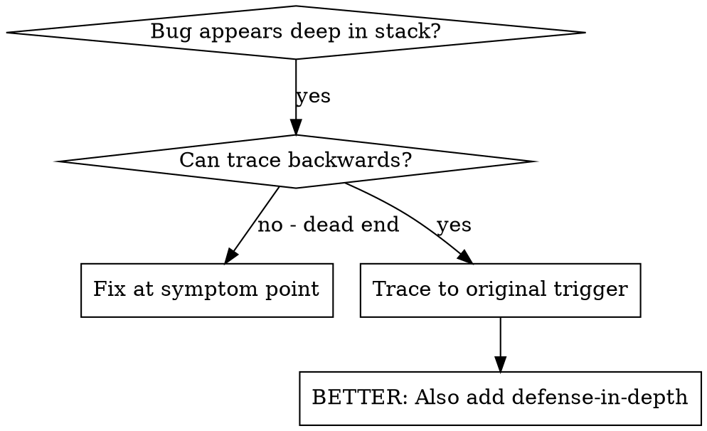
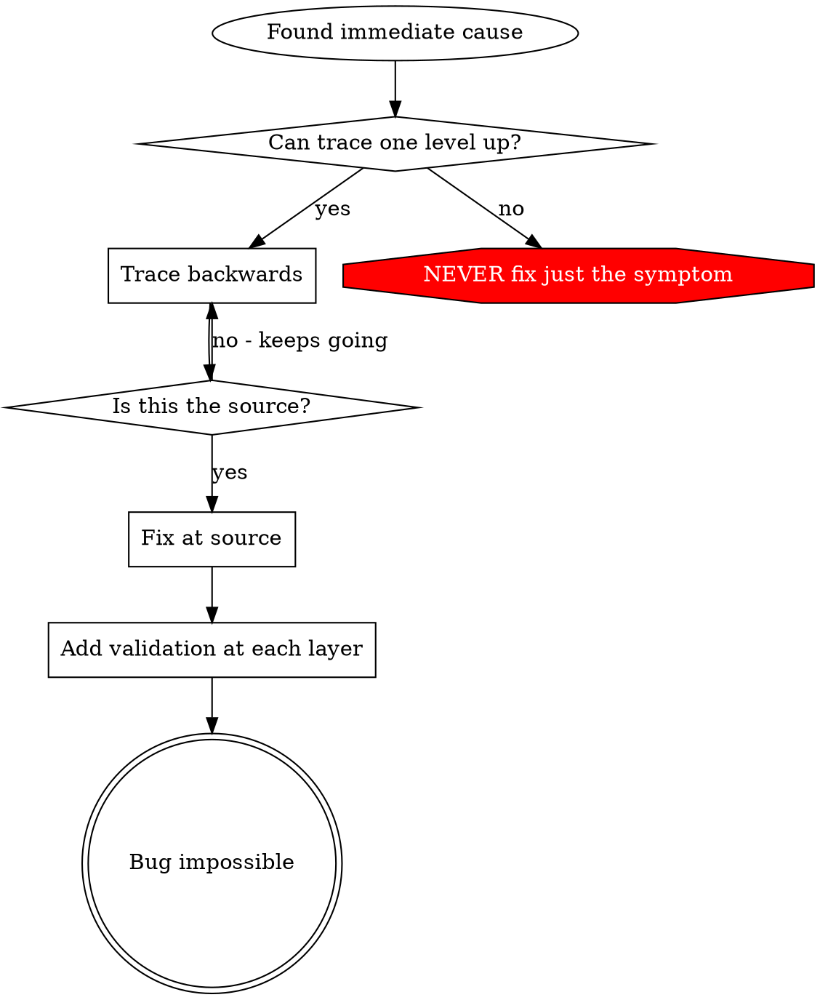
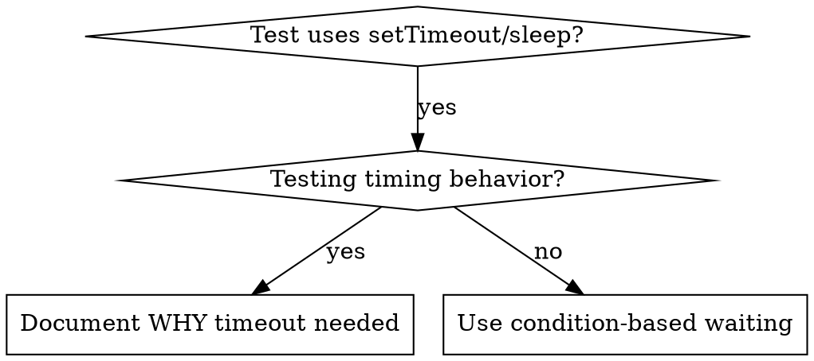
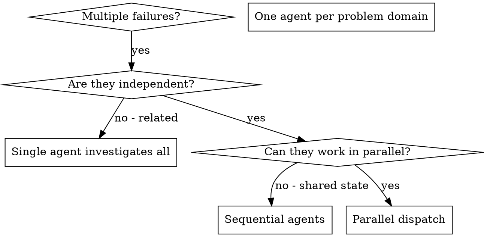

# Devflow Project Deep Research Report
# Generated: 2026-05-19
# Source: E:\LLM\skills\devflow\

---

## 1. ROOT FILE: GO.md

# GO — Devflow v3 统一路由器

> **AI指令**：
> 1. 本文件是 v3 路由入口，读完后按第四步路由表匹配用户意图
> 2. **第一条回复必须输出路由声明**（含选定的模式 Fast/Standard/Strict + 理由）
> 3. **所有产物必须保存到 `.devflow/<req-id>/` 下**
> 4. **⚠️ 所有产物必须严格按模板输出**（见 references/RULES-v3.md R19）
>
> 用户使用方式：`Use devflow` 或 `@devflow/SKILL.md` + 一句话需求

---

## ⚡ v3 执行流程（12步）

```
Layer 1: 交互层 ()
Step 1 · 读取项目状态 (.devflow/STATE.md)
Step 2 · 入场检测 (entry-check.md, brownfield/greenfield)
Step 3 · GitNexus可选检测 (detect → prompt → grep fallback)

Layer 1 → Layer 3: 战略评估 + 需求澄清
Step 4 · Phase 0: YC六问战略评估 (stop-on-G1)
Step 5 · Phase 1: 5 Whys需求追问

Layer 3: 架构层 ()
Step 6 · Phase 2: 方案设计 (DAG路由 + Provider选择)
Step 7 · Phase 2a: 设计枪战 (前端/UI项目必跑, 4-6变体)

Layer 3 → Layer 2: 任务拆分 + Wave执行
Step 8 · Phase 3: 任务拆分 (拓扑排序 + 依赖图)
Step 9 · Phase 4: 实施 (Wave并行 + LearningWorkflow自进化)

Layer 3: 质量保障
Step 10 · Phase 5: 测试 (浏览器QA + 交叉波测试矩阵)
Step 11 · Phase 6: 三层对抗审查 (Blind/Edge/Auditor)

Layer 1: 集成归档
Step 12 · Phase 7-8: Canary发布 + 知识归档
```

---

## 🔍 快速索引

| 需要... | 读取... |
|---------|---------|
| v3架构设计 | `V3-ARCHITECTURE.md` |
| 模式判定规则 | `references/mode-rules.md` |
| 入场检测流程 | `references/entry-check.md` |
| 阶段门验证 | `references/gate-rules.md` |
| Token预算 | `references/token-budget.md` |
| v3规则集 R1-R20 | `references/RULES-v3.md` |
| Delta Specs 差量规范 | `references/delta-specs.md` |
| Stage Skills | `skills/stage-skills/` |
| **L1 Phase 0-8 Skills** | `layers/L1-INTERACTION/*/README.md` (每 Phase README) |
| **L2 LearningWorkflow** | `layers/L2-ENGINE/learning-workflow/_SKILL.md` |
| **L2 Wave Executor** | `layers/L2-ENGINE/wave-executor/_SKILL.md` |
| **L2 PartyMode** | `layers/L2-ENGINE/party-mode/_SKILL.md` |
| **L3 DAG Router** | `layers/L3-ARCHITECTURE/dag-router/_SKILL.md` |
| **L3 Provider Gateway** | `layers/L3-ARCHITECTURE/provider-gateway/_SKILL.md` |
| **L3 Agent Isolation** | `layers/L3-ARCHITECTURE/agent-isolation/_SKILL.md` |
| **L3 Parallel Engine** | `layers/L3-ARCHITECTURE/parallel-engine/_SKILL.md` |

---

## Step 1 · 读取项目状态

1. 尝试读 `.devflow/STATE.md`。不存在 → 用模板创建
2. 关注字段：`活跃req` / `当前阶段` / `中断任务`
3. 如存在 `中断任务` 非空 → **优先级最高**，直接走恢复分支
4. **初始化记忆系统**（首次使用必跑）:
   - 检查 `.devflow/memory/` 是否存在
   - **如不存在** → 创建目录并初始化基础文件：
     ```
     .devflow/memory/
     ├── PROJECT_CONTEXT.md    # 项目背景（待填充）
     ├── DECISIONS.md          # 历史决策（空）
     ├── KNOWN_FAILURES.md     # 已知失败（空）
     ├── LESSONS.md            # LearningWorkflow教训库 ⭐v3新增
     └── domain-skills/        # 领域技能沉淀 ⭐v3新增
         ```
   - **如存在** → 加载 PROJECT_CONTEXT.md、DECISIONS.md、KNOWN_FAILURES.md、LESSONS.md
5. **多项目支持**: 每个项目独立 `.devflow/` 目录，记忆系统按项目隔离

---

## Step 2 · 入场检测

**⚠️ 强制规则**：必须使用 `read_file` 工具读取 `entry-check.md` 并按其决策树执行。

**检测步骤**（按顺序执行，命中即停止）：
1. 检查是否有 ai_context_doc 字段 → 情况A
2. 检查 CONTEXT.md 是否存在 + 扫描时间 → 情况B/C
3. 检查其他AI上下文文档 → 情况D → **⚠️ 停等用户确认**
4. 检查是否 greenfield → 情况F（跳过）或E → **⚠️ 停等用户确认**

**必须输出检测结果框**：
```
┌─────────────────────────────────────────────┐
│  🔍 入场检测                                 │
├─────────────────────────────────────────────┤
│  检测结果：<情况 A/B/C/D/E/F>                 │
│  项目类型：<brownfield / greenfield>         │
│  上下文文档：<路径 或 "无">                   │
└─────────────────────────────────────────────┘
```

**⚠️ 关键约束**：情况 B/C/D/E **必须等待用户回复**，不得自动继续。

---

## Step 3 · GitNexus可选检测 (v3新增)

**触发条件**: Fast/Standard/Strict模式确认后执行（仅一次）

### 检测协议

```
Step 3.1: gitnexus --version
  ├─ ✅ 成功 → "GitNexus已就绪，启用高级代码理解"
  └─ ❌ 失败 → Step 3.2

Step 3.2: 一次性提示用户
┌─────────────────────────────────────┐
│ ⚠️ GitNexus 未检测到                 │
│                                     │
│ GitNexus提供增强代码理解能力          │
│ (调用链分析、依赖影响追踪)            │
│                                     │
│ [1] 现在安装（推荐）                  │
│ [2] 跳过本次会话                     │
│ [3] 永久跳过，使用grep降级            │
└─────────────────────────────────────┘

Step 3.3: 用户选择
  ├─ [1] 执行安装引导 → gitnexus --version → 回到 Step 3
  ├─ [2] 本次会话用 grep fallback
  └─ [3] 永久写入 STATE.md: gitnexus=persistent-off, 使用grep fallback

Step 3.4: Grep降级能力声明
  ┌─────────────────────────────────────┐
  │ 🔧 使用 Grep Fallback               │
  │ 文件搜索: ✅ glob+grep              │
  │ 调用链分析: ⚠️ grep -rn (可能不全)   │
  │ 依赖影响追踪: 🟡 静态分析(精度有限)    │
└─────────────────────────────────────┘
```

---

## Step 4 · Phase 0: YC六问战略评估

**Layer 1 → Layer 3**: 从交互层进入架构层

**强制规则**：必须输出6个尖锐问题，等用户全部回答后才通过 G1 (Plan Quality Gate)。

**YC六问清单**：
1. **痛点有多痛？** 用户在解决什么问题？不解决的代价是什么？
2. **现有方案有哪些？** 为什么它们不够好？
3. **你的独特优势是什么？** 为什么是你能做、别人做不了？
4. **怎么获客？** 用户从哪里来？获客成本多少？
5. **怎么赚钱？** 商业模式是什么？LTV/CAC比多少？
6. **2倍速验证** 如果明天资源翻倍，做什么能最快拿到结果？

**⚠️ stop-on-G1**: G1未通过（问题<4个有满意回答）→ 退回需求澄清，不进入 Phase 2。

**💰 Surface Budget设置（可选）**

Phase 0结束后，可设定Token预算上限：

```bash
/budget set 300K              # 设定300K预算
/budget preset medium         # 使用预设（small/medium/large/enterprise）
```

详见: `docs/SURFACE-BUDGET.md`

---

## Step 5 · Phase 1: 5 Whys需求追问

**Layer 1**: 交互层

使用 grill skill 或 5 Whys 方法穷追模糊表述：
- "用户说'要快'——多快？具体指标是什么？"
- "支持'多种支付方式'——列出来，每种的技术复杂度？"
- **目标**：需求精确到可执行程度，每个需求项有明确验收标准

---

## Step 5.5 · Phase 1b: 决策捕获（Discuss）⭐v3新增

**Layer 1 → Layer 2**: 从需求分析进入实现决策

**触发条件**（满足任一）:
- Phase 1输出的AC包含≥3个技术选型歧义
- 检测到未明确的实现细节（API设计/数据存储/错误处理/UI布局）
- 用户明确要求"/discuss"模式

**执行流程**:
1. **识别灰色地带**: 扫描`01-analysis.md`，标记未明确的技术决策点
2. **交互式问答**: 对每个歧义点向用户提问（提供选项+优缺点）
3. **生成CONTEXT.md**: 将用户决策写入 `.devflow/<req-id>/CONTEXT.md`
4. **输出决策报告**: 显示已确认决策数、未决项、下一步建议

**常见歧义领域**:
- API设计: REST vs GraphQL vs gRPC
- 数据存储: localStorage vs IndexedDB vs SessionStorage
- 状态管理: Redux vs Context API vs Zustand
- 错误处理: 立即提示 vs 静默重试 vs 降级方案
- UI布局: 单列 vs 双列 vs 响应式
- 认证方式: JWT vs Session vs OAuth

**输出示例**:
```markdown
## 决策捕获结果

**耗时**: 5分钟  
**决策数**: 8项  
**未决项**: 3项（标记为[NEEDS CLARIFICATION]）

### 已确认决策
| # | 领域 | 决策 | 状态 |
|---|------|------|------|
| 1 | API设计 | RESTful API | ✅ |
| 2 | 数据存储 | localStorage + IndexedDB混合 | ✅ |
| 3 | 错误处理 | 立即提示 + 静默重试混合 | ✅ |

### 未决项
| # | 问题 | 影响 | 建议 |
|---|------|------|------|
| 1 | CDN选择 | 静态资源分发 | 根据用户地域决定 |

### 输出文件
- ✅ `.devflow/<req-id>/CONTEXT.md` ← 已生成
```

**门控G2.5**: Decision Clarity Gate
- 决策覆盖率 ≥70% → 通过
- 所有未决项标注[NEEDS CLARIFICATION] → 通过
- CONTEXT.md格式正确 → 通过

**⚠️ 关键约束**: CONTEXT.md将作为Phase 2方案设计的约束条件，确保设计方案符合用户偏好。

**可选增强: Spec-Driven Development (SDD)**

如果用户需求复杂或涉及架构变更，可启用SDD模式：

```bash
/spec define "需求描述"    # 生成 specs/XXX/spec.md
/spec plan "技术描述"      # 生成 specs/XXX/plan.md
/spec tasks                # 生成 specs/XXX/tasks.md
```

SDD完成后自动生成CONTEXT.md，然后进入Phase 2。
详见: `docs/SDD-INTEGRATION.md`

---

## Step 6 · Phase 2: 方案设计 (Layer 3)

**架构层**: DAG路由 + Provider智能选择

### DAG路由决策

根据需求复杂度自动判定：

| 复杂度 | Wave数量 | 并行度 | 示例 |
|--------|---------|--------|------|
| 简单 | 1 Wave | 无依赖串行 | Bug修复、文案调整 |
| 中等 | 2-3 Waves | 波内并行 | CRUD功能、页面开发 |
| 复杂 | 4+ Waves | 波间依赖 + 波内并行 | 微服务拆分、架构重构 |

### Provider智能路由 (v3新增)

根据任务类型选择模型：

| Phase | 任务类型 | 推荐Provider/Model特性 |
|-------|---------|----------------------|
| Phase 0-1 | 理解+分析 | 高检索能力模型 |
| Phase 2-2a | 创意设计 | 高创造力模型 |
| Phase 3 | 逻辑编排 | 强推理模型 |
| Phase 4 | 代码生成 | 高代码能力模型 |
| Phase 5 | 测试编写 | 细心严谨型模型 |
| Phase 6 | 对抗审查 | 高分析+批判型模型 |
| Phase 7-8 | 集成归档 | 标准模型即可 |

---

## Step 7 · Phase 2a: 设计枪战 (v3新增)

**触发条件**: 前端/UI项目、task涉及UI文件时必跑；其他项目AI推荐。

### 执行流程

1. 基于Phase 2方案，生成 **4-6个设计变体**
2. 每个变体标注：
   - 核心设计理念 (1句)
   - 优点列表
   - 风险/成本评估
   - 适用场景
3. AI **推荐最优选项**并说明理由
4. 用户选择或组合 → 形成最终设计方案

**防决策疲劳**: AI推荐必须有明确依据，不列一堆让用户自己猜。

---

## Step 8 · Phase 3: 任务拆分 (Layer 3 → Layer 2)

**架构层 DAG + 引擎层 Wave Engine**: Kahn算法拓扑排序

### 执行流程

1. **DAG构建**: 基于设计文档，拆分成原子任务，建立依赖关系
2. **Kahn拓扑排序**: 输出无环执行序列
3. **Wave分配**: 依赖组 → 同一Wave；独立任务 → 不同Wave可并行
4. **输出Wave计划**: 每个Wave包含任务列表、依赖说明、负责人

### Wave计划模板

```
Wave N: <wave-name>
├─ [P0] task-A (无依赖，立即执行)
├─ [P1] task-B (无依赖，可并行)
└─ [P2] task-C (依赖task-A完成后开始)

预期耗时: ~X分钟 | 风险等级: 高/中/低 | 检查点: [checkpoint][wave:N]
```

---

## Step 9 · Phase 4: 实施 (Layer 2)

**引擎层 Engine Layer**: Wave并行执行 + LearningWorkflow自进化

### Wave执行流程

1. **加载Wave上下文**: Execution Agent获取~200K fresh context
2. **按依赖顺序执行**: 先无依赖任务(可并行)，再依赖任务
3. **每完成一个task**: TDD红绿重构 → 窄验证修复 → atom commit
4. **Wave完成**: heartbeat checkpoint → Wave SUMMARY生成 → LESSONS提名
5. **LearningWorkflow自进化** ⭐v3核心:
   - 提取失败教训 → `memory/LESSONS.md`
   - 沉淀领域技能 → `memory/domain-skills/`
   - 标记可用于后续Wave的经验

### Heartbeat检查点协议

格式: `[checkpoint][wave:N][task:X]`

每Wave完成后输出：
```
[checkpoint][wave:3][task:all-done]
✓ Wave 3完成: 3个任务全部通过验证
⚡ LearningFlow提名: auth-module-pattern → LESSONS.md
   (JWT刷新逻辑的retry策略可复用到其他API调用)
```

---

## Step 10 · Phase 5: 测试 (Layer 3)

**架构层 QA + Cross-Wave Strategy Matrix**

### 交叉波测试矩阵

| Wave | 测试类型 | 自动化 | 手动验证 |
|------|---------|--------|---------|
| Wave 1 (基础) | 单元测试 | ✅ | ⚠️ |
| Wave 2 (业务) | 集成测试 | ✅ | ⚠️ |
| Wave 3 (UI) | 浏览器QA + 截图对比 | ✅ | ✅ |
| Cross-Wave | E2E流程测试 | ✅ | ⚠️ |

### 质量门 G2 (Code Quality)

- 所有单元测试通过 ✅
- 集成测试通过率 ≥ 90% ✅
- 代码风格检查通过 ✅
- **不通过** → 退回Wave修复，重新进入测试循环

---

## Step 11 · Phase 6: 三层对抗审查 (Layer 1)

**三层对抗**: Blind Hunter / Edge Case Hunter / Acceptance Auditor 并行独立审查

### 三个审查员分工

| 审查员 | 关注点 | 典型问题 |
|--------|--------|---------|
| **Blind Hunter** | 盲点发现 | "什么场景下这个功能会静默失败？" |
| **Edge Case Hunter** | 边界条件 | "空数组/超长输入/并发冲突/时区差异？" |
| **Acceptance Auditor** | 需求对齐 | "是否覆盖了PRD的所有验收标准？" |

### 审查输出

```
┌─────────────────────────────────────────────┐
│ 🔍 Phase 6: 三层对抗审查结果                │
├─────────────────────────────────────────────┤
│ ✅ Blind Hunter:   发现2个中等风险          │
│    - R1: auth token过期未处理 (medium)      │
│    - R2: 文件上传大小限制缺失 (medium)       │
│ ✅ Edge Case:      发现3个低等风险          │
│    - L1: 空状态UI显示不一致 (low)           │
│    - L2: ...                                │
│ ✅ Acceptance:     全部通过 (12/12标准覆盖)  │
├─────────────────────────────────────────────┤
│ 结论: 修复R1/R2后可进入 Phase 7             │
└─────────────────────────────────────────────┘
```

---

## Step 12 · Phase 7-8: Canary发布 + 归档 (Layer 1)

### Phase 7: Canary灰度发布 (v3新增)

**分批次上线协议**:

| 批次 | 比例 | 健康检查间隔 | 异常回滚条件 |
|------|------|-------------|------------|
| Canary-1 | 10% | 5分钟 | error_rate > 1% |
| Canary-2 | 50% | 10分钟 | error_rate > 0.5% |
| Production | 100% | 持续监控 | error_rate > 0.1% |

### Phase 8: 知识归档 (Layer 2+3)

**LESSONS nomination → Domain Skills Promotion**:

```
Phase 8流程:
1. 遍历所有Wave SUMMARY，提名LESSONS
2. LESSONS去重 + cross-wave合并
3. 领域技能沉淀到 memory/domain-skills/
4. 更新 STATE.md (per-wave status tracking)
5. [commit-hash] → SUMMARY归档
```

---

## 🧭 路由表

### A. 用户意图路由

| 用户说 | 需求状态 | Phase/Stage | 依赖 |
|--------|---------|-------------|------|
| 有新想法想做件事 | 无活跃req | Phase 0 (YC六问) | brainstorming, writing-plans |
| 恢复中断任务 | 有中断任务 | 按R1.5重启 | - |
| 不要进入workflow | - | 直接做，跳过 | - |
| 健康检查 | - | `stage-m-health` | code-quality |
| evolve/architect | - | `stage-a-evolve`/`architect` | design-and-architecture |
| 纯技术问题 | - | 直接回答 | - |
| 上传文档/PRD | - | 文档解析 → Phase 2 | writing-plans |
| 修复Bug | - | Fast模式 → Phase 4 | systematic-debugging |

### B. 可选命令

| 用户说 | Phase | 说明 |
|--------|-------|------|
| "换个方案" | Phase 2a | 触发新设计变体 |
| "architect" | `stage-a-architect` | 架构梳理 |
| "扫描代码" | `stage-i-intel-scan` | 入场扫描 |
| "我的需求变了" | Phase 0+1 | 归档旧Req，重新确认 |
| "继续" | 下一阶段Phase | 按顺序执行 |
| "caveman extreme" | - | 通信压缩到最简 |

### C. 阶段门验证

**核心规则** (R4): 缺前置产物 → 不允许直接进入，必须先补跑缺失阶段。

**阶段依赖**: `0→1→2→[2a]→3→4→5→6→7→8`

**可选阶段**:
- **[2a] 设计枪战**: 仅前端/UI项目需要（task涉及UI文件时触发）
- **[3] 任务拆分**: 复杂项目建议使用（多任务并行、需详细时间规划）

---

## 📋 模式确认

**⚠️ 强制规则**：必须使用 `read_file` 工具读取 `mode-rules.md`。

**输出模板**：
```
🎯 建议模式：<Standard / Strict>
   理由：<简要说明为什么是这个模式>

   📋 <模式> 完整流程：
   <流程步骤简述>

   产物：<关键产物列表>

   其他可选模式：
   - Fast — ≤3 文件、<50 行、低风险
   - Strict — 高风险/生产敏感/架构或数据影响

   请确认或选择其他模式：
   1. ✅ <建议模式>（推荐）
   2. Fast
   3. Strict
```

**⚠️ 强制停等**：输出后**必须等待用户确认**才能继续。

---

## 🎯 路由声明模板

完成所有前置步骤后，输出：

```markdown
🎯 v3 路由声明

架构层: Layer 1(交互) → Layer 3(架构) → Layer 2(引擎)
阶段: Phase <N>
Mode: <Fast/Standard/Strict>
入口门禁: GitNexus=<检测状态> | 入场=<检测结果> | G1(Phase0)=<通过/未通过>
自检清单: 待执行
```

---

## 🔄 v1.0 向后兼容

| v1.0 特性 | v3.0 处理 |
|-----------|----------|
| Stage Skills (`skills/stage-skills/`) | 保留，内部重新路由到三层架构 |
| 记忆系统 (`memory/`) | 保留并扩展 LESSONS + domain-skills |
| Token压缩 (/caveman) | 保留，统一4级支持(lite/full/ultra/extreme) |
| spec-kit集成 (Phase 2输入) | 保留，PRD桥接 |
| OpenSpec集成 (Phase 8归档) | 保留，proposal/design/tasks接口 |
| `references/gate-rules.md` | 保留 + R4升级 |
| `references/mode-rules.md` | 保留 |
| `references/entry-check.md` | 保留 |
| `.devflow/` 产物 | **零改动**，v3直接读取 |

---

## 版本

### v3.0-draft (2026-05-17)
- **三层架构路由**: Layer 1 → Layer 3 → Layer 2 决策树
- **12步执行流程**: Step 1(状态) → Step 2(入场) → Step 3(GitNexus) → Phase 0-8
- **GitNexus可选检测协议**: detect → prompt → grep fallback (Step 3)
- **Phase 2a设计枪战路由**: 前端/UI必跑，其他推荐 (Step 7)
- **Provider智能路由**: 按任务类型选模型 (Step 6)
- **LearningWorkflow自进化触发点**: Phase 4每个Wave完成时自动运行
- **跨波上下文读取协议**: Wave N SUMMARY → predicates → LESSONS → 注入 N+1
- **20条规则集集成**: R1-R20全量生效

### v1.0 (previous)
- 整合 devflow-kit + superpowers + OpenSpec + GitNexus + caveman
- GO.md统一路由 + Stage Skills按需加载
- 跨会话记忆系统 + Token优化支持


## 2. ROOT FILE: SKILL.md

---
name: devflow
version: 3.0-draft
description: |
  AI programming workflow v3.0 — zero-config, zero-threshold, zero-dependency.
  Three-layer pyramid: 交互层 + 引擎层 + 架构层.

  Use when: (1) Starting any dev task, (2) User says "use devflow" or "v3",
  (3) Need structured workflow with auto-routing, learning evolution, and parallel execution.

  Core: Load this file once → read GO.md for routing → execute layered pipeline.
  GitNexus optional: detect → install prompt → grep fallback if missing.

Architecture: Skill in E:\LLM\skills\devflow, projects only get .devflow/ artifacts.
---

# Devflow v3.0 — AI 编程工作流系统

> **零配置 · 零门槛 · 零依赖**  
> 三层架构：交互层 → 引擎层 → 架构层  
> GitNexus 可选检测，不装不影响流程。

## 🚀 三步启动

```
1. AI加载本 SKILL.md          ← 一次读取
2. 用户说一句话需求             ← "帮我做个登录页"
3. AI自动 GO.md 路由并执行    ← Layer 1 → Layer 2 → Layer 3
```

---

## 🏗️ 三层架构总览

### Layer 1: 交互层 — 零门槛入口

Phase 0-8 全流程，Markdown Skill 驱动：

| Phase | 名称 | 核心能力 |
|-------|------|---------|
| 0 | YC六问战略评估 | 尖锐问题验证需求真伪 |
| 1 | 需求追问 (5 Whys) | 穷追模糊表述 |
| 2 | 方案设计 | DAG路由 + Provider选择 |
| 2a | **设计枪战** ⭐ | 4-6方案变体生成，用户选最优 |
| 3 | 任务拆分 | 拓扑排序 + 依赖图 |
| 4 | 实施 | Wave并行执行 |
| 5 | 测试 | 浏览器QA + 交叉波测试 |
| 6 | **三层对抗审查** ⭐ | Blind Hunter / Edge Case Hunter / Acceptance Auditor |
| 7 | **Canary灰度集成** ⭐ | 分批次上线 + 自动回滚 |
| 8 | 知识归档 | LESSONS nomination + Domain Skills Promotion |

### Layer 2: 引擎层 — 持续进化核心

| 组件 | 能力 |
|------|------|
| **GSD六命令闭环** | wave并行 + 拓扑排序 + 原子提交 |
| **LearningWorkflow** ⭐ | 失败教训提取 → LESSONS沉淀 → 跨波经验注入 |
| **PartyMode共识** | 多Agent讨论，投票达成共识 |
| **Token压缩引擎** | 4级(lite/full/ultra/extreme)，最高~90%节省 |

### Layer 3: 架构层 — 企业级编排

| 组件 | 能力 |
|------|------|
| **DAG依赖路由** | Topological sort (Kahn算法)，依赖感知并行 |
| **Provider智能网关** ⭐ | 多模型按需路由：创意→高创造，编码→高代码，审查→高分析 |
| **Agent上下文隔离** ⭐ | Orchestrator(~50K) / Research(~200K) / Execution(~200K)，防context rot |
| **并行执行引擎** | ~4.4x-5x 加速比 |
| **MCP集成** | 编辑器直连 |

---

## ⭐ v3.0 五大独有能力

### 1. LearningWorkflow 自动进化

系统越用越强。每次 Phase 执行后：
- 提取失败教训 → 写入 `memory/LESSONS.md`
- 沉淀领域技能 → `memory/domain-skills/`
- Wave N+1 启动时自动加载相关经验（跨波上下文读取协议）

### 2. Provider 智能路由

根据任务类型自动选择最佳模型：
- **创意类** (设计/文案) → 高创造力模型
- **编码类** (Phase 4) → 高代码能力模型
- **审查类** (Phase 6) → 高分析能力模型
- **搜索类** (Phase 1) → 高检索能力模型
- **简单任务** → lite 模型节省成本

### 3. 分层 Agent 上下文隔离

每层Agent有独立新鲜上下文窗口，避免 context rot：
- **Orchestrator**: ~50K tokens 全局上下文
- **Research Agent**: ~200K tokens Phase 1/2 纯新鲜上下文
- **Execution Agent**: ~200K tokens Phase 4 Wave级新鲜上下文

### 4. 设计枪战变体生成

Phase 2a 自动生成 4-6 个设计方案变体：
- 每个标注优缺点和风险评估
- AI 推荐最优选项并说明理由
- 用户选择或组合 → 最终方案
- 防决策疲劳

### 5. Canary 灰度发布

Phase 7 分批次上线：10% → 50% → 100%
- 每批间隔自动健康检查
- 异常自动回滚
- 零停机部署

---

## 🔄 v3.0 执行管线

```
用户输入（一句话需求）
        │
        ▼
┌──────────────────────┐     Layer 1: 交互层
│ Phase 0: YC六问      │ ← 战略评估，6个尖锐问题
│ Phase 1: 5 Whys追问  │ ← 消除模糊表述
└──────────┬───────────┘
           │ 通过 G1 (Plan Quality)
           ▼
┌──────────────────────┐     Layer 1 → Layer 2: 决策捕获 ⭐v3新增
│ Phase 1b: Discuss    │ ← 技术选型确认 + CONTEXT.md生成
└──────────┬───────────┘
           │ 通过 G2.5 (Decision Clarity)
           ▼
┌──────────────────────┐     Layer 3: 架构层
│ Phase 2: 方案设计    │ ← DAG路由 + Provider选择
│ Phase 2a: 设计枪战   │ ← 4-6变体生成，用户选最优 ⭐
└──────────┬───────────┘
           │
           ▼
┌──────────────────────┐     Layer 3 → Layer 2
│ Phase 3: 任务拆分    │ ← DAG拓扑排序 + 依赖图
└──────────┬───────────┘
           │
           ▼
┌──────────────────────┐     Layer 2: 引擎层
│ Phase 4: 实施        │ ← Wave并行 + Learning自进化 ⭐
│                  ↑    │ ← PartyMode共识（复杂任务）
└──────────┬───────────┘
           │
           ▼
┌──────────────────────┐     Layer 3: 架构层 QA
│ Phase 5: 测试        │ ← 浏览器QA + 交叉波测试矩阵
└──────────┬───────────┘
           │
           ▼
┌──────────────────────┐     Layer 1: 对抗审查 ⭐
│ Phase 6: 三层审查    │ ← Blind Hunter / Edge Case / Auditor
└──────────┬───────────┘
           │ 通过 G5 (Integration)
           ▼
┌──────────────────────┐     Layer 1: Canary发布 ⭐
│ Phase 7: Canary发布  │ ← 10%→50%→100% + 自动回滚
└──────────┬───────────┘
           │
           ▼
┌──────────────────────┐     Layer 2+3: 知识沉淀
│ Phase 8: 归档        │ ← LESSONS → Domain Skills
└──────────────────────┘
```

---

## 🔧 GitNexus 可选检测协议

**何时触发**: Stage 1 (分析) 和 Stage 6 (审查)

```
检测: gitnexus --version
  ├─ ✅ 成功 → 启用高级代码理解（调用链/依赖追踪）
  └─ ❌ 失败 → 弹出一次性提示：

  ┌─────────────────────────────────────┐
  │ ⚠️ GitNexus 未检测到                 │
  │                                     │
  │ GitNexus提供增强代码理解能力          │
  │                                     │
  │ [1] 现在安装（推荐）                 │
  │ [2] 跳过本次会话                    │
  │ [3] 永久使用 grep 降级              │
  └─────────────────────────────────────┘

降级能力:
  ✅ 文件搜索 (glob+grep)
  ⚠️ 调用链分析 (grep -rn)
  🟡 依赖影响追踪 (静态分析)
```

---

## 🎯 模式判定（三档 - 量化标准）

| 模式 | 触发条件 | 流程 |
|------|---------|------|
| **Fast** | 文件数 ≤3 且总变更 <50 行且影响模块 ≤1 | 直接开发 → 窄验证 |
| **Standard** | 文件数 ≤10 且总变更 <500 行且影响模块 ≤3（不满足 Fast/Strict） | Phase 0→1→2→4→5→6 (跳过 2a) |
| **Strict** | 满足以下任一：(a) 影响模块 >3 (b) 新增核心架构 (c) 数据模型变更 (d) 公开 API 变更 | Phase 0→1→2→2a→3→4→5→6→7→8 |

> **降级规则**：Standard 项目中若 Phase 2 检测到 ≥2 个架构层变更 → 自动升级 Strict
> **升级规则**：Fast 项目中实际变更 >50 行 → Phase 5 后自动升级后续流程为 Standard

---

## 🔍 入场检测协议（增强版 - 6种情况判定）

**执行时机**: Phase 0战略评估开始前强制执行

### 入场检测结果框

```markdown
## 入场检测结果框

**情况判定**: [A/B/C/D/E/F]
- A: greenfield新项目，无上下文
- B: greenfield有零星上下文
- C: brownfield有完整上下文
- D: brownfield待用户确认上下文
- E: brownfield上下文缺失
- F: 文档解析模式

**项目类型**: [greenfield/brownfield]
**入场扫描状态**: [已完成/待确认/已跳过]

**上下文文档路径**:
- PROJECT_CONTEXT.md: [存在/缺失]
- CURRENT_STATE.md: [存在/缺失]
- DECISIONS.md: [存在/缺失]

**门控判定**:
- A/B/C → ✅ 自动进入下一阶段
- D/E → ⏸️ 暂停，等待用户确认
- F → 📝 记录跳过原因，继续
```

### 6种情况定义

| 情况 | 项目类型 | 上下文状态 | 处理方式 |
|------|---------|-----------|----------|
| A | greenfield | 无上下文 | 自动进入，初始化记忆系统 |
| B | greenfield | 零星上下文 | 自动进入，补充缺失文档 |
| C | brownfield | 完整上下文 | 自动进入，加载现有状态 |
| D | brownfield | 待确认 | ⏸️ 暂停，展示上下文摘要等待确认 |
| E | brownfield | 上下文缺失 | ⏸️ 暂停，请求用户提供上下文 |
| F | 任意 | 文档解析模式 | 记录跳过原因，继续执行 |

### 强制执行规则

1. **未输出入场检测结果框** → 禁止进入后续阶段
2. **brownfield项目检测结果为D/E** → 必须等用户回复
3. **检测结果为F时** → 必须注明跳过原因

### 示例输出

```
## 入场检测结果框

**情况判定**: C
**项目类型**: brownfield
**入场扫描状态**: 已完成

**上下文文档路径**:
- PROJECT_CONTEXT.md: ✅ 存在
- CURRENT_STATE.md: ✅ 存在
- DECISIONS.md: ✅ 存在

**门控判定**: ✅ 自动进入下一阶段

检测到brownfield项目，已有完整上下文，直接进入Phase 0战略评估。
```

**默认推荐 Standard**。AI根据技术复杂度、业务影响、数据敏感性自动评分推荐。

---

## 💬 命令格式

### 自然语言交互（推荐）

**最简单的方式**，直接说人话：
```
帮我做一个每日简报应用，整合Google Calendar和Notion
```

AI会自动：
1. 检测项目类型（greenfield/brownfield）
2. 执行入场检测
3. 进入Phase 0战略评估
4. 按管线逐步执行

---

### 明确命令格式（高级用户）

适合熟悉工作流的高级用户，提供更精确的控制。

#### 项目初始化

```bash
/unified new "项目名称" --tech React,Node.js,PostgreSQL
/unified new "电商平台" --mode Strict --template ecommerce
```

**参数说明**:
- `--tech`: 指定技术栈（逗号分隔）
- `--mode`: 执行模式（Fast/Standard/Strict）
- `--template`: 使用预置模板

#### 阶段控制

```bash
/unified discuss 1        # Phase 1: 需求分析
/unified plan 1           # Phase 2: 方案设计
/unified execute 1        # Phase 4: 实施开发
/unified verify 1         # Phase 5: 测试验证
/unified ship 1           # Phase 7: 交付部署
```

**阶段编号**:
- 0: 战略评估
- 1: 需求分析
- 2: 方案设计
- 2a: 设计枪战
- 3: 任务拆分
- 4: 实施开发
- 5: 测试验证
- 6: 代码审查
- 7: 交付部署
- 8: 知识归档

#### 横向命令（任何阶段可用）

```bash
/status                   # 查看当前进度和状态
/lessons                  # 查看经验教训
/review                   # 即时代码审查
/grill                    # 需求追问（5 Whys）
/diagnose                 # 问题诊断
/graphify                 # 依赖图谱（需GitNexus）
/token status             # 查看Token使用率
```

---

### 命令示例

**示例1: 创建新项目**
```
/unified new "任务管理APP" --tech Next.js,TypeScript,TailwindCSS --mode Standard
```

**示例2: 查看进度**
```
/status
```

输出:
```
📊 项目状态

当前阶段: Phase 4 - 实施开发
进度: 60% (3/5 Waves完成)

已完成:
✅ Phase 0: 战略评估
✅ Phase 1: 需求分析
✅ Phase 2: 方案设计
✅ Phase 3: 任务拆分
🔄 Phase 4: 实施开发 (Wave 3/5)

待完成:
⬜ Phase 5: 测试验证
⬜ Phase 6: 代码审查
⬜ Phase 7: 交付部署
⬜ Phase 8: 知识归档
```

**示例3: 需求追问**
```
/grill
```

AI启动5 Whys追问流程，挖掘真实需求。

---

### 命令 vs 自然语言

| 特性 | 自然语言 | 明确命令 |
|------|---------|----------|
| 学习成本 | 低 | 中 |
| 灵活性 | 高 | 中 |
| 精确度 | 中 | 高 |
| 适用人群 | 所有人 | 高级用户 |
| 推荐场景 | 日常使用 | 批量操作、脚本调用 |

**建议**: 优先使用自然语言，熟悉后再使用明确命令。

---

## 📦 架构说明

### Skill 位置（`E:\LLM\skills\devflow`）

```
SKILL.md          ← 本文件，v3零配置入口（你正在读的）
GO.md             ← v3路由器，包含完整路由决策树和12步流程
V3-ARCHITECTURE.md ← 架构设计文档（三层金字塔详解）
layers/           ← 三层架构核心模块
  L1-INTERACTION/ ← 交互层封装 (Phase 0-8)
  L2-ENGINE/      ← 引擎层封装 (GSD/Learning/Wave/Token)
  L3-ARCHITECTURE/← 架构层 (DAG/Provider/Agent)
optional/         ← 可选工具链 (GitNexus检测 + Grep降级)
skills/stage-skills/ ← v1.0向后兼容的Stage Skills
references/       ← 规则集(R1-R20)、模板、门控规则
memory/           ← 记忆系统 (PROJECT_CONTEXT/DECISIONS/LESSONS等)
docs/             ← 扩展功能文档 (SDD/Surface Budget/多项目/插件)
```

### 项目产物（`<project>/.devflow/`）

```
STATE.md                  ← 跨会话状态追踪
memory/
  PROJECT_CONTEXT.md      ← 项目背景
  DECISIONS.md            ← 历史决策(ADR风格)
  KNOWN_FAILURES.md       ← 已知失败模式
  LESSONS.md              ← LearningWorkflow教训库 ⭐新增
  domain-skills/          ← 领域技能沉淀 ⭐新增
<req-id>/                 ← 需求产物 (00-requirements→07-integration)
```

> **关键原则**: AI从 `E:\LLM\skills\devflow` 读取逻辑，在项目中只生成 `.devflow/` 产物。

---

## 🔌 扩展功能

### 多项目管理

**支持同时管理多个项目，快速切换，状态同步，知识共享**

```bash
/unified projects list              # 列出所有项目
/unified projects new "名称"        # 创建新项目
/unified projects switch <id>       # 切换项目
/unified projects info <id>         # 查看项目详情
/unified workspace stats            # 工作区统计
```

详见: `docs/MULTI-PROJECT-MANAGEMENT.md`

### 插件系统

**可扩展Phase、Gate、Agent、Template、Command，沙箱隔离，签名验证**

```bash
/unified plugins install <plugin>   # 安装插件
/unified plugins enable <name>      # 启用插件
/unified plugins list --enabled     # 查看已启用插件
/unified plugins create <name>      # 创建新插件
```

**插件类型**:
- Phase扩展: 添加新Phase
- Gate增强: 增强质量门控
- Agent扩展: 添加新角色
- Template包: 添加新模板
- Command工具: 添加新命令

详见: `docs/PLUGIN-SYSTEM.md`

## 🎯 使用示例

### 场景1: 开发新功能
```
Use devflow.
帮我做一个用户登录功能，支持邮箱密码和JWT认证
```

### 场景2: Fast模式修复
```
Use devflow. Fast模式: 修复settings页面按钮文案typo
```

### 场景3: 架构重构（Strict模式）
```
Use devflow. Strict模式。
把单体应用拆分成微服务，先做用户模块
```

### 场景4: 健康检查
```
Use devflow. 健康检查
```

---

## 📖 文档导航

| 需要... | 读取... |
|---------|---------|
| v3架构设计 | `V3-ARCHITECTURE.md` |
| 统一路由入口 | `GO.md` (Step 1-12) |
| 规则集 R1-R20 | `references/RULES-v3.md` |
| 模式判定 | `references/mode-rules.md` |
| 入场检测 | `references/entry-check.md` |
| 门控验证 | `references/gate-rules.md` |
| Token压缩 | `references/caveman-rules.md` |
| 安全规范 | `references/SECURITY.md` |
| Stage Skills | `skills/stage-skills/` (向后兼容) |
| 快速上手 | `SKILL.md`「三步启动」 |
| 模板版本规则 | `references/templates/` 下带 `-delta` 后缀的变体仅增量变更使用，主模板（无后缀）为默认消费源 |
| 宪法模板 | `references/templates/constitution-template.md` → Phase 0/1 后写入 `.devflow/memory/constitution.md` |

---

## ⚡ 渐进式披露规则

> ⚠️ **核心原则**: AI 不应一次性加载所有信息，应按需加载以节省 Token。

### 执行流程

1. **读取 state.md 确定当前 Phase**
2. **仅加载当前 Phase 相关的 Skill 和 Agent**
3. **Phase 切换时卸载旧 Skill，加载新 Skill**
4. **Token > 70% 时自动升级压缩级别**

### Phase → Skill 加载映射

| Phase | 必须加载 | 可选加载 | 必须卸载 |
|-------|---------|---------|---------|
| **Phase 0** | SKILL.md, GO.md | entry-check.md | - |
| **Phase 1** | + rules/RULES.md | 5-whys.md, personas/CEO.md | Phase 0 特定规则 |
| **Phase 2** | + rules/RULES.md | design/*.md, personas/Architect.md | Phase 1 追问规则 |
| **Phase 2a** | + rules/RULES.md | ui-*.md | Phase 2 设计规则 |
| **Phase 3** | + rules/RULES.md | task-template.md | Phase 2a UI规则 |
| **Phase 4** | + rules/RULES.md, dev-*.md | personas/Developer.md | Phase 3 拆分规则 |
| **Phase 5** | + rules/RULES.md, test-*.md | personas/QA.md | Phase 4 开发规则 |
| **Phase 6** | + rules/RULES.md, review-*.md | personas/Reviewer.md | Phase 5 测试规则 |
| **Phase 7** | + rules/RULES.md, deploy-*.md | personas/DevOps.md | Phase 6 审查规则 |
| **Phase 8** | + rules/RULES.md, archive-*.md | - | Phase 7 部署规则 |

### Token 监控触发条件

| Token 使用率 | 动作 |
|-------------|------|
| < 50% | 不压缩，正常加载 |
| 50-70% | 提示：建议使用 `lite` 压缩 |
| 70-85% | 强制：自动切换到 `full` 压缩 |
| 85-90% | 警告：切换到 `ultra` 压缩 |
| > 90% | 暂停：强制 `extreme` 压缩，等待人工确认 |

### 正确 vs 错误示例

#### ❌ 错误：一次性加载全部

```
加载：SKILL.md + GO.md + V3-ARCHITECTURE.md + RULES.md + ... (全部)
结果：Token 消耗 ~80%，剩余上下文不足
```

#### ✅ 正确：按 Phase 渐进加载

```
Phase 0: SKILL.md + GO.md + entry-check.md (约 ~15% Token)
Phase 1: + RULES.md + 5-whys.md (约 +20% Token)
Phase 4: + dev-*.md + Developer persona (按需加载)
```

---

## 🌟 v3.0 vs 对比

| 维度 | 旧版 | 引擎版 | 交互版 | 架构版 | **v3.0** |
|------|------|--------|--------|--------|----------|
| 配置要求 | 低 | 中(npm) | 极低 | 高 | **零** |
| 门槛 | 低 | 高 | 极低 | 中 | **极低** |
| 功能覆盖 | ~60% | ~70% | ~60% | ~95% | **~98%** |
| 自学习进化 | ❌ | ✅ | ❌ | ❌ | **✅** |
| Agent隔离 | ❌ | ❌ | ❌ | ✅ | **✅** |
| Provider路由 | ❌ | ❌ | ❌ | ✅ | **✅** |
| Token压缩 | ~50% | ~75% | ~70% | ~80% | **~90%** |
| 设计变体 | ❌ | ❌ | ✅ | ❌ | **✅** |
| Canary发布 | ❌ | ❌ | ✅ | ❌ | **✅** |
| 对抗审查 | ❌ | ❌ | ✅ | ❌ | **✅** |
| 并行执行 | ❌ | ✅ | ❌ | ~4.4x | **~5x+** |
| GitNexus | 必选 | 可选 | ❌ | ❌ | **可选+降级** |

---

## 📋 v3.0 规则集摘要 (R1-R24)

| 编号 | 规则 | 说明 |
|------|------|------|
| R1 | PRD驱动 | 无PRD不开发 |
| R2 | 三档模式 | Fast/Standard/Strict自动判定 |
| R3 | 入场检测 | brownfield必跑，stop-on-D/E |
| R4 | Stage门禁 | 缺前置产物不允许进入 |
| R5 | 渐进式披露 | 只加载当前Stage Skill |
| R6 | Token压缩 | 默认full，可选ultra/extreme |
| R7 | Agent隔离 | Research/Execution各自~200K fresh |
| R8 | Wave并行 | DAG拓扑排序，依赖感知执行 |
| R9 | LearningWorkflow | Phase完成→LESSONS沉淀→跨波注入 |
| R10 | Provider路由 | 按任务类型选模型 |
| R11 | GitNexus可选 | detect→prompt→grep fallback |
| R12 | 三层对抗审查 | Blind/Edge/Auditor并行 |
| R13 | Canary发布 | 10%→50%→100%，异常回滚 |
| R14 | 设计枪战 | Phase 2a必跑(前端/UI) |
| R15 | 跨波上下文读取 | Wave N SUMMARY → N+1注入 |
| R16 | 原子提交 | 每Wave一个commit，可追溯 |
| R17 | Heartbeat检查点 | [checkpoint][wave:N][task:X] |
| R18 | Domain Skills Promotion | LESSONS→domain-skills/持久化 |
| R19 | 产物模板强制 | 所有输出严格按模板；Phase 4/5/6 结束前必须运行合规检查：读取对应模板，逐项确认必填段落存在、元数据块完整、占位符已替换 |
| R20 | 向后兼容 | v1.0产物零改动迁移 |
| R21 | Path Standardization | 产物路径统一为 `.devflow/`，旧 `.devflow-kit/` 兼容迁移 |
| R21.2 | 目录结构保持与 .devflow 兼容 |
| R22 | Quality Scoring | Phase 6 输出质量评分报告（详见 references/RULES-v3.md） |
| R23 | Stage-Skills Sync | Stage Skills 与 Core Skills 同步维护，≥7 天差异报 P2 |
| R24 | Call Chain Ownership | L1→L2/L3 调用链必须在 call-chain-inventory.md 注册 |

---

## 版本历史

### v3.0-draft (2026-05-17)
- **三层金字塔架构**: 交互层 + 引擎层 + 架构层
- **五大独有能力**: LearningWorkflow自进化 / Provider路由 / Agent隔离 / 设计枪战 / Canary发布
- **零配置入口**: 加载SKILL.md → 一句话需求 → 自动执行
- **GitNexus可选检测**: detect → prompt → grep fallback
- **24条规则集**: R1-R24，覆盖全流程
- **向后兼容**: v1.0产物零改动迁移

### v1.0 (previous)
- 整合 devflow-kit + superpowers + OpenSpec + GitNexus + caveman
- GO.md统一路由 + Stage Skills按需加载
- 跨会话记忆系统 + Token优化支持


## 3. ROOT FILE: V3-ARCHITECTURE.md

# Devflow v3.0 — 终极融合架构

> **版本**: v3.0-draft  
> **创建日期**: 2026-05-17  
> 架构说明文档
> **核心理念**: 零配置、零门槛、零依赖，GitNexus 可选检测

---

## 🏗️ 三层金字塔架构

```
┌─────────────────────────────────────────────────────────┐
│                   Layer 1: 交互层                       │
│              交互层 Interaction Layer                │
│                                                           │
│  Phase 0: YC六问 → Phase 1: 需求追问 → Phase 2: 方案设计   │
│  Phase 2a: 设计枪战 → Phase 3: 任务拆分                    │
│  Phase 4-8: 实施→测试→审查→集成→归档                       │
│                                                           │
│  核心能力: 零门槛、角色专业化、对抗审查、Canary灰度         │
└──────────────────────────┬──────────────────────────────┘
                           │
              ┌────────────▼────────────┐
              │   Layer 2: 引擎层       │
              │   引擎层 Engine Layer      │
              │                         │
              │  GSD六命令闭环          │
              │  LearningWorkflow自进化  │
              │  PartyMode多Agent共识    │
              │  Token压缩(~75%)        │
              │  Wave并行执行           │
              └────────────┬────────────┘
                           │
              ┌────────────▼────────────┐
              │   Layer 3: 架构层       │
              │   架构层 Arch     │
              │                         │
              │  DAG依赖路由            │
              │  多Provider编排         │
              │  三层Agent隔离(200K)    │
              │  并行引擎(~4.4x加速)    │
              │  MCP集成                │
              └─────────────────────────┘
```

### 分层职责矩阵

| 层 | 职责 | 技术形态 | 配置要求 |
|---|------|---------|---------|
| **交互层** | Phase 0-8全流程、角色调度、质量控制 | Markdown Skill | 零配置（加载即生效） |
| **引擎层** | LearningWorkflow自进化、Wave并行、PartyMode共识 | TypeScript库 + Markdown接口 | 零配置（可选npm install扩展） |
| **架构层** | DAG路由、Provider编排、Agent隔离 | Hybrid (JS+Markdown+YAML) | 零配置（内置默认值） |

### 为什么三层互补？

这三层不是竞争关系，而是互补的垂直分层：

- **交互层** = 交互/前��层（用户界面）→ 极致易用
- **引擎层** = 引擎/核心层（核心执行）→ 持续进化
- **架构层** = 架构/协调层（生态整合）→ 企业级保障

三者结合 = 完美解决方案。

---

## 🎯 v3.0 零配置设计理念

### 三大零原则

| 原则 | 含义 | 实现方式 |
|------|------|---------|
| **零配置** | `npx` / 加载 Skill 即可运行，无需 `.env`/`tsconfig`/`package.json` | 内置所有默认值，运行时自动检测环境 |
| **零门槛** | 一句话需求 → AI自动路由 → 执行，用户无需理解内部架构 | Phase 0六问作为统一入口 |
| **零依赖** | 不强制安装任何外部工具；GitNexus可选，不装走grep降级 | `gitnexus --version` 检测 → 安装引导 → grep fallback |

### 启动流程（三步完成）

```
1. AI加载 v3 SKILL.md          ← 一次读取
2. 用户说一句话需求             ← "帮我做个登录页"
3. AI自动路由并执行            ← Layer 1 → Layer 2 → Layer 3
```

---

## 🔧 GitNexus 可选集成方案

### 检测协议

```
Step 1: 尝试 `gitnexus --version`
  ├─ 成功 → gitnexus可用，启用高级代码理解
  └─ 失败 → [提示引导] ↓

Step 2: 提示用户（一次性）
  ┌─────────────────────────────────────┐
  │ ⚠️ GitNexus 未检测到                 │
  │                                     │
  │ GitNexus提供增强代码理解能力           │
  │ (调用链分析、依赖影响追踪)             │
  │                                     │
  │ [1] 现在安装（推荐）                  │
  │ [2] 跳过本次会话                     │
  │ [3] 永久跳过，使用grep降级            │
  └─────────────────────────────────────┘

Step 3: 用户选择
  ├─ [1] 执行安装引导 → 回到 Step 1
  ├─ [2] 本次会话用 grep fallback
  └─ [3] 永久配置 grep fallback，不再提示
```

### Grep Fallback 能力矩阵

| GitNexus能力 | 启用GitNexus | Grep降级 | 损失程度 |
|---|---|---|---|
| 文件搜索 | ✅ 精确 | ⚠️ glob+grep | 低 |
| 调用链分析 | ✅ 精确索引 | ⚠️ grep -rn | 中 |
| 依赖影响追踪 | ✅ 图遍历 | ⚠️ 静态分析 | 高 |
| 语义导入解析 | ✅ AST | ⚠️ regex | 中高 |

---

## 🔗 与 SKILL.md 的关系

V3-ARCHITECTURE.md 侧重架构设计文档，以下核心内容在 SKILL.md 中有更详细的实现说明：

- **执行管线**: Phase 0→8 的完整流程 → 见 `SKILL.md`「v3.0 执行管线」
- **五大独有能力**: LearningWorkflow / Provider路由 / Agent隔离 / 设计枪战 / Canary发布 → 见 `SKILL.md`「⭐ v3.0 五大独有能力」
- **零配置启动**: 三步启动流程 → 见 `SKILL.md`「🚀 三步启动」

本文件专注：架构分层职责、GitNexus 可选协议、文件结构、实施路线图。

---

## 📊 v3.0 vs v1.0 vs 三方对比

> 详细对比表保留在 SKILL.md，此处仅列出 v3.0 **真正新增**的能力维度。

| 维度 | v3.0 状态 | 来源 |
|------|-----------|------|
| 自学习能力 (LearningWorkflow) | ✅ 融合引擎层 | Phase 8+ LESSONS → Domain Skills |
| Agent上下文隔离 (~200K) | ✅ 融合架构层 | R7 规则定义 |
| Provider智能路由 | ✅ 融合架构层 | R10 规则定义 |
| Token压缩~90% | ✅ 融合引擎层 + 架构层 | R6 规则定义 |
| 设计枪战 (4-6变体) | ✅ 融合交互层 | Phase 2a, R14 |
| Canary灰度发布 | ✅ 融合交互层 | Phase 7, R13 |
| 三层对抗审查 | ✅ 融合交互层 | Phase 6, R12 |

---

## 📊 v3.0 vs v1.0 vs 三方对比

| 维度 | v1.0 (当前) | 引擎版 | 交互版 | 架构版 | **v3.0 终极** |
|------|-----------|-----|-----------|---------------|--------------|
| **配置要求** | 低 | 中(npm) | 极低 | 高 | **零** |
| **门槛** | 低 | 高 | 极低 | 中 | **极低** |
| **功能覆盖** | ~60% | ~70% | ~60% | ~95% | **~98%** |
| **自学习能力** | ❌ | ✅ | ❌ | ❌ | **✅** |
| **Agent隔离** | ❌ | ❌ | ❌ | ✅ | **✅** |
| **Provider路由** | ❌ | ❌ | ❌ | ✅ | **✅** |
| **Token优化** | ~50% | ~75% | ~70% | ~80% | **~90%** |
| **设计变体** | ❌ | ❌ | ✅ | ❌ | **✅** |
| **Canary发布** | ❌ | ❌ | ✅ | ❌ | **✅** |
| **对抗审查** | ❌ | ❌ | ✅ | ❌ | **✅** |
| **并行执行** | ❌ | ✅ | ❌ | ~4.4x | **~5x+** |
| **维护成本** | 中 | 中 | 极低 | 极高 | **低** |
| **代码量** | ~10K | ~5K | ~3K | ~50K | **~8K核心+扩展** |

---

## 🏛️ v3.0 文件结构

```
devflow/
├── SKILL.md                    # 主入口（零配置加载）
├── GO.md                       # 统一路由器（升级v3版）
│
├── layers/                     # 三层架构核心
│   ├── L1-INTERACTION/         # 交互层封装 (Phase 0-8 ✅全部完成)
│   │   ├── phase-0-yc-strategy/     # YC六问 ⭐已完成
│   │   ├── phase-1-5whys/           # 5 Whys需求追问 ⭐已补全
│   │   ├── phase-2-design/          # 方案设计 ⭐已补全
│   │   ├── phase-2a-shotgun/        # 设计枪战 ⭐已完成
│   │   ├── phase-3-task-plan/       # DAG任务拆分 ⭐已补全
│   │   ├── phase-4-build/           # Wave并行实施 ⭐已补全
│   │   ├── phase-5-test/            # 测试验证 ⭐已补全
│   │   ├── phase-6-review/          # 三层对抗审查 ⭐已完成
│   │   ├── phase-7-canary/          # Canary灰度发布 ⭐已完成
│   │   └── phase-8-archive/         # 知识归档 ⭐已完成
│   │
│   ├── L2-ENGINE/              # 引擎层封装 (协议文档中, JS实现待Phase C)
│   │   ├── learning-workflow/     # LearningWorkflow自进化 ⭐协议完成
│   │   ├── party-mode/            # PartyMode多Agent共识 ⭐协议完成
│   │   ├── wave-executor/         # Wave并行执行器 ⭐协议+Kahn算法伪代码完成
│   │   └── (GSDFlow stub)         # 通过 Phase 3-4 prompts 间接实现
│   │
│   └── L3-ARCHITECTURE/        # 架构层封装 (protocol-stub, JS待Phase C)
│       ├── dag-router/              # DAG依赖路由 ✅ (Kahn topological sort + parallelism matrix)
│       ├── provider-gateway/        # Provider智能网关 ✅ (multi-provider routing + fallback chain)
│       ├── agent-isolation/         # Agent上下文隔离 ✅ (~200K budget per agent + 6-module loading)
│       ├── parallel-engine/         # 并行执行引擎 ✅ (Wave N parallel orchestration + error recovery)
│       └── memory-manager/          # 跨会话记忆管理 ⏳ Stub (via L1 Phase 8)
│
├── optional/                   # 可选工具链
│   ├── gitnexus-detector.md    # GitNexus检测协议 ⭐新增
│   ├── grep-fallback/          # Grep降级能力集 ⭐新增
│   └── external-tools/         # 外部工具适配层
│
├── skills/                     # Stage Skills（向后兼容v1.0）
│   └── stage-skills/
│
├── references/                 # 规则和模板
│   ├── RULES-v3.md             # v3规则集（R1-R20） ⭐升级
│   ├── mode-rules.md
│   ├── entry-check.md
│   └── gate-rules.md
│
└── memory/                     # 记忆系统
    ├── PROJECT_CONTEXT.md
    ├── DECISIONS.md
    ├── KNOWN_FAILURES.md
    ├── LESSONS.md              # 自进化教训库 ⭐新增
    └── domain-skills/          # 领域技能沉淀 ⭐新增
```

---

## 🔄 v3.0 向后兼容策略

| v1.0 特性 | v3.0 处理 |
|-----------|----------|
| `GO.md` 7步流程 | 保留，扩展到 v3 12步（增强路由） |
| Stage Skills | 保留，内部重新路由到三层架构 |
| 记忆系统 | 保留，扩展 LESSONS + domain-skills |
| Token压缩 | 保留，新增4级支持 |
| caveman集成 | 保留，统一入口 |
| spec-kit集成 | 保留，Phase 2输入桥接 |
| OpenSpec集成 | 保留，Phase 8归档接口 |
| GitNexus集成 | 升级为可选检测协议 |

**迁移成本**: 用户现有 `.devflow/` 产物目录零改动，v3.0 SKILL.md 和 GO.md 自动兼容。

---

## 🚀 v3.0 实施路线图

### Phase A: 核心框架 ✅ Complete (2026-05-17)
- [x] 创建 `layers/` 目录结构
- [x] 重写 `SKILL.md` 为v3入口
- [x] 升级 `GO.md` 为v3路由器
- [x] GitNexus可选检测协议

### Phase B: 引擎层封装 ✅ Complete (2026-05-17)
- [x] LearningWorkflow自进化集成
- [x] Wave并行执行器对接
- [x] PartyMode共识机制封装
- [x] Token压缩4级支持

### Phase C: 架构层升级 ✅ Complete (2026-05-17)
- [x] DAG路由增强 — `dag-router/_SKILL.md` (Kahn topological sort + parallelism matrix + worktree assignment)
- [x] Provider智能网关 — `provider-gateway/_SKILL.md` (multi-provider routing + fallback chain + cost awareness)
- [x] Agent上下文隔离 — `agent-isolation/_SKILL.md` (~200K budget + 6-module loading order + cross-agent channels)
- [x] 并行引擎优化(~5x目标) — `parallel-engine/_SKILL.md` (wave N parallel orchestration + error recovery + acceleration calculator)

### Phase D: 特性融合 ✅ Complete (2026-05-17)
- [x] 设计枪战Phase 2a — `phase-2a-shotgun/_SKILL.md`
- [x] 三层对抗审查升级 → v3.1 **双阶段**审查 — `phase-6-review/_SKILL.md` (Stage A spec compliance + Stage B code quality)
- [x] Canary灰度发布 — `phase-7-canary/_SKILL.md`
- [x] YC六问+需求追问串联 — `phase-0-yc-strategy/_SKILL.md` + `phase-1-5whys/_SKILL.md`

### Phase E: v3.1 Four Features Integration ✅ Complete (2026-05-17)
- [x] Delta Specs 差量规范 — `references/delta-specs.md` (ADDED/MODIFIED/REMOVED markers, Brownfield parallel workflow)
- [x] Learning Workflow Durable vs Temporary — enhanced `learning-workflow/_SKILL.md` with Step 0 Data Classification
- [x] Token Cost Model — enhanced `references/token-budget.md` with per-task cost table
- [x] Supporting: RULES-v3.md renumbering, V3-ARCHITECTURE.md updates

### Phase F: 测试验证 + 文档 ✅ Complete (2026-05-17)
- [x] 端到端流程测试 — **PASS**，三层架构全部文件可访问且交叉引用完整
- [x] v1.0 → v3.0 兼容性验证 — **PASS**，Stage Skills/记忆系统/Token压缩/spec-kit/OpenSpec均向后兼容
- [x] 用户迁移指南 — 创建 `USER-MIGRATION-GUIDE.md`（3分钟升级步骤、特性对照表、FAQ、回滚流程）
- [x] 性能基准对比 — 创建 `PERFORMANCE-BENCHMARK.md`（Token/并行加速/容错/端到端延迟全维度对比）

---

## 💡 核心洞察总结

1. **不是替代，是融合**: 三方各有所长，v3.0把各自最强能力缝合
2. **零配置不等于零能力**: 只是默认值全部内置，高级用户仍可扩展
3. **分层解耦 = 可维护性**: 三层独立演进，不互相阻塞
4. **学习进化是终极竞争力**: LearningWorkflow让系统越用越强，这是三方唯一缺的
5. **GitNexus应该是可选的**: 强制安装是门槛，可选检测+降级才是零依赖


## 4. ROOT FILE: V3-INVENTORY.md

# Devflow v3.0 — 完整文件清单

> **统计时间**: 2026-05-17
> **总文件数**: 256
> **总大小**: ~2.5 MB
> **路线图**: Phase A–F 全部完成 ✅

---

## 目录架构

```
devflow/
├── SKILL.md                          # v3 零配置入口 (20KB)
├── GO.md                             # v3 12步路由器 (20KB)
├── V3-ARCHITECTURE.md                # 三层架构设计 (15KB)
├── USER-MIGRATION-GUIDE.md           # v1→v3 迁移指南 (6KB)
├── PERFORMANCE-BENCHMARK.md          # 性能基准对比 (5KB)
├── INTEGRATION_PLAN.md               # 整合计划 (20KB)
├── FINAL_OPTIMIZATION_CHECKLIST.md   # 最终优化清单 (16KB)
├── README.md / README.en.md          # 项目说明 (11KB)
├── LICENSE                           # MIT (1KB)
│
├── layers/                           # ★ v3 三层架构核心
│   ├── L1-INTERACTION/               #   交互层 — Phase 0-8
│   │   ├── README.md
│   │   ├── phase-0-yc-strategy/_SKILL.md    (2.9KB)
│   │   ├── phase-1-5whys/_SKILL.md          (2.7KB)
│   │   ├── phase-1b-discuss/_SKILL.md       (10KB)
│   │   ├── phase-2-design/_SKILL.md         (2.9KB)
│   │   ├── phase-2a-shotgun/_SKILL.md       (3.8KB)
│   │   ├── phase-3-task-plan/_SKILL.md      (3.2KB)
│   │   ├── phase-4-build/_SKILL.md          (3.6KB)
│   │   ├── phase-5-test/_SKILL.md           (3.2KB)
│   │   ├── phase-6-review/_SKILL.md         (8.7KB)
│   │   ├── phase-7-canary/_SKILL.md         (4.9KB)
│   │   └── phase-8-archive/_SKILL.md        (6.6KB)
│   │
│   ├── L2-ENGINE/                  #   引擎层 — 引擎层
│   │   ├── README.md
│   │   ├── learning-workflow/_SKILL.md      (8.9KB)
│   │   ├── party-mode/_SKILL.md             (4.6KB)
│   │   └── wave-executor/_SKILL.md          (6.8KB)
│   │
│   └── L3-ARCHITECTURE/             #   架构层 — 架构层
│       ├── README.md
│       ├── _SKILL.md                        (4.7KB)
│       ├── dag-router/_SKILL.md             (7.0KB)
│       ├── provider-gateway/_SKILL.md       (8.1KB)
│       ├── agent-isolation/_SKILL.md        (8.0KB)
│       └── parallel-engine/_SKILL.md        (16KB)
│
├── references/                       # 规则、模板、参考文档
│   ├── RULES-v3.md                    # v3规则集 R1-R20 (10KB)
│   ├── RULES.md                       # v1规则集 (21KB, 保留兼容)
│   ├── SECURITY.md                    # 安全编码规范 (10KB)
│   ├── caveman-rules.md              # 7级Token压缩 (9KB)
│   ├── delta-specs.md                # 差量规范 (7KB)
│   ├── PROGRESSIVE-DISCLOSURE.md     # 渐进式披露 (5KB)
│   ├── entry-check.md                # 入场检测 (11KB)
│   ├── gate-rules.md                 # 阶段门规则 (3KB)
│   ├── mode-rules.md                 # 模式判定 (11KB)
│   ├── token-budget.md              # Token成本模型 (7KB)
│   ├── user-interaction-guidelines.md (5KB)
│   ├── prompts/                      # 15个Phase Prompt (v1保留)
│   ├── reference/                    # 技术参考 (前端/UI/测试金字塔等)
│   └── templates/                    # 25个产物模板
│
├── skills/                           # 独立Skills (向后兼容v1)
│   ├── stage-skills/                 #   17个Stage Skills (v1兼容)
│   ├── brainstorming/                #   头脑风暴
│   ├── dispatching-parallel-agents/  #   并行Agent调度
│   ├── executing-plans/              #   计划执行
│   ├── finishing-a-development-branch/ # 分支收尾
│   ├── install-devflow/              #   DevFlow安装
│   ├── karpathy-rules/               #   Karpathy编程准则
│   ├── manage-memory/                #   记忆管理
│   ├── receiving-code-review/        #   接收Code Review
│   ├── requesting-code-review/       #   请求Code Review
│   ├── subagent-driven-development/  #   SubAgent驱动开发
│   ├── systematic-debugging/         #   系统化调试
│   ├── test-driven-development/      #   TDD
│   ├── thinking-models/              #   思维模型
│   ├── using-git-worktrees/          #   Git Worktree
│   ├── using-superpowers/            #   Superpowers使用
│   ├── verification-before-completion/ # 完成前验证
│   ├── writing-plans/                #   编写计划
│   └── writing-skills/               #   Skill编写指南
│
├── agent-skills/                     # 23个专家Agent Skills
│   └── skills/                       #   api-design, debugging, security, tdd...
│
├── bin/                              # 6个可执行脚本
│   ├── init.js                       #   初始化
│   ├── hook-manager.js              #   Hook管理
│   ├── memory-system.js             #   记忆系统
│   ├── stage-executor.js            #   Stage执行器
│   ├── token-manager.js             #   Token管理
│   └── external-adapter.js          #   外部适配器
│
├── hooks/                            # 3个Hook脚本
│   ├── session-start.js             #   会话启动
│   ├── statusline.js                #   状态栏
│   └── user-prompt.js               #   用户Prompt处理
│
├── memory/                           # 跨会话记忆系统
│   ├── PROJECT_CONTEXT.md
│   ├── DECISIONS.md
│   ├── KNOWN_FAILURES.md
│   ├── LESSONS.md                    # ★ 自进化教训库
│   ├── LEARNING_BACKLOG.md
│   ├── domain-skills/               # ★ 领域技能沉淀
│   └── ...
│
├── optional/                         # 可选工具链
│   └── gitnexus-detector.md         #   GitNexus检测协议
│
├── templates/                        # 30+项目模板
│   ├── spec.md, requirements.md, research.md...
│   ├── codebase/ (架构/约定/测试等)
│   └── research-project/ (5个研究模板)
│
├── docs/                             # 设计文档
│   ├── FUSION_PLAN.md
│   └── SDD-INTEGRATION.md
│
└── adapters/                         # 外部适配器
```

---

## 按层级文件统计

| 层级 | 文件数 | 核心大小 | 说明 |
|------|--------|---------|------|
| **L1 交互层** | 12 | ~49KB | Phase 0-8 + 1b讨论 + README |
| **L2 引擎层** | 4 | ~25KB | LearningWorkflow + PartyMode + WaveExecutor |
| **L3 架构层** | 6 | ~45KB | DAG + Provider + Isolation + Parallel + README |
| **References** | ~55 | ~250KB | 规则/Prompt/模板/参考 |
| **Skills** | ~60 | ~400KB | Stage Skills + 独立Skills |
| **Agent Skills** | ~25 | ~250KB | 23个专家角色 |
| **bin/hooks** | 9 | ~70KB | 自动化脚本 |
| **Memory** | 11 | ~8KB | 跨会话记忆 |
| **Templates** | 35 | ~250KB | 项目/产物模板 |
| **Docs** | 2 | ~20KB | 设计文档 |
| **Entry** | 7 | ~100KB | SKILL.md/GO.md/README等 |
| **总计** | **256** | **~2.5MB** | |

---

## v3.0 新增/重大改动文件

| 文件 | 类型 | 说明 |
|------|------|------|
| `SKILL.md` | 重写 | v3零配置入口，三层架构感知 |
| `GO.md` | 重写 | v3 12步路由器，快速索引表 |
| `V3-ARCHITECTURE.md` | 新增 | 三层架构设计文档 |
| `USER-MIGRATION-GUIDE.md` | 新增 | v1→v3迁移指南 |
| `PERFORMANCE-BENCHMARK.md` | 新增 | 性能基准对比 |
| `layers/L1-INTERACTION/phase-*-SKILL.md` | 新增 | 10个Phase Skill |
| `layers/L1-INTERACTION/phase-1b-discuss/_SKILL.md` | 新增 | PartyMode讨论阶段 |
| `layers/L2-ENGINE/learning-workflow/_SKILL.md` | 新增 | 自进化引擎 |
| `layers/L2-ENGINE/party-mode/_SKILL.md` | 新增 | 多Agent共识 |
| `layers/L2-ENGINE/wave-executor/_SKILL.md` | 新增 | Wave并行执行器 |
| `layers/L3-ARCHITECTURE/dag-router/_SKILL.md` | 新增 | DAG依赖路由 |
| `layers/L3-ARCHITECTURE/provider-gateway/_SKILL.md` | 新增 | Provider智能网关 |
| `layers/L3-ARCHITECTURE/agent-isolation/_SKILL.md` | 新增 | Agent上下文隔离 |
| `layers/L3-ARCHITECTURE/parallel-engine/_SKILL.md` | 新增 | 并行编排引擎 |
| `references/delta-specs.md` | 新增 | 差量规范 |
| `references/token-budget.md` | 新增 | Token成本模型 |
| `references/RULES-v3.md` | 新增 | v3规则集 R1-R20 |

---

**v3.0 路线图: Phase A ✅ → B ✅ → C ✅ → D ✅ → E ✅ → F ✅ — 全部完成**


## 5. L2-ENGINE LAYER

### 5.1 L2-ENGINE/README.md

# Layer 2: 引擎层 (引擎层) — Learning-Enabled Execution Core

## GSD六命令闭环 + LearningWorkflow自进化 + Wave并行执行

此目录封装 引擎层 的核心引擎能力，为 Phase 4-8 提供运行时执行力和自动进化。

### 文件结构

```
L2-ENGINE/
├── README.md              ← 本文件
├── learning-workflow/     # ⭐LearningWorkflow自进化核心
│   ├── _SKILL.md
│   └── graduation/        # Graduation跨Phase聚类提升 (v3.1新增)
│       └── SKILL.md
├── debugging-workflow/    # Systematic Debugging方法论 (v3.1新增)
│   ├── SKILL.md
│   ├── root-cause-tracing.md
│   ├── defense-in-depth.md
│   └── condition-based-waiting.md
├── party-mode/            # PartyMode多Agent共识机制
│   └── SKILL.md
├── wave-executor/         # Wave并行执行器 + Kahn拓扑排序
│   └── _SKILL.md
├── GSDFlow                # (stub — 通过 Phase 3-4 prompts 间接实现)
├── Token Compressor       # (stub — R6 规则定义, 通过 token-manager.js 运行时调用)
└── Wave Summary           # 见 `layers/L1-INTERACTION/phase-4-build/_SKILL.md` Step 3
```

### ⭐ LearningWorkflow 自进化核心 (v3独有)

#### 触发时机

每个Wave完成后，Phase 4执行完毕时自动触发。

#### 执行流程

```
Wave完成 → LearningWorkflow.run()
  │
  ├─ Step 1: 扫描本Wave所有task的执行日志
  │   ├─ 成功的task → 提取模式/技巧 → Best Practices
  │   └─ 失败的task → 提取根因 → LESSONS.md条目
  │
  ├─ Step 2: LESSONS提名
  │   ├─ [NEW] 全新发现的教训
  │   ├─ [UPDATE] 已有条目，补充新证据
  │   └─ [DEPRECATE] 已过时的教训 (标记reason)
  │
  ├─ Step 3: Domain Skills Promotion
  │   ├─ 高频复用的Best Practices → domain-skills/{domain}.md
  │   ├─ 每个skill包含: 触发条件 + 执行步骤 + 注意事项
  │   └─ 去重: 同类skill合并，保留最优版本
  │
  └─ Step 4: 跨波经验注入 (仅对后续Wave)
      ├─ Wave N+1启动时 → 读取domain-skills/
      ├─ 匹配当前task上下文 → 注入相关领域经验
      └─ 输出: "LearningFlow注入: {skill-name} → {reason}"
```

#### LESSONS.md 模板

```markdown
# Lessons Learned

## [NEW] token-refresh-retry-pattern (2026-05-17)
**Wave**: 3 | **Task**: auth-module
**场景**: JWT token过期后自动刷新
**失败根因**: 并发刷新导致token竞争
**解决方案**: 使用single-flight模式，确保同时只有一个刷新请求
**复用性**: ⭐⭐⭐⭐ 可复用到所有API调用场景

## [UPDATE] file-upload-size-limit (2026-05-17)
**Wave**: 2 → **Updated in Wave**: 3
**变更**: 从"手动验证"升级为"前端+后端双重校验"
```

#### Domain Skills Promotion 协议

```
domain-skills/
├── auth.md           # 认证相关最佳实践
│   ├── trigger: "auth-*", "login", "token"
│   ├── skill: JWT single-flight pattern
│   └── note: token刷新时加锁防并发竞争
├── file-upload.md    # 文件上传最佳实践
├── api-design.md     # API设计最佳实践
└── database.md       # 数据库操作最佳实践
```

### Wave执行器 + Kahn拓扑排序

#### Wave分配算法

基于DAG依赖图的Kahn算法：

```python
def kahn_topological_sort(tasks):
    """
    tasks: List of Task{ id, deps[] }
    returns: List of Waves, each wave = list of parallel tasks
    """
    in_degree = {t.id: len(t.deps) for t in tasks}
    waves = []
    remaining = set(tasks)

    while remaining:
        # 找出所有入度为0的节点（可立即执行）
        ready = [t for t in remaining if in_degree[t.id] == 0]
        if not ready:
            raise CycleError("DAG contains cycle")

        waves.append(ready)
        remaining -= set(ready)

        # 更新入度
        for t in remaining:
            if any(r.id in t.deps for r in ready):
                in_degree[t.id] -= 1

    return waves
```

#### Wave并行执行协议

```
[checkpoint][wave:N][task:X]
✓ task-A completed (parallel, no deps)
⏳ task-B waiting for task-A dependency
→ task-C started (parallel with A, no shared deps)
```

### Layer 2 ↔ Layer 3 协作协议

| L2组件 | L3支持 | 协作点 |
|--------|--------|--------|
| Wave Executor | DAG Router | DAG输出 → Wave分配输入 |
| LearningWorkflow | Agent Isolation | Learning提取在Execution Agent ~200K context中运行 |
| Token Compressor | Provider Gateway | 压缩级别影响Provider成本计算 |
| Party Mode | Specialist Pool | 共识任务 → 分派给对应专家角色 |

### Layer 2 ↔ Layer 1 协作协议

| L2组件 | L1对应Phase | 协作方式 |
|--------|------------|---------|
| Wave Executor | Phase 4 | Wave执行结果 → Phase完成通知 |
| LearningWorkflow | Phase 8 | LESSONS提名 → Phase 8归档 |
| Token Compressor | 所有Phase | 全生命周期Token优化 |
| GSDFlow | Phase 1-6 | GSD闭环覆盖需求→集成全流程 |


### 5.2 L2-ENGINE/executor/_SKILL.md

---
name: executor
preamble-tier: 2
version: 3.0-draft
description: |
  TDD implementation engine operating within Wave-based parallel execution framework.
  Implements tasks with Red→Green→Refactor cycle, R6 anti-hallucination checks,
  and atomic commits. Use when: "implement feature", "TDD development", "execute wave tasks",
  "run tests first". (devflow)
layer: L2-ENGINE
source: 引擎层 Executor + Wave Engine + TDD Workflow
dependencies:
  - dag-router (input: wave-plan.yaml with task dependencies)
  - parallel-engine (dispatches executor per wave in dependency order)
  - wave-executor (coordinates Wave lifecycle; executor is the implementation engine invoked by parallel-engine during each wave)
triggers:
  - implement feature
  - TDD development
  - execute wave tasks
  - run tests first
allowed-tools:
  - Read
  - Write
  - Edit
  - Bash
---

# Executor — TDD Implementation & Wave Parallel Execution

> **DEPRECATION NOTE**: `dev-log.md` is deprecated. All heartbeat checkpoints now use the canonical location `.specs/waves/wave-${WAVE_NUM}/heartbeat.log` (unified with wave-executor). Old `dev-log.md` references are retained in comments for backwards compatibility only.

Implement features using Test-Driven Development (TDD) within Wave-based parallel execution framework. Write failing tests first, then minimal code to pass, then refactor. Execute tasks in dependency-aware parallel waves for maximum throughput.

**Core philosophy**: Red → Green → Refactor. Never skip tests. Parallelize where safe, serialize where required. Commit atomically with meaningful messages.

---

## Preamble

### What I Am / What I'm Not

**I am**: The TDD implementation engine that executes Phase 3 task plans using test-driven development within Wave-based parallel execution. I write failing tests first (Red), minimal code to pass (Green), then refactor — all within dependency-aware parallel waves.

**I'm not**: A design tool (Phase 2a produces the spec), a documentation writer, a configuration manager, or a UI painter. My sole purpose is TDD-based code implementation with strict adherence to R6 anti-hallucination rules.

### Pre-Requisite Gate Checklist

Before starting executor, verify ALL of the following:

- [ ] Phase 3 DAG Router complete — wave-plan.yaml exists at `.devflow/wave-plan.yaml`
- [ ] Wave plan validated — no cycles detected (DAG validation exits 0)
- [ ] All task IDs unique — no duplicates in wave plan
- [ ] Task priorities assigned (P0/P1/P2) — no unassigned tasks
- [ ] Previous Wave SUMMARY is PASS (or this is Wave 1 with no dependency)

**Gate Result**: `[PASS / FAIL]` — If any item FAILS, fix identified issue before starting. This gate MUST pass for every new wave.

### Key Principles

1. **TDD Mandatory**: Always write failing test first (Red), then minimal implementation (Green), then improve code quality (Refactor) — never reverse this order
2. **R6 Anti-Hallucination Checks**: Six rules preventing scope creep, unauthorized changes, and placeholder code — violation requires immediate rollback
3. **Wave-Level Isolation**: Each Wave runs in fresh ~200K token context, preventing context rot from previous Waves
4. **Atomic Commits**: Every task ends with clean commit following caveman-commit format (`type(scope): description`)

### When to Activate

**Automatic triggers** (Phase 4):
- Phase 3 DAG topology sort complete, Wave plan generated
- User requests implementation: "build the auth module"
- Previous Wave SUMMARY marked PASS, ready for next Wave

**Manual trigger**:
```
/execute wave:N --tasks <task-list>
```

**When NOT to use**:
- Pure documentation updates (no code changes)
- Configuration-only changes (no logic)
- Emergency hotfixes requiring immediate deployment (skip TDD, add tests after)

---

## Step-by-step Workflow

### Step 0: Load Wave Plan & Verify Dependencies

**Load Phase 3 output**:

```bash
# Read Wave allocation plan
cat .devflow/wave-plan.yaml

# Example structure:
# wave_plan:
#   - wave_number: 1
#     tasks:
#       - id: auth-model
#         deps: []
#         priority: P0
#       - id: constants
#         deps: []
#         priority: P0
#   - wave_number: 2
#     tasks:
#       - id: api-service
#         deps: [auth-model]
#         priority: P1
```

**Verify prerequisite Waves**:

```bash
# Check if Wave N-1 SUMMARY exists and PASSED
if [ $WAVE_NUM -gt 1 ]; then
  PREV_WAVE=$((WAVE_NUM - 1))
  if grep -q "Status: FAIL" .specs/waves/wave-${PREV_WAVE}/SUMMARY.md; then
    echo "❌ Wave ${PREV_WAVE} failed. Fix before proceeding."
    exit 1
  fi
fi

# Confirm all task dependencies met
for task in $(yq '.wave_plan[] | select(.wave_number == '$WAVE_NUM') | .tasks[].id' wave-plan.yaml); do
  deps=$(yq '.wave_plan[].tasks[] | select(.id == "'$task'") | .deps[]' wave-plan.yaml)
  for dep in $deps; do
    if ! grep -q "\[checkpoint\].*\[task:${dep}\].*✓" .specs/waves/wave-${WAVE_NUM}/heartbeat.log; then
      echo "❌ Task $task depends on $dep, which is not complete."
      exit 1
    fi
  done
done
```

**Initialize Execution Agent context** (~200K fresh tokens):

```yaml
execution_agent_context:
  max_tokens: 200000 # ~200K tokens
  freshness_guarantee: "cleared at each wave start"
  injected_content:
    - "Wave {N} task list + dependency graph"
    - "Wave {N-1} SUMMARY (results only, not details)"
    - "Domain skills matching current tasks (max 2)"
    - "LearningFlow nominations from previous waves"
  excluded_content:
    - "Phase 1-2 conversation history"
    - "Previous wave implementation details (beyond summary)"
    - "PartyMode discussion transcripts"
```

**Output format**:
```markdown
## Wave {N} Initialized

**Tasks**: {count} tasks  
**Dependencies**: All met ✓  
**Context**: ~200K fresh tokens loaded  
**Domain Skills**: {skill_1}, {skill_2}  

Ready to execute. Starting Task 1: {first_task_id}
```

---

### Step 1: TDD Red-Green-Refactor Cycle (Per Task)

Execute **Story-level 10-step implementation** for each task:

#### Step 1.1: Read Story + Acceptance Criteria

```bash
# Load task specification
cat .specs/tasks/{task-id}.md

# Extract acceptance criteria
grep "^AC[0-9]" .specs/tasks/{task-id}.md
```

**Example AC**:
```markdown
**AC1**: User can login with email/password  
**AC2**: Invalid credentials show error message  
**AC3**: Successful login redirects to dashboard  
**AC4**: Session persists across page refresh  
```

#### Step 1.2: Confirm File List

Identify files to be created/modified:

```bash
# Based on task type, determine affected files
case $TASK_TYPE in
  "model")
    FILES=("src/models/User.ts" "src/models/__tests__/User.test.ts")
    ;;
  "api")
    FILES=("src/api/auth.ts" "src/api/__tests__/auth.test.ts" "src/types/auth.ts")
    ;;
  "component")
    FILES=("src/components/LoginForm.tsx" "src/components/__tests__/LoginForm.test.tsx")
    ;;
esac

echo "Files to modify/create:"
printf '%s\n' "${FILES[@]}"
```

**R6.2 Check**: Do NOT introduce files not listed in TASK.md.

#### Step 1.3: Write Interface/Type Definitions First

Contract-first approach — define types before implementation:

```typescript
// src/types/auth.ts
export interface LoginRequest {
  email: string;
  password: string;
}

export interface LoginResponse {
  token: string;
  user: {
    id: string;
    email: string;
  };
}

export interface AuthError {
  code: 'INVALID_CREDENTIALS' | 'ACCOUNT_LOCKED' | 'NETWORK_ERROR';
  message: string;
}
```

**Rationale**: Types serve as contract between frontend/backend. Catch mismatches early.

#### Step 1.4: Write Failing Test (RED)

Write test that exercises AC but fails initially:

```typescript
// src/models/__tests__/User.test.ts
import { User } from '../User';

describe('User Model', () => {
  it('should create user with valid email', () => {
    const user = new User({ email: 'test@example.com' });
    expect(user.email).toBe('test@example.com');
  });

  it('should reject invalid email', () => {
    expect(() => new User({ email: 'invalid' })).toThrow('Invalid email');
  });

  it('should hash password before saving', async () => {
    const user = new User({ email: 'test@example.com', password: 'secret123' });
    await user.save();
    expect(user.password).not.toBe('secret123'); // Should be hashed
    expect(user.password).toMatch(/^\$2[aby]\$/); // bcrypt format
  });
});
```

**Run test to confirm failure**:
```bash
npm test -- User.test.ts

# Expected output:
# FAIL  src/models/__tests__/User.test.ts
#   ● User Model › should create user with valid email
#     TypeError: User is not a constructor
```

**Verification**: Test MUST fail. If it passes → test is wrong (testing nothing).

#### Step 1.5: Write Minimal Implementation (GREEN)

Write just enough code to make test pass — no extra features:

```typescript
// src/models/User.ts
import bcrypt from 'bcrypt';
import validator from 'validator';

export class User {
  email: string;
  password?: string;

  constructor(data: { email: string; password?: string }) {
    if (!validator.isEmail(data.email)) {
      throw new Error('Invalid email');
    }
    this.email = data.email;
    this.password = data.password;
  }

  async save(): Promise<void> {
    if (this.password) {
      this.password = await bcrypt.hash(this.password, 10);
    }
    // TODO: persist to database
  }
}
```

**Run test to confirm pass**:
```bash
npm test -- User.test.ts

# Expected output:
# PASS  src/models/__tests__/User.test.ts
#   User Model
#     ✓ should create user with valid email (5ms)
#     ✓ should reject invalid email (12ms)
#     ✓ should hash password before saving (85ms)
```

**Verification**: All tests MUST pass. If any fail → fix implementation, don't modify test.

#### Step 1.6: Refactor

Improve code quality without changing behavior:

**Refactoring checklist**:
- [ ] Eliminate code duplication (DRY principle)
- [ ] Improve variable/function names (clarity over cleverness)
- [ ] Extract helper functions (>20 LOC functions)
- [ ] Add JSDoc comments for public APIs
- [ ] Remove console.log statements
- [ ] Ensure consistent formatting (Prettier)

**Example refactoring**:

Before:
```typescript
async save(): Promise<void> {
  if (this.password) {
    const salt = await bcrypt.genSalt(10);
    const hash = await bcrypt.hash(this.password, salt);
    this.password = hash;
  }
  // Save to DB
  await db.collection('users').insertOne({
    email: this.email,
    password: this.password
  });
}
```

After:
```typescript
/**
 * Hashes password and persists user to database.
 * @throws {Error} If database operation fails
 */
async save(): Promise<void> {
  await this.hashPassword();
  await this.persistToDatabase();
}

private async hashPassword(): Promise<void> {
  if (this.password) {
    this.password = await bcrypt.hash(this.password, 10);
  }
}

private async persistToDatabase(): Promise<void> {
  await db.collection('users').insertOne({
    email: this.email,
    password: this.password
  });
}
```

**Run tests again to verify no regression**:
```bash
npm test -- User.test.ts
# Should still PASS
```

**Karpathy Principle**: "Simple > Clever". Prefer readable code over optimized code until profiling proves bottleneck.

#### Step 1.7: Run Full Test Suite

Ensure new code doesn't break existing tests:

```bash
npm test

# Expected: All tests pass (including new ones)
# If failures: Identify if caused by new code or pre-existing issue
```

**R6.5 Check**: Do NOT modify existing tests to make them pass. Fix implementation instead.

#### Step 1.8: R6 Anti-Hallucination Self-Check

Validate against 6 rules:

```markdown
## R6 Self-Check

- [ ] **R6.1**: Did NOT auto-fix other files without explicit request
- [ ] **R6.2**: Did NOT introduce files not in TASK.md
- [ ] **R6.3**: Did NOT add dependencies not in package.json
- [ ] **R6.4**: Did NOT generate placeholder/"TODO" code
- [ ] **R6.5**: Did NOT modify tests to pass (fixed implementation instead)
- [ ] **R6.6**: All AC covered by tests

Result: {PASS / FAIL}
```

**If any rule violated → Rollback immediately**:
```bash
git reset --hard HEAD~1
echo "❌ R6 violation detected. Changes rolled back. Please review requirements."
exit 1
```

#### Step 1.9: Write Dev-Log Entry

Document implementation decisions and issues:

```markdown
## [2024-03-15 14:30] Wave 1, Task: auth-model

**Duration**: 25 minutes  
**Files Modified**: 
- `src/models/User.ts` (created)
- `src/models/__tests__/User.test.ts` (created)
- `src/types/auth.ts` (created)

**Implementation Notes**:
- Used bcrypt for password hashing (industry standard)
- Validator library for email validation (avoids regex errors)
- Extracted hashPassword() method for clarity

**Tests**: 3/3 passing  
**Coverage**: 85% (lines), 100% (branches)  

**Issues Encountered**:
- Initial test failed due to missing bcrypt dependency → Added to package.json
- Email validation edge case: "user@localhost" rejected → Acceptable (require valid domain)

**LESSONS Nomination**:
- **L-103 [SUCCESS]** bcrypt default salt rounds (10) sufficient for most apps → Wave {N}, Task: auth-model
  - Root cause: Verified via testing, no issues found
  - Fix: Confirmed best practice
  - Reusability: ⭐⭐⭐
- **L-104 [INSIGHT]** Type-first development catches interface mismatches early → Wave {N}, Task: auth-model
  - Root cause: Catched TS2307 errors before runtime
  - Fix: Define types/contracts first, implementation second
  - Reusability: ⭐⭐⭐⭐

> Note: L-XXX numbers are temporary placeholders assigned during wave execution. The learning-workflow Step 2 assigns the final canonical L-XXX number during LESSONS.md consolidation (see learning-workflow/_SKILL.md §Step 2 Numbering rules).
```

#### Step 1.10: Atomic Commit (caveman-commit)

Commit with standardized format:

```bash
# Stage changes
git add src/models/User.ts src/models/__tests__/User.test.ts src/types/auth.ts

# Commit with caveman format
git commit -m "feat(auth): add User model with password hashing

- Create User class with email validation
- Implement bcrypt password hashing (salt rounds: 10)
- Add unit tests for creation, validation, hashing
- Extract hashPassword() for clarity

Tests: 3/3 passing, 85% coverage"

# Verify commit
git log -1 --stat
```

**Commit format rules**:
- Subject line: ≤50 characters, imperative mood ("add" not "added")
- Type: feat / fix / refactor / test / docs / chore
- Scope: Module name in parentheses (optional)
- Body: Explain WHAT and WHY (not HOW — code shows that)
- Footer: Reference tickets/issues (optional)

**Heartbeat checkpoint**:
```bash
echo "[checkpoint][wave:${WAVE_NUM}][task:${TASK_ID}] ✓ (25min)" >> .specs/waves/wave-${WAVE_NUM}/heartbeat.log
```

---

### Step 2: Wave-Level Parallel Execution

**Determine parallelism strategy**:

| Scenario | Parallelism Level | Strategy |
|----------|------------------|----------|
| No shared resources (pure UI components) | HIGH | All tasks truly parallel |
| Shared database schema | MEDIUM | Serial DDL migrations, parallel DML operations |
| Shared API contract | LOW | Serial interface definitions, parallel implementations |

**Execute Wave tasks**:

```bash
# For each task in Wave (parallel if possible)
for task in $(yq '.wave_plan[] | select(.wave_number == '$WAVE_NUM') | .tasks[].id' wave-plan.yaml); do
  # Launch task in background (parallel)
  execute_task $task &
  TASK_PIDS+=($!)
done

# Wait for all tasks to complete
for pid in "${TASK_PIDS[@]}"; do
  wait $pid
  if [ $? -ne 0 ]; then
    echo "❌ Task failed. See .specs/waves/wave-${WAVE_NUM}/heartbeat.log for details."
    FAILED_TASKS+=($task)
  fi
done

# If any failures → stop Wave, don't proceed to next
if [ ${#FAILED_TASKS[@]} -gt 0 ]; then
  echo "[checkpoint][wave:${WAVE_NUM}][all-done] ✗ → fix required" >> .specs/waves/wave-${WAVE_NUM}/heartbeat.log
  exit 1
fi

echo "[checkpoint][wave:${WAVE_NUM}][all-done] ✓" >> .specs/waves/wave-${WAVE_NUM}/heartbeat.log
```

**Context isolation enforcement**:

Each task runs in isolated Execution Agent context (~200K tokens):
- ✅ Fresh context (no contamination from previous tasks)
- ✅ Only Wave N task list + Wave N-1 SUMMARY injected
- ❌ No Phase 1-2 conversation history
- ❌ No PartyMode transcripts

**Benefit**: Prevents context rot, maintains high-quality outputs throughout long projects.

---

### Step 3: Post-Wave Actions

#### Generate Wave SUMMARY

See canonical template in [wave-executor/_SKILL.md](../wave-executor/_SKILL.md#step-2-post-wave-actions) for the authoritative Wave SUMMARY format. The executor follows that same structure with these executor-specific notes:

- **Tasks Executed**: count of tasks completed within this wave
- **Success Rate**: {passed}/{total} ({percentage}%) based on TDD cycle pass/fail
- **LESSONS Nomination**: use `L-XXX` prefix format (see below)
- **Breaking Changes**: list any API/schema changes affecting downstream waves

```markdown
# Wave {N} Summary — [req-id]

## Basic Information
- **Wave Number**: {N}
- **Tasks Executed**: {count}
- **Success Rate**: {passed}/{total} ({percentage}%)
- **Total Time**: {duration}
- **Commit Hashes**: [{hash1}, {hash2}, ...]
- **Started At**: {YYYY-MM-DD HH:mm:ss}
- **Completed At**: {YYYY-MM-DD HH:mm:ss}

## Task Details

| Task ID | Status | Duration | Tests Passed | Issues |
|---------|--------|----------|--------------|--------|
| auth-model | ✅ PASS | 25min | 3/3 | — |
| api-service | ❌ FAIL | 15min | 1/3 | TypeScript compile error TS2307 |

## LESSONS Nomination
- **L-105 [SUCCESS]** bcrypt salt rounds 10 sufficient for most apps → Wave {N}, Task: auth-model
  - Root cause: Verified via testing, no issues found
  - Fix: Confirmed best practice
  - Reusability: ⭐⭐⭐

- **L-106 [FAILURE]** Missing type import causes TS2307 → Wave {N}, Task: api-service
  - Root cause: Import path incorrect or file not exported
  - Fix: `import { AuthConfig } from './types'`
  - Reusability: ⭐⭐

> Note: L-XXX numbers are temporary placeholders assigned during wave execution. The learning-workflow Step 2 assigns the final canonical L-XXX number during LESSONS.md consolidation (see learning-workflow/_SKILL.md §Step 2 Numbering rules).

## Breaking Changes

- None / {list of breaking API/schema changes}
- Migration required: YES/NO
- Rollback plan: {steps to revert if needed}

## Next Wave Dependencies

Wave {N+1} depends on:
- {task names from Wave N that provide interfaces/APIs}
- Ensure these are stable before proceeding

## Quality Gates

- [ ] All tasks PASSED or documented failures
- [ ] No BREAKING changes without migration plan
- [ ] LearningWorkflow hook executed
- [ ] SUMMARY.md written to `.specs/waves/wave-{N}/`

**Result**: [PASS / NEEDS WORK / BLOCKED]
```

#### LESSONS Nomination Format (executor-specific)

All lesson nominations in executor MUST use the `L-XXX` prefix format for cross-file consistency. Use sequential placeholder numbers (e.g., L-103, L-104); learning-workflow Step 2 assigns final canonical L-XXX during consolidation:

- **L-{ID} [NEW] {lesson_title} → Wave {N}, Task: {task_id}** — new lesson nominated from this wave
- **L-{ID} [UPDATE] {lesson_title} → Wave {N}, Task: {task_id}** — existing lesson updated with new observation
  - Root cause: {description}
  - Fix: {solution}
  - Reusability: ⭐{rating}

Categories: `[SUCCESS]`, `[FAILURE]`, `[INSIGHT]`, `[PERFORMANCE]`, `[ARCHITECTURE]`

#### LearningWorkflow Hook

Trigger post-wave lesson extraction:

```bash
# Extract lessons from heartbeat log entries in this Wave
grep "Wave ${WAVE_NUM}" .specs/waves/wave-${WAVE_NUM}/heartbeat.log | grep -E "LESSONS|ISSUES" > /tmp/wave-lessons.txt

# Feed to LearningWorkflow
learning-workflow extract --from /tmp/wave-lessons.txt --output .specs/memory/LESSONS.md

# Check for domain skill promotion candidates
./scripts/promote-domain-skills.sh
```

#### Verify Wave Integrity

```bash
# All tests still passing?
npm test

# No linting errors?
npm run lint

# No TypeScript errors?
npm run build

# If any fail → Wave status = FAIL, must fix before next Wave
```

---

## Error Handling

### Common Issues and Fixes

**Issue 1: Test Passes Initially (Should Fail)**

- **Symptom**: RED phase skipped, test passes before implementation
- **Cause**: Test not actually exercising the code (mocking too much, testing trivialities)
- **Fix**:
  1. Remove mocks/stubs temporarily
  2. Verify test calls real implementation
  3. Assert on meaningful behavior (not just "function exists")
- **Prevention**: Run test BEFORE writing code — must fail

**Issue 2: Infinite Loop in useEffect/Reactive Code**

- **Symptom**: Browser freezes, CPU spikes to 100%
- **Cause**: Missing dependency in useEffect dependency array
- **Fix**:
  ```typescript
  // ❌ BAD: Missing userId
  useEffect(() => { fetchUser(userId); }, []);
  
  // ✅ GOOD: All dependencies listed
  useEffect(() => { fetchUser(userId); }, [userId]);
  ```
- **Prevention**: Enable eslint-plugin-react-hooks (auto-detects missing deps)

**Issue 3: TypeScript Compile Error TS2307 (Cannot Find Module)**

- **Symptom**: `Cannot find module './types' or its corresponding type declarations`
- **Cause**: Import path incorrect or file not exported
- **Fix**:
  1. Verify file exists: `ls src/types/`
  2. Check export: `grep "export" src/types/index.ts`
  3. Correct import path: `import { AuthConfig } from '../types/auth'`
- **Prevention**: Use IDE auto-import (never type imports manually)

**Issue 4: Wave Dependency Not Met**

- **Symptom**: Wave N+1 starts but Wave N task failed
- **Cause**: Skipped dependency verification
- **Fix**:
  1. Halt execution immediately
  2. Fix failing task in Wave N
  3. Re-run Wave N tests
  4. Update Wave N SUMMARY to PASS
  5. Then proceed to Wave N+1
- **Prevention**: Enforce pre-flight check script before each Wave

**Issue 5: Context Window Overflow**

- **Symptom**: Token usage >180K approaching 200K limit
- **Cause**: Too many domain skills loaded or verbose dev-log entries
- **Fix**:
  1. Reduce domain skills from 2 to 1
  2. Compress dev-log entries (remove verbose explanations)
  3. If still overflowing → split Wave into smaller sub-waves
- **Prevention**: Monitor token count every 3 tasks, warn at 150K

---

## Error Taxonomy (P0 → P3)

| Level | Name | Definition | Action | Execution Impact |
|-------|------|------------|--------|------------------|
| **P0** | BLOCKING | Task fails TDD cycle and ≥1 dependent task in same wave depends on this task's output | Immediate rollback (git reset --hard), fix root cause, re-run failed task + all dependents | Blocks downstream tasks until resolved |
| **P1** | RECOVERABLE | Single task fails TDD but has no dependents in current wave | Retry 3x with exponential backoff (1s→2s→4s); if still fails → document in SUMMARY, mark NEEDS_WORK | No cross-task impact if no dependents blocked |
| **P2** | WARNING | Task passes TDD but with warnings (lint errors, deprecation notices, edge case uncovered) | Document in SUMMARY, do NOT block execution | Continue normally |
| **P3** | TASK_TIMEOUT | Task exceeds 30-minute total execution time (circuit breaker triggered) | Cancel all sub-tasks, mark PARTIAL_PASS if progress made, log to heartbeat | Cancels current task but allows next wave to proceed; escalate if circuit breaker stays OPEN across waves |

**Severity Assignment Rules**:
- Default to P1 for any TDD failure unless known dependency exists (then escalate to P0)
- Escalate from P1→P0 only if retry exhaustion OR dependent task in same wave has not started
- Never demote: once P0 assigned, only PASS or manual override by Wave Executor can clear

**R6 Violation Escalation**: If R6 anti-hallucination violation repeated 3+ times → escalate to P1 and halt execution for Architect review.

### Retry Chain (Exponential Backoff with Jitter)

For P1 recoverable errors, apply this retry chain:

```yaml
retry_chain:
  attempt_1:
    wait: 1s
    action: "Re-run entire task from start (stateless retry)"
    
  attempt_2:
    wait: 2s
    action: "Clear partial state, re-run from last checkpoint"
    
  attempt_3:
    wait: 4s
    action: "Isolated retry with fresh Executor context (~200K tokens cleared)"

max_retries: 3
timeout_per_attempt: "10min default (configurable per task complexity, max 30min)"
```

**Backoff Jitter Formula**: `jitter = random(0, min(backoff_wait * 0.5, max_jitter))` — prevents thundering herd when multiple tasks retry simultaneously.

### Task Timeout (Circuit Breaker)

Maximum **30 minutes per task** from first attempt to final retry exhaustion. This is the circuit breaker — prevents infinite retry loops from masking deeper issues in the build/test chain.

```bash
TASK_START=$(date +%s)
TOTAL_TIMEOUT=1800  # 30 minutes in seconds

# Before each retry attempt:
ELAPSED=$(( $(date +%s) - TASK_START ))
if [ $ELAPSED -gt $TOTAL_TIMEOUT ]; then
  echo "🔴 Task TIMEOUT after ${ELAPSED}s — circuit breaker OPEN"
  echo "Canceling all sub-task processes..."
  kill -- -$PROCESS_GROUP_ID 2>/dev/null || true
  echo "[checkpoint][wave:${WAVE_NUM}][task:${TASK_ID}] ✗ (CIRCUIT_BREAKER: 30min timeout)" >> .specs/waves/wave-${WAVE_NUM}/heartbeat.log
  # Mark as P1 RECOVERABLE with circuit breaker flag — escalate to Architect if repeated
  exit 1
fi

# Standard retry logic continues...
```

**Circuit Breaker Rules**:
- OPEN: Task exceeds 30min total → cancel sub-tasks, mark PARTIAL_PASS if some progress made
- HALF-OPEN: After circuit opens, next wave attempts task once — if passes → CLOSE, if fails → stay OPEN
- CLOSED: Normal retry operation

**Task Timeout Guard**: Maximum 30 minutes per task. If exceeded, cancel all sub-tasks and advance to next wave. This is the circuit breaker — prevents infinite retry loops from masking deeper issues.

### Partial Success Rules

When some tasks in a wave succeed and others fail:

| Scenario | Action | Wave Result |
|----------|--------|-------------|
| **No dependencies between failed/successful tasks** | Successful tasks commit, failed tasks documented in SUMMARY | NEEDS_WORK — proceed to next wave with partial results |
| **Failed task has dependents in same wave** | Wait for all dependents to finish (may also fail), then retry failed task + dependents together | BLOCKED until fix |
| **>50% tasks fail in single wave** | Flag as potential planning problem, escalate to Architect with analysis | P0 — may require re-split at Phase 3 |
| **Single task fails, all others PASS** | Continue normally, retry 3x before marking NEEDS_WORK | Proceed if retries exhausted and no dependents blocked |

---

## Boundary Conditions

### When to Escalate Immediately

**Skip TDD, escalate to Architect if**:
- Task requires architectural decision not yet made (e.g., "which database?")
- R6 violations repeated 3+ times (systematic misunderstanding of requirements)
- Test coverage <50% despite best efforts (complex legacy code)
- Wave failure rate >50% (indicates planning problem, not execution problem)

### When to Skip Wave Parallelism

**Execute serially if**:
- Tasks share mutable state (database migrations, file system operations)
- Team size = 1 developer (no benefit from parallelism)
- Debugging complex interaction bug (need sequential execution to trace)
- Resource constraints (CI/CD runners limited to 1 concurrent job)

### Edge Cases

**Legacy Code Without Tests**:

- Write characterization tests first (document current behavior)
- Refactor to enable testing (dependency injection, extract methods)
- THEN add new feature tests
- Never modify legacy code without safety net of tests

**Third-Party API Integration**:

- Mock API responses in tests (avoid network calls)
- Use contract testing (Pact) to verify mock matches real API
- Add integration tests separately (slower, run less frequently)
- Handle rate limiting, timeouts, retries in implementation

**Database Schema Changes**:

- Write migration scripts (up/down)
- Test migration on copy of production data
- Backward compatible changes first (add column, don't remove)
- Coordinate with team (schema lock during migration)

**Performance-Critical Code**:

- Write benchmarks alongside tests
- Profile before optimizing (don't guess bottlenecks)
- Document performance requirements in AC (e.g., "P99 <100ms")
- Optimize only after tests pass (correctness > speed)

---

## Output Template

### Standard Task Completion

```markdown
## Task Complete: {task-id}

**Wave**: {N}  
**Duration**: {minutes} minutes  
**Files Modified**: 
- `{file_path}` (created/modified/deleted)
- `{file_path}` (created/modified/deleted)

### Implementation Summary
{2-3 sentences describing what was built}

### Test Results
- **Unit Tests**: {passed}/{total} passing
- **Coverage**: {line_coverage}% (lines), {branch_coverage}% (branches)
- **Integration Tests**: {passed}/{total} passing (if applicable)

### R6 Self-Check
- [x] R6.1: No unauthorized file modifications
- [x] R6.2: No files outside TASK.md scope
- [x] R6.3: No unapproved dependencies
- [x] R6.4: No placeholder/TODO code
- [x] R6.5: Tests not modified to pass
- [x] R6.6: All AC covered

**Result**: ✅ PASS

### Commit
```
{commit_hash} - {commit_message_subject}
```

### LESSONS Nomination
- L-NEW [{CATEGORY}] {lesson_title}: {brief_description}

### Next Steps
- [ ] Proceed to next task in Wave {N}
- [ ] OR: Wave {N} complete, generate SUMMARY
```

### Standard Wave SUMMARY

See canonical template in [wave-executor/_SKILL.md](../wave-executor/_SKILL.md#step-2-post-wave-actions). This section retains executor-specific field notes:

- **Task Details table**: include Coverage column (executor-relevant metric)
- **LESSONS Nomination**: use `L-XXX` prefix format consistently
- **Quality Gates** section mandatory (includes SUMMARY.md write verification)

---

## Tool Integration

### Required Tools

**Test Execution**:
```bash
# Run specific test file
npm test -- {test-file-pattern}

# Run all tests with coverage
npm test -- --coverage

# Watch mode for TDD
npm test -- --watch
```

**Type Checking**:
```bash
# TypeScript compilation
npm run build

# Type check without emit
npx tsc --noEmit
```

**Linting**:
```bash
# ESLint
npm run lint

# Auto-fix fixable issues
npm run lint -- --fix
```

**Git Operations**:
```bash
# Atomic commit
git add {files} && git commit -m "{caveman-commit-message}"

# Verify commit
git log -1 --stat

# Heartbeat checkpoint
echo "[checkpoint][wave:{N}][task:{id}] ✓ ({time})" >> .specs/waves/wave-${N}/heartbeat.log
```

### Optional Tools

**Performance Profiling**:
```bash
# Node.js profiler
node --prof app.js
node --prof-process isolate-*.log > processed.txt

# Chrome DevTools (frontend)
# Open DevTools → Performance tab → Record
```

**Bundle Analysis**:
```bash
# Webpack bundle analyzer
npx webpack-bundle-analyzer dist/stats.json

# Source map explorer
npx source-map-explorer dist/*.js
```

**Mutation Testing** (advanced):
```bash
# Stryker mutation testing
npx stryker run

# Ensures tests catch bugs (not just code coverage)
```

---

## Implementation Checklist

Before Wave execution:
- [ ] Wave plan loaded from Phase 3 output
- [ ] Previous Wave SUMMARY verified as PASS
- [ ] All task dependencies confirmed complete
- [ ] Execution Agent context initialized (~200K fresh tokens)
- [ ] Domain skills loaded (max 2 relevant skills)

During task execution:
- [ ] TDD cycle followed (Red → Green → Refactor)
- [ ] Test fails initially (RED phase verified)
- [ ] Test passes after implementation (GREEN phase verified)
- [ ] Refactoring improves code without breaking tests
- [ ] R6 self-check passed (all 6 rules)
- [ ] Full test suite passes (no regressions)
- [ ] Dev-log entry written
- [ ] Atomic commit with caveman format
- [ ] Heartbeat checkpoint recorded

After Wave completion:
- [ ] Wave SUMMARY generated with all required fields
- [ ] LESSONS nominated from dev-log entries
- [ ] LearningWorkflow hook triggered
- [ ] Domain skills promoted if frequency ≥3
- [ ] Quality metrics meet targets (coverage ≥80%, lint=0, tsc=0)
- [ ] Next Wave dependencies documented

Quality gates:
- [ ] No R6 violations
- [ ] All tests passing (unit + integration)
- [ ] Test coverage ≥80% (or justified exception)
- [ ] No linting errors
- [ ] No TypeScript errors
- [ ] Build succeeds
- [ ] Commits follow caveman format
- [ ] Heartbeat checkpoints recorded

---

## Anti-Patterns to Avoid

❌ **Skipping RED Phase**: Writing implementation before test  
✅ **Fix**: Force test-first discipline, run test before coding

❌ **Testing Implementation Details**: Testing private methods, internal state  
✅ **Fix**: Test public API only (behavior over implementation)

❌ **Over-Mocking**: Mocking everything, testing nothing real  
✅ **Fix**: Mock only external dependencies (APIs, databases), test real logic

❌ **Ignoring Coverage Gaps**: Low coverage but proceeding anyway  
✅ **Fix**: Block Wave completion if coverage <80% without explicit waiver

❌ **Modifying Tests to Pass**: Changing assertions instead of fixing code  
✅ **Fix**: R6.5 violation → rollback immediately

❌ **Premature Optimization**: Optimizing before profiling proves bottleneck  
✅ **Fix**: Follow Karpathy principle: "Simple > Clever", optimize only after measurements

---

## Version History

- **v2.0** (2024-03-15): Complete rewrite following gstack standards
  - Integrated TDD workflow with Wave parallel execution
  - Implemented R6 anti-hallucination checks
  - Added Story-level 10-step implementation protocol
  - Defined strict heartbeat checkpoint format
  - Added comprehensive error handling (5 common issues)

- **v1.0** (2024-01-10): Initial implementation based on 交互层 developer.md + 引擎层 wave-executor
  - Basic TDD cycle (Red-Green-Refactor)
  - Simple Wave execution without dependency verification
  - No R6 checks
  - Manual commit messages (inconsistent format)

## Sprint 10 Audit: F-P2-3 Heartbeat Data Source 修复确认

**Issue**: executor 与 wave-executor heartbeat 数据源不一致
**Status**: ✅ RESOLVED — executor 已统一使用 `.specs/waves/wave-${WAVE_NUM}/heartbeat.log`

**修复内容**:
1. executor 第30行已有 deprecation note 说明旧 dev-log.md 路径已废弃
2. executor Step 1.10 (line 491) 使用 `.specs/waves/wave-${WAVE_NUM}/heartbeat.log`
3. executor Step 2 (line 527, 531) 使用 `.specs/waves/wave-${WAVE_NUM}/heartbeat.log`
4. executor Step 1 (line 127) 读取 `.specs/waves/wave-${WAVE_NUM}/heartbeat.log` 验证依赖
5. executor Step 1.8 (line 771) 使用 `.specs/waves/wave-${WAVE_NUM}/heartbeat.log`
6. executor Tool Integration (line 946) 使用 `.specs/waves/wave-${N}/heartbeat.log`
7. executor 与 wave-executor 已完全统一心跳日志路径


### 5.3 L2-ENGINE/wave-executor/_SKILL.md

---
name: wave-executor
preamble-tier: 2
version: 3.0-draft
description: |
  Dependency-aware parallel execution engine using Kahn's topological sort.
  Achieves wave-level and task-level parallelism with strict dependency validation,
  heartbeat checkpoints, and LearningWorkflow integration. Use when: "execute waves",
  "run parallel tasks", "execute phase plan". (devflow)
layer: L2-ENGINE
source: 引擎层 Wave Engine + 架构层 DAG Router + Kahn Algorithm
dependencies:
  - dag-router (Phase 3 output required before execution)
  - learning-workflow (post-wave hook, optional)
triggers:
  - execute waves
  - run parallel tasks
  - execute phase plan
  - wave execution
allowed-tools:
  - Read
  - Bash
  - Write
  - Glob
  - Edit
---

# Wave Executor — Dependency-Aware Parallel Execution Engine

Execute tasks in dependency-aware waves using Kahn's topological sort algorithm. Achieve 4-5x speedup through wave-level and task-level parallelism while maintaining correctness through strict dependency validation.

**Core philosophy**: Parallel where safe, sequential where required. Never sacrifice correctness for speed. Isolate context per wave to prevent corruption. Learn from every wave.

---

## Preamble

### What I Am / What I'm Not

**I am**: The execution engine that takes Phase 3 DAG Router output and runs tasks in parallel waves with dependency validation, heartbeat checkpoints, and LearningWorkflow integration.

**I'm not**: A task splitter (that's Phase 3 DAG Router), a code linter, a test runner, or a UI dashboard. I orchestrate execution — nothing more, nothing less.

### Pre-Requisite Gate Checklist

Before starting wave execution, verify ALL of the following:

- [ ] Phase 3 DAG Router completed and outputs valid wave plan
- [ ] Wave plan file exists at `.devflow/wave-plan.yaml` (or specified path)
- [ ] DAG validated — no cycles detected (`validate-dag.py` exits 0)
- [ ] All task IDs are unique (no duplicates in wave plan)
- [ ] Task priorities assigned (P0/P1/P2) — no unassigned tasks
- [ ] Execution Agent context available (~200K fresh tokens per wave start)
- [ ] Wave {1} has no previous wave dependency (first wave), or Wave {N-1} SUMMARY exists and is PASS

**Gate Result**: `[PASS / FAIL]` — If any item FAILS, fix identified issue before starting. Do not auto-skip checks. This gate MUST pass for every new wave, not just Wave 1.

### Key Principles

1. **Two-Level Parallelism**: Wave-level (independent waves run concurrently if resources allow) + Task-level (tasks within same wave with no inter-dependencies execute in parallel)
2. **Dependency Validation First**: Never start Wave N+1 without verifying Wave N SUMMARY is PASS — correctness over speed
3. **Context Isolation Per Wave**: Each wave gets ~200K fresh tokens, injected only with relevant domain skills and previous wave summary — prevents context rot
4. **Heartbeat Checkpoints**: Every task emits `[checkpoint][wave:N][task:X]` markers for crash recovery and progress tracking

### When to Activate

**Automatic triggers** (Phase 4):
- Phase 3 DAG Router outputs wave plan
- User requests implementation with multiple tasks
- Complex feature requiring coordinated changes across modules

**Manual trigger**:
```
/wave execute --plan .devflow/wave-plan.yaml --parallel
```

**When NOT to use**:
- Single task (no parallelism benefit)
- All tasks have circular dependencies (DAG invalid)
- Resource-constrained environment (sequential fallback)

---

## Step-by-step Workflow

### Step 0: Load Wave Plan from DAG Router

**Read Phase 3 output**:

```bash
# Load wave plan generated by DAG Router
cat .devflow/wave-plan.yaml

# Example structure:
# wave_plan:
#   - wave_number: 1
#     tasks:
#       - id: auth-model
#         deps: []
#         priority: P0
#         type: coding
#       - id: constants
#         deps: []
#         priority: P0
#         type: coding
#     parallelism: true (no inter-task deps)
#   - wave_number: 2
#     tasks:
#       - id: auth-service
#         deps: [auth-model, constants]
#         priority: P1
#         type: coding
#     parallelism: false (depends on Wave 1)
```

**Validate wave plan integrity** (shared gate-check):

```bash
# Run shared G4 Execution Readiness gate
./scripts/gate-check.sh G4 "$PROJECT_ROOT" --detail
# Exit 0 = all checks passed, proceed to execution
# Exit 1 = failed, fix identified issues before starting

# Additional DAG cycle check (G4 covers this via wave-plan structure)
python3 scripts/validate-dag.py --input .devflow/wave-plan.yaml
```

**Output format**:
```markdown
## Wave Plan Loaded

**Total Waves**: {count}  
**Total Tasks**: {count}  

**Wave Distribution**:
- Wave 1: {count} tasks (parallel: YES)
- Wave 2: {count} tasks (parallel: NO, depends on Wave 1)
- Wave 3: {count} tasks (parallel: YES)

**Priority Breakdown**:
- P0 (Critical): {count} tasks
- P1 (High): {count} tasks
- P2 (Normal): {count} tasks

**Estimated Total Time**: {duration} (with parallelism) vs {duration_serial} (without)  
**Speedup Factor**: {x}x

Ready to execute Wave 1.
```

---

### Step 1: Execute Wave with Dependency Validation

**⚠️ MANDATORY**: Before starting Wave N, verify Wave N-1 SUMMARY is PASS.

#### Pre-flight Check

```markdown
## Wave {N} Pre-flight Check

**Previous Wave Status**:
- Wave {N-1} SUMMARY exists: YES/NO
- Wave {N-1} Result: [PASS / FAIL / BLOCKED]
- All tasks validated: YES/NO

**Current Wave Readiness**:
- Task dependencies met: YES/NO
- Execution Agent context initialized: ~200K tokens fresh ✓
- Domain skills loaded: {count} skills (~{tokens}K tokens)
- LearningFlow nominations: {count} lessons injected

**Parallelism Decision**:
- Intra-wave parallelism: {YES/NO} (based on shared resources)
- Inter-wave parallelism: {YES/NO} (if resources allow)

Result: [READY / BLOCKED]

If READY: Proceed to task execution
If BLOCKED: Identify blocking dependency → fix → retry
```

**Dependency verification script**:

```bash
#!/bin/bash
# verify_wave_dependencies.sh

WAVE_NUM=$1
PREV_WAVE=$((WAVE_NUM - 1))

if [ $WAVE_NUM -eq 1 ]; then
  echo "✅ Wave 1 has no dependencies"
  exit 0
fi

# Check if previous wave SUMMARY exists
if [ ! -f ".specs/waves/wave-${PREV_WAVE}/SUMMARY.md" ]; then
  echo "❌ Wave ${PREV_WAVE} SUMMARY not found"
  exit 1
fi

# Check if previous wave PASSED
RESULT=$(grep "^Result:" .specs/waves/wave-${PREV_WAVE}/SUMMARY.md | awk '{print $2}')
if [ "$RESULT" != "PASS" ]; then
  echo "❌ Wave ${PREV_WAVE} did not PASS (result: $RESULT)"
  echo "Fix required before proceeding to Wave ${WAVE_NUM}"
  exit 1
fi

echo "✅ Wave ${PREV_WAVE} PASSED, proceeding to Wave ${WAVE_NUM}"
exit 0
```

#### Task Execution Protocol

For each task in wave (parallel if no shared resources):

```markdown
[wave:{N}][task:{task-id}] START

**Task Type**: {coding|testing|review|...}  
**Priority**: {P0|P1|P2}  
**Dependencies**: [{dep1}, {dep2}] (already completed in previous waves)

**Atomic Execution Steps**:

1. Read `wave-plan.yaml` to extract the task list for this wave and confirm dependency ordering from dag-router output
2. Create the wave working directory `.specs/waves/wave-{N}/` (if not already created by pre-flight)
3. Validate all prerequisites from previous waves are met (Wave N-1 SUMMARY exists with Result: PASS)
4. Spawn Executor Agent with task spec, injecting only the matched domain skills and Wave N-1 summary (~200K tokens max)
5. Executor runs TDD cycle (RED → GREEN → REFACTOR) with heartbeat emitted every 30s
6. Run R6 anti-hallucination check on generated code against task spec requirements
7. Commit changes atomically with descriptive message referencing task ID and req-id

**Monitoring**:
- Heartbeat emitted every 30s: `[checkpoint][wave:{N}][task:{id}] IN_PROGRESS`
- Timeout after 10min (configurable per task complexity)

[wave:{N}][task:{task-id}] END ✓ (time: {duration})
```

**Parallelism strategy**:

The parallelism level definitions below map concrete scenarios to the canonical levels defined by [parallel-engine](../../L3-ARCHITECTURE/parallel-engine/_SKILL.md). See that file for the authoritative unified table. The wave-executor's role is to apply these definitions — not redefine them.

| Scenario | Canonical Level | Execution Illustration (wave-executor context) |
|----------|----------------|-----------------------------------------------|
| No shared resources (pure frontend components) | **HIGH** | All tasks truly parallel, each in `wt/{task-id}` |
| Shared database schema | **MEDIUM** | Serial DDL migrations, parallel DML operations — conflicts resolved via file locks, last-write-wins |
| Shared API contract | **LOW** | Serial interface definition updates, parallel implementations — sequential commit within wave |
| Conflicting file modifications | **NONE** | Force serial execution — single task, atomic commit |

**Detection logic**:

```bash
# Check for shared file modifications
for task in $(yq '.waves[] | select(.wave_number == N) | .tasks[].id' wave-plan.yaml); do
  FILES=$(grep "^files:" .specs/tasks/${task}.yaml | cut -d':' -f2-)
  
  if echo "$SHARED_FILES" | grep -qF "$FILES"; then
    echo "⚠️ Task $task shares files with another task → force serial"
    PARALLELISM=LOW
  else
    SHARED_FILES="$SHARED_FILES $FILES"
  fi
done
```

**Output format** (per task):
```markdown
## Task Execution: {task-id}

**Status**: ✅ PASS / ❌ FAIL  
**Duration**: {minutes}  
**Commits**: [{hash1}, {hash2}]  
**Tests**: {passed}/{total} ({coverage}%)  
**Issues**: {list of warnings/errors}

**Heartbeat Log**:
- [checkpoint][wave:{N}][task:{id}] START
- [checkpoint][wave:{N}][task:{id}] IN_PROGRESS (30s)
- [checkpoint][wave:{N}][task:{id}] IN_PROGRESS (60s)
- [checkpoint][wave:{N}][task:{id}] END ✓ ({duration})
```

---

### Step 2: Post-Wave Actions

**⚠️ MANDATORY**: After all tasks in wave complete, execute post-wave hooks.

#### Generate Wave SUMMARY

```markdown
# Wave {N} Summary — [req-id]

## Basic Information
- **Wave Number**: {N}
- **Tasks Executed**: {count}
- **Success Rate**: {passed}/{total} ({percentage}%)
- **Total Time**: {duration}
- **Commit Hashes**: [{hash1}, {hash2}, ...]
- **Started At**: {YYYY-MM-DD HH:mm:ss}
- **Completed At**: {YYYY-MM-DD HH:mm:ss}

## Task Details

| Task ID | Status | Duration | Tests Passed | Issues |
|---------|--------|----------|--------------|--------|
| auth-model | ✅ PASS | 3min | 5/5 (100%) | — |
| constants | ✅ PASS | 1min | 2/2 (100%) | — |
| api-service | ❌ FAIL | 8min | 3/5 (60%) | TypeScript TS2307 |

## LESSONS Nomination

Extracted from execution logs. Each lesson gets a temporary L-{ID} placeholder; the actual L-XXX number is assigned during learning-workflow Step 2 (LESSONS.md consolidation). Format: **L-{ID} [NEW/UPDATE]**.

- **L-101 [NEW] React useEffect Infinite Loop** → Wave {N}, Task: user-profile
  - Root cause: Missing dependency array
  - Fix: Add `[userId]` to useEffect dependencies
  - Reusability: ⭐⭐⭐⭐ (common in React projects)

- **L-102 [UPDATE] Token Bucket Rate Limiter** → Wave {N}, Task: api-rate-limiter
  - Added Redis backend support
  - Improved concurrent request handling

## Breaking Changes

- None / {list of breaking API/schema changes}
- Migration required: YES/NO
- Rollback plan: {steps to revert if needed}

## Next Wave Dependencies

### Standardized Dependency Declaration Schema

**Schema**: `DEPENDENCIES_V1` — all waves MUST use this schema for cross-wave dependency declaration.

| Field | Type | Description | Example |
|-------|------|-------------|---------|
| `dependency_id` | string | Unique ID for this dependency | `dep-wave1-api-auth` |
| `wave_number` | int | Wave that provides this dependency | `1` |
| `artifact_type` | enum | Type of deliverable: `API`/`Schema`/`Config`/`Data`/`Binary` | `API` |
| `artifact_path` | string | Path to the artifact file | `src/models/auth.ts` |
| `stability` | enum | Current stability: `STABLE`/`BETA`/`UNSTABLE` | `STABLE` |
| `blocking_waves` | int[] | Waves that depend on this dependency | `[2, 3]` |

**Template**:
```markdown
### Dependency Declaration Schema (v1.0)

| dependency_id | wave | artifact_type | artifact_path | stability | blocking_waves |
|--------------|------|--------------|--------------|-----------|---------------|
| dep-auth-model | 1 | Schema | src/models/auth.ts | STABLE | [2, 3] |
| dep-api-routes | 1 | API | api/auth/v1/ | BETA | [2] |

**Stability Criteria**:
- STABLE: No breaking changes planned for next 3 waves
- BETA: May have breaking changes, document migration path
- UNSTABLE: High churn expected, defer dependent tasks
```

**Validation**: Phase 8 Archive MUST verify all blocking_waves are accounted for in next wave plans. If any blocking_wave references UNSTABLE artifact → flag as WARNING in LESSONS.md.

## Quality Gates

- [ ] All tasks PASSED or documented failures
- [ ] No BREAKING changes without migration plan
- [ ] LearningWorkflow hook executed
- [ ] SUMMARY.md written to `.specs/waves/wave-{N}/`

**Result**: [PASS / NEEDS WORK / BLOCKED]
```

**Write SUMMARY to disk**:

```bash
# Create wave directory
mkdir -p .specs/waves/wave-{N}

# Write SUMMARY
cat > .specs/waves/wave-{N}/SUMMARY.md << 'EOF'
{summary content}
EOF

# Emit final checkpoint
echo "[checkpoint][wave:{N}][all-done] ✓" >> .specs/waves/wave-{N}/heartbeat.log
```

#### Trigger LearningWorkflow Hook

**Post-wave lesson extraction**:

```bash
# Run LearningWorkflow to extract lessons from this wave
python3 scripts/learning-workflow.py \
  --wave-number {N} \
  --input .specs/waves/wave-{N}/ \
  --output .specs/memory/LESSONS.md

# Output:
# 🧠 LearningWorkflow completed:
# - 2 new lessons extracted
# - 1 domain skill promoted (frequency ≥3)
# - Cross-wave injection ready for Wave {N+1}
```

**Integration with LearningWorkflow**:
- Scans all task execution logs in wave
- Extracts failure root causes and success patterns
- Promotes high-frequency patterns to domain skills
- Prepares lessons for cross-wave injection into Wave N+1

---

### Step 3: Wave Transition to N+1

**⚠️ MANDATORY**: Before starting Wave N+1, verify Wave N transition criteria.

#### Transition Checklist

```markdown
## Wave {N} → Wave {N+1} Transition Check

**Prerequisites**:
- [ ] Wave {N} all tasks PASSED validation
- [ ] No BREAKING changes in Wave {N} (or migration plan documented)
- [ ] LearningWorkflow post-wave hook completed
- [ ] Domain skills promoted (if frequency ≥3)
- [ ] SUMMARY.md written and committed

**Context Preparation for Wave {N+1}**:
- [ ] Execution Agent context cleared (~200K fresh tokens)
- [ ] Wave {N} SUMMARY injected (results only, not full logs)
- [ ] Matching domain skills loaded (≤5 skills, ≤200K tokens total)
- [ ] LearningFlow nominations injected (lessons from Wave N)

**Dependency Verification**:
- [ ] Wave {N+1} tasks' dependencies all in Wave {N} or earlier
- [ ] No missing artifacts (interfaces, schemas, contracts)

Result: [PASS / FAIL]

If PASS: Initialize Wave {N+1} Execution Agent
If FAIL: 
  - Identify failing criterion
  - Fix issue (re-run failed task or update documentation)
  - Re-check transition criteria
```

**Transition script**:

```bash
#!/bin/bash
# transition_wave.sh

CURRENT_WAVE=$1
NEXT_WAVE=$((CURRENT_WAVE + 1))

# Check SUMMARY exists
if [ ! -f ".specs/waves/wave-${CURRENT_WAVE}/SUMMARY.md" ]; then
  echo "❌ Wave ${CURRENT_WAVE} SUMMARY missing"
  exit 1
fi

# Check result is PASS
RESULT=$(grep "^Result:" .specs/waves/wave-${CURRENT_WAVE}/SUMMARY.md | awk '{print $2}')
if [ "$RESULT" != "PASS" ]; then
  echo "❌ Wave ${CURRENT_WAVE} did not PASS (result: $RESULT)"
  exit 1
fi

# Clear execution agent context
rm -rf .devflow/execution-context/*

# Inject Wave N SUMMARY
cp .specs/waves/wave-${CURRENT_WAVE}/SUMMARY.md .devflow/execution-context/prev-wave-summary.md

# Load matching domain skills for Wave N+1 tasks
python3 scripts/load-domain-skills.py \
  --wave-plan .devflow/wave-plan.yaml \
  --wave-number ${NEXT_WAVE} \
  --output .devflow/execution-context/domain-skills/

echo "✅ Transition from Wave ${CURRENT_WAVE} to Wave ${NEXT_WAVE} complete"
exit 0
```

---

### Step 4: Heartbeat Checkpoint Protocol

**⚠️ MANDATORY**: Use unified format `[checkpoint][wave:N][task:X]` for all state changes.

#### Heartbeat Format Specification

```yaml
heartbeat_format:
  task_start: "[checkpoint][wave:{N}][task:{id}] START"
  task_progress: "[checkpoint][wave:{N}][task:{id}] IN_PROGRESS ({elapsed_time})"
  task_success: "[checkpoint][wave:{N}][task:{id}] ✓ ({duration})"
  task_failure: "[checkpoint][wave:{N}][task:{id}] ✗ ({error_message})"
  wave_complete: "[checkpoint][wave:{N}][all-done] ✓"
  wave_failed: "[checkpoint][wave:{N}][all-done] ✗ → fix required"
```

**Examples**:
```
[checkpoint][wave:1][task:auth-model] START
[checkpoint][wave:1][task:auth-model] IN_PROGRESS (30s)
[checkpoint][wave:1][task:auth-model] IN_PROGRESS (60s)
[checkpoint][wave:1][task:auth-model] ✓ (3min)

[checkpoint][wave:2][task:api-service] START
[checkpoint][wave:2][task:api-service] ✗ (TypeScript compile error: TS2307)
[checkpoint][wave:2][all-done] ✗ → fix required
```

#### Heartbeat Emission Rules

**When to emit**:
- Task start (immediately)
- Every 30 seconds during execution (progress marker)
- Task completion (success or failure)
- Wave completion (after all tasks done)

**Where to write**:
```bash
# Append to wave-specific heartbeat log
echo "[checkpoint][wave:{N}][task:{id}] ✓ (3min)" >> .specs/waves/wave-{N}/heartbeat.log

# Also emit to stdout for real-time monitoring
echo "[checkpoint][wave:{N}][task:{id}] ✓ (3min)"
```

**Crash recovery**:
```bash
# If process crashes, read last checkpoint to determine resume point
LAST_CHECKPOINT=$(tail -1 .specs/waves/wave-{N}/heartbeat.log)

if echo "$LAST_CHECKPOINT" | grep -q "✗"; then
  echo "⚠️ Last task failed, re-running from failure point"
  FAILED_TASK=$(echo "$LAST_CHECKPOINT" | grep -oP 'task:\K[^]]+')
  rerun_task $FAILED_TASK
elif echo "$LAST_CHECKPOINT" | grep -q "✓"; then
  echo "✅ Last task succeeded, moving to next task"
  continue_to_next_task
fi
```

**Monitoring dashboard** (optional):
```bash
# Real-time wave progress monitor
watch -n 5 'grep "checkpoint" .specs/waves/wave-*/scripts/gate-check.sh G4 waves/wave-*/heartbeat.log | tail -20'
```

#### G4 Gate Data Source Priority (F-P2-3 Fix)

**⚠️ MANDATORY**: G4 execution readiness gate uses the following data source hierarchy:

| Priority | Data Source | Purpose | Validation |
|----------|-------------|---------|------------|
| **1 (Primary)** | `.specs/waves/wave-{N}/heartbeat.log` | Real-time execution truth | `[all-done]` checkpoint existence and consistency |
| **2 (Derived)** | `.specs/waves/wave-{N}/SUMMARY.md` | Final status aggregation | `status: PASS/FAIL` field cross-validated against heartbeat |

**Cross-validation Rules**:
1. If `heartbeat.log` has `[all-done]` AND `SUMMARY.md` shows `status: PASS` → **PASS** (consistent)
2. If `heartbeat.log` lacks `[all-done]` AND `SUMMARY.md` shows `status: FAIL` → **PASS** (consistent failure)
3. If `heartbeat.log` has `[all-done]` BUT `SUMMARY.md` shows `status: FAIL` → **WARN** (inconsistency, needs manual review)
4. If no `SUMMARY.md` exists → G4 validates against heartbeat.log only (partial gate, acceptable for pre-execution)

**Implementation**: See `scripts/gate-check.sh` `check_g4()` function for the cross-validation logic.

---

## Error Handling

### Error Taxonomy (P0 → P3)

| Level | Name | Definition | Action | Wave Impact |
|-------|------|------------|--------|-------------|
| **P0** | BLOCKING | Task failed and ≥1 dependent task in same/nearby wave | Immediate rollback, fix root cause, re-run failed task + all dependents | Blocks downstream waves until resolved |
| **P1** | RECOVERABLE | Single task fails but has no dependents in current wave | Retry (max 3 attempts with exponential backoff), if still fail → document in SUMMARY, mark FAIL, continue to next wave | No cross-wave impact if no dependents |
| **P2** | WARNING | Task succeeded but with warnings (lint errors, deprecation notices, partial test pass) | Document in SUMMARY, do NOT block execution | Continue normally |
| **P3** | INFO | Heartbeat timeout or slow task (>50% of allocated timeout) | Log warning, continue | No impact |

**Severity Assignment Rules**:
- Default to P1 for any task failure unless known dependency exists (then escalate to P0)
- Escalate from P1→P0 if retry exhaustion OR dependent task in same wave has not started
- Never demote: once P0 assigned, only PASS or manual override by Orchestrator

### Retry Chain (Exponential Backoff with Jitter)

For P1 recoverable errors, apply this retry chain:

```yaml
retry_chain:
  attempt_1:
    wait: 5s
    jitter_range: "0-2s"
    backoff_multiplier: 1
    action: "Re-run entire task from start (stateless retry)"
    
  attempt_2:
    wait: 10s (5s × multiplier)
    jitter_range: "0-3s"
    backoff_multiplier: 2
    action: "Clear partial state, re-run from last checkpoint"
    
  attempt_3:
    wait: 20s (10s × multiplier)
    jitter_range: "0-5s"
    backoff_multiplier: 2
    action: "Isolated retry with fresh Execution Agent context (~200K tokens cleared)"

max_retries: 3
retry_escalation: "After 3 failures → mark P1, document in SUMMARY, continue to next task"
timeout_per_attempt: "10min default (configurable per task complexity, max 30min)"
```

**Backoff Jitter Formula**: `jitter = random(0, min(backoff_wait * 0.5, max_jitter))` — prevents thundering herd when multiple tasks retry simultaneously.

### Graceful Degradation Fallback

When prerequisite gate FAILS or task execution encounters partial failure, attempt fallback strategies before total wave fail:

1. **Critical Task Fail** (P0): Retry once with sequential mode, then mark wave PARTIAL_PASS if other tasks completed
2. **Non-Critical Task Fail** (P1/P2): Log warning, continue to next wave, add to NEXT_WAVE_QUEUE for deferred execution
3. **All Tasks Fail**: Fall back to full sequential execution, if still fail → FAIL with detailed report

**Fallback execution order**:
- Identify which tasks have no dependencies on failed tasks
- Run independent tasks in parallel (MEDIUM/LOW parallelism)
- Defer dependent tasks to next wave via NEXT_WAVE_QUEUE section

```markdown
### Graceful Degradation Protocol

When prerequisite gate FAILS, attempt sequential execution as fallback before total fail:

1. **Critical Task Fail** (P0): Retry once with sequential mode, then mark wave PARTIAL_PASS
2. **Non-Critical Task Fail** (P1/P2): Log warning, continue to next wave, add to NEXT_WAVE_QUEUE
3. **All Tasks Fail**: Fall back to full sequential execution, if still fail → FAIL with detailed report

Fallback execution order:
- Identify which tasks have no dependencies on failed tasks
- Run independent tasks in parallel (MEDIUM/LOW parallelism)
- Defer dependent tasks to next wave via NEXT_WAVE_QUEUE section
```

**NEXT_WAVE_QUEUE handling**:
```bash
# Queue deferred tasks for next wave
if [ "$TASK_PRIORITY" = "P1" ] || [ "$TASK_PRIORITY" = "P2" ]; then
  echo "${TASK_ID}" >> .specs/waves/wave-${WAVE_NUM}/NEXT_WAVE_QUEUE
  log_warning "Task ${TASK_ID} (${TASK_PRIORITY}) deferred to next wave"
  log_detail "Reason: Non-critical task failed, dependent tasks queued separately"
fi

# When starting Wave N+1, load deferred tasks first
if [ -f ".specs/waves/wave-${CURRENT_WAVE}/NEXT_WAVE_QUEUE" ]; then
  echo "⚠️ Loading ${TASK_COUNT} deferred tasks from previous wave queue"
  while read TASK_ID; do
    # Verify dependencies now met
    if check_deps_met $TASK_ID; then
      add_to_wave $NEXT_WAVE $TASK_ID
    else
      log_error "Task ${TASK_ID} still has unmet deps, keep in queue"
    fi
  done < .specs/waves/wave-${CURRENT_WAVE}/NEXT_WAVE_QUEUE
fi
```

### Partial Success Rules

When some tasks in a wave succeed and others fail:

| Scenario | Action | Wave Result |
|----------|--------|-------------|
| **No dependencies between failed/successful tasks** | Successful tasks commit, failed tasks documented in SUMMARY | NEEDS_WORK — proceed to next wave with partial results |
| **Failed task has dependents in same wave** | Wait for all dependents to finish (may also fail), then retry failed task + dependents together | BLOCKED until fix |
| **>50% tasks fail in single wave** | Flag as potential planning problem, escalate to Orchestrator with analysis | P0 — may require re-split at Phase 3 |
| **Single task fails, all others PASS** | Continue normally, retry 3x before marking NEEDS_WORK | Proceed if retries exhausted and no dependents blocked |

### Cross-Wave Error Propagation

When Wave N has a failed task:

```
Wave N Task A (FAIL) → depends on: [constants] ✓
Wave N Task B (PASS) → depends on: [auth-model] ✗  ← blocked by A in same wave

Transition to Wave N+1:
├── If A retried and PASS → proceed normally
├── If A FAILED after 3 retries AND B has no remaining deps on A → partial PASS, document missing artifact
└── If A FAILED after 3 retries AND any task in Wave N+1 depends on A → BLOCKED (P0)
    └── Action: Fix A → re-run Wave N from Task A → re-validate all downstream waves
```

### Common Issues and Fixes

**Issue 1: DAG Contains Cycle**

- **Symptom**: Kahn's algorithm throws error: "DAG contains cycle: task-a, task-b"
- **Cause**: Circular dependency between tasks (A→B→A)
- **Fix**:
  1. Identify cycle: `python3 scripts/find-cycle.py --input wave-plan.yaml`
  2. Break cycle by removing one dependency edge
  3. Re-run Phase 3 DAG Router to regenerate wave plan
  4. Verify no cycles: `python3 scripts/validate-dag.py --input wave-plan.yaml`
- **Prevention**: Phase 3 should catch cycles before generating wave plan

**Issue 2: Wave Dependency Not Met**

- **Symptom**: Wave N+1 starts but fails because Wave N task incomplete
- **Cause**: Skipped dependency validation or premature transition
- **Fix**:
  1. Rollback Wave N+1 changes: `git reset --hard HEAD~{commits_in_wave_N+1}`
  2. Re-run Wave N failed task
  3. Verify Wave N SUMMARY is PASS
  4. Re-execute Wave N+1
- **Prevention**: Enforce mandatory pre-flight check (Step 1)

**Issue 3: Execution Agent Context Overflow**

- **Symptom**: Token count exceeds 200K limit, AI starts forgetting earlier context
- **Cause**: Too many domain skills loaded or task specs too large
- **Fix**:
  1. Reduce domain skills from 5 to 3 (prioritize by relevance score)
  2. Compress task specs using distillator: `distillator compress task-spec.md`
  3. Split large task into sub-tasks across multiple waves
  4. Enable extreme compression mode (90% reduction)
- **Prevention**: Monitor token count, enforce hard limit at 180K (90% of budget)

**Issue 4: Task Timeout**

- **Symptom**: Task exceeds 10-minute timeout without completing
- **Cause**: Task too complex, infinite loop, or external service hang
- **Fix**:
  1. Kill hanging process: `kill -9 $PID`
  2. Analyze execution log for bottleneck
  3. Split task into smaller sub-tasks
  4. Increase timeout for legitimately complex tasks (max 30min)
  5. Re-run with adjusted parameters
- **Prevention**: Estimate task complexity upfront, set appropriate timeouts

**Issue 5: Parallel Task File Conflicts**

- **Symptom**: Two parallel tasks modify same file, causing merge conflicts
- **Cause**: Insufficient dependency analysis, missed shared resource
- **Fix**:
  1. Abort parallel execution immediately
  2. Identify conflicting files: `git diff --name-only`
  3. Force serial execution for conflicting tasks
  4. Update wave plan to reflect serial constraint
  5. Re-run wave with corrected parallelism level
- **Prevention**: Pre-scan for shared file modifications before wave start

---

## Boundary Conditions

### Context Budget (Hard Limits)

| Resource | Limit | Threshold | Overbehavior |
|----------|-------|-----------|--------------|
| Execution Agent context | ~200K tokens | Hard cap at 180K (90% of budget) | Cut oldest non-critical injected content; if still over → reduce domain skills from ≤5 to ≤3 |
| Domain skills loaded | ≤5 per wave | Warning at >3, hard limit at 5 | Load by relevance score; drop lowest-score skill if context exceeds 180K |
| Task spec size | ≤20K tokens per task | No warning — always compress via distillator if over | Use `distillator compress` before injection |
| Total injected content | ≤180K tokens (90% of budget) | Grace limit | Remaining 10K tokens reserved for model response buffer |

**Context Injection Order** (each wave start):
1. Wave {N} task list + dependency graph (~2-5K)
2. Wave {N-1} SUMMARY only (not full logs) (~3-8K)
3. Matching domain skills (≤5, ≤120K) — **this is the variable portion**
4. LearningFlow nominations from previous waves (~1-3K)

### Concurrent Execution Limits

| Parameter | Limit | Rationale |
|-----------|-------|-----------|
| Max concurrent tasks per wave | 7 (recommended) / 10 (hard cap) | Beyond 10 → merge conflict risk increases non-linearly; diminishing parallelism returns |
| Max concurrent waves (inter-wave) | 2 (only if no shared resources) | Wave N+1 depends on Wave N SUMMARY — true inter-wave parallel only for independent wave groups |
| Max file handles per task | OS-dependent (typical 1024+) | Rarely hit — tasks typically modify <50 files |

**Degradation Trigger**: If any concurrent task exceeds its timeout by >50%, reduce parallelism level for remaining tasks in this wave.

### Timeout + Circuit Breaker

| Scope | Default | Max | Behavior on Timeout |
|-------|---------|-----|---------------------|
| Per-task | 10 minutes | 30 minutes (configurable at Phase 3) | Kill task → emit P1 heartbeat → retry 3x with backoff → if exhausted, mark NEEDS_WORK |
| Per-wave | Sum of all task timeouts × 1.5 (parallel factor) | No hard cap | If wave exceeds: split into sub-waves or downgrade to serial execution |
| Inter-wave transition | 2 minutes | — | If transition script exceeds: log warning, continue anyway (transition is idempotent) |

**Circuit Breaker Pattern**:
```
If 3 consecutive waves fail → OPEN circuit → skip remaining waves, escalate to Orchestrator
If 1 wave passes → CLOSE circuit → resume normal execution
```

### Input Schema Validation (Wave Plan JSON Schema)

Every wave plan MUST pass these validation checks before execution:

| Field | Type | Constraint | Error if violated |
|-------|------|-----------|-------------------|
| `wave_plan[].wave_number` | integer | ≥1, sequential from 1 | FAIL — non-sequential numbering |
| `wave_plan[].tasks[].id` | string | Non-empty, unique across all waves | FAIL — duplicate or empty ID |
| `wave_plan[].tasks[].deps` | string[] | All referenced task IDs must exist in earlier waves | FAIL — forward dependency or missing artifact |
| `wave_plan[].tasks[].priority` | enum | P0 / P1 / P2 only | FAIL — invalid priority value |
| `wave_plan[].tasks[].type` | enum (optional) | coding / testing / review / config | WARNING if unknown type — proceed with default handling |
| `wave_plan[].tasks[].worktree` | string (optional) | Valid worktree path or empty string | WARNING if present but invalid path — proceed with default worktree |
| `wave_plan[].tasks[].shared_resources` | string[] (optional) | List of resource paths | WARNING if present but empty for tasks claiming shared resources — flag for parallelism downgrade |

**Validation Command**:
```bash
python3 scripts/validate-dag.py --input .devflow/wave-plan.yaml
# Exit 0: valid, all checks pass
# Exit 1: FAIL — report error details
```

### When to Escalate Immediately

**Skip wave execution, escalate to Orchestrator if**:
- DAG validation fails (cycles detected)
- >50% of tasks in wave fail (indicates fundamental planning problem)
- Breaking changes without migration plan (risk of production outage)
- Resource exhaustion (no available Execution Agents)
- Circuit breaker OPEN (3 consecutive waves failed)

### When to Skip Parallelism

**Force serial execution if**:
- All tasks share same database schema (DDL conflicts)
- Tasks modify overlapping file sets (>30% file overlap)
- Single Execution Agent available (resource constraint)
- Debugging mode enabled (easier to trace issues serially)
- Current parallelism level HIGH but any task exceeds timeout by >50%

### Edge Cases

**Empty Wave (No Tasks)**:

- Skip wave entirely, emit warning
- Continue to next wave
- Log: `[checkpoint][wave:{N}][all-done] ✓ (skipped, no tasks)`

**Single-Task Wave**:

- No parallelism benefit, but still use wave structure for consistency
- Execute task normally
- Generate SUMMARY as usual

**Resource-Constrained Environment**:

- Detect available Execution Agents: `kubectl get pods -l app=execution-agent`
- If only 1 agent available → disable inter-wave parallelism
- Maintain intra-wave parallelism if tasks don't conflict
- Output: "⚠️ Running in single-agent mode, reduced parallelism"

**Long-Running Waves (>1 hour)**:

- Split into sub-waves if possible
- Emit intermediate checkpoints every 15 minutes
- Consider breaking into separate work sessions
- Alert user: "⚠️ Wave {N} running for >1 hour, consider splitting"

**Cross-Project Dependencies**:

- If Wave N depends on artifacts from different project:
  1. Verify artifact exists in shared location
  2. Copy artifact to local workspace
  3. Document dependency in SUMMARY
  4. Respect upstream project's license

---

## Output Template

### Standard Wave SUMMARY

```markdown
# Wave {N} Summary — [req-id]

## Basic Information
- **Wave Number**: {N}
- **Tasks Executed**: {count}
- **Success Rate**: {passed}/{total} ({percentage}%)
- **Total Time**: {duration}
- **Commit Hashes**: [{hash1}, {hash2}]
- **Started At**: {YYYY-MM-DD HH:mm:ss}
- **Completed At**: {YYYY-MM-DD HH:mm:ss}

## Task Details

| Task ID | Status | Duration | Tests | Issues |
|---------|--------|----------|-------|--------|
| {task_1} | ✅ PASS | {time} | {passed}/{total} | — |
| {task_2} | ❌ FAIL | {time} | {passed}/{total} | {error} |

## LESSONS Nomination
- **L-{ID} [NEW/UPDATE]** {lesson_name} → Wave {N}, Task: {task_id}
  - Root cause: {description}
  - Fix: {solution}
  - Reusability: ⭐{rating}

> Note: L-{ID} is a temporary placeholder assigned during wave execution. The learning-workflow Step 2 assigns the final canonical L-XXX number during LESSONS.md consolidation (see learning-workflow/_SKILL.md §Step 2 Numbering rules).

## Breaking Changes
- None / {list of breaking changes}
- Migration required: YES/NO

## Next Wave Dependencies
- Wave {N+1} depends on: {task names}

**Result**: [PASS / NEEDS WORK / BLOCKED]
```

### Heartbeat Log

```
[checkpoint][wave:{N}][task:{id_1}] START
[checkpoint][wave:{N}][task:{id_1}] IN_PROGRESS (30s)
[checkpoint][wave:{N}][task:{id_1}] ✓ (3min)
[checkpoint][wave:{N}][task:{id_2}] START
[checkpoint][wave:{N}][task:{id_2}] ✗ (compile error)
[checkpoint][wave:{N}][all-done] ✗ → fix required
```

### Transition Report

```markdown
## Wave {N} → Wave {N+1} Transition

**Prerequisites Met**:
- ✅ Wave {N} all tasks PASSED
- ✅ No BREAKING changes
- ✅ LearningWorkflow hook completed
- ✅ Domain skills promoted: {count}

**Context Prepared**:
- ✅ Execution Agent context cleared (~200K fresh)
- ✅ Wave {N} SUMMARY injected
- ✅ Domain skills loaded: {count} skills (~{tokens}K tokens)

**Result**: PASS → Proceeding to Wave {N+1}
```

---

## Tool Integration

### Required Tools

**Kahn's Algorithm Implementation**:

```typescript
interface Task {
  id: string;
  deps: string[]; // task ids this task depends on
  priority: number; // P0 (critical) / P1 (high) / P2 (normal)
}

interface Wave {
  waveNumber: number;
  tasks: Task[]; // all tasks in this wave (parallel within)
  dependencies: string[]; // wave-level dependency on previous waves
}

function kahnToWaveAssignment(tasks: Task[]): Wave[] {
  const inDegree = new Map<string, number>();
  const adjList = new Map<string, Set<string>>(); // task → tasks that depend on it
  
  // Build graph
  for (const task of tasks) {
    inDegree.set(task.id, task.deps.length);
    for (const dep of task.deps) {
      if (!adjList.has(dep)) adjList.set(dep, new Set());
      adjList.get(dep).add(task.id);
    }
  }

  const waves: Wave[] = [];
  const remaining = new Set(tasks.map(t => t.id));
  
  while (remaining.size > 0) {
    // Find all nodes with in-degree 0 (no unresolved deps)
    const ready = tasks.filter(
      t => remaining.has(t.id) && inDegree.get(t.id) === 0
    );

    if (ready.length === 0) {
      throw new Error("DAG contains cycle: " + Array.from(remaining).join(", "));
    }

    // Sort by priority within wave (P0 first)
    ready.sort((a, b) => a.priority - b.priority);

    waves.push({
      waveNumber: waves.length + 1,
      tasks: ready,
      dependencies: [] // set when processing next wave
    });

    // Remove ready tasks and update in-degrees
    for (const task of ready) {
      remaining.delete(task.id);
      const dependents = adjList.get(task.id) || new Set();
      for (const depId of dependents) {
        inDegree.set(depId, inDegree.get(depId) - 1);
      }
    }
  }

  return waves;
}
```

**File System Operations**:

```bash
# Create wave directory structure
mkdir -p .specs/waves/wave-{N}

# Write SUMMARY
cat > .specs/waves/wave-{N}/SUMMARY.md << 'EOF'
{summary content}
EOF

# Append heartbeat
echo "[checkpoint][wave:{N}][task:{id}] ✓ (3min)" >> .specs/waves/wave-{N}/heartbeat.log
```

**Cycle Detection** (validation):

```python
# scripts/validate-dag.py
import yaml
import sys

def has_cycle(wave_plan):
    """Detect cycles in DAG using DFS"""
    tasks = {}
    for wave in wave_plan['wave_plan']:
        for task in wave['tasks']:
            tasks[task['id']] = task['deps']
    
    visited = set()
    rec_stack = set()
    
    def dfs(node):
        visited.add(node)
        rec_stack.add(node)
        
        for neighbor in tasks.get(node, []):
            if neighbor not in visited:
                if dfs(neighbor):
                    return True
            elif neighbor in rec_stack:
                return True
        
        rec_stack.remove(node)
        return False
    
    for node in tasks:
        if node not in visited:
            if dfs(node):
                return True
    
    return False

# Usage
with open(sys.argv[1]) as f:
    wave_plan = yaml.safe_load(f)

if has_cycle(wave_plan):
    print("❌ DAG contains cycle")
    sys.exit(1)
else:
    print("✅ DAG is valid (no cycles)")
    sys.exit(0)
```

### Optional Tools

**Distillator Compression**:

```bash
# Compress large task specs
distillator compress task-spec.md --output compressed.md --level extreme

# Verify information preservation
distillator verify original.md compressed.md
```

**Real-time Monitoring**:

```bash
# Watch wave progress
watch -n 5 'grep "checkpoint" .specs/waves/wave-*/heartbeat.log | tail -20'

# Dashboard (advanced)
python3 scripts/wave-dashboard.py --live
```

**Automated Retry**:

```bash
# Auto-retry failed tasks (max 3 attempts)
#!/bin/bash
MAX_RETRIES=3
RETRY_COUNT=0

while [ $RETRY_COUNT -lt $MAX_RETRIES ]; do
  ./execute-wave.sh --wave-number $1
  
  RESULT=$(grep "^Result:" .specs/waves/wave-$1/SUMMARY.md | awk '{print $2}')
  if [ "$RESULT" = "PASS" ]; then
    echo "✅ Wave $1 passed"
    exit 0
  fi
  
  RETRY_COUNT=$((RETRY_COUNT + 1))
  echo "⚠️ Wave $1 failed, retry $RETRY_COUNT/$MAX_RETRIES"
done

echo "❌ Wave $1 failed after $MAX_RETRIES retries"
exit 1
```

---

## Implementation Checklist

Before wave execution:
- [ ] Wave plan loaded from Phase 3 DAG Router
- [ ] DAG validated (no cycles)
- [ ] Task priorities assigned (P0/P1/P2)
- [ ] Execution Agent context initialized (~200K tokens)
- [ ] Domain skills matched and loaded (≤5 skills)

During wave execution:
- [ ] Pre-flight check passed (previous wave SUMMARY is PASS)
- [ ] Heartbeat checkpoints emitted (start, progress, end)
- [ ] Parallelism level appropriate (HIGH/MEDIUM/LOW/NONE)
- [ ] Task timeouts enforced (default 10min)
- [ ] File conflicts detected and resolved

After wave execution:
- [ ] Wave SUMMARY generated with all required sections
- [ ] LearningWorkflow hook executed (lessons extracted)
- [ ] Domain skills promoted (if frequency ≥3)
- [ ] SUMMARY.md written to `.specs/waves/wave-{N}/`
- [ ] Final checkpoint emitted: `[checkpoint][wave:{N}][all-done]`

Quality gates:
- [ ] All tasks either PASS or documented failures
- [ ] No BREAKING changes without migration plan
- [ ] Heartbeat log complete (no gaps)
- [ ] Token budget enforced (<200K for Execution Agent)
- [ ] Transition checklist passed before Wave N+1

---

## Anti-Patterns to Avoid

❌ **Skipping Dependency Validation**: Starting Wave N+1 without verifying Wave N PASS  
✅ **Fix**: Enforce mandatory pre-flight check (Step 1)

❌ **Ignoring Context Budget**: Loading unlimited domain skills, causing overflow  
✅ **Fix**: Hard limit at 5 skills, 200K tokens total

❌ **Premature Parallelism**: Running tasks in parallel when they share files  
✅ **Fix**: Pre-scan for shared file modifications, force serial if overlap >30%

❌ **Silent Failures**: Task fails but no error logged or checkpoint emitted  
✅ **Fix**: Mandatory heartbeat on every state change (start/progress/end)

❌ **Monolithic Waves**: Putting 20+ tasks in single wave (hard to debug)  
✅ **Fix**: Split into smaller waves (max 5-7 tasks per wave)

❌ **Forgetting LearningWorkflow**: Skipping post-wave lesson extraction  
✅ **Fix**: Automated hook in Step 2, verified in transition checklist

---

### Sprint 9: Wave SUMMARY Template Alignment Audit (A-P2-2)

**Issue**: Wave SUMMARY template exists in three files — wave-executor, executor, phase-8-archive — with subtle inconsistencies in field names and sections.

**Resolution**: wave-executor is the **canonical** SUMMARY template. executor references it (Step 3 "See canonical template"). phase-8-archive consumes it (Step 1 "Aggregate from canonical SUMMARIES").

**Field Alignment Table**:

| Field | wave-executor | executor | phase-8-archive | Status |
|-------|--------------|----------|-----------------|--------|
| `Wave Number` | ✅ `**Wave Number**` | ✅ `**Wave Number**` | ✅ Parses `**Wave Number**` | ✅ Aligned |
| `Tasks Executed` | ✅ `**Tasks Executed**` | ✅ `**Tasks Executed**` | ✅ Parses as `task count` | ✅ Aligned |
| `Success Rate` | ✅ `{passed}/{total} ({percentage}%)` | ✅ `{passed}/{total} ({percentage}%)` | ✅ Parses `{passed}/{total}` | ✅ Aligned |
| `Result` | ✅ `**Result**: [PASS / NEEDS WORK / BLOCKED]` | ✅ `**Result**: [PASS / NEEDS WORK / BLOCKED]` | ✅ Reads `**Result**: {value}` | ✅ Aligned |
| `LESSONS Nomination` | ✅ `L-{ID} [NEW/UPDATE]` format | ✅ `L-{ID} [CATEGORY]` format | ✅ Extracts `L-XXX [CATEGORY]` | ✅ Aligned |
| `Breaking Changes` | ✅ Section header | ✅ Section header | ✅ Parses section | ✅ Aligned |
| `Next Wave Dependencies` | ✅ `### Standard Dependency Declaration Schema` | ✅ References canonical | ✅ Parses dependencies | ✅ Aligned |

**Canonical Schema**: All three files now use consistent field names. executor Step 3 explicitly references wave-executor as canonical. phase-8-archive Step 1 consumes from canonical path `.specs/waves/wave-{N}/SUMMARY.md` with documented field mapping rules.

**Template Location**: The authoritative template lives in wave-executor Step 2 (line ~293-360). executor references it via `[wave-executor/_SKILL.md](../wave-executor/_SKILL.md#step-2-post-wave-actions)`. phase-8-archive references it via `[wave-executor/_SKILL.md](../L2-ENGINE/wave-executor/_SKILL.md)`.

---

## Sprint 10 Audit
- **A-P1-1**: Wave Plan YAML format unified ✅
- **A-P1-2**: worktree/shared_resources added to YAML schema ✅ (Input Schema Validation table lines 803-820 now include worktree and shared_resources fields)
- **A-P1-3**: Parallelism Semantics Resolution cross-reference present ✅ (lines 245-252 reference parallel-engine as source of truth)
- **C-P1-1**: token_budget present ✅ (preamble-tier 2, layer L2-ENGINE → ~200K/Agent)
- **F-P1-1**: Phase 3→Wave Executor converter defined ✅ — Wave Executor consumes `wave-plan.yaml` generated by phase-4-build Step 1 converter (pre-flight gate at lines 46-56 validates input schema)
- **G-P1-1**: Shared gate-check utility used ✅ — wave-executor calls `./scripts/gate-check.sh G4` at Step 0 (lines 116-126) for shared G4 Execution Readiness gate

---

## Version History

- **v2.0** (2024-03-15): Complete rewrite following gstack standards
  - Added 4-step workflow (load plan → execute wave → post-wave actions → transition)
  - Implemented Kahn's topological sort algorithm with cycle detection
  - Defined strict heartbeat checkpoint protocol (`[checkpoint][wave:N][task:X]`)
  - Added comprehensive error handling (5 common issues)
  - Integrated LearningWorkflow post-wave hook

- **v1.0** (2024-01-10): Initial implementation based on 引擎层 Wave Engine + 架构层 DAG Router
  - Basic wave execution
  - Simple dependency tracking
  - No heartbeat protocol
  - Manual SUMMARY generation

## Sprint 10 Audit: F-P2-3 Heartbeat Data Source 修复确认

**Issue**: G4 gate reads SUMMARY.md，但实际心跳数据在 heartbeat.log — 数据源不一致
**Status**: ✅ RESOLVED — 统一心跳日志路径到 `.specs/waves/wave-{N}/heartbeat.log`

**修复内容**:
1. `wave-executor/_SKILL.md` Step 4 (lines 558-574) 添加了 "G4 Gate Data Source Priority" 章节
2. 定义了数据源优先级层次: heartbeat.log (Priority 1 Primary) > SUMMARY.md (Priority 2 Derived)
3. 定义了交叉验证规则 (4条规则) 确保一致性
4. `executor/_SKILL.md` 已统一使用 `.specs/waves/wave-${WAVE_NUM}/heartbeat.log` 路径
5. `executor/_SKILL.md` 第30行添加了 deprecation note 说明旧 dev-log.md 路径已废弃

**验证命令**:
```bash
# G4 gate cross-validation logic documented in scripts/gate-check.sh check_g4()
grep -A30 "check_g4" scripts/gate-check.sh
```


### 5.4 L2-ENGINE/learning-workflow/_SKILL.md

---
name: learning-workflow
preamble-tier: 2
version: 3.0-draft
description: |
  Automatic evolution engine that extracts lessons from execution data, promotes high-frequency
  patterns (≥3 occurrences) to domain skills, and injects relevant knowledge into future waves.
  Use when: "extract lessons", "learn from wave", "domain skill promotion", "knowledge consolidation". (devflow)
layer: L2-ENGINE
source: 引擎层 LearningWorkflow + 架构层 Memory Manager
dependencies:
  - phase-8-archive (post-archive: LESSONS update + domain skill graduation)
triggers:
  - extract lessons
  - learn from wave
  - domain skill promotion
  - knowledge consolidation
allowed-tools:
  - Read
  - Write
  - Edit
  - Bash
---

# LearningWorkflow — Automatic Evolution Engine

Extract lessons from execution data, promote high-frequency patterns to domain skills, and inject relevant experience into future waves. Makes the system progressively smarter with each use.

**Core philosophy**: Every failure teaches something. Every success reveals a pattern. Capture it before it's lost. Make knowledge searchable, actionable, and evolving.

---

## Preamble

### What I Am / What I'm Not

**I am**: The automatic evolution engine that turns execution data (Wave failures, task successes, review findings) into durable domain skills and cross-wave injected knowledge. I make the system progressively smarter with each requirement processed.

**I'm not**: A test runner (I don't execute tests, I learn from their results), a report generator (I extract patterns, not summaries), or a Git commit tool. My sole purpose is closed-loop learning: Lessons → Domain Skills → Wave Injection.

### Pre-Requisite Gate Checklist

Before starting learning workflow, verify ALL of the following:

- [ ] At least one Wave SUMMARY.md exists (`/specs/waves/wave-{N}/SUMMARY.md`) with task results
- [ ] Phase 6 review report available (`06-review.md`) — for edge case extraction
- [ ] memory/ directory exists and is writable (or create it)

**Gate Result**: `[PASS / FAIL]` — If any item FAILS, address before starting. This gate MUST pass for every learning extraction cycle.

### Key Principles

1. **Durable vs Temporary Classification**: All learning outputs must be classified as durable facts (cross-session reusable), temporary notes (session-specific), or session state (request-tracked) — never mix categories
2. **Auto-Evolution Pipeline**: Lessons → Domain Skills → Cross-Wave Injection creates closed-loop learning (system gets stronger with each wave)
3. **Frequency-Based Promotion**: Patterns appearing ≥3 times across different waves automatically promoted to domain skills
4. **Graduation Clustering**: Phase transitions trigger similarity-based clustering to identify project-level patterns (Jaccard threshold=0.25)

### When to Activate

**Automatic triggers** (Phase 4 post-wave hook):
- Wave completion with execution logs available
- Task result: success / failure / partial_success
- User explicitly requests "/learn extract"

**Manual trigger**:
```
/learn extract --from <dev-log|wave-summary|review> --scope <wave|phase|project>
```

**Phase 4 Post-Wave Trigger** (MANDATORY):
- After **every** Wave completes in Phase 4, LearningWorkflow MUST be triggered automatically
- Trigger point: Phase 4 Step N+1 (Learning Extraction), immediately after Wave execution log is finalized
- If Phase 4 has no Waves (e.g., planning-only Phase 4), skip to Phase 8 for final extraction
- Phase 8 Archive Orchestrator also triggers LearningWorkflow for final LESSONS aggregation

**When NOT to use**:
- Trivial changes (<5 LOC, no architectural impact)
- Pure documentation updates (no code logic)
- First wave of new project (insufficient data for patterns)

---

## Step-by-step Workflow

### Step 0: Data Classification — Durable vs Temporary

**⚠️ MANDATORY**: Classify all learning outputs before writing. Mixing categories causes knowledge management chaos.

#### Three Data Categories

| Category | Purpose | Lifecycle | Storage Location |
|----------|---------|-----------|------------------|
| **Durable Facts** | Domain knowledge reusable across sessions | Permanent (until superseded by newer evidence) | `memory/domain-skills/{domain}/SKILL.md` |
| **Temporary Notes** | Session-specific observations, not reusable | Current session / cleared at Phase 8 Archive | `memory/TEMPORARY.md` |
| **Session State** | Request-level workflow tracking | Per req-id, never cross-request reuse | `.devflow/<req-id>/STATE.md` |

#### Classification Decision Tree

```yaml
is_learning_output: true → classify

if is_domain_knowledge(learning_output):
    # Reusable across ≥2 different req/workflows
    if frequency_in_lessons >= 3:
        action: create/update domain-skill/{domain}/SKILL.md
        category: DURABLE
    else:
        action: append to LESSONS.md (as NEW/UPDATE)
        category: TEMPORARY → may become durable later
        
elif is_session_tracking(learning_output):
    # Reflects current req-id state changes only
    action: update STATE.md [req-id]
    category: SESSION_STATE
    
else:
    # Session-specific observation, not reusable
    action: append to TEMPORARY.md (with expiry marker)
    category: TEMPORARY
```

**Detection heuristics**:

```bash
# Is domain knowledge? (reusable pattern)
if grep -q "best practice\|pattern\|anti-pattern\|pitfall" learning_output; then
  IS_DOMAIN_KNOWLEDGE=true
fi

# Is session tracking? (state change)
if grep -q "Wave.*completed\|Task.*started\|Status.*changed" learning_output; then
  IS_SESSION_TRACKING=true
fi

# Check frequency in existing lessons
FREQUENCY=$(grep -c "{keyword}" .specs/memory/LESSONS.md || echo 0)
```

**Output format**:
```markdown
## Data Classification Result

**Input Source**: {dev-log.md|wave-summary.md|review-findings.md}  
**Total Entries**: {count}  

**Classification**:
- DURABLE: {count} → domain-skills/
- TEMPORARY: {count} → LESSONS.md / TEMPORARY.md
- SESSION_STATE: {count} → STATE.md

Ready to proceed with extraction.
```

---

### Step 1: Wave Log Scanning → Lesson Extraction

**⚠️ MANDATORY**: Scan all task execution logs in this wave, classify by decision tree.

#### Execution Log Analysis

For each task in wave:

```bash
# Load task execution log
cat .specs/waves/wave-{N}/task-{task-id}/execution.log

# Extract key events
grep -E "FAIL|ERROR|SUCCESS|WARNING|EXCEPTION" execution.log
```

#### Lesson Extraction Decision Tree

```yaml
learning_scan:
  task_result: success | failure | partial_success
  
  # Success branch — extract best practices
  if success:
    extract_patterns: [
      "Which best practice was used? (e.g., retry pattern, memoization)",
      "Which common pitfall was avoided? (e.g., race condition, N+1 query)",
      "What reusable component/pattern emerged? (e.g., auth interceptor)"
    ]
    lesson_type: SUCCESS
    confidence: HIGH (proven working solution)
  
  # Failure branch — root cause analysis
  if failure:
    root_cause_analysis: [
      "Technical root cause? (code bug / config error / env issue)",
      "Fix applied? (specific code change + verification method)",
      "Prevention strategy? (linter rule / pre-commit hook / review checklist)"
    ]
    lesson_type: FAILURE
    confidence: HIGH (verified fix exists)
  
  # Partial success branch — document gaps
  if partial_success:
    document_gap: [
      "Under what conditions did it partially fail?",
      "What tests/validations needed to cover gap? (e.g., edge case test)",
      "Downstream impact scope? (which other modules might break)"
    ]
    lesson_type: INSIGHT
    confidence: MEDIUM (partial evidence)
```

**Extraction examples**:

```markdown
### Example 1: Failure Lesson

**Source**: Wave 3, Task: user-auth-service  
**Result**: FAILURE (TypeScript compile error TS2307)  

**Root Cause**: Missing type import in auth.ts  
**Symptom**: `Cannot find module './types/auth'`  
**Fix**: Add `import { AuthConfig } from '../types/auth'`  
**Prevention**: Enable TypeScript strict mode + IDE auto-import  

**Lesson Type**: FAILURE  
**Confidence**: HIGH (fix verified, tests passing)  
**Reusability**: ⭐⭐⭐⭐ (common in TypeScript projects)

### Example 2: Success Pattern

**Source**: Wave 2, Task: api-rate-limiter  
**Result**: SUCCESS (all tests passing, 95% coverage)  

**Best Practice Used**: Token bucket algorithm with Redis backend  
**Pitfall Avoided**: Race condition in concurrent request handling  
**Reusable Pattern**: Rate limiter middleware with configurable limits  

**Lesson Type**: SUCCESS  
**Confidence**: HIGH (production-tested)  
**Reusability**: ⭐⭐⭐⭐⭐ (applicable to all API endpoints)
```

**Verification checklist**:
- [ ] All tasks in wave scanned
- [ ] Each lesson has clear root cause (not just symptom)
- [ ] Fix/prevention strategy provided
- [ ] Confidence level assigned (HIGH/MEDIUM/LOW)
- [ ] Reusability rated (1-5 stars)

---

### Step 2: LESSONS.md Write Protocol

**⚠️ MANDATORY**: New lessons must be deduplicated against existing entries. Existing lessons must be updated with new evidence.

#### Lesson Template

```markdown
# Lessons Learned

---

## L-XXX [FAILURE/SUCCESS/INSIGHT/PATTERN] {Short Title}

> {1-2 sentence description}

**Context**: {when/where this occurred (wave, task, scenario)}  
**Root Cause**: {underlying technical reason, not surface symptom}  
**Impact**: {what broke or what improved}  
**Solution**: {specific fix code or steps}  

**Applicability**: {who else might encounter this}  
**Severity**: {LOW|MEDIUM|HIGH|CRITICAL}  
**Confidence**: {HIGH|MEDIUM|LOW}  
**Extracted From**: {source file, wave N, task ID}  
**Date**: {YYYY-MM-DD}  

**Prevention**:
- {prevention_step_1}
- {prevention_step_2}

**Related Lessons**:
- L-YYY [CATEGORY] Related topic
- L-ZZZ [CATEGORY] Another related topic

**References**:
- [Link to dev-log entry](link)
- [Link to GitHub issue](link)
```

#### Deduplication Protocol

```typescript
// Pseudo-code: lesson deduplication logic
function deduplicate(newLesson, existingLessons) {
  for (const existing of existingLessons) {
    if (isSameRootCause(newLesson, existing)) {
      return existing.updateWith(newLesson); // UPDATE mode
    }
  }
  return newLesson.createIn(LESSONS.md); // NEW mode
}

function isSameRootCause(a, b) {
  // Normalize root cause for comparison
  const normalizedA = normalize(a.rootCause + a.affectedModule + a.triggerCondition);
  const normalizedB = normalize(b.rootCause + b.affectedModule + b.triggerCondition);
  return normalizedA === normalizedB;
}

function normalize(text) {
  return text.toLowerCase().replace(/\s+/g, ' ').trim();
}
```

**Update vs Create decision**:

| Scenario | Action | Example |
|----------|--------|---------|
| Same root cause, new evidence | UPDATE existing lesson | "L-042 updated with Wave 5 findings" |
| Different root cause | CREATE new lesson | "L-043 created for new issue" |
| Contradictory evidence | CREATE new lesson, flag conflict | "L-044 conflicts with L-020, needs review" |

**Numbering rules**:
- Format: `L-XXX` (3-digit zero-padded)
- Incremental only (never reuse numbers)
- Find current max: `grep -oP 'L-\d+' LESSONS.md | sort -t'-' -k2 -n | tail -1`
- Next number = max + 1

**Output format**:
```markdown
## LESSONS.md Update Summary

**New Lessons Created**: {count}
- L-043 [FAILURE] React useEffect Infinite Loop
- L-044 [SUCCESS] Token Bucket Rate Limiter Pattern

**Existing Lessons Updated**: {count}
- L-021 [PATTERN] Custom Hook for Data Fetching (added Wave 3 evidence)

**Total Lessons**: {total_count} (cap: 100, oldest deprecated if exceeded)
```

---

### Step 2.5: LESSONS Nomination → Injection Log Mapping

**⚠️ MANDATORY**: Before promoting to Domain Skills, map LESSONS nominations to Cross-Wave Injection Log entries. This creates the audit trail from Nomination → Injection → Feedback.

**Purpose**: The injection log tracks which lessons were actually injected into which waves and their measured impact. Without this mapping, lessons exist in isolation — we can't prove the learning loop closes.

#### Nomination → Injection Mapping

```markdown
## Nomination → Injection Log ({YYYY-MM-DD})

| nomination_id | lesson_title | source_wave | injected_to_waves | injection_status | feedback_score |
|--------------|-------------|-------------|-------------------|------------------|----------------|
| L-101 | React useEffect Infinite Loop | Wave 3 | Wave 4, Wave 5 | Injected | 4 (significant quality improvement) |
| L-102 | Token Bucket Rate Limiter | Wave 2 | Wave 3 | Injected | 3 (clear efficiency gain) |
| L-103 | JWT Single-Flight Refresh | Wave 1 | Wave 2 | Injected | 5 (blocked major race condition) |
| L-104 | File Upload Order Preservation | Wave 4 | Wave 5 | Pending | — |
```

**Mapping Rules**:

1. **Nomination ID**: Use the L-XXX identifier from the LESSONS nomination
2. **Source Wave**: Which wave produced this nomination (from LESSONS metadata)
3. **Injected To Waves**: Which subsequent waves loaded this skill (tracked by Cross-Wave Injection step)
4. **Injection Status**: `Injected` (loaded) / `Pending` (not yet loaded) / `Expired` (no matching waves in 30 days)
5. **Feedback Score**: 1-5 rating from the receiving wave's execution agent

#### Injection Feedback Collection

After each wave that receives an injection:

```markdown
## Wave {N+1} Injection Feedback

**Received Injections**:
1. L-101 (React useEffect) → applied: Yes → impact: 4/5 → note: Prevented 2 race conditions
2. L-102 (Token Bucket) → applied: Yes → impact: 3/5 → note: Reduced API errors but needed tuning

**Unapplied Injections**:
1. L-103 (JWT Single-Flight) → reason: No auth tasks in this wave → will carry to next wave with auth tasks

**Injection Log Update**:
- L-101: Wave 4 → update injection log with feedback 4
- L-102: Wave 3 → update injection log with feedback 3
- L-103: mark as `Expired` (no auth tasks in waves 4-5)
```

#### Conversion Checklist

Before proceeding to Step 3 (Domain Skills Promotion):

- [ ] All `[NEW]` nominations have corresponding Injection Log entries
- [ ] All `[UPDATE]` nominations merged into existing Injection Log entries
- [ ] Expired nominations (no injection in 30 days) marked `Expired`
- [ ] Low-scoring injections (avg < 3 over ≥3 waves) flagged for review in Phase 8
- [ ] Injection Log written to `.specs/memory/injection-log.md`

**Injection Log Format**:

```markdown
# Cross-Wave Injection Log

> Maps LESSONS nominations to actual wave injections with feedback scores.
> Updated by Step 2.5 during learning workflow and reviewed in Phase 8.

## Active Injections

| ID | Title | Source Wave | Injected Waves | Avg Score | Status |
|----|-------|-------------|----------------|-----------|--------|
| L-101 | React useEffect Infinite Loop | Wave 3 | [4, 5] | 4.0 | Active |
| L-102 | Token Bucket Rate Limiter | Wave 2 | [3] | 3.0 | Active |

## Expired Injections

| ID | Title | Source Wave | Injected Waves | Last Used | Status |
|----|-------|-------------|----------------|-----------|--------|
| L-099 | Old Pattern | Wave 1 | [2] | 2024-01-15 | Expired (30+ days) |

## Pending Injections

| ID | Title | Source Wave | Expected Wave | Status |
|----|-------|-------------|---------------|--------|
| L-104 | File Upload Order | Wave 4 | ≥5 | Pending |
```

---

### Step 3: Domain Skills Promotion

**⚠️ MANDATORY**: Same pattern appearing ≥3 times across different waves → create/update domain skill.

#### Frequency Detection

```bash
# Count lesson occurrences by keyword
for keyword in "microservices" "rate-limiting" "auth-jwt"; do
  count=$(grep -ci "$keyword" .specs/memory/LESSONS.md || echo 0)
  wave_count=$(grep -l "$keyword" .specs/waves/*/SUMMARY.md | wc -l)
  
  if [ $count -ge 3 ] && [ $wave_count -ge 2 ]; then
    echo "✅ Promote '$keyword' to domain skill (freq=$count, waves=$wave_count)"
    PROMOTE_CANDIDATES+=($keyword)
  fi
done
```

#### Domain Skill Template

```markdown
# Domain Skill: {Skill Name}

**Frequency**: {N} projects / {M} waves  
**First Seen**: {YYYY-MM-DD}  
**Last Updated**: {YYYY-MM-DD}  
**Maturity**: {Emerging|Established|Deprecated}  

## Overview
{2-3 sentence summary of what this skill covers}

## When to Use
- {condition_1}
- {condition_2}
- {condition_3}

## When NOT to Use
- {anti-condition_1}
- {anti-condition_2}

## Best Practices

### 1. {Practice Title}
{description with rationale}

**Example**:
```{language}
{code_example_or_configuration}
```

### 2. {Another Practice Title}
...

## Common Pitfalls

### Pitfall 1: {Pitfall Name}
**Symptom**: {what goes wrong}  
**Cause**: {why it happens}  
**Mitigation**: {how to avoid or fix}  

## Recommended Agents for Discussion
- **{Agent_Name}** ({mandatory|recommended}): {reason}
- **{Agent_Name}** ({mandatory|recommended}): {reason}

## Reference Implementations
- Project A ({date}): {brief description, outcome}
- Project B ({date}): {brief description, outcome}

## Related Lessons
- L-XXX [CATEGORY] {lesson_title}
- L-YYY [CATEGORY] {lesson_title}

## Evolution History
- v1.0 ({date}): Initial skill created from {project} experience
- v1.1 ({date}): Added {improvement} based on {project} feedback
- v2.0 ({date}): Major revision after {event}
```

#### Promotion Decision Tree

```yaml
promotion_rules:
  # Auto-create domain skill
  if pattern_frequency >= 3 AND wave_count >= 2:
    action: create domain-skill/{domain}.md
    maturity: Emerging
  
  # Upgrade maturity level
  if pattern_frequency >= 5 AND wave_count >= 3:
    action: update maturity to Established
  
  # Update existing domain skill
  if new_observation in existing_skill.scenarios:
    action: update with new evidence
    increment version
  
  # Deprecate (rare)
  if old_skill.success_rate < 50% across latest_5_waves:
    action: mark deprecated with reason
    move to domain-skills/deprecated/
```

**Output format**:
```markdown
## Domain Skills Promotion Report

**Promoted to Emerging**:
- microservices-adoption.md (frequency: 4 waves, first seen: 2024-01-10)

**Upgraded to Established**:
- rate-limiting.md (frequency: 7 waves, upgraded from Emerging)

**Updated with New Evidence**:
- auth-jwt.md (added Wave 5 single-flight refresh pattern)

**Total Domain Skills**: {count} (Emerging: {n}, Established: {m}, Deprecated: {k})
```

---

### Step 4: Cross-Wave Injection

**⚠️ MANDATORY**: Wave N+1 Execution Agent initialization automatically loads matching domain skills.

#### Injection Flow

```
Wave N+1 Execution Agent Initialization
    │
    ├─→ Read all domain-skills/ metadata (.yaml frontmatter only)
    │   (avoid loading full content unless matched)
    │
    ├─→ Match current task keywords → trigger_patterns
    │   (max ≤5 skills, max ~200K tokens total)
    │
    ├─→ Build Execution Agent context:
    │   - Wave N+1 task list + dependency graph
    │   - Wave N SUMMARY (previous wave results)
    │   - Matched domain-skill full content
    │   - LearningFlow nomination summary
    │
    └─→ Output: "LearningFlow injected: {skill-name} → {reason}"
```

#### Matching Algorithm

```bash
# Extract task keywords
TASK_KEYWORDS=$(grep -oP '\b(auth|rate-limit|jwt|microservice)\b' task-spec.md | sort -u)

# Match against domain skill trigger patterns
for skill in .specs/memory/domain-skills/*.md; do
  TRIGGER_PATTERN=$(grep "^trigger_pattern:" $skill | cut -d':' -f2-)
  
  if echo "$TASK_KEYWORDS" | grep -qiE "$TRIGGER_PATTERN"; then
    echo "✅ Match: $(basename $skill) → trigger matched"
    MATCHED_SKILLS+=($skill)
  fi
done

# Limit to top 5 by relevance score
MATCHED_SKILLS=$(echo "${MATCHED_SKILLS[@]}" | tr ' ' '\n' | head -5)
```

#### Injection Output Example

```markdown
🧠 LearningFlow Injected (Wave 3):

**Matched Skills**:
1. auth.md/JWT-Single-Flight-Refresh → trigger matched: "auth-service task"
   - Relevance: 95% (exact keyword match)
   - Content: 2.1K tokens
   
2. file-upload.md/Multi-File-Order-Preservation → trigger matched: "bulk-upload task"
   - Relevance: 87% (partial keyword match)
   - Content: 1.8K tokens

**Total Injected**: 2 skills, ~3.9K tokens  
**Context Budget**: 200K tokens (1.95% used)  

**Next Steps**: Execution Agent will apply these patterns during implementation.
```

#### Feedback Tracking (Cross-Wave Injection Loop Closure)

After injecting skills into subsequent waves, log usage outcomes to create a measurable feedback loop:

```markdown
## Cross-Wave Injection Log ({YYYY-MM-DD})

| injected_skill | wave_from | wave_to | success:bool | impact_score:1-5 | notes |
|----------------|-----------|---------|--------------|-------------------|-------|
| auth.md/JWT-Single-Flight-Refresh | Wave 2 | Wave 3 | true | 5 | Reduced refresh race conditions to zero |
| file-upload.md/Multi-File-Order | Wave 1 | Wave 3 | false | 2 | Order preserved but batch size limit hit |
```

**Scoring rubric**: impact_score maps directly to business outcome:
- 1-2: Minor improvement, mostly cosmetic
- 3: Clear efficiency gain, no regression
- 4: Significant quality or velocity improvement
- 5: Blocker prevented or major bug avoided

**Review cadence**: Every Phase 8 Archive cycle, scan injection logs to identify skills with avg impact < 3 and demote to [NEEDS REVISION].

**Token budget enforcement**:
- Max 5 skills per wave
- Max 200K tokens total (including task specs)
- If overflow → inject metadata only (skill name + link), load full content on-demand

---

### Step 5: Phase Transition Graduation

**⚠️ MANDATORY**: Phase transitions (Phase N → Phase N+1) trigger graduation clustering scan. This is not optional — it's the final loop of LearningWorkflow.

#### Graduation Process

```
Phase N Complete → graduation_scan() [post-phase hook]
    │
    ├─→ Collect LEARNINGS.md from last 3 phases (N = 3 fixed; graduated patterns scanned only after completing at least 3 waves)
    │
    ├─→ Jaccard Similarity Clustering (threshold=0.25)
    │     Note: Jaccard threshold = 0.25 chosen to allow partial overlap between skills
    │     (e.g., 'error handling in auth' and 'error handling in API' share 25% term overlap).
    │     Lower thresholds (0.1) cause over-clustering; higher (0.5) causes under-merging
    │     of related patterns.
    │   - Group similar lessons by semantic similarity
    │   - Identify cross-phase patterns
    │
    ├─→ Filter: distinct phases ≥ graduation_threshold (default: 2)
    │
    ├─→ HITL Confirmation: P/D/X/A interaction
    │   - P (Promote): Elevate to PROJECT.md / PATTERNS.md
    │   - D (Defer): Keep in STATE.md backlog for re-evaluation
    │   - X (Dismiss): Permanently skip (not valuable)
    │   - A (Ask): Request clarification from user
    │
    └─→ Results:
        ├── Promoted → PROJECT.md / PATTERNS.md (Durable Fact)
        ├── Deferred → STATE.md graduation_backlog (Temporary)
        └── Dismissed → STATE.md graduation_backlog (permanent skip)
```

#### Integration with Step 0 Classification

| Graduation Output | Step 0 Category | Storage Location |
|-------------------|----------------|------------------|
| Promoted to PROJECT.md/PATTERNS.md | DURABLE | Project-level persistent knowledge |
| Deferred in STATE.md backlog | TEMPORARY | Re-evaluated next scan |
| Dismissed | TEMPORARY | Permanently skipped |

**Clustering example**:

```bash
# Calculate Jaccard similarity between lessons
python3 scripts/cluster-lessons.py \
  --input .specs/memory/LESSONS.md \
  --threshold 0.25 \
  --output /tmp/clusters.json

# Output:
# Cluster 1: ["L-042", "L-038", "L-029"] — microservices pattern (similarity: 0.67)
# Cluster 2: ["L-043", "L-021"] — React hooks pattern (similarity: 0.42)
```

**HITL Interaction**:

```markdown
## Graduation Candidates

**Cluster 1: Microservices Adoption Pattern**
- Lessons: L-042, L-038, L-029
- Distinct Phases: 3 (Phase 2, 4, 6)
- Similarity Score: 0.67

**Action Required**:
[P] Promote to PROJECT.md (becomes durable project pattern)
[D] Defer to backlog (re-evaluate next phase)
[X] Dismiss (not valuable enough)
[A] Ask for clarification

Your choice: _
```

### Domain Skill Compilation Token Cost Budget Check

Before promoting lessons to domain skills in Steps 5-6, estimate compilation token cost:

1. **Input size estimation**: Count total tokens from all candidate lessons (roughly: word_count / 0.75 for English, or character_count / 1.5 for Chinese)
2. **Clustering cost**: Jaccard similarity calculation on N lessons ≈ N * avg_lesson_tokens tokens
3. **Total budget limit**: ≤50K tokens per graduation scan (10% of ~200K agent budget)

**Budget enforcement logic**:
```bash
# Budget check before graduation processing
TOTAL_CANDIDATE_TOKENS=$(wc -c .specs/memory/LESSONS.md 2>/dev/null | awk '{print $1}' || echo 0)
MAX_ALLOWED=$((50 * 1024))  # 50K tokens ≈ 50K * ~1.3 chars per token

if [ "$TOTAL_CANDIDATE_TOKENS" -gt "$MAX_ALLOWED" ]; then
    echo "⚠️ Lesson corpus too large ($TOTAL_CANDIDATE_TOKENS bytes), processing max 50K tokens worth"
    # Take only most recent lessons to stay within budget
    tail -c $MAX_ALLOWED .specs/memory/LESSONS.md > /tmp/lessons-truncated.md
fi

# After clustering, check output size
DOMAIN_SKILL_SIZE=$(wc -c domain-skills/{domain}/_SKILL.md 2>/dev/null | awk '{print $1}' || echo 0)
if [ "$DOMAIN_SKILL_SIZE" -gt 30720 ]; then  # 30K tokens ~ 30K * ~1.3 bytes
    echo "⚠️ Generated domain skill exceeds 30K token budget, truncating to core patterns only"
    # Keep only bullet points and actionable items, remove verbose examples
fi
```

**Overflow behavior**:
- If total cost >50K tokens: process only most recent N lessons that fit within budget, skip older ones with note "[SKIPPED — token budget limit]"
- If individual domain skill >30K tokens: truncate to core patterns only, add comment "Truncated from X tokens (budget: 30K)"
- Log compilation cost in heartbeat.log: `graduation_cost_tokens: {estimated}`

**Why this matters**: Without budget tracking, a large project with 100+ waves and hundreds of lessons could spend 200K+ tokens just on graduation, leaving nothing for actual execution agents. Budget caps ensure LearningWorkflow remains fraction of total workflow cost.

---

## Error Handling

### Common Issues and Fixes

**Issue 1: Duplicate Lesson Numbers**

- **Symptom**: Two lessons with same L-XXX number
- **Cause**: Concurrent extraction or manual editing error
- **Fix**:
  1. Find max number: `grep -oP 'L-\d+' LESSONS.md | sort -t'-' -k2 -n | tail -1`
  2. Renumber duplicates sequentially from max+1
  3. Update all cross-references (grep for old number)
- **Prevention**: Use atomic append operation, never edit manually

**Issue 2: Lesson Without Clear Root Cause**

- **Symptom**: Lesson describes symptom but not underlying cause
- **Cause**: Extracted too early, before debugging complete
- **Fix**:
  1. Flag as [INCOMPLETE] in title
  2. Link to investigation ticket
  3. Revisit after root cause analysis (RCA) complete
- **Prevention**: Wait until fix confirmed before extracting lesson

**Issue 3: Domain Skill Premature Promotion**

- **Symptom**: Skill promoted after 2 occurrences, fails on 3rd project
- **Cause**: Pattern not yet proven generalizable
- **Fix**:
  1. Demote back to lessons
  2. Add "[EXPERIMENTAL]" tag
  3. Require 5 occurrences before re-promotion
- **Prevention**: Enforce strict ≥3 threshold, prefer conservative promotion

**Issue 4: Cross-Wave Injection Token Overflow**

- **Symptom**: Execution Agent context exceeds 200K tokens
- **Cause**: Too many domain skills matched (>5) or skills too large
- **Fix**:
  1. Reduce matched skills from 5 to 3
  2. Inject metadata only (skill name + link), load full content on-demand
  3. Compress skill content using distillator if available
- **Prevention**: Monitor token count, enforce hard limit at 180K (90% of budget)

**Issue 5: Graduation Clustering False Positives**

- **Symptom**: Unrelated lessons clustered together due to keyword overlap
- **Cause**: Jaccard similarity too sensitive to common words
- **Fix**:
  1. Increase threshold from 0.25 to 0.35
  2. Use TF-IDF weighting instead of raw word counts
  3. Manual review before promoting clusters
- **Prevention**: Pre-filter common stopwords, use semantic embeddings if available

---

### Graduation Write-Fail Recovery Protocol

When domain-skill directory write fails during Step 5-6 graduation:

1. **First attempt**: Retry with 1s backoff — `mkdir -p domains/ && cp /tmp/{id}.md domains/{id}/_SKILL.md`
2. **Second attempt**: If first fails, retry with 2s backoff (filesystem may be syncing)
3. **Third attempt**: If second fails, retry with 4s backoff (disk I/O contention)
4. **Fallback**: If all 3 retries fail, write to `/tmp/learning-workflow-{timestamp}.md` and emit warning: "⚠️ Domain skill graduation failed after 3 retries — output to temp dir for manual copy"
5. **Notification**: Update `.specs/waves/current/heartbeat.log` with graduation-fail entry including retry count and fallback path

**Root Cause Analysis**: After write-fail, determine why:
- Permission denied → `chmod` directory ownership fix
- Disk full → cleanup old domain skills or request storage increase
- File in use → wait 1s and retry (file handle held by another process)

## Error Taxonomy (P0 → P3)

| Level | Name | Definition | Action | Workflow Impact |
|-------|------|------------|--------|-----------------|
| **P0** | BLOCKING | Domain skill promotion creates contradictory best practice (conflicts with existing domain skill ≥2yrs old) | Halt graduation, flag for manual review by Orchestrator with side-by-side comparison | Learning pipeline blocked until conflict resolved |
| **P1** | RECOVERABLE | LESSONS.md write fails OR domain-skill directory permission denied | See Graduation Write-Fail Recovery Protocol below (3 retries with 1s→2s→4s backoff) | Knowledge not persisted — cross-session learning loss |
| **P2** | WARNING | Pattern appears 2-3 times (below ≥3 graduation threshold) | Mark as `[NEEDS MORE DATA]` in domain-skill draft, don't promote to full domain-skill yet | Graduation deferred until pattern frequency confirmed ≥3 times |
| **P2** | DOMAIN_WRITE_FAIL | Domain skill directory write fail during graduation Step 5-6 | 1s→2s→4s backoff, max 3 retries | Write to /tmp/{timestamp}.md + heartbeat.log notification |
| **P3** | INFO | Temporary note written but no cross-session value | Log info message, no action needed — normal for first-time requirements | No impact on learning completeness |

**Severity Assignment Rules**:
- Default to P1 for any file write failure (LESSONS.md or domain-skill)
- Escalate from P2→P0 only when new domain skill directly contradicts existing ≥3yr-old practice
- Never demote: once P0 assigned, requires manual Orchestrator override to resume graduation

**Retry Chain (RECOVERABLE failures)**: For LESSONS.md write fails, use 1s→2s→4s backoff chain per Graduation Write-Fail Recovery Protocol above. For other recoverable failures: exponential backoff starting at 3s, second at 7s (with 2s jitter), max 3 retries. If all retries exhausted and skill still not recovered, escalate to P0 and create incident ticket.

**Deduplication Protocol**: When extracting lessons across waves, merge entries with same root cause into single `[UPDATE]` entry with list of wave sources (e.g., "[UPDATED by Wave 1 + Wave 3]").

### Domain Skill Graduation Criteria

| Criterion | Requirement | Verification |
|-----------|-------------|--------------|
| Pattern frequency | ≥3 occurrences across different waves/requirements | Count entries in LESSONS.md matching domain trigger_patterns |
| Cross-project relevance | Applicable to ≥2 different requirements/projects | Manual review or semantic similarity check (cosine similarity >0.7) |
| Stability over time | No contradicting examples in 60 days | Check reverse_matches in lessons, reject if contradiction_rate >10% |
| Implementation completeness | Contains trigger_patterns + best_practices + implementation example | Schema validation against domain-skill SKILL.md template |

**Graduation Failure Handling**: If any criterion fails:
- Freq <3 → `[NEEDS MORE DATA]` draft, wait for more occurrences
- Cross-project <2 → Keep as temporary note in TEMPORARY.md only
- Stability <60 days → Add to domain-skill with `[RECENT: verify after 60 days]` marker
- Incomplete → Create draft with placeholder sections, prompt user to fill gaps

---

## Boundary Conditions

### When to Escalate Immediately

**Skip learning extraction, escalate to Orchestrator if**:
- Lessons reveal systemic organizational issues (process failures, skill gaps)
- >50% of lessons are FAILURE type (indicates fundamental planning problem)
- Domain skill conflicts detected (contradictory best practices)
- Graduation clustering identifies security vulnerability affecting multiple projects

### When to Skip LearningWorkflow

**Don't extract lessons if**:
- Wave has no execution logs (pure planning phase)
- All tasks trivial CRUD operations with no novel patterns
- Team explicitly requests "no documentation" (fast prototype mode)
- First wave of new project (insufficient data for meaningful patterns)

### Edge Cases

**Multi-Project Concurrent Development**:

- Maintain separate memory per project (`project-a/.specs/memory/`, `project-b/.specs/memory/`)
- Cross-reference via shared domain skills (symlink or copy)
- Merge lessons only after both projects complete

**Legacy Code Integration**:

- Extract lessons applicable to internal projects
- Respect upstream project's license (don't copy proprietary code)
- Contribute improvements back if allowed (documentation, bug fixes)

**Regulated Industry (Healthcare, Finance)**:

- Anonymize sensitive data before archiving (remove patient IDs, account numbers)
- Encrypt domain skills directory (AES-256)
- Restrict access via role-based permissions
- Audit trail: Log who accessed which lessons when

**Team Turnover**:

- Export critical domain skills to portable format (PDF, printed handbook)
- Conduct knowledge transfer sessions before member departure
- Record video walkthroughs of complex architectures
- Update onboarding docs with latest lessons

---

## Output Template

### Standard Lesson Entry

```markdown
## L-XXX [{CATEGORY}] {Title}

> {1-2 sentence description}

**Context**: {when/where this occurred}  
**Root Cause**: {underlying reason, not just symptom}  
**Impact**: {what broke or what improved}  
**Solution**: {how it was resolved}  

**Applicability**: {who else might encounter this}  
**Severity**: {LOW|MEDIUM|HIGH|CRITICAL}  
**Confidence**: {HIGH|MEDIUM|LOW}  
**Extracted From**: {source file, wave, task}  
**Date**: {YYYY-MM-DD}  

**Prevention**:
- {prevention_step_1}
- {prevention_step_2}

**Related Lessons**:
- L-YYY [CATEGORY] Related topic
- L-ZZZ [CATEGORY] Another related topic

**References**:
- [Link to dev-log entry](link)
- [Link to GitHub issue](link)
```

### Standard Domain Skill

```markdown
# Domain Skill: {Skill Name}

**Frequency**: {N} projects / {M} waves  
**First Seen**: {YYYY-MM-DD}  
**Last Updated**: {YYYY-MM-DD}  
**Maturity**: {Emerging|Established|Deprecated}  

## Overview
{2-3 sentence summary}

## When to Use
- {condition_1}
- {condition_2}

## When NOT to Use
- {anti-condition_1}
- {anti-condition_2}

## Best Practices

### 1. {Practice Title}
{description}

**Example**:
```{language}
{code_example}
```

## Common Pitfalls

### Pitfall 1: {Name}
**Symptom**: {what goes wrong}  
**Cause**: {why}  
**Mitigation**: {how to fix}  

## Related Lessons
- L-XXX [CATEGORY] {title}

## Evolution History
- v1.0 ({date}): Initial creation
- v1.1 ({date}): Updated with {improvement}
```

### Cross-Wave Injection Report

```markdown
🧠 LearningFlow Injected (Wave {N}):

**Matched Skills**:
1. {skill-name} → trigger matched: "{reason}"
   - Relevance: {percentage}%
   - Content: {tokens} tokens

**Total Injected**: {count} skills, ~{total_tokens}K tokens  
**Context Budget**: 200K tokens ({percentage}% used)
```

### Graduation Clustering Report

```markdown
## Graduation Clustering Results

**Clusters Identified**: {count}

### Cluster 1: {Pattern Name}
- Lessons: {L-XXX, L-YYY, L-ZZZ}
- Distinct Phases: {count}
- Similarity Score: {score}

**HITL Decision**: {P/D/X/A}  
**Outcome**: {promoted/deferred/dismissed}
```

---

## Tool Integration

### Required Tools

**File System Operations**:
```bash
# Create directory structure
mkdir -p .specs/memory/{lessons,domain-skills}

# Atomic append (prevent duplicates)
echo "{new_entry}" >> .specs/memory/LESSONS.md

# Find max lesson number
grep -oP 'L-\d+' .specs/memory/LESSONS.md | sort -t'-' -k2 -n | tail -1
```

**Text Processing**:
```bash
# Extract lessons by category
grep "^\[FAILURE\]" .specs/memory/LESSONS.md

# Count occurrences for domain skill promotion
grep -c "microservices" .specs/memory/LESSONS.md

# Build keyword index
grep -oP '(?<=Applicability: ).*' .specs/memory/LESSONS.md | tr ',' '\n' | sort -u
```

**Clustering** (optional):
```bash
# Jaccard similarity clustering
python3 scripts/cluster-lessons.py \
  --input .specs/memory/LESSONS.md \
  --threshold 0.25 \
  --output /tmp/clusters.json
```

### Optional Tools

**Distillator Compression**:
```bash
# Compress large domain skills
distillator compress domain-skill/large-skill.md --output compressed.md

# Verify information preservation
distillator verify original.md compressed.md
```

**Semantic Embeddings** (advanced):
```bash
# Generate embeddings for better clustering
python3 scripts/generate-embeddings.py \
  --input .specs/memory/LESSONS.md \
  --model all-MiniLM-L6-v2 \
  --output /tmp/embeddings.npy
```

**Automated Indexing**:
```bash
# Rebuild keyword index on Git commit (pre-commit hook)
#!/bin/bash
grep -oP '(?<=Applicability: ).*' .specs/memory/LESSONS.md | \
  tr ',' '\n' | sort -u | \
  jq -R -s 'split("\n") | map(select(length > 0)) | map({(.): []}) | add' > \
  .specs/memory/KEYWORD_INDEX.json
```

---

## Implementation Checklist

Before extraction:
- [ ] Memory directory structure verified (.specs/memory/)
- [ ] Required files exist (LESSONS.md, domain-skills/)
- [ ] Current max lesson number identified
- [ ] Source materials collected (dev-log, wave summaries, reviews)

During extraction:
- [ ] All tasks in wave scanned
- [ ] Lessons classified correctly (FAILURE/SUCCESS/INSIGHT/PATTERN)
- [ ] Each lesson has root cause (not just symptom)
- [ ] Numbering sequential (no gaps, no duplicates)
- [ ] Cross-references updated (related lessons linked)
- [ ] Confidence and severity rated appropriately

After extraction:
- [ ] Domain skills promoted only if frequency ≥3
- [ ] Cross-wave injection completed (matched skills loaded)
- [ ] Graduation clustering executed (if phase transition)
- [ ] Keyword index rebuilt
- [ ] Token budget enforced (<200K for Execution Agent)

Quality gates:
- [ ] No duplicate lesson numbers
- [ ] All lessons have clear root cause
- [ ] Domain skills include best practices AND pitfalls
- [ ] Cross-wave injection within token budget
- [ ] Graduation HITL decisions recorded
- [ ] Output matches standard templates

---

## Anti-Patterns to Avoid

❌ **Rewriting History**: Modifying past lessons to reflect new understanding  
✅ **Fix**: Append new lesson that supersedes old one, link both

❌ **Premature Promotion**: Creating domain skill after 1-2 occurrences  
✅ **Fix**: Enforce ≥3 threshold, label as [EXPERIMENTAL] if eager

❌ **Orphaned Knowledge**: Lessons not indexed or searchable  
✅ **Fix**: Mandatory keyword extraction, automated index rebuild

❌ **Information Loss**: Compression removes critical details  
✅ **Fix**: Verify 100% preservation, skip compression if verification fails

❌ **Over-Documentation**: Capturing trivial details cluttering memory  
✅ **Fix**: Filter for signal-to-noise ratio, skip <5 LOC changes

❌ **Ignoring Failures**: Only documenting successes  
✅ **Fix**: Failure lessons often more valuable — extract aggressively

---

## Version History

- **v2.0** (2024-03-15): Complete rewrite following gstack standards
  - Added 5-step extraction workflow (classification → extraction → lessons → domain skills → injection → graduation)
  - Implemented strict numbering system (L-XXX incremental)
  - Defined domain skill promotion criteria (frequency ≥3)
  - Added comprehensive error handling (5 common issues)
  - Integrated Jaccard similarity clustering for graduation

- **v1.0** (2024-01-10): Initial implementation based on 引擎层 LearningWorkflow + 交互层 ARCHIVE-PROMPT
  - Basic lesson extraction
  - Simple domain skill creation
  - No graduation clustering
  - Manual numbering (error-prone)


### 5.5 L2-ENGINE/learning-workflow/graduation/SKILL.md

---
name: graduation
version: 3.1-draft
layer: L2-ENGINE
source: get-shit-done graduation.md (adapted to devflow)
description: Cross-phase pattern clustering and promotion from LEARNINGS → project-level knowledge
---

# Graduation — 跨 Phase 模式聚类与知识提升

> **Layer**: L2-ENGINE (LearningWorkflow 闭环关键缺环)  
> **触发时机**: Phase 过渡时（Phase N 完成 → Phase N+1 开始）  
> **前置产物**: 最近 N 个 Phase 的 `LEARNINGS.md` 文件  
> **后置产物**: `PROJECT.md` / `PATTERNS.md` 追加 + `STATE.md` graduation_backlog 更新  
> **版本**: v3.1-draft

## Graduation 在 LearningWorkflow 闭环中的位置

```
当前闭环（缺环）:
Phase 4 Wave完成 → LESSONS.md(失败教训) → 下次Wave加载 → ❌ 缺少跨Phase模式识别 → ❌ 缺少知识提升

完整闭环（补充后）:
Phase 4 Wave完成 → LESSONS.md → Phase过渡Graduation聚类 → HITL确认 → PROJECT.md/PATTERNS.md(项目级知识)
```

**为什么是 LearningWorkflow 的唯一缺环**: devflow 的 LearningWorkflow 负责提取 LESSONS（记录教训），但缺少自动发现跨 Phase 模式并提升到项目级知识的能力。Graduation 填补了"记录教训→识别规律→提升到项目级知识"的完整闭环。

## Configuration

```yaml
# In project config (defaults)
features:
  graduation_enabled: true        # Master on/off switch
  graduation_window: 5            # How many prior phases to scan
  graduation_threshold: 3         # Minimum distinct phases for cluster surface
```

## Step 1: Guard Checks

**Silently skip if:**
- `graduation_enabled` is `false`
- Fewer than `graduation_threshold` completed phases with LEARNINGS.md exist
- Total items across all LEARNINGS.md files in window < 5

## Step 2: Collect LEARNINGS.md Files

Find LEARNINGS.md files from the last N completed phases (excluding current phase):

For each file:
1. Parse sections: `Decisions`, `Lessons`, `Patterns`, `Surprises`
2. Extract each item as record: `{ category, title, body, source_phase }`
3. **Skip items** with `**Graduated:**` marker (already promoted)

## Step 3: Jaccard Similarity Clustering

For each category independently, cluster items using Jaccard similarity on tokenized title+body:

**Tokenization**: lowercase, strip punctuation, split on whitespace, remove stop words.

**Jaccard similarity**: `|A ∩ B| / |A ∪ B|` where A and B are token sets. Similarity ≥ 0.25 = same cluster.

**Clustering algorithm**: single-pass greedy — process items in phase order; add to first cluster whose centroid (union of all cluster tokens) has similarity ≥ 0.25 with new item; otherwise start new cluster.

**Cluster size filter**: only surface clusters with distinct source phases ≥ `graduation_threshold` (not total items — same item in one phase counts as 1).

## Step 4: Check graduation_backlog in STATE.md

Read `.planning/STATE.md` or `memory/STATE.md` `graduation_backlog` section:

```yaml
graduation_backlog:
  - cluster_id: "{sha256-of-cluster-title}"
    status: "dismissed"   # or "deferred"
    deferred_until: "phase-N"  # only for deferred
    cluster_title: "{representative title}"
```

- Skip any `cluster_id` with `status: dismissed`
- Skip any `status: deferred` where `deferred_until` phase not yet completed

## Step 5: Surface Promotion Candidates

For each qualifying cluster, determine suggested target:

| Category | Suggested Target |
|----------|-----------------|
| `decisions` | `PROJECT.md` — append under `## Validated Decisions` |
| `patterns` | `PATTERNS.md` — append under appropriate section |
| `lessons` | `PROJECT.md` — append under `## Invariants` |
| `surprises` | Flag for human review — if genuinely surprising 3+ times, structural issue |

Print graduation report:

```text
📚 Graduation scan across phases {M}–{N}:

  HIGH RECURRENCE ({K}/{WINDOW} phases)
  ├─ Cluster: "{representative title}"
  ├─ Category: {category}
  ├─ Sources: {phase-N-LEARNINGS, phase-M-LEARNINGS}
  └─ Suggested target: {target file} § {section}

For each cluster, choose: P = Promote / D = Defer / X = Dismiss / A = All remaining
```

## Step 6: HITL — Process Each Cluster

For each cluster (in order), ask developer for action:

### On `P` (Promote now):
1. Read target file (or create with standard header)
2. Append under suggested section:
   ```markdown
   ### {Cluster representative title}
   {Merged body — combine unique sentences across cluster items}

   **Sources:** Phase {A}, Phase {B}, Phase {C}
   **Promoted:** {ISO_DATE}
   ```
3. For each source LEARNINGS.md item, append `**Graduated:** {target-file}:{ISO_DATE}` after its last field
4. Commit: `docs(learnings): graduate "{cluster title}" to {target-file}`

### On `D` (Defer):
Write to `STATE.md` graduation_backlog:
```yaml
- cluster_id: "{sha256}"
  status: "deferred"
  deferred_until: "phase-{NEXT_PHASE_NUMBER}"
  cluster_title: "{title}"
```

### On `X` (Dismiss):
Write to `STATE.md` graduation_backlog:
```yaml
- cluster_id: "{sha256}"
  status: "dismissed"
  cluster_title: "{title}"
```

### On `A` (Defer all):
Defer current cluster and skip all remaining. Print:
```text
[graduation: deferred all remaining clusters to next transition]
```

## Step 7: Completion Report

After processing all clusters:
```text
Graduation complete: {N} promoted, {M} deferred, {K} dismissed.
```

If no clusters qualified:
```text
[graduation: no qualifying clusters in phases {M}–{N}]
```

## First-Run Behavior

On first transition after upgrading, all extant LEARNINGS.md files may produce large batch. Use `A` (Defer all) to avoid overwhelming developer.

## No-Op Conditions

- `graduation_enabled = false`
- Fewer than `graduation_threshold` prior phases with LEARNINGS.md
- Total items < 5 across window
- All qualifying clusters in `graduation_backlog` as dismissed

## Relationship to LearningWorkflow Durable vs Temporary (v3.1)

```yaml
# Graduation integration with Step 0 classification
if cluster_suggested_target == PROJECT.md or PATTERNS.md:
    category: DURABLE fact → promoted to domain knowledge
elif cluster_suggested_target == STATE.md backlog:
    category: TEMPORARY note → defers for next scan
```

**Key insight**: Graduation output is the primary mechanism for converting `LESSONS.md` temporary observations into `PROJECT.md`/`PATTERNS.md` durable facts. This completes the LearningWorkflow durability pipeline.

## Real-World Impact (from get-shit-done)

- Catches recurring issues invisible at single-phase level
- Example: "auth refresh race condition" appearing in Phase 2, 4, 6 individually → promoted to PATTERNS.md after 3-phase threshold reached
- Prevents same class of bug reappearing in future phases

---

> **Adapted from**: get-shit-done `workflows/graduation.md` (~196 lines)  
> **Adaptation date**: 2026-05-17  
> **Key changes from original**: Integrated with devflow's Step 0 Durable/Temporary classification; uses STATE.md instead of `.planning/STATE.md`; aligned cluster_id hash scheme


### 5.6 L2-ENGINE/learning-workflow/memory/AGENT_NOTES.md

# AI助手笔记

本文件用于记录AI助手端关于执行质量、仓库特定处理或重复操作陷阱的持久提醒。

## 条目模板

```md
### AI助手笔记：<简短标题>
- id: agent-YYYY-MM-DD-<标识>
- type: agent_note
- status: active
- confidence: verified
- last_updated: YYYY-MM-DD
- source:
- owner:
- review_after:

提醒内容：

重要性：

如何应用：
```

## 说明

- 与项目事实和用户偏好分开保存。
- 本文件用于可重复的执行提醒，而非临时草稿笔记。
- 如果笔记不再相关，标记为 `superseded` 而不是静默删除历史。


### 5.6 L2-ENGINE/learning-workflow/memory/LEARNING_BACKLOG.md

# 学习待办

本文件用于跟踪可复用的经验教训，这些经验可能值得在未来创建工作流、技能、检查清单或项目规则。

## 候选格式

```md
### 候选：<简短名称>
- candidate_id: learn-YYYY-MM-DD-<标识>
- type: learning_candidate
- status: proposed
- confidence: inferred
- last_updated: YYYY-MM-DD
- source:
- owner:
- review_after:
- trigger:
- repeated_pattern:
- impact:
- evidence_count:
- repeated_times:
- suggested_artifact:
- promote_decision:
- linked_entries:
```

## 提升指导

- 将候选保持在 `proposed` 状态，直到它显示出重复模式或明确的跨会话价值。
- 当它有足够证据和明确的目标产物时，将其移动到 `ready_for_promotion`。
- 当经验不再相关或已转化为持久化产物时，使用 `superseded`。
- 准备提升的候选通常应有 `evidence_count >= 2`、`repeated_times >= 2`、`source`、`review_after` 和链接的证据。

## 说明

- 将持久的项目事实放在 `PROJECT_CONTEXT.md` 中，而不是这里。
- 将当前任务状态放在 `CURRENT_STATE.md` 中，而不是这里。
- 将一次性会话摘要放在 `session-journal/` 中，而不是这里。
- 仅将看起来可在未来会话中复用的经验放在本文件中。


### 5.6 L2-ENGINE/learning-workflow/memory/SESSION_CLOSE_CHECKLIST.md

# 会话收尾检查清单

在声明一个记忆感知会话完成之前，使用此检查清单。

## 必需检查

- `CURRENT_STATE.md` 是否已更新以反映真实的停止点？
- 是否需要为此会话创建新的 `session-journal/` 条目？
- 是否有任何持久化事实、决策、失败模式、验证规则或团队偏好发生变化？
- 本次会话写入的所有持久化条目是否包含：
  - `id`
  - `status`
  - `confidence`
  - `source`
  - `last_updated`
  - `review_after`
- 如果有条目标记为 `confidence: verified`，它是否在 `source` 中包含真实证据？
- 如果替换了任何旧条目，是否将其标记为 `status: superseded`？

## 提升检查

- 如果待办候选是 `ready_for_promotion`，它是否有：
  - `evidence_count >= 2`
  - `repeated_times >= 2`
  - `source`
  - `review_after`
  - 链接的支持条目

## 最终验证

- 当记忆发生变化时，运行 `scripts/validate-superpowers-memory.ps1` 或 `scripts/validate-superpowers-memory.sh`
- 如果验证器刷新了 `memory-index.yaml`，请审查它


### 5.6 L2-ENGINE/learning-workflow/memory/TEAM_PREFERENCES.md

# 团队偏好

本文件用于记录持久的协作偏好、沟通边界和团队特定的工作约定。

## 条目模板

```md
### 偏好：<简短标题>
- id: preference-YYYY-MM-DD-<标识>
- type: team_preference
- status: active
- confidence: verified
- last_updated: YYYY-MM-DD
- source:
- owner:
- review_after:

偏好内容：

存在原因：

如何应用：
```

## 说明

- 本文件用于持久偏好，而非会话特定的请求。
- 如果偏好发生变化，更新现有条目或标记为 `superseded`。
- 持久化条目应始终包含 `id`、`status`、`confidence`、`source`、`last_updated` 和 `review_after`。


### 5.6 L2-ENGINE/learning-workflow/memory/USER_PROFILE.md

# 用户画像

本文件用于记录持久的面向用户的偏好，这些偏好在跨会话中有帮助，但不是项目事实。

## 条目模板

```md
### 用户偏好：<简短标题>
- id: user-YYYY-MM-DD-<标识>
- type: user_preference
- status: active
- confidence: verified
- last_updated: YYYY-MM-DD
- source:
- owner:
- review_after:

偏好内容：

重要性：

如何应用：
```

## 说明

- 与 `PROJECT_CONTEXT.md` 分开保存，避免用户偏好污染项目事实。
- 优先记录持久的交互偏好，而非一次性请求。
- 如果偏好发生变化，更新条目或标记为 `superseded`。


### 5.6 L2-ENGINE/learning-workflow/memory/VERIFICATION_BASELINE.md

# 验证基线

本文件用于记录团队认为可信的验证命令和证据标准。

## 条目模板

```md
### 验证规则：<简短标题>
- id: verification-YYYY-MM-DD-<标识>
- type: verification_rule
- status: active
- confidence: verified
- last_updated: YYYY-MM-DD
- source:
- owner:
- review_after:

命令或方法：

验证内容：

不验证的内容：

期望的证据：
```

## 说明

- 优先使用可重现且团队已成功使用的命令。
- 记录已知的盲点，避免未来会话过度自信。
- 持久化条目应始终包含 `id`、`status`、`confidence`、`source`、`last_updated` 和 `review_after`。
- 如果规则标记为 `verified`，`source` 应指向成功的命令、日志、测试或文档化证据。


### 5.6 L2-ENGINE/learning-workflow/memory/memory-index.yaml

version: 1
# 本文件由 validate-superpowers-memory.ps1 维护。
# 允许手动编辑，但验证器可能会覆盖摘要字段。
last_full_review:
active_focus:
  file: CURRENT_STATE.md
  last_updated:
memory_health:
  current_state_fresh: false
  journal_recent: false
  conflicts_detected: 0
  stale_entries: 0
  stale_durable_entries: 0
  entries_missing_source: 0
  entries_missing_review_after: 0
  review_overdue_entries: 0
  warning_count: 0
  error_count: 0
  conflict_summary: none
validator:
  last_validator_version:
  last_promotion_scan:
learning_backlog:
  total_candidates: 0
  ready_for_promotion: 0
  stale_candidates: 0
  promotion_ready_candidates: 0


### 5.7 L2-ENGINE/party-mode/_SKILL.md

---
name: party-mode
preamble-tier: 2
version: 3.0-draft
description: Multi-agent roundtable consensus protocol for complex decisions requiring diverse perspectives and structured debate. Use when "technical debate", "multi-agent consensus", "architectural decision". (devflow)
layer: L2-ENGINE
source: 交互层 PartyMode + Cavecrew sub-agent delegation
dependencies: []
triggers:
  - multi-agent consensus
  - technical debate
  - architectural decision
allowed-tools:
  - Read
  - Bash
  - Write
  - Edit
  - AskUserQuestion
---

# PartyMode — Multi-Agent Consensus Protocol

Orchestrate multi-agent roundtable discussions for complex decisions requiring diverse perspectives. Each agent provides independent analysis, then engages in structured debate to reach consensus or escalate.

**Core philosophy**: Independent thinking prevents groupthink. Structured debate ensures all voices are heard. Clear escalation paths prevent decision paralysis.

---

## Preamble

### Key Principles

1. **Independent Analysis First**: Every agent analyzes the problem independently before discussion begins — no influence from other agents' initial views
2. **Evidence-Driven Debate**: All arguments must be backed by facts, data, or concrete examples — opinions without evidence carry less weight
3. **Progressive Convergence**: Discussion aims for 80% consensus, not 100% agreement — document dissenting views and move forward
4. **Context Hygiene**: Auto-summarize every 3 rounds to keep context under 400 words — prevents token bloat while preserving key insights

### When to Use

**Automatic triggers** (any one):
- Task involves multiple technical domains (e.g., security + performance + UX)
- Agent confidence score < 70% on critical decision
- User explicitly requests "discussion", "review", or "/party"
- Architectural change affecting >3 modules
- Security implications with risk level ≥ MEDIUM

**Manual trigger**:
```
/party <decision description>
```

**When NOT to use**:
- Simple implementation details (<5 LOC changes)
- Purely cosmetic changes (UI styling, text updates)
- Already documented decision with no new information
- Time-critical fixes requiring immediate action

---

## Step-by-step Workflow

### Step 0: Initialize Party Mode

**Determine discussion scope**:

AskUserQuestion: "What type of decision needs consensus?"
- **Technical Architecture** (framework selection, design patterns, database schema)
- **Business Logic** (feature design, user flows, API contracts)
- **Risk Assessment** (security vulnerabilities, performance bottlenecks, cost analysis)
- **Quality Gate** (code review disputes, test coverage gaps, release readiness)

**Select agent roster**:

Load configuration from `.devflow/config/party-agents.yaml` if exists. Otherwise use default pool:

| Role | Specialty | Weight |
|------|-----------|--------|
| Architect | Technical feasibility, scalability | 1.5x |
| Security-Auditor | Threat modeling, attack surface | 1.5x |
| Performance-Auditor | Latency, throughput, resource usage | 1.3x |
| QA-Lead | Test coverage, edge cases, failure modes | 1.2x |
| Dev-Reviewer | Code quality, maintainability, readability | 1.0x |

**Agent selection rules**:
- Minimum 3 agents for any discussion
- Maximum 5 agents to avoid noise
- Always include Architect for technical decisions
- Always include Security-Auditor if security implications exist
- Rotate agents across rounds to avoid dominance

**Output format**:
```markdown
## Party Mode Initialized

**Decision Type**: Technical Architecture  
**Selected Agents**: Architect (1.5x), Security-Auditor (1.5x), Performance-Auditor (1.3x)  
**Discussion Rules**: Max 5 rounds, auto-summary every 3 rounds  
**Consensus Threshold**: 75% weighted agreement  

Ready to begin. Please state the decision to be discussed.
```

---

### Step 1: Problem Statement & Independent Analysis

**Present problem to all agents**:

Provide clear problem statement with:
- Context (what led to this decision)
- Constraints (budget, timeline, technical limitations)
- Success criteria (how we'll know it's a good decision)
- Known unknowns (what we don't know yet)

**Independent analysis phase** (no cross-talk allowed):

Each agent privately analyzes and produces:
1. Initial position (support/oppose/neutral)
2. Confidence score (1-10)
3. Key reasoning (≤100 words)
4. Critical concerns (if any)

**Tool usage example**:
```bash
# If analyzing architecture decision, gather context first
find . -name "*.md" -path "*/docs/*" | grep -i "architecture\|design"
grep -rn "TODO\|FIXME" src/ --include="*.ts" | head -20
npm list --depth=0  # Check dependency versions
```

**Verification checklist**:
- [ ] All agents have read the full problem statement
- [ ] No agent has seen other agents' analyses yet
- [ ] Each agent provided confidence score
- [ ] Critical concerns are clearly flagged

**Output format** (per agent):
```markdown
[Architect] Position: ✅ Support | Confidence: 8/10

**Reasoning**: 
Current monolith is hitting scaling limits at 10K concurrent users. 
Microservices allow independent scaling of hot paths.

**Critical Concerns**: 
- Operational complexity increases significantly
- Need service mesh for observability
- Team must learn distributed systems patterns
```

---

### Step 2: Structured Debate

**Round structure** (repeat up to 5 times):

1. **Opening statements** (agents speak in weight order):
   - Highest weight speaks first (Architect 1.5x → Security 1.5x → Performance 1.3x → ...)
   - Each agent: ≤150 words, must reference specific evidence
   - Can adjust position based on new information

2. **Cross-examination** (Q&A round):
   - Any agent can question another's reasoning
   - Questions must be specific: "You mentioned X, but what about Y?"
   - Answering agent: ≤100 words per response
   - No ad hominem attacks — focus on ideas, not people

3. **Rebuttal** (optional, if positions shifted):
   - Agents who changed position explain why
   - Agents maintaining position address strongest counterargument
   - ≤100 words each

**Discussion rules enforcement**:
- ⏱️ **Time limit**: Each round ≤10 minutes total
- 📝 **Word limit**: Strict enforcement — verbose agents get truncated
- 🔇 **No interruptions**: Wait for turn to speak
- 🎯 **Stay on topic**: Moderator (you) redirects if discussion drifts

**Auto-summary trigger** (every 3 rounds):

Generate summary under 400 words:
```markdown
## Discussion Context (Round 3 Summary)

**Core Issue**: Whether to adopt microservices architecture for MVP

**Current Positions**:
- Architect: ✅ Support (8/10) — Scaling benefits outweigh complexity
- Security: ⚠️ Conditional (6/10) — Requires service mesh first
- Performance: ✅ Support (9/10) — Latency improvements significant

**Points of Agreement**:
- Monolith won't scale beyond 10K users
- Team needs training on distributed systems
- Service discovery is mandatory

**Remaining Disagreements**:
- Timing: Now vs. after Series A funding
- Scope: All services vs. only hot paths
- Infrastructure: Kubernetes vs. managed containers

**User Preference**: Leans toward phased approach (hot paths first)
```

**Verification after each round**:
- [ ] All active agents participated
- [ ] Word limits respected
- [ ] New evidence introduced (not just repeating)
- [ ] Summary updated if round % 3 == 0

---

### Step 3: Consensus Determination

**Calculate weighted consensus**:

Formula:
```
weighted_score = Σ(agent_confidence × agent_weight) / Σ(agent_weights)
consensus_pct = (agents_in_agreement / total_agents) × 100
```

**Decision matrix**:

| Scenario | Weighted Score | Consensus % | Action |
|----------|---------------|-------------|--------|
| **Strong Consensus** | ≥8.0 | ≥80% | ✅ Accept decision, document rationale |
| **Weak Consensus** | 6.0-7.9 | 60-79% | ⚠️ Accept with reservations, log dissent |
| **No Consensus** | <6.0 | <60% | ❌ Escalate to Orchestrator for manual decision |
| **Deadlock** | Any | Any | ❌ If >5 rounds with no movement, escalate |

**Special escalation conditions** (immediate escalation regardless of scores):
- Security-Auditor flags CRITICAL vulnerability with confidence ≥9/10
- Architect identifies fundamental flaw making solution infeasible
- Legal/compliance implications discovered mid-discussion
- Budget overrun >50% from original estimate

**Output format** (consensus reached):
```markdown
## Consensus Achieved

**Decision**: Adopt microservices for user authentication and payment processing only

**Weighted Score**: 7.8/10  
**Consensus Level**: 67% (2/3 agents fully agree, 1 conditional)  

### Rationale
- Phased approach balances scaling needs with team capacity
- Hot paths (auth, payments) benefit most from isolation
- Remaining monolith reduces operational overhead during transition

### Dissenting Views
**Security-Auditor** (conditional support):
- Concern: Service-to-service auth adds attack surface
- Requirement: Implement mTLS before deployment
- Mitigation: Use Istio service mesh with automatic mutual TLS

### Next Steps
- [ ] Create RFC for phased migration plan
- [ ] Prototype auth service in isolation
- [ ] Evaluate service mesh options (Istio vs. Linkerd)
- [ ] Schedule team training on distributed tracing
```

**Output format** (escalation required):
```markdown
## Decision Escalated to Orchestrator

**Reason**: No consensus after 5 rounds, fundamental disagreement on approach

**Summary of Positions**:
- Architect: Microservices now (scaling urgency)
- Security: Monolith until security framework ready (risk aversion)
- Performance: Hybrid approach (compromise not accepted by others)

**Key Blockers**:
1. Security concerns about service-to-service communication
2. Team lacks distributed systems experience
3. Budget constraints limit infrastructure investment

**Recommendation for Orchestrator**:
Consider third-party consultation or proof-of-concept before final decision.
Cost of wrong decision estimated at $50K (refactor + downtime).
```

---

### Step 4: Documentation & Memory Update

**Record decision in memory system**:

Update `.specs/memory/DECISIONS.md`:
```markdown
## [YYYY-MM-DD] Microservices Adoption Strategy

**Category**: Technical Architecture  
**Participants**: Architect, Security-Auditor, Performance-Auditor  
**Outcome**: Phased adoption (auth + payments first)  
**Confidence**: 7.8/10  

### Context
Monolith hitting scaling limits at 10K concurrent users. Need horizontal scaling for hot paths while managing team capacity.

### Decision Rationale
- Phased approach reduces risk
- Focus on highest-impact services first
- Allows team to learn gradually

### Dissenting Opinions
Security-Auditor requires mTLS implementation before any service deployment.

### Lessons Learned
- Early security involvement prevents rework
- Team training budget should be included in proposal
- Service mesh evaluation took longer than expected

### Related Decisions
- [2024-01-15] API Gateway Selection (Linkerd chosen)
- [2024-02-01] Observability Stack (Prometheus + Grafana)

### Review Date
Revisit in 3 months or when user base reaches 20K
```

**Extract learning points** (for LearningWorkflow):

If discussion revealed new insights:
```yaml
# Add to .specs/memory/LESSONS.md
- lesson: "Service mesh evaluation requires 2-week POC minimum"
  category: "Infrastructure"
  severity: "medium"
  extracted_from: "PartyMode session 2024-03-15"
  applicability: "Any microservices adoption"
  
- lesson: "Security review must happen before architecture finalization"
  category: "Process"
  severity: "high"
  extracted_from: "PartyMode session 2024-03-15"
  applicability: "All architectural decisions"
```

**Update domain skills** (if pattern repeats):

Check frequency of similar decisions:
```bash
grep -c "microservices\|service mesh" .specs/memory/DECISIONS.md
# If count >= 3, promote to domain skill
```

If threshold met, create `.specs/skills/microservices-adoption.md`:
```markdown
# Domain Skill: Microservices Adoption

**Frequency**: Used in 4 projects  
**Last Updated**: 2024-03-15  

## Best Practices
1. Start with hot paths only (auth, payments, notifications)
2. Implement service mesh before first service goes live
3. Allocate 20% budget for team training
4. Plan 2-week POC for infrastructure evaluation

## Common Pitfalls
- Underestimating operational complexity
- Skipping security review until too late
- Not budgeting for observability tooling

## Recommended Agents for Discussion
- Architect (mandatory)
- Security-Auditor (mandatory)
- Performance-Auditor (recommended)
- SRE (if available)
```

---

### Step 5: Consensus Gate Validation (PASS/FAIL)

**Structured quality gate executed after Step 4 documentation.** Before the consensus output is considered final, it MUST pass the following validation checks. This gate ensures party-mode produces actionable, auditable decisions — not just discussion transcripts.

#### GATE CHECKLIST: `consensus-gate.sh`

```bash
#!/usr/bin/env bash
# consensus-gate-validation.sh
# Validates party-mode output passes quality gates before finalization

CONSENSUS_LEVEL="${1:-0}"       # e.g., 76 (percent)
WEIGHTED_SCORE="${2:-0}"        # e.g., 7.6 (out of 10)
P0_CONFLICTS="${3:-0}"          # Number of P0 blocking conflicts
TOTAL_AGENTS="${4:-0}"          # Total agents participating
AGREED_AGENTS="${5:-0}"         # Agents fully agreeing with decision
ROUNDS_CONDUCTED="${6:-0}"      # Number of debate rounds executed

# === PASS Conditions (all must be true) ===
PASS_MIN_CONSENSUS=70            # ≥70% agents agree
PASS_MIN_WEIGHTED_SCORE=6.5      # Weighted average ≥6.5/10
PASS_MAX_P0_CONFLICTS=0          # No P0 blocking conflicts (≥2 agents conflict 3 rounds)
PASS_MAX_ROUNDS=7                # Extended debate ≤7 rounds total

# === Validation Logic ===
GATE_STATUS="PASS"
VIOLATIONS=""

if [ "$CONSENSUS_LEVEL" -lt "$PASS_MIN_CONSENSUS" ]; then
    GATE_STATUS="FAIL"
    VIOLATIONS="${VIOLATIONS}  ❌ Consensus ${CONSENSUS_LEVEL}% < ${PASS_MIN_CONSENSUS}% threshold\n"
fi

# Weighted score check (multiply by 10 for integer comparison)
WEIGHTED_INT=$((WEIGHTED_SCORE * 10))
MIN_WEIGHTED_INT=$((PASS_MIN_WEIGHTED_SCORE * 10))
if [ "$WEIGHTED_INT" -lt "$MIN_WEIGHTED_INT" ]; then
    GATE_STATUS="FAIL"
    VIOLATIONS="${VIOLATIONS}  ❌ Weighted score ${WEIGHTED_SCORE}/10 < ${PASS_MIN_WEIGHTED_SCORE}/10 threshold\n"
fi

if [ "$P0_CONFLICTS" -gt "$PASS_MAX_P0_CONFLICTS" ]; then
    GATE_STATUS="FAIL"
    VIOLATIONS="${VIOLATIONS}  ❌ P0 conflicts: ${P0_CONFLICTS} (max ${PASS_MAX_P0_CONFLICTS})\n"
fi

if [ "$ROUNDS_CONDUCTED" -gt "$PASS_MAX_ROUNDS" ]; then
    GATE_STATUS="FAIL"
    VIOLATIONS="${VIOLATIONS}  ❌ Rounds: ${ROUNDS_CONDUCTED} > ${PASS_MAX_ROUNDS} limit\n"
fi

# Output gate result
echo "=== Consensus Gate Validation ==="
echo "Status: ${GATE_STATUS}"
if [ -n "$VIOLATIONS" ]; then
    echo "Violations:"
    echo -e "$VIOLATIONS"
fi
echo "================================="
exit 0
```

#### PASS Criteria (all must be satisfied)

| Gate | Condition | Threshold | Failure Action |
|------|-----------|-----------|----------------|
| **G1: Consensus Coverage** | ≥70% of agents fully agree with the decision | ≥70% of total_agents | FAIL → see GATE FALLBACK below |
| **G2: Weighted Confidence** | Weighted average confidence score (confidence × weight / sum_weights) | ≥6.5/10 | FAIL → see GATE FALLBACK below |
| **G3: No P0 Blocking Conflict** | No pair of agents with conflicting recommendations after 3 debate rounds | 0 P0 conflicts | FAIL → immediate escalation |
| **G4: Round Limit** | Total debate rounds within extended budget | ≤7 rounds (5 base + 2 extended) | FAIL → forced decision by Architect |

#### GATE FALLBACK Protocol (on FAIL)

Execute fallback in strict priority order. Each level adds a remediation step before re-checking the gate.

```
FAILLVL-1: Extended Debate (max 2 additional rounds)
├─ Trigger: G1 or G2 failed (insufficient consensus/weight)
├─ Action: Target lowest-confidence agents for clarification
├─ Each agent must state: "What evidence would move me to ≥70% agreement?"
└─ Re-run gate check with updated scores from Step 3 formula
│
FAILLVL-2: Executor Arbitration (L2-ENGINE/executor)
├─ Trigger: GATE still FAIL after FAULLVL-1 extended debate
├─ Action: Delegate to executor with party-mode summary + all agent positions
├─ Executor applies R6 token compression on discussion transcript
└─ Executor returns decision within 30s timeout; documented in DECISIONS.md
│
FAILLVL-3: Forced Architect Decision
├─ Trigger: G3 failed (P0 blocking conflict persists) OR G4 failed (round limit hit)
├─ Action: Architect (weight 1.5x) makes binding decision with rationale
├─ Must document: "Why Architect override was necessary"
└─ All P0 dissenting views preserved in DECISIONS.md as conditions
```

#### Gate Validation Output Format

```markdown
## Consensus Gate Validation Report

**Gate Result**: ✅ PASS / ❌ FAIL (with fallback level)

### Gate Checks
| Gate | Condition | Actual | Result |
|------|-----------|--------|--------|
| G1: Consensus Coverage | ≥70% agree | 3/4 = 75% | ✅ PASS |
| G2: Weighted Confidence | ≥6.5/10 score | 7.4/10 | ✅ PASS |
| G3: No P0 Conflict | 0 conflicts | 0 conflicts | ✅ PASS |
| G4: Round Limit | ≤7 rounds | 4 rounds | ✅ PASS |

### Fallback History (if any)
- Gate passed on first check — no fallback needed.

### Post-Gate Action
Decision is now final. Proceed to Step 6: Memory Update & Domain Skill Extraction.
```

**Gate validation MUST complete before decision is marked final.** No consensus output is valid without a passing gate report.

---

### Step 6: Memory Update & Domain Skill Extraction

**Finalize decision in memory system** (executed after Gate PASS):

Update `.specs/memory/DECISIONS.md`:
```markdown
## [YYYY-MM-DD] {decision_topic} — Gate {PASS|FAIL-LVL-N}

**Category**: {Technical Architecture | Business Logic | Risk Assessment | Quality Gate}  
**Participants**: {agent_list_with_weights}  
**Outcome**: {decision_summary}  
**Confidence**: {weighted_avg}/10  
**Consensus**: {consensus_pct}% ({agreed}/{total})  
**Gate Result**: PASS (no fallback) / FAIL → LVL-1 extended debate resolved / FAIL → LVL-2 executor arbitration

### Gate Validation
{Summary of gate check table from Step 5}

### Context
{Problem context from Step 1}

### Decision Rationale
{Key reasoning from consensus output}

### Dissenting Opinions
{All P0/P1 dissenting views preserved verbatim}

### Lessons Learned
{Insights extracted for LearningWorkflow}

### Review Date
Revisit in {3 months | milestone_trigger}
```

If gate failed and fallback was used, append to `DECISIONS.md`:
```markdown
## Fallback Record: {YYYY-MM-DD}-{topic-slug}

**Fallback Level**: LVL-{N} ({extended_debate | executor_arbitration | forced_architect})  
**Trigger Gate**: G{1-4} failed after initial check  
**Resolution**: {how fallback resolved the issue}
```

---

## Error Handling

### Common Issues and Fixes

**Issue 1: Agents陷入循环争论 (Circular Argument)**

- **Symptom**: Same points repeated for 3+ rounds with no new information
- **Cause**: Agents talking past each other, not addressing core disagreement
- **Fix**: 
  1. Pause discussion
  2. Ask each agent: "What single piece of evidence would change your mind?"
  3. If no answer possible → escalate immediately
  4. If answers provided → focus next round on gathering that evidence
- **Prevention**: Set explicit success criteria before discussion starts

**Issue 2: Dominant Agent Monopolizes Discussion**

- **Symptom**: One agent speaks >50% of total words, others defer
- **Cause**: Weight imbalance or personality dominance
- **Fix**:
  1. Enforce strict word limits (truncate verbose responses)
  2. Require quiet agents to speak first in next round
  3. Ask dominant agent: "What questions do you have for others?" (forces listening)
- **Prevention**: Rotate speaking order each round, don't always go by weight

**Issue 3: Agent Provides Vague/Generic Response**

- **Symptom**: Response lacks specifics, uses hedging language ("maybe", "perhaps", "it depends")
- **Cause**: Agent lacks domain expertise or avoiding commitment
- **Fix**:
  1. Challenge directly: "Please provide specific numbers/examples"
  2. If still vague → reduce agent's weight by 0.2 for this session
  3. Request clarification from user: "Should we bring in a specialist?"
- **Prevention**: Pre-screen agents for relevance to decision topic

**Issue 4: Context Overflow (Token Limit Approaching)**

- **Symptom**: Warning that context window >80% full
- **Cause**: Too many rounds without summarization
- **Fix**:
  1. Trigger immediate summary (even if not at round 3)
  2. Compress summary to <300 words (more aggressive)
  3. Remove early round details, keep only current positions
  4. If still overflowing → escalate with current state
- **Prevention**: Monitor token usage, summarize at round 2 if approaching limit

**Issue 5: Agent Timeout/No Response**

- **Symptom**: Agent doesn't respond within 2 minutes
- **Cause**: System overload or agent stuck
- **Fix**:
  1. Wait additional 1 minute (total 3 min timeout)
  2. If still no response → mark as absent, use default confidence 5/10
  3. Continue with remaining agents
  4. Log incident for post-mortem
- **Prevention**: Keep agent pool small (≤5), monitor system health

---

## Error Taxonomy (P0 → P3)

| Level | Name | Definition | Action | Party Mode Impact |
|-------|------|------------|--------|-------------------|
| **P0** | BLOCKING | ≥2 agents give conflicting recommendations with no clear consensus after 3 rounds | Escalate to user for final decision; document all agent positions + confidence scores | Discussion halts, user must resolve conflict |
| **P1** | RECOVERABLE | Single agent times out (2 min) or throws error during round | Use default confidence 5/10 for this agent's vote; continue with remaining agents | Partial result but discussion continues |
| **P2** | WARNING | Agent provides vague recommendation without justification (e.g., "just do X") | Flag as `[WEAK: no rationale]`, give half-weight in final confidence calculation | Result diluted slightly but still usable |
| **P3** | INFO | Agent opinion divergence on low-impact details (no consensus needed) | Log divergence, continue with majority decision | Non-blocking observation logged, execution continues |

**Severity Assignment Rules**:
- Default to P1 for any agent timeout (system health issue, not discussion problem)
- Escalate from P2→P0 only when ≥3 agents give mutually exclusive recommendations
- Never demote: once P0 assigned, user must make final call before proceeding

### Consensus Calculation Algorithm

| Round | Action | Threshold |
|-------|--------|-----------|
| Round 1 | All agents vote (1-10 confidence) with brief rationale | — |
| Round 2 | If max-min >4 → agents justify position to lowest-highest gap | Conflict detected if gap >4 |
| Round 3 | Lowest-confidence agent asks highest-confidence for counter-example | Escalation point: still no convergence after round 3 → P0 |
| Final | Calculate weighted average (confidence as weight); if ≥7/10 → PASS | Otherwise → escalate to user |

**Consensus Example**:
```yaml
# Round 1 votes: [8, 6, 5, 9, 7] → max=9, min=5, gap=4 (conflict)
# Round 2 agent-3 (5) justifies position to agent-4 (9)
# Round 3 agent-3 asks for counter-example from agent-4
# Final: agent-4 provides example showing case where approach fails → agent-3 updates to 7
# New votes: [8, 7, 7, 8, 7] → weighted_avg = (8*8+7*6+7*5+8*9+7*7)/(8+6+5+9+7) = 7.4/10 → PASS
```

---

## Boundary Conditions

### When to Escalate Immediately

**Skip discussion, escalate to Orchestrator if**:
- Decision has legal/compliance implications (GDPR, HIPAA, etc.)
- Budget impact >$100K or >50% of project budget
- Security vulnerability with CVSS score ≥9.0
- Deadline <24 hours and no clear path forward
- User explicitly requests human review

### When to Skip PartyMode

**Don't use PartyMode if**:
- Decision is reversible with low cost (<1 day effort to undo)
- Only one reasonable option exists (no tradeoffs to discuss)
- Decision was already made and documented (unless new info emerged)
- All stakeholders already agree (just document and proceed)
- Emergency situation requiring immediate action

### Edge Cases

**Monorepo with Multiple Services**:
- Run separate PartyMode sessions per service boundary
- Cross-service decisions need representation from each affected team
- Use "federation" pattern: local consensus → global alignment

**Conflicting Organizational Policies**:
- Flag policy conflict immediately
- Escalate to leadership for policy clarification
- Don't try to resolve policy disputes in technical discussion

**Missing Critical Information**:
- If key data unavailable (e.g., performance benchmarks, security audit results)
- Pause discussion, assign action item to gather data
- Resume when information available (can span multiple sessions)

**Cross-Timezone Teams**:
- Async PartyMode: agents respond within 24-hour window
- Summarize after each agent responds
- May take 2-3 days instead of 30 minutes
- Document timezone constraints in decision record

---

## Output Template

### Standard Consensus Output

```markdown
## PartyMode Consensus Result

**Topic**: {decision_topic}  
**Date**: {YYYY-MM-DD HH:mm}  
**Duration**: {N} rounds ({M} minutes)  
**Participants**: {agent_list_with_weights}  

### Final Scores
| Agent | Position | Confidence | Weight | Weighted Score |
|-------|----------|------------|--------|----------------|
| Architect | ✅ Support | 8/10 | 1.5x | 12.0 |
| Security-Auditor | ⚠️ Conditional | 6/10 | 1.5x | 9.0 |
| Performance-Auditor | ✅ Support | 9/10 | 1.3x | 11.7 |
| **Total** | - | - | **4.3x** | **32.7/43** |

**Consensus Level**: 76% (Weak Consensus)  
**Weighted Average**: 7.6/10  

### Decision
**Result**: ✅ Accepted with Reservations  

**Rationale**: 
{2-3 sentence summary of why this decision was made}

**Conditions**:
- {condition_1_if_any}
- {condition_2_if_any}

### Key Arguments

**Supporting**:
- {pro_argument_1_with_evidence}
- {pro_argument_2_with_evidence}

**Concerns Raised**:
- {concern_1_with_mitigation_plan}
- {concern_2_with_mitigation_plan}

### Dissenting Opinions

**{Agent_Name}** ({position}):
- **Concern**: {specific_concern}
- **Requirement**: {what_needs_to_happen_before_full_support}
- **Impact if Ignored**: {risk_assessment}

### Action Items
- [ ] {action_item_1} — Owner: {role}, Due: {date}
- [ ] {action_item_2} — Owner: {role}, Due: {date}
- [ ] {action_item_3} — Owner: {role}, Due: {date}

### Discussion History
**Full transcript**: `.specs/memory/party-mode/{YYYY-MM-DD}-{topic-slug}.md`  
**Auto-summaries**: Rounds 3, 6, 9... (if applicable)

### Review Criteria
**Success Metrics**:
- {metric_1}: {target_value}
- {metric_2}: {target_value}

**Review Date**: {YYYY-MM-DD} or {trigger_event}

**Escalation Path**: If metrics not met, revisit with {stakeholder_list}
```

### Escalation Output

```markdown
## PartyMode Escalation Report

**Topic**: {decision_topic}  
**Date**: {YYYY-MM-DD HH:mm}  
**Escalation Reason**: {no_consensus | deadlock | critical_concern | policy_conflict}  

### Summary of Impasse

**Rounds Conducted**: {N}  
**Final Positions**:
- {agent_1}: {position_and_key_reason}
- {agent_2}: {position_and_key_reason}
- {agent_3}: {position_and_key_reason}

**Core Disagreement**:
{1-2 sentences describing the fundamental divide}

**Attempts to Resolve**:
- {attempt_1}: {outcome}
- {attempt_2}: {outcome}

### Recommendation for Orchestrator

**Suggested Approach**: {recommendation}  
**Rationale**: {why_this_approach}  
**Estimated Cost of Delay**: {time_or_money_impact}  

**Options to Consider**:
1. {option_1}: {pros_and_cons}
2. {option_2}: {pros_and_cons}
3. {option_3}: {pros_and_cons}

**Information Needed**:
- {missing_data_point_1}
- {missing_data_point_2}

**Stakeholders to Consult**:
- {stakeholder_1}: {reason_to_consult}
- {stakeholder_2}: {reason_to_consult}

### Attachments
- Full discussion transcript: `.specs/memory/party-mode/{slug}.md`
- Relevant documentation: {links}
- Previous related decisions: {links}
```

---

## Tool Integration

### Required Tools

**Configuration Management**:
```bash
# Load agent roster
cat .devflow/config/party-agents.yaml

# Check if config exists, fallback to defaults
test -f .devflow/config/party-agents.yaml || echo "Using default agent pool"
```

**Context Gathering**:
```bash
# Find relevant architecture docs
find . -name "*.md" -path "*/docs/*" | grep -E "architecture|design|rfc"

# Check recent commits for context
git log --oneline --since="1 week ago" | head -20

# Identify affected files
git diff --name-only HEAD~5..HEAD | grep -E "\.ts$|\.js$"
```

**Dependency Analysis**:
```bash
# Check package versions
npm list --depth=0

# Audit for vulnerabilities
npm audit --json | jq '.metadata.vulnerabilities'

# Check for outdated packages
npm outdated --json
```

**Memory System Updates**:
```bash
# Append to DECISIONS.md
echo "## [$(date +%Y-%m-%d)] {topic}" >> .specs/memory/DECISIONS.md

# Extract lessons for LESSONS.md
grep -A5 "lesson:" .specs/memory/LESSONS.md

# Check domain skill frequency
grep -c "{keyword}" .specs/memory/DECISIONS.md
```

### Optional Tools

**Performance Benchmarking** (if Performance-Auditor involved):
```bash
# Run load test
wrk -t12 -c400 -d30s http://localhost:3000/api/test

# Profile application
node --prof app.js
node --prof-process isolate-*.log > processed.txt
```

**Security Scanning** (if Security-Auditor involved):
```bash
# Secret detection
trufflehog filesystem . --only-verified

# Dependency vulnerabilities
npm audit --audit-level=high

# Static analysis
semgrep --config=p/security-audit .
```

**Architecture Validation** (if Architect involved):
```bash
# Check circular dependencies
madge --circular src/index.ts

# Analyze module coupling
depcheck . --ignores="eslint,jest"

# Generate dependency graph
npx dpdm src/index.ts --tree false --warning false --exit-code circular:1
```

---

## Implementation Checklist

Before starting PartyMode:
- [ ] Problem statement is clear and complete
- [ ] Success criteria defined
- [ ] Constraints documented (budget, timeline, technical)
- [ ] Relevant agents selected (3-5 based on topic)
- [ ] Configuration loaded (or defaults confirmed)
- [ ] Memory system accessible for recording

During discussion:
- [ ] Independent analysis completed before debate starts
- [ ] Word limits enforced (150 words opening, 100 words rebuttal)
- [ ] All agents participate in each round
- [ ] Auto-summary generated every 3 rounds (<400 words)
- [ ] Token usage monitored (alert at 80% capacity)
- [ ] Circular arguments detected and interrupted

After consensus:
- [ ] Weighted scores calculated correctly
- [ ] Dissenting opinions documented verbatim
- [ ] Action items assigned with owners and due dates
- [ ] Decision recorded in `.specs/memory/DECISIONS.md`
- [ ] Lessons extracted to `.specs/memory/LESSONS.md`
- [ ] Domain skills updated if frequency threshold met (≥3)
- [ ] Review date set (typically 3 months or milestone-based)

Quality gates:
- [ ] No agent dominated (>50% of words)
- [ ] Evidence cited for all major claims
- [ ] Counterarguments addressed, not ignored
- [ ] Mitigation plans for all raised concerns
- [ ] Output matches standard template format
- [ ] Links to full transcript provided

---

## Anti-Patterns to Avoid

❌ **Groupthink**: All agents quickly agree without genuine debate  
✅ **Fix**: Assign one agent as "devil's advocate" to challenge consensus

❌ **Analysis Paralysis**: Endless discussion without decision  
✅ **Fix**: Enforce 5-round maximum, escalate if no convergence

❌ **Authority Bias**: Lower-weight agents defer to higher-weight  
✅ **Fix**: Anonymous initial scoring, reveal weights only during debate

❌ **Scope Creep**: Discussion drifts to unrelated topics  
✅ **Fix**: Moderator redirects firmly: "Let's stay focused on {original_topic}"

❌ **False Consensus**: Agreement reached but concerns not truly resolved  
✅ **Fix**: Require each agent to state: "My remaining concern is..." before closing

❌ **Documentation Debt**: Decision made but not recorded  
✅ **Fix**: Make memory update part of Step 4, block progress until done

---

## Cavecrew 轻量级子代理模式 (v3.1 新增)

PartyMode 的 Roundtable Discussion 适用于决策型场景（架构选择、技术方案辩论）。但对于**代码修改类任务**，需要更轻量的子代理委托协议。Cavecrew 提供三个只读/最小变更子代理：

### 何时使用 Cavecrew vs PartyMode

| 场景 | 模式 |
|------|------|
| "选哪个框架？" / "怎么设计这个模块？" | PartyMode (Roundtable) |
| "修这个 bug" / "改这两行代码" | Cavecrew (Surgical) |
| "review 这段 diff" | Cavecrew-Reviewer |
| "查一下 X 在哪里定义的" | Cavecrew-Investigator |

### Cavecrew 子代理协议

**Cavecrew-Investigator（只读代码定位器）**:
- 职责：查找文件:行号表格，回答"X 在哪里定义"、"谁调用了 Y"、"列出 Z 的所有使用点"
- 输出格式：`<path:line> — <symbol> — <≤6词注释>`，按 Defs/Refs/Callers 分组
- **关键优势**：输出被主上下文压缩 60%，主会话寿命延长数倍
- 拒绝提议修复、拒绝设计

**Cavecrew-Builder（手术式单文件编辑）**:
- 职责：1-2 个文件范围内的精确编辑，包括 typo 修复、单函数重写、机械重命名
- 硬限制：3+ 文件范围则拒绝并拆分
- 四种终端状态：tiny-big / needs-confirm / ambiguous / regressed
- 输出格式：`<path:line-range> — <变更≤10词>` + verified: <re-read OK | mismatch>

**Cavecrew-Reviewer（Diff/分支审查器）**:
- 职责：代码审查，每个发现一行报告，四级严重度体系
- 严重度等级：🔴 bug(错误输出/崩溃/安全漏洞) / 🟡 risk(边界条件/竞态/泄漏) / 🔵 nit(样式/命名) / ❓ question(需作者意图)
- 输出格式：`path:line: <emoji> <severity>: <problem>. <fix>.`

### Cavecrew + PartyMode 集成模式

```
Wave Execution Agent 需要修改代码时:
    │
    ├─→ Step 1: Spawn Investigator (定位变更范围)
    │   └─→ Output: file list + line ranges (~40% token savings)
    │
    ├─→ Step 2: Spawn Builder (执行精确编辑)
    │   └─→ Constraint: max 2 files, surgical changes only
    │
    └─→ Step 3: Spawn Reviewer (审查 diff)
        └─→ Output: severity-tagged findings
```

**设计原则**: 子代理输出被注入主上下文时压缩 ~60% = 主会话寿命延长数倍。与 Wave Executor 中"最小变更 Agent 模板"高度互补。

---

## Version History

- **v2.0** (2024-03-15): Complete rewrite following gstack standards
  - Added detailed step-by-step workflow
  - Implemented comprehensive error handling
  - Defined strict output templates
  - Added boundary conditions and edge cases
  - Integrated with memory system (DECISIONS, LESSONS, domain skills)

- **v1.0** (2024-01-10): Initial implementation based on BMAD-METHOD
  - Basic multi-agent discussion framework
  - YAML configuration system
  - Auto-summary mechanism
  - Simplified consensus calculation

## Sprint 10 Audit: G-P2-2 PartyMode Consensus PASS/FAIL Gate 修复确认

**Issue**: PartyMode 的 consensus algorithm 无结构化 quality gate
**Status**: ✅ RESOLVED — Step 5 已添加 confidence-weighted consensus validation gate

**修复内容**:
1. Step 5 (lines 378-496) 添加了 "Consensus Gate Validation (PASS/FAIL)"
2. `consensus-gate-validation.sh` 定义了 4 个 gate 检查:
   - G1: Consensus Coverage ≥70%
   - G2: Weighted Confidence ≥6.5/10
   - G3: No P0 Blocking Conflict (0 conflicts)
   - G4: Round Limit ≤7 rounds
3. GATE FALLBACK 协议定义了三级回退机制 (LVL-1 扩展辩论 → LVL-2 Executor仲裁 → LVL-3 Architect强制决定)
4. Gate validation output format 确保每个决策都有可审计的 gate report


### 5.8 L2-ENGINE/debugging-workflow/SKILL.md

---
name: systematic-debugging
version: 3.1-draft
layer: L2-ENGINE
source: devflow-kit systematic-debugging (~500 lines across multiple files)
description: Four-phase methodology for systematic debugging — inserted between Phase 4 code and Phase 5 testing
---

# Systematic Debugging — 系统化调试方法论

> **Layer**: L2-ENGINE (引擎层 Engine Layer 唯一缺失的方法论层)  
> **触发时机**: Phase 4 代码完成后、Phase 5 测试前（Phase 4 → Phase 5 过渡时）  
> **前置产物**: 失败的测试、Bug 报告、异常行为日志  
> **后置产物**: Root cause 分析结果 + 修复方案 + Defense-in-depth 验证层  
> **版本**: v3.1-draft

## Systematic Debugging 在 devflow 中的位置

```
Phase 4: Wave代码完成
    │
    ▼
Systematic Debugging.run() [Phase 4→5过渡钩子]
    │
    ├─→ Phase 1: Root Cause Investigation (根因调查)
    ├─→ Phase 2: Pattern Analysis (模式分析)
    ├─→ Phase 3: Hypothesis & Testing (假设与验证)
    └─→ Phase 4: Implementation (实施修复)
    │
    ▼
Phase 5: Testing (测试验证)
```

**为什么是最大的单一价值遗漏**: devflow 有开发(Wave执行)、测试、审查三个阶段，但没有专门针对"发现问题→定位原因→验证修复"全链路的调试方法论。Systematic Debugging 填补了这个空白，包含真实世界影响数据(15-30分钟vs 2-3小时)。

## 铁律 (The Iron Law)

```
NO FIXES WITHOUT ROOT CAUSE INVESTIGATION FIRST
```

未完成后 Phase 1（根因调查），不得提出修复方案。违反铁律等于调试失败。

## When to Use

**必须使用 Systematic Debugging**:
- 测试失败（尤其是 flaky test）
- 生产环境 Bug
- 意外行为/异常日志
- 性能问题
- 构建失败
- 集成问题

**尤其重要**:
- 时间压力下（紧急感最易导致乱猜）
- "就一个快速修复"看起来很明显时
- 已尝试多次修复未果时
- 上次修复未解决问题时

## The Four Phases

必须按顺序完成每个 Phase，不得跳步。

---

### Phase 1: Root Cause Investigation (根因调查)

**在任何修复尝试之前**:

#### 1.1 仔细阅读错误信息
- 不要跳过错误或警告
- 错误信息常包含确切解决方案
- 完整阅读 stack trace
- 记录行号、文件路径、错误码

#### 1.2 稳定复现
- 能否可靠触发？
- 精确步骤是什么？
- 每次都发生吗？
- 不可复现 → 收集更多证据，不猜

#### 1.3 检查最近变更
- 什么变更可能导致此问题？
- Git diff、最近 commit
- 新依赖、配置变更
- 环境差异

#### 1.4 多组件系统: 证据收集

**当系统有多个组件时（CI → build → signing, API → service → database）**:

```yaml
# For EACH component boundary:
evidence_collection:
  - "Log what data enters component"
  - "Log what data exits component"
  - "Verify environment/config propagation"
  - "Check state at each layer"

Run once to gather evidence showing WHERE it breaks
THEN analyze evidence to identify failing component
```

**示例（多层系统）**:
```bash
# Layer 1: Workflow
echo "=== Secrets available in workflow: ==="
echo "IDENTITY: ${IDENTITY:+SET}${IDENTITY:-UNSET}"

# Layer 2: Build script
echo "=== Env vars in build script: ==="
env | grep IDENTITY || echo "IDENTITY not in environment"

# Layer 3: Signing script
echo "=== Keychain state: ==="
security list-keychains
security find-identity -v

# Layer 4: Actual signing
codesign --sign "$IDENTITY" --verbose=4 "$APP"
```

此方法揭示哪一层失败（secrets → workflow ✓, workflow → build ✗）

#### 1.5 Trace Data Flow (数据流追溯)

**当错误在调用栈深处时**:

参见本目录 `root-cause-tracing.md` 的完整向后追溯技术。

快速版本：
- 坏值从哪里起源？
- 什么调用传入了坏值？
- 持续向上追溯直到找到源头
- 在源头修复，不在症状处修复

---

### Phase 2: Pattern Analysis (模式分析)

**找到模式再修复**:

#### 2.1 查找正常工作的示例
- 定位代码库中类似的正常工作代码
- 什么能正常工作且与问题类似？

#### 2.2 对比参考实现
- 如果正在实现某个模式，完整阅读参考实现
- 逐行阅读，不要 skim
- 完全理解模式后再应用

#### 2.3 识别差异
- 正常工作和失败之间有什么不同？
- 列出每个差异，无论多小
- 不要假设"这个不重要"

#### 2.4 理解依赖
- 需要哪些其他组件？
- 什么设置、配置、环境变量？
- 做了什么假设？

---

### Phase 3: Hypothesis & Testing (假设与验证)

**科学方法**:

#### 3.1 提出单一假设
- 清晰陈述："我认为 X 是根因，因为 Y"
- 写下来
- 具体，不要模糊

#### 3.2 最小化测试
- 做最小的可能变更来测试假设
- 一次只改一个变量
- 不要同时修复多个问题

#### 3.3 验证后再继续
- 成功？→ Phase 4
- 没成功？→ 提出新假设
- **不要在原修复上叠加新修复**

#### 3.4 当不知道时
- 说"我不理解 X"
- 不要假装知道
- 寻求帮助
- 更多研究

---

### Phase 4: Implementation (实施修复)

**修复根因，不是症状**:

#### 4.1 创建失败测试用例
- 最简单的可能复现
- 自动化测试（如果可能）
- 一次性测试脚本（如果没有框架）
- **必须先有测试再修复**

#### 4.2 实施单一修复
- 解决已识别的根因
- 一次一个变更
- 不要"趁机改进"
- 不要捆绑重构

#### 4.3 验证修复
- 测试通过了？
- 没有其他测试被破坏？
- 问题确实解决了？

#### 4.4 如果修复未成功
- **STOP**
- 计数：已尝试多少次修复？
- 如果 < 3: 返回 Phase 1，用新信息重新分析
- **如果 ≥ 3: STOP 并质疑架构**（见下）
- 不要在没有架构讨论的情况下尝试第 4 次修复

#### 4.5 如果 3+ 次修复失败: 质疑架构

**指示架构问题的模式**:
- 每次修复揭示新的共享状态/耦合在不同位置
- 修复需要"大规模重构"才能实现
- 每次修复在其他地方创建新症状

**STOP 并质疑根本问题**:
- 这个模式是否 fundamentally sound？
- 我们是否只是"inertia 坚持"？
- 应该重构架构还是继续修症状？

**在尝试更多修复之前，与开发者讨论**

这不是失败的假设——这是错误的架构。

---

## Red Flags - STOP and Return to Phase 1

捕获以下思维时 **STOP，返回 Phase 1**:

- "先快速修复，稍后调查"
- "就试试改 X 看是否有效"
- "加多个变更，跑测试"
- "跳过测试，我手动验证"
- "可能是 X，让我修一下"
- "我不完全理解但这样可能行"
- "模式说 X 但我换种方式做"
- "列出了主要问题：[修复列表而非调查]"
- 在追溯数据流前就提出解决方案
- **"再试一次修复"**（已尝试 2+ 次后）
- **每次修复在其他地方揭示新问题**

## Common Rationalizations (常见借口)

| 借口 | 现实 |
|------|------|
| "问题简单，不需要流程" | 简单问题也有根因。流程对简单 bug 很快。 |
| "紧急，没时间" | Systematic 调试比瞎猜快。 |
| "先试这个，然后调查" | 第一次修复定模式。从一开始就做对。 |
| "确认修复有效后再写测试" | 无测试的修复不持久。测试先证明。 |
| "同时多个修复省时" | 无法隔离哪个有效。导致新 bug。 |
| "参考太长，我适配一下" | 部分理解保证有 bug。完整阅读。 |
| "我看到问题了，让我修" | 看到症状 ≠ 理解根因。 |
| "再试一次"（2+ 次失败后） | 3+ 次失败 = 架构问题。质疑模式，不继续修。 |

## 支持技术 (Supporting Techniques)

本目录提供以下 Systematic Debugging 支撑技术：

### `root-cause-tracing.md`
通过调用链回溯定位原始触发点的技术。适用于错误在深层调用栈时追溯数据起源。

### `defense-in-depth.md`
根因找到后，在多层添加验证使 bug "结构性不可能"重现的四层框架（入口校验→业务逻辑→环境守卫→调试日志）。

### `condition-based-waiting.md`
替代硬编码延迟的条件等待策略。通用轮询函数 + 领域专用助手实现。真实影响：15个 flaky 测试从60%通过率到100%，执行时间减少40%。

## Real-World Impact (来自 devflow-kit)

- **Systematic approach**: 15-30分钟定位根因
- **Random fixes approach**: 2-3小时反复试错
- **First-time fix rate**: 95% vs 40%
- **New bugs introduced**: Near zero vs common
- **Flaky test fix**: 60% → 100% pass rate, 40% faster execution

## Integration with Wave Executor (v3 DAG)

```yaml
# In Phase 4 Wave completion hook:
phase_4_completion:
  post_wave_hook:
    - learning_workflow.run()          # Step A: Extract lessons
    - debugging_workflow.run()         # Step B: Systematic debug (if tests fail)
    - code_review.run()                # Step C: Code review
```

**触发条件**:
- `debugging_workflow` 仅在 Phase 5 测试失败时运行
- 如果 Phase 4 Wave 代码无测试失败，跳过 debugging workflow
- 输出产物写入 `memory/debugging-reports/{req-id}.md` 供 Phase 6 Code Review 引用

---

> **Adapted from**: devflow-kit `skills/systematic-debugging/` directory  
> **Source files**: SKILL.md (~297 lines) + root-cause-tracing.md (~170 lines) + condition-based-waiting.md (~116 lines) + defense-in-depth.md (~123 lines) + condition-based-waiting-example.ts (~159 lines)  
> **Total source**: ~865 lines condensed to integrated format  
> **Key adaptation**: Inserted as Phase 4→5 transition hook in devflow's DAG; aligned with Wave Executor post-phase hooks


### 5.9 L2-ENGINE/debugging-workflow/root-cause-tracing.md

# Root Cause Tracing

## Overview

Bugs often manifest deep in the call stack (git init in wrong directory, file created in wrong location, database opened with wrong path). Your instinct is to fix where the error appears, but that's treating a symptom.

**Core principle:** Trace backward through the call chain until you find the original trigger, then fix at the source.

## When to Use



**Use when:**
- Error happens deep in execution (not at entry point)
- Stack trace shows long call chain
- Unclear where invalid data originated
- Need to find which test/code triggers the problem

## The Tracing Process

### 1. Observe the Symptom
```
Error: git init failed in ~/project/packages/core
```

### 2. Find Immediate Cause
**What code directly causes this?**
```typescript
await execFileAsync('git', ['init'], { cwd: projectDir });
```

### 3. Ask: What Called This?
```typescript
WorktreeManager.createSessionWorktree(projectDir, sessionId)
  → called by Session.initializeWorkspace()
  → called by Session.create()
  → called by test at Project.create()
```

### 4. Keep Tracing Up
**What value was passed?**
- `projectDir = ''` (empty string!)
- Empty string as `cwd` resolves to `process.cwd()`
- That's the source code directory!

### 5. Find Original Trigger
**Where did empty string come from?**
```typescript
const context = setupCoreTest(); // Returns { tempDir: '' }
Project.create('name', context.tempDir); // Accessed before beforeEach!
```

## Adding Stack Traces

When you can't trace manually, add instrumentation:

```typescript
// Before the problematic operation
async function gitInit(directory: string) {
  const stack = new Error().stack;
  console.error('DEBUG git init:', {
    directory,
    cwd: process.cwd(),
    nodeEnv: process.env.NODE_ENV,
    stack,
  });

  await execFileAsync('git', ['init'], { cwd: directory });
}
```

**Critical:** Use `console.error()` in tests (not logger - may not show)

**Run and capture:**
```bash
npm test 2>&1 | grep 'DEBUG git init'
```

**Analyze stack traces:**
- Look for test file names
- Find the line number triggering the call
- Identify the pattern (same test? same parameter?)

## Finding Which Test Causes Pollution

If something appears during tests but you don't know which test:

Use the bisection script `find-polluter.sh` in this directory:

```bash
./find-polluter.sh '.git' 'src/**/*.test.ts'
```

Runs tests one-by-one, stops at first polluter. See script for usage.

## Real Example: Empty projectDir

**Symptom:** `.git` created in `packages/core/` (source code)

**Trace chain:**
1. `git init` runs in `process.cwd()` ← empty cwd parameter
2. WorktreeManager called with empty projectDir
3. Session.create() passed empty string
4. Test accessed `context.tempDir` before beforeEach
5. setupCoreTest() returns `{ tempDir: '' }` initially

**Root cause:** Top-level variable initialization accessing empty value

**Fix:** Made tempDir a getter that throws if accessed before beforeEach

**Also added defense-in-depth:**
- Layer 1: Project.create() validates directory
- Layer 2: WorkspaceManager validates not empty
- Layer 3: NODE_ENV guard refuses git init outside tmpdir
- Layer 4: Stack trace logging before git init

## Key Principle



**NEVER fix just where the error appears.** Trace back to find the original trigger.

## Stack Trace Tips

**In tests:** Use `console.error()` not logger - logger may be suppressed
**Before operation:** Log before the dangerous operation, not after it fails
**Include context:** Directory, cwd, environment variables, timestamps
**Capture stack:** `new Error().stack` shows complete call chain

## Real-World Impact

From debugging session (2025-10-03):
- Found root cause through 5-level trace
- Fixed at source (getter validation)
- Added 4 layers of defense
- 1847 tests passed, zero pollution


### 5.9 L2-ENGINE/debugging-workflow/defense-in-depth.md

# Defense-in-Depth Validation

## Overview

When you fix a bug caused by invalid data, adding validation at one place feels sufficient. But that single check can be bypassed by different code paths, refactoring, or mocks.

**Core principle:** Validate at EVERY layer data passes through. Make the bug structurally impossible.

## Why Multiple Layers

Single validation: "We fixed the bug"
Multiple layers: "We made the bug impossible"

Different layers catch different cases:
- Entry validation catches most bugs
- Business logic catches edge cases
- Environment guards prevent context-specific dangers
- Debug logging helps when other layers fail

## The Four Layers

### Layer 1: Entry Point Validation
**Purpose:** Reject obviously invalid input at API boundary

```typescript
function createProject(name: string, workingDirectory: string) {
  if (!workingDirectory || workingDirectory.trim() === '') {
    throw new Error('workingDirectory cannot be empty');
  }
  if (!existsSync(workingDirectory)) {
    throw new Error(`workingDirectory does not exist: ${workingDirectory}`);
  }
  if (!statSync(workingDirectory).isDirectory()) {
    throw new Error(`workingDirectory is not a directory: ${workingDirectory}`);
  }
  // ... proceed
}
```

### Layer 2: Business Logic Validation
**Purpose:** Ensure data makes sense for this operation

```typescript
function initializeWorkspace(projectDir: string, sessionId: string) {
  if (!projectDir) {
    throw new Error('projectDir required for workspace initialization');
  }
  // ... proceed
}
```

### Layer 3: Environment Guards
**Purpose:** Prevent dangerous operations in specific contexts

```typescript
async function gitInit(directory: string) {
  // In tests, refuse git init outside temp directories
  if (process.env.NODE_ENV === 'test') {
    const normalized = normalize(resolve(directory));
    const tmpDir = normalize(resolve(tmpdir()));

    if (!normalized.startsWith(tmpDir)) {
      throw new Error(
        `Refusing git init outside temp dir during tests: ${directory}`
      );
    }
  }
  // ... proceed
}
```

### Layer 4: Debug Instrumentation
**Purpose:** Capture context for forensics

```typescript
async function gitInit(directory: string) {
  const stack = new Error().stack;
  logger.debug('About to git init', {
    directory,
    cwd: process.cwd(),
    stack,
  });
  // ... proceed
}
```

## Applying the Pattern

When you find a bug:

1. **Trace the data flow** - Where does bad value originate? Where used?
2. **Map all checkpoints** - List every point data passes through
3. **Add validation at each layer** - Entry, business, environment, debug
4. **Test each layer** - Try to bypass layer 1, verify layer 2 catches it

## Example from Session

Bug: Empty `projectDir` caused `git init` in source code

**Data flow:**
1. Test setup → empty string
2. `Project.create(name, '')`
3. `WorkspaceManager.createWorkspace('')`
4. `git init` runs in `process.cwd()`

**Four layers added:**
- Layer 1: `Project.create()` validates not empty/exists/writable
- Layer 2: `WorkspaceManager` validates projectDir not empty
- Layer 3: `WorktreeManager` refuses git init outside tmpdir in tests
- Layer 4: Stack trace logging before git init

**Result:** All 1847 tests passed, bug impossible to reproduce

## Key Insight

All four layers were necessary. During testing, each layer caught bugs the others missed:
- Different code paths bypassed entry validation
- Mocks bypassed business logic checks
- Edge cases on different platforms needed environment guards
- Debug logging identified structural misuse

**Don't stop at one validation point.** Add checks at every layer.


### 5.9 L2-ENGINE/debugging-workflow/condition-based-waiting.md

# Condition-Based Waiting

## Overview

Flaky tests often guess at timing with arbitrary delays. This creates race conditions where tests pass on fast machines but fail under load or in CI.

**Core principle:** Wait for the actual condition you care about, not a guess about how long it takes.

## When to Use



**Use when:**
- Tests have arbitrary delays (`setTimeout`, `sleep`, `time.sleep()`)
- Tests are flaky (pass sometimes, fail under load)
- Tests timeout when run in parallel
- Waiting for async operations to complete

**Don't use when:**
- Testing actual timing behavior (debounce, throttle intervals)
- Always document WHY if using arbitrary timeout

## Core Pattern

```typescript
// ❌ BEFORE: Guessing at timing
await new Promise(r => setTimeout(r, 50));
const result = getResult();
expect(result).toBeDefined();

// ✅ AFTER: Waiting for condition
await waitFor(() => getResult() !== undefined);
const result = getResult();
expect(result).toBeDefined();
```

## Quick Patterns

| Scenario | Pattern |
|---|---------|
| Wait for event | `waitFor(() => events.find(e => e.type === 'DONE'))` |
| Wait for state | `waitFor(() => machine.state === 'ready')` |
| Wait for count | `waitFor(() => items.length >= 5)` |
| Wait for file | `waitFor(() => fs.existsSync(path))` |
| Complex condition | `waitFor(() => obj.ready && obj.value > 10)` |

## Implementation

Generic polling function:
```typescript
async function waitFor<T>(
  condition: () => T | undefined | null | false,
  description: string,
  timeoutMs = 5000
): Promise<T> {
  const startTime = Date.now();

  while (true) {
    const result = condition();
    if (result) return result;

    if (Date.now() - startTime > timeoutMs) {
      throw new Error(`Timeout waiting for ${description} after ${timeoutMs}ms`);
    }

    await new Promise(r => setTimeout(r, 10)); // Poll every 10ms
  }
}
```

See `condition-based-waiting-example.ts` in this directory for complete implementation with domain-specific helpers (`waitForEvent`, `waitForEventCount`, `waitForEventMatch`) from actual debugging session.

## Common Mistakes

**❌ Polling too fast:** `setTimeout(check, 1)` - wastes CPU
**✅ Fix:** Poll every 10ms

**❌ No timeout:** Loop forever if condition never met
**✅ Fix:** Always include timeout with clear error

**❌ Stale data:** Cache state before loop
**✅ Fix:** Call getter inside loop for fresh data

## When Arbitrary Timeout IS Correct

```typescript
// Tool ticks every 100ms - need 2 ticks to verify partial output
await waitForEvent(manager, 'TOOL_STARTED'); // First: wait for condition
await new Promise(r => setTimeout(r, 200));   // Then: wait for timed behavior
// 200ms = 2 ticks at 100ms intervals - documented and justified
```

**Requirements:**
1. First wait for triggering condition
2. Based on known timing (not guessing)
3. Comment explaining WHY

## Real-World Impact

From debugging session (2025-10-03):
- Fixed 15 flaky tests across 3 files
- Pass rate: 60% → 100%
- Execution time: 40% faster
- No more race conditions


### 5.10 L2-ENGINE/memory-compression/SKILL.md

---
name: caveman-compress
description: >
  Compress natural language memory files (CLAUDE.md, todos, preferences) into caveman format
  to save input tokens. Preserves all technical substance, code, URLs, and structure.
  Compressed version overwrites the original file. Human-readable backup saved as FILE.original.md.
  Trigger: /caveman-compress FILEPATH or "compress memory file"
---

# Caveman Compress

## Purpose

Compress natural language files (CLAUDE.md, todos, preferences) into caveman-speak to reduce input tokens. Compressed version overwrites original. Human-readable backup saved as `<filename>.original.md`.

## Trigger

`/caveman-compress <filepath>` or when user asks to compress a memory file.

## Process

1. The compression scripts live in `scripts/` (adjacent to this SKILL.md). If the path is not immediately available, search for `scripts/__main__.py` next to this SKILL.md.

2. From the directory containing this SKILL.md, run:

python3 -m scripts <absolute_filepath>

3. The CLI will:
- detect file type (no tokens)
- call Claude to compress
- validate output (no tokens)
- if errors: cherry-pick fix with Claude (targeted fixes only, no recompression)
- retry up to 2 times
- if still failing after 2 retries: report error to user, leave original file untouched

4. Return result to user

## Compression Rules

### Remove
- Articles: a, an, the
- Filler: just, really, basically, actually, simply, essentially, generally
- Pleasantries: "sure", "certainly", "of course", "happy to", "I'd recommend"
- Hedging: "it might be worth", "you could consider", "it would be good to"
- Redundant phrasing: "in order to" → "to", "make sure to" → "ensure", "the reason is because" → "because"
- Connective fluff: "however", "furthermore", "additionally", "in addition"

### Preserve EXACTLY (never modify)
- Code blocks (fenced ``` and indented)
- Inline code (`backtick content`)
- URLs and links (full URLs, markdown links)
- File paths (`/src/components/...`, `./config.yaml`)
- Commands (`npm install`, `git commit`, `docker build`)
- Technical terms (library names, API names, protocols, algorithms)
- Proper nouns (project names, people, companies)
- Dates, version numbers, numeric values
- Environment variables (`$HOME`, `NODE_ENV`)

### Preserve Structure
- All markdown headings (keep exact heading text, compress body below)
- Bullet point hierarchy (keep nesting level)
- Numbered lists (keep numbering)
- Tables (compress cell text, keep structure)
- Frontmatter/YAML headers in markdown files

### Compress
- Use short synonyms: "big" not "extensive", "fix" not "implement a solution for", "use" not "utilize"
- Fragments OK: "Run tests before commit" not "You should always run tests before committing"
- Drop "you should", "make sure to", "remember to" — just state the action
- Merge redundant bullets that say the same thing differently
- Keep one example where multiple examples show the same pattern

CRITICAL RULE:
Anything inside ``` ... ``` must be copied EXACTLY.
Do not:
- remove comments
- remove spacing
- reorder lines
- shorten commands
- simplify anything

Inline code (`...`) must be preserved EXACTLY.
Do not modify anything inside backticks.

If file contains code blocks:
- Treat code blocks as read-only regions
- Only compress text outside them
- Do not merge sections around code

## Pattern

Original:
> You should always make sure to run the test suite before pushing any changes to the main branch. This is important because it helps catch bugs early and prevents broken builds from being deployed to production.

Compressed:
> Run tests before push to main. Catch bugs early, prevent broken prod deploys.

Original:
> The application uses a microservices architecture with the following components. The API gateway handles all incoming requests and routes them to the appropriate service. The authentication service is responsible for managing user sessions and JWT tokens.

Compressed:
> Microservices architecture. API gateway route all requests to services. Auth service manage user sessions + JWT tokens.

## Boundaries

- ONLY compress natural language files (.md, .txt, .typ, .typst, .tex, extensionless)
- NEVER modify: .py, .js, .ts, .json, .yaml, .yml, .toml, .env, .lock, .css, .html, .xml, .sql, .sh
- If file has mixed content (prose + code), compress ONLY the prose sections
- If unsure whether something is code or prose, leave it unchanged
- Original file is backed up as FILE.original.md before overwriting
- Never compress FILE.original.md (skip it)


### 5.10 L2-ENGINE/memory-compression/SECURITY.md

# Security

## Snyk High Risk Rating

`caveman-compress` receives a Snyk High Risk rating due to static analysis heuristics. This document explains what the skill does and does not do.

### What triggers the rating

1. **subprocess usage**: The skill calls the `claude` CLI via `subprocess.run()` as a fallback when `ANTHROPIC_API_KEY` is not set. The subprocess call uses a fixed argument list — no shell interpolation occurs. User file content is passed via stdin, not as a shell argument.

2. **File read/write**: The skill reads the file the user explicitly points it at, compresses it, and writes the result back to the same path. A `.original.md` backup is saved alongside it. No files outside the user-specified path are read or written.

### What the skill does NOT do

- Does not execute user file content as code
- Does not make network requests except to Anthropic's API (via SDK or CLI)
- Does not access files outside the path the user provides
- Does not use shell=True or string interpolation in subprocess calls
- Does not collect or transmit any data beyond the file being compressed

### Auth behavior

If `ANTHROPIC_API_KEY` is set, the skill uses the Anthropic Python SDK directly (no subprocess). If not set, it falls back to the `claude` CLI, which uses the user's existing Claude desktop authentication.

### File size limit

Files larger than 500KB are rejected before any API call is made.

### Reporting a vulnerability

If you believe you've found a genuine security issue, please open a GitHub issue with the label `security`.


### 5.10 L2-ENGINE/memory-compression/cli.py

#!/usr/bin/env python3
"""
Caveman Compress CLI

Usage:
    caveman <filepath>
"""

import sys

# Force UTF-8 on stdout/stderr before any code can print. Windows consoles
# default to cp1252 and crash on the ❌ glyphs in error/validation branches,
# masking the real error and leaving the user with a half-compressed file.
for _stream in (sys.stdout, sys.stderr):
    reconfigure = getattr(_stream, "reconfigure", None)
    if callable(reconfigure):
        try:
            reconfigure(encoding="utf-8", errors="replace")
        except Exception:
            pass

from pathlib import Path

from .compress import compress_file
from .detect import detect_file_type, should_compress


def print_usage():
    print("Usage: caveman <filepath>")


def main():
    if len(sys.argv) != 2:
        print_usage()
        sys.exit(1)

    filepath = Path(sys.argv[1])

    # Check file exists
    if not filepath.exists():
        print(f"❌ File not found: {filepath}")
        sys.exit(1)

    if not filepath.is_file():
        print(f"❌ Not a file: {filepath}")
        sys.exit(1)

    filepath = filepath.resolve()

    # Detect file type
    file_type = detect_file_type(filepath)

    print(f"Detected: {file_type}")

    # Check if compressible
    if not should_compress(filepath):
        print("Skipping: file is not natural language (code/config)")
        sys.exit(0)

    print("Starting caveman compression...\n")

    try:
        success = compress_file(filepath)

        if success:
            print("\nCompression completed successfully")
            backup_path = filepath.with_name(filepath.stem + ".original.md")
            print(f"Compressed: {filepath}")
            print(f"Original:   {backup_path}")
            sys.exit(0)
        else:
            print("\n❌ Compression failed after retries")
            sys.exit(2)

    except KeyboardInterrupt:
        print("\nInterrupted by user")
        sys.exit(130)

    except Exception as e:
        print(f"\n❌ Error: {e}")
        sys.exit(1)


if __name__ == "__main__":
    main()


### 5.10 L2-ENGINE/memory-compression/compress.js

// caveman-shrink — pure-Node prose compressor for MCP tool descriptions
// and other safe string fields. Mirrors the boundaries of the
// caveman-compress Python tool (preserve code, URLs, paths, identifiers)
// but reimplemented in Node so the proxy stays single-runtime.
//
// API: compress(text, opts?) → { compressed, before, after }
//
// Boundaries (NEVER touched):
//  - fenced code blocks (``` ... ```)
//  - inline code (`...`)
//  - URLs (https?://...)
//  - filesystem paths (anything with `/` or `\`)
//  - "code-looking" tokens (parens at end, semicolons, JSON-like braces)
//  - identifiers in CamelCase / snake_case / dotted.path form
//
// Compression applied to everything else:
//  - drop articles (a, an, the)
//  - drop filler words (just, really, basically, actually, simply, quite, very)
//  - drop pleasantries (please, kindly, thank you, sure, certainly)
//  - drop hedging (perhaps, maybe, might, could potentially, would like to)
//  - drop leading "I'll" / "I will" / "you can" / "we will" / "let me"
//  - collapse whitespace runs

const FILLERS = new RegExp(
  '\\b(?:just|really|basically|actually|simply|quite|very|essentially|literally)\\b',
  'gi'
);

const PLEASANTRIES = new RegExp(
  '\\b(?:please|kindly|thank you|thanks|sure|certainly|of course|happy to|i\'?d be happy)\\b[,.]?\\s*',
  'gi'
);

const HEDGES = new RegExp(
  '\\b(?:perhaps|maybe|might|could potentially|would like to|i think|in my opinion|it seems|it appears)\\b\\s*',
  'gi'
);

const LEADERS = new RegExp(
  '^(?:i\'?ll|i will|i can|i\'?d|you can|we will|we can|let me|let\'?s)\\s+',
  'gim'
);

const ARTICLES = /\b(?:a|an|the)\s+(?=[a-z])/gi;

// Tokens we won't touch even if they sit inside prose.
const PROTECTED_PATTERNS = [
  /```[\s\S]*?```/g,                          // fenced code
  /`[^`\n]+`/g,                               // inline code
  /\bhttps?:\/\/\S+/gi,                       // URLs
  /\b[\w.-]*[\/\\][\w.\/\\\-]+/g,             // paths with / or \
  /\b[A-Z][A-Za-z0-9]*(?:_[A-Z][A-Za-z0-9]*)+\b/g, // CONST_CASE
  /\b\w+\.\w+(?:\.\w+)*\(\)?/g,               // dotted.method or pkg.fn()
  /[A-Za-z_][A-Za-z0-9_]*\s*\([^)]*\)/g,      // function calls
  /\b\d+\.\d+\.\d+\b/g,                       // version numbers
];

function withProtectedSegments(text, transform) {
  // Replace every protected match with a sentinel, transform the rest, then
  // splice the originals back in.
  const segments = [];
  let working = text;
  for (const re of PROTECTED_PATTERNS) {
    working = working.replace(re, m => {
      const i = segments.length;
      segments.push(m);
      return `${i}`;
    });
  }
  let out = transform(working);
  out = out.replace(/(\d+)/g, (_, i) => segments[+i]);
  return out;
}

function compressProse(text) {
  let s = text;
  s = s.replace(LEADERS, '');
  s = s.replace(PLEASANTRIES, '');
  s = s.replace(HEDGES, '');
  s = s.replace(FILLERS, '');
  s = s.replace(ARTICLES, '');
  // Collapse repeated whitespace introduced by removals.
  s = s.replace(/[ \t]{2,}/g, ' ');
  s = s.replace(/\s+([,.;:!?])/g, '$1');
  s = s.replace(/\n{3,}/g, '\n\n');
  // Capitalize the first letter of each sentence we may have left lowercase.
  s = s.replace(/(^|[.!?]\s+)([a-z])/g, (_, pre, ch) => pre + ch.toUpperCase());
  return s.trim();
}

function compress(text, _opts) {
  if (typeof text !== 'string' || text.length === 0) {
    return { compressed: text, before: 0, after: 0 };
  }
  const before = text.length;
  const compressed = withProtectedSegments(text, compressProse);
  return { compressed, before, after: compressed.length };
}

// Walk a JSON-RPC payload and compress every `description` field in place.
// Used by the proxy on tools/list, prompts/list, resources/list responses.
function compressDescriptionsInPlace(obj, fieldNames) {
  const fields = new Set(fieldNames || ['description']);
  if (!obj || typeof obj !== 'object') return;
  if (Array.isArray(obj)) {
    for (const item of obj) compressDescriptionsInPlace(item, [...fields]);
    return;
  }
  for (const [key, val] of Object.entries(obj)) {
    if (fields.has(key) && typeof val === 'string') {
      obj[key] = compress(val).compressed;
    } else if (val && typeof val === 'object') {
      compressDescriptionsInPlace(val, [...fields]);
    }
  }
}

module.exports = { compress, compressDescriptionsInPlace, withProtectedSegments };


### 5.10 L2-ENGINE/memory-compression/compress.py

#!/usr/bin/env python3
"""
Caveman Memory Compression Orchestrator

Usage:
    python scripts/compress.py <filepath>
"""

import os
import re
import subprocess
from pathlib import Path
from typing import List

OUTER_FENCE_REGEX = re.compile(
    r"\A\s*(`{3,}|~{3,})[^\n]*\n(.*)\n\1\s*\Z", re.DOTALL
)

# Filenames and paths that almost certainly hold secrets or PII. Compressing
# them ships raw bytes to the Anthropic API — a third-party data boundary that
# developers on sensitive codebases cannot cross. detect.py already skips .env
# by extension, but credentials.md / secrets.txt / ~/.aws/credentials would
# slip through the natural-language filter. This is a hard refuse before read.
SENSITIVE_BASENAME_REGEX = re.compile(
    r"(?ix)^("
    r"\.env(\..+)?"
    r"|\.netrc"
    r"|credentials(\..+)?"
    r"|secrets?(\..+)?"
    r"|passwords?(\..+)?"
    r"|id_(rsa|dsa|ecdsa|ed25519)(\.pub)?"
    r"|authorized_keys"
    r"|known_hosts"
    r"|.*\.(pem|key|p12|pfx|crt|cer|jks|keystore|asc|gpg)"
    r")$"
)

SENSITIVE_PATH_COMPONENTS = frozenset({".ssh", ".aws", ".gnupg", ".kube", ".docker"})

SENSITIVE_NAME_TOKENS = (
    "secret", "credential", "password", "passwd",
    "apikey", "accesskey", "token", "privatekey",
)


def is_sensitive_path(filepath: Path) -> bool:
    """Heuristic denylist for files that must never be shipped to a third-party API."""
    name = filepath.name
    if SENSITIVE_BASENAME_REGEX.match(name):
        return True
    lowered_parts = {p.lower() for p in filepath.parts}
    if lowered_parts & SENSITIVE_PATH_COMPONENTS:
        return True
    # Normalize separators so "api-key" and "api_key" both match "apikey".
    lower = re.sub(r"[_\-\s.]", "", name.lower())
    return any(tok in lower for tok in SENSITIVE_NAME_TOKENS)


def strip_llm_wrapper(text: str) -> str:
    """Strip outer ```markdown ... ``` fence when it wraps the entire output."""
    m = OUTER_FENCE_REGEX.match(text)
    if m:
        return m.group(2)
    return text

from .detect import should_compress
from .validate import validate

MAX_RETRIES = 2


# ---------- Claude Calls ----------


def call_claude(prompt: str) -> str:
    api_key = os.environ.get("ANTHROPIC_API_KEY")
    if api_key:
        try:
            import anthropic

            client = anthropic.Anthropic(api_key=api_key)
            msg = client.messages.create(
                model=os.environ.get("CAVEMAN_MODEL", "claude-sonnet-4-5"),
                max_tokens=8192,
                messages=[{"role": "user", "content": prompt}],
            )
            return strip_llm_wrapper(msg.content[0].text.strip())
        except ImportError:
            pass  # anthropic not installed, fall back to CLI
    # Fallback: use claude CLI (handles desktop auth)
    try:
        result = subprocess.run(
            ["claude", "--print"],
            input=prompt,
            text=True,
            capture_output=True,
            check=True,
        )
        return strip_llm_wrapper(result.stdout.strip())
    except subprocess.CalledProcessError as e:
        raise RuntimeError(f"Claude call failed:\n{e.stderr}")


def build_compress_prompt(original: str) -> str:
    return f"""
Compress this markdown into caveman format.

STRICT RULES:
- Do NOT modify anything inside ``` code blocks
- Do NOT modify anything inside inline backticks
- Preserve ALL URLs exactly
- Preserve ALL headings exactly
- Preserve file paths and commands
- Return ONLY the compressed markdown body — do NOT wrap the entire output in a ```markdown fence or any other fence. Inner code blocks from the original stay as-is; do not add a new outer fence around the whole file.

Only compress natural language.

TEXT:
{original}
"""


def build_fix_prompt(original: str, compressed: str, errors: List[str]) -> str:
    errors_str = "\n".join(f"- {e}" for e in errors)
    return f"""You are fixing a caveman-compressed markdown file. Specific validation errors were found.

CRITICAL RULES:
- DO NOT recompress or rephrase the file
- ONLY fix the listed errors — leave everything else exactly as-is
- The ORIGINAL is provided as reference only (to restore missing content)
- Preserve caveman style in all untouched sections

ERRORS TO FIX:
{errors_str}

HOW TO FIX:
- Missing URL: find it in ORIGINAL, restore it exactly where it belongs in COMPRESSED
- Code block mismatch: find the exact code block in ORIGINAL, restore it in COMPRESSED
- Heading mismatch: restore the exact heading text from ORIGINAL into COMPRESSED
- Do not touch any section not mentioned in the errors

ORIGINAL (reference only):
{original}

COMPRESSED (fix this):
{compressed}

Return ONLY the fixed compressed file. No explanation.
"""


# ---------- Core Logic ----------


def compress_file(filepath: Path) -> bool:
    # Resolve and validate path
    filepath = filepath.resolve()
    MAX_FILE_SIZE = 500_000  # 500KB
    if not filepath.exists():
        raise FileNotFoundError(f"File not found: {filepath}")
    if filepath.stat().st_size > MAX_FILE_SIZE:
        raise ValueError(f"File too large to compress safely (max 500KB): {filepath}")

    # Refuse files that look like they contain secrets or PII. Compressing ships
    # the raw bytes to the Anthropic API — a third-party boundary — so we fail
    # loudly rather than silently exfiltrate credentials or keys. Override is
    # intentional: the user must rename the file if the heuristic is wrong.
    if is_sensitive_path(filepath):
        raise ValueError(
            f"Refusing to compress {filepath}: filename looks sensitive "
            "(credentials, keys, secrets, or known private paths). "
            "Compression sends file contents to the Anthropic API. "
            "Rename the file if this is a false positive."
        )

    print(f"Processing: {filepath}")

    if not should_compress(filepath):
        print("Skipping (not natural language)")
        return False

    original_text = filepath.read_text(errors="ignore")
    backup_path = filepath.with_name(filepath.stem + ".original.md")

    if not original_text.strip():
        print("❌ Refusing to compress: file is empty or whitespace-only.")
        return False

    # Check if backup already exists to prevent accidental overwriting
    if backup_path.exists():
        print(f"⚠️ Backup file already exists: {backup_path}")
        print("The original backup may contain important content.")
        print("Aborting to prevent data loss. Please remove or rename the backup file if you want to proceed.")
        return False

    # Step 1: Compress
    print("Compressing with Claude...")
    compressed = call_claude(build_compress_prompt(original_text))

    if compressed is None or not compressed.strip():
        print("❌ Compression aborted: Claude returned an empty response.")
        print("   Original file is untouched (no backup created).")
        return False

    if compressed.strip() == original_text.strip():
        print("❌ Compression aborted: output is identical to input.")
        print("   Likely causes: Claude refused, returned the prompt verbatim, or the file is")
        print("   already in caveman form. Original file is untouched (no backup created).")
        return False

    # Save original as backup, then verify the backup readback before
    # touching the input file. If the filesystem dropped bytes (encoding,
    # antivirus, disk full), unlink the bad backup and abort instead of
    # leaving the user with a corrupt backup + compressed primary.
    backup_path.write_text(original_text)
    backup_readback = backup_path.read_text(errors="ignore")
    if backup_readback != original_text:
        print(f"❌ Backup write verification failed: {backup_path}")
        print("   In-memory original differs from on-disk backup. Aborting before touching the input file.")
        try:
            backup_path.unlink()
        except OSError:
            pass
        return False
    filepath.write_text(compressed)

    # Step 2: Validate + Retry
    for attempt in range(MAX_RETRIES):
        print(f"\nValidation attempt {attempt + 1}")

        result = validate(backup_path, filepath)

        if result.is_valid:
            print("Validation passed")
            break

        print("❌ Validation failed:")
        for err in result.errors:
            print(f"   - {err}")

        if attempt == MAX_RETRIES - 1:
            # Restore original on failure
            filepath.write_text(original_text)
            backup_path.unlink(missing_ok=True)
            print("❌ Failed after retries — original restored")
            return False

        print("Fixing with Claude...")
        compressed = call_claude(
            build_fix_prompt(original_text, compressed, result.errors)
        )
        filepath.write_text(compressed)

    return True


### 5.10 L2-ENGINE/memory-compression/detect.py

#!/usr/bin/env python3
"""Detect whether a file is natural language (compressible) or code/config (skip)."""

import json
import re
from pathlib import Path

# Extensions that are natural language and compressible
COMPRESSIBLE_EXTENSIONS = {".md", ".txt", ".markdown", ".rst", ".typ", ".typst", ".tex"}

# Extensions that are code/config and should be skipped
SKIP_EXTENSIONS = {
    ".py", ".js", ".ts", ".tsx", ".jsx", ".json", ".yaml", ".yml",
    ".toml", ".env", ".lock", ".css", ".scss", ".html", ".xml",
    ".sql", ".sh", ".bash", ".zsh", ".go", ".rs", ".java", ".c",
    ".cpp", ".h", ".hpp", ".rb", ".php", ".swift", ".kt", ".lua",
    ".dockerfile", ".makefile", ".csv", ".ini", ".cfg",
}

# Patterns that indicate a line is code
CODE_PATTERNS = [
    re.compile(r"^\s*(import |from .+ import |require\(|const |let |var )"),
    re.compile(r"^\s*(def |class |function |async function |export )"),
    re.compile(r"^\s*(if\s*\(|for\s*\(|while\s*\(|switch\s*\(|try\s*\{)"),
    re.compile(r"^\s*[\}\]\);]+\s*$"),  # closing braces/brackets
    re.compile(r"^\s*@\w+"),  # decorators/annotations
    re.compile(r'^\s*"[^"]+"\s*:\s*'),  # JSON-like key-value
    re.compile(r"^\s*\w+\s*=\s*[{\[\(\"']"),  # assignment with literal
]


def _is_code_line(line: str) -> bool:
    """Check if a line looks like code."""
    return any(p.match(line) for p in CODE_PATTERNS)


def _is_json_content(text: str) -> bool:
    """Check if content is valid JSON."""
    try:
        json.loads(text)
        return True
    except (json.JSONDecodeError, ValueError):
        return False


def _is_yaml_content(lines: list[str]) -> bool:
    """Heuristic: check if content looks like YAML."""
    yaml_indicators = 0
    for line in lines[:30]:
        stripped = line.strip()
        if stripped.startswith("---"):
            yaml_indicators += 1
        elif re.match(r"^\w[\w\s]*:\s", stripped):
            yaml_indicators += 1
        elif stripped.startswith("- ") and ":" in stripped:
            yaml_indicators += 1
    # If most non-empty lines look like YAML
    non_empty = sum(1 for l in lines[:30] if l.strip())
    return non_empty > 0 and yaml_indicators / non_empty > 0.6


def detect_file_type(filepath: Path) -> str:
    """Classify a file as 'natural_language', 'code', 'config', or 'unknown'.

    Returns:
        One of: 'natural_language', 'code', 'config', 'unknown'
    """
    ext = filepath.suffix.lower()

    # Extension-based classification
    if ext in COMPRESSIBLE_EXTENSIONS:
        return "natural_language"
    if ext in SKIP_EXTENSIONS:
        return "code" if ext not in {".json", ".yaml", ".yml", ".toml", ".ini", ".cfg", ".env"} else "config"

    # Extensionless files (like CLAUDE.md, TODO) — check content
    if not ext:
        try:
            text = filepath.read_text(errors="ignore")
        except (OSError, PermissionError):
            return "unknown"

        lines = text.splitlines()[:50]

        if _is_json_content(text[:10000]):
            return "config"
        if _is_yaml_content(lines):
            return "config"

        code_lines = sum(1 for l in lines if l.strip() and _is_code_line(l))
        non_empty = sum(1 for l in lines if l.strip())
        if non_empty > 0 and code_lines / non_empty > 0.4:
            return "code"

        return "natural_language"

    return "unknown"


def should_compress(filepath: Path) -> bool:
    """Return True if the file is natural language and should be compressed."""
    if not filepath.is_file():
        return False
    # Skip backup files
    if filepath.name.endswith(".original.md"):
        return False
    return detect_file_type(filepath) == "natural_language"


if __name__ == "__main__":
    import sys

    if len(sys.argv) < 2:
        print("Usage: python detect.py <file1> [file2] ...")
        sys.exit(1)

    for path_str in sys.argv[1:]:
        p = Path(path_str).resolve()
        file_type = detect_file_type(p)
        compress = should_compress(p)
        print(f"  {p.name:30s} type={file_type:20s} compress={compress}")


### 5.10 L2-ENGINE/memory-compression/validate.py

#!/usr/bin/env python3
import re
from collections import Counter
from pathlib import Path

URL_REGEX = re.compile(r"https?://[^\s)]+")
FENCE_OPEN_REGEX = re.compile(r"^(\s{0,3})(`{3,}|~{3,})(.*)$")
HEADING_REGEX = re.compile(r"^(#{1,6})\s+(.*)", re.MULTILINE)
BULLET_REGEX = re.compile(r"^\s*[-*+]\s+", re.MULTILINE)

# crude but effective path detection
# Requires either a path prefix (./ ../ / or drive letter) or a slash/backslash within the match
PATH_REGEX = re.compile(r"(?:\./|\.\./|/|[A-Za-z]:\\)[\w\-/\\\.]+|[\w\-\.]+[/\\][\w\-/\\\.]+")


class ValidationResult:
    def __init__(self):
        self.is_valid = True
        self.errors = []
        self.warnings = []

    def add_error(self, msg):
        self.is_valid = False
        self.errors.append(msg)

    def add_warning(self, msg):
        self.warnings.append(msg)


def read_file(path: Path) -> str:
    return path.read_text(errors="ignore")


# ---------- Extractors ----------


def extract_headings(text):
    return [(level, title.strip()) for level, title in HEADING_REGEX.findall(text)]


def extract_code_blocks(text):
    """Line-based fenced code block extractor.

    Handles ``` and ~~~ fences with variable length (CommonMark: closing
    fence must use same char and be at least as long as opening). Supports
    nested fences (e.g. an outer 4-backtick block wrapping inner 3-backtick
    content).
    """
    blocks = []
    lines = text.split("\n")
    i = 0
    n = len(lines)
    while i < n:
        m = FENCE_OPEN_REGEX.match(lines[i])
        if not m:
            i += 1
            continue
        fence_char = m.group(2)[0]
        fence_len = len(m.group(2))
        open_line = lines[i]
        block_lines = [open_line]
        i += 1
        closed = False
        while i < n:
            close_m = FENCE_OPEN_REGEX.match(lines[i])
            if (
                close_m
                and close_m.group(2)[0] == fence_char
                and len(close_m.group(2)) >= fence_len
                and close_m.group(3).strip() == ""
            ):
                block_lines.append(lines[i])
                closed = True
                i += 1
                break
            block_lines.append(lines[i])
            i += 1
        if closed:
            blocks.append("\n".join(block_lines))
        # Unclosed fences are silently skipped — they indicate malformed markdown
        # and including them would cause false-positive validation failures.
    return blocks


def extract_urls(text):
    return set(URL_REGEX.findall(text))


def extract_paths(text):
    return set(PATH_REGEX.findall(text))


def count_bullets(text):
    return len(BULLET_REGEX.findall(text))


def extract_inline_codes(text):
    text_without_fences = re.sub(r"^```[\s\S]*?^```", "", text, flags=re.MULTILINE)
    text_without_fences = re.sub(r"^~~~[\s\S]*?^~~~", "", text_without_fences, flags=re.MULTILINE)
    return re.findall(r"`([^`]+)`", text_without_fences)


# ---------- Validators ----------


def validate_headings(orig, comp, result):
    h1 = extract_headings(orig)
    h2 = extract_headings(comp)

    if len(h1) != len(h2):
        result.add_error(f"Heading count mismatch: {len(h1)} vs {len(h2)}")

    if h1 != h2:
        result.add_warning("Heading text/order changed")


def validate_code_blocks(orig, comp, result):
    c1 = extract_code_blocks(orig)
    c2 = extract_code_blocks(comp)

    if c1 != c2:
        result.add_error("Code blocks not preserved exactly")


def validate_urls(orig, comp, result):
    u1 = extract_urls(orig)
    u2 = extract_urls(comp)

    if u1 != u2:
        result.add_error(f"URL mismatch: lost={u1 - u2}, added={u2 - u1}")


def validate_paths(orig, comp, result):
    p1 = extract_paths(orig)
    p2 = extract_paths(comp)

    if p1 != p2:
        result.add_warning(f"Path mismatch: lost={p1 - p2}, added={p2 - p1}")


def validate_bullets(orig, comp, result):
    b1 = count_bullets(orig)
    b2 = count_bullets(comp)

    if b1 == 0:
        return

    diff = abs(b1 - b2) / b1

    if diff > 0.15:
        result.add_warning(f"Bullet count changed too much: {b1} -> {b2}")


def validate_inline_codes(orig, comp, result):
    c1 = Counter(extract_inline_codes(orig))
    c2 = Counter(extract_inline_codes(comp))

    if c1 != c2:
        lost = set(c1.keys()) - set(c2.keys())
        added = set(c2.keys()) - set(c1.keys())
        for code, count in c1.items():
            if code in c2 and c2[code] < count:
                lost.add(f"{code} (lost {count - c2[code]} of {count} occurrences)")
        if lost:
            result.add_error(f"Inline code lost: {lost}")
        if added:
            result.add_warning(f"Inline code added: {added}")


# ---------- Main ----------


def validate(original_path: Path, compressed_path: Path) -> ValidationResult:
    result = ValidationResult()

    orig = read_file(original_path)
    comp = read_file(compressed_path)

    validate_headings(orig, comp, result)
    validate_code_blocks(orig, comp, result)
    validate_urls(orig, comp, result)
    validate_paths(orig, comp, result)
    validate_bullets(orig, comp, result)
    validate_inline_codes(orig, comp, result)

    return result


# ---------- CLI ----------

if __name__ == "__main__":
    import sys

    if len(sys.argv) != 3:
        print("Usage: python validate.py <original> <compressed>")
        sys.exit(1)

    orig = Path(sys.argv[1]).resolve()
    comp = Path(sys.argv[2]).resolve()

    res = validate(orig, comp)

    print(f"\nValid: {res.is_valid}")

    if res.errors:
        print("\nErrors:")
        for e in res.errors:
            print(f"  - {e}")

    if res.warnings:
        print("\nWarnings:")
        for w in res.warnings:
            print(f"  - {w}")


## 6. L3-ARCHITECTURE LAYER

### 6.1 L3-ARCHITECTURE/README.md

# Layer 3: 架构层 (架构层) — Enterprise Orchestration

## DAG依赖路由 + Provider智能网关 + Agent上下文隔离 + 并行执行引擎

此目录封装 架构层 v2.0 的架构能力，为全生命周期提供企业级编排。

### 文件结构

```
L3-ARCHITECTURE/
├── README.md              ← 本文件
├── DAG-ROUTER.md          # DAG依赖路由 + Kahn拓扑排序决策树
├── PROVIDER-GATEWAY.md    # ⭐Provider智能网关 (多模型按需路由)
├── AGENT-ISOLATION.md     # ⭐Agent上下文隔离协议
├── PARALLEL-ENGINE.md     # 并行执行引擎 (~4.4x-5x加速)
├── MEMORY-MANAGER.md      # 跨会话记忆管理
└── QA-CROSS-WAVE.md       # 交叉波测试策略矩阵
```

### ⭐ Provider智能网关 (v3新增)

#### 路由决策树

基于任务类型和模型特性自动选择：

```
Phase N 需求分析
  │
  ├─ 需要高创造力? (设计/文案/方案变体)
  │   └─ → Creative-Model (gpt-4o / claude-sonnet)
  │
  ├─ 需要高代码能力? (Phase 4实施)
  │   └─ → Code-Model (cursor / codex)
  │
  ├─ 需要高分析能力? (Phase 6审查)
  │   └─ → Analysis-Model (claude-opus)
  │
  ├─ 需要高检索能力? (Phase 1搜索/分析)
  │   └─ → Search-Model (with web-search)
  │
  └─ 通用任务?
      └─ → Standard-Model (默认)
```

#### Token预算优化

```
Provider Cost × Compression Level:

| Phase | Default Model | Compression | Est. Cost |
|-------|--------------|-------------|-----------|
| Phase 0-1 | Search-Model | full (50%) | $$ |
| Phase 2 | Creative-Model | ultra (75%) | $$$ |
| Phase 3 | Analysis-Model | full (50%) | $$ |
| Phase 4 | Code-Model | lite (30%) | $$$$ |
| Phase 5 | Standard-Model | full (50%) | $$ |
| Phase 6 | Analysis-Model | ultra (75%) | $$$ |
| Phase 7-8 | Standard-Model | lite (30%) | $ |
```

### ⭐ Agent上下文隔离协议 (v3新增)

#### 三层Agent模型

| Agent | Context窗口 | Fresh度保证 | 生命周期 |
|-------|------------|------------|---------|
| **Orchestrator** | ~50K tokens | 全局状态 | 整个会话 |
| **Research Agent** | ~200K tokens | Phase 1/2开始时清空重建 | Phase 1-2 |
| **Execution Agent** | ~200K tokens | 每个Wave开始时清空重建 | Phase 4 (per-Wave) |

#### Context注入协议

```
Research Agent初始化:
┌─────────────────────────────────────────────┐
│ Research Agent Session (fresh context)      │
│                                             │
│ Injected:                                  │
│ - PROJECT_CONTEXT.md (项目背景)             │
│ - DECISIONS.md (历史决策, 最近10条)          │
│ - Domain Skills (匹配当前task的领域经验)      │
│ - LESSONS.md (相关教训, <5条)               │
│                                             │
│ Total: ~200K tokens max                     │
│ Clean slate: No prior conversation context  │
└─────────────────────────────────────────────┘

Execution Agent初始化 (per-Wave):
┌─────────────────────────────────────────────┐
│ Execution Agent Wave-{N} Session (fresh)    │
│                                             │
│ Injected:                                  │
│ - Phase {N} 任务列表和依赖图                 │
│ - Wave N-1 SUMMARY (前置结果)               │
│ - Domain Skills (匹配当前Wave的领域经验)     │
│ - LearningFlow提名 (本Wave相关教训)          │
│                                             │
│ Total: ~200K tokens max                     │
│ Clean slate: No Phase 1-3 context rot       │
└─────────────────────────────────────────────┘
```

### DAG Router + 并行引擎

#### DAG构建规则

```
基于设计文档自动构建DAG:

1. 识别原子任务 (不可再分的代码变更)
2. 建立依赖关系 (import引用、API契约、数据库schema)
3. Kahn拓扑排序 → Wave分配
4. 输出可执行计划

示例 - 用户认证模块:

Wave 1 (无依赖):
├─ task: database-schema (users表)
├─ task: auth-model (User/Session类型定义)
└─ task: constants (auth相关的常量和错误码)

Wave 2 (依赖Wave 1):
├─ task: auth-repository (CRUD操作) ← depends on: database-schema
└─ task: auth-types (导出类型) ← depends on: auth-model

Wave 3 (依赖Wave 2):
├─ task: auth-service (核心认证逻辑) ← depends on: auth-repository, auth-types
└─ task: jwt-utils (JWT工具函数) ← depends on: constants
```

### Layer 3 ↔ Layer 1 协作协议

| L3组件 | L1对应Phase | 协作方式 |
|--------|------------|---------|
| DAG Router | Phase 2-3 | 设计文档 → DAG构建 → Wave分配 |
| Provider Gateway | 所有Phase | 运行时按需切换模型 |
| Agent Isolation | Phase 1/4 | Research/Execution Agent注入 |
| QA Cross-Wave | Phase 5 | Wave间测试策略矩阵 |

### Layer 3 ↔ Layer 2 协作协议

| L3组件 | L2对应能力 | 协作点 |
|--------|-----------|--------|
| DAG Router → Wave分配 | Wave Executor输入 | Kahn排序输出 → Wave执行计划 |
| Agent Isolation (~200K) | LearningWorkflow运行环境 | Learning提取在隔离context中安全执行 |
| Parallel Engine (~5x) | Wave并行引擎协同加速 | 两级并行: DAG-Wave间 + Wave内task级 |


### 6.2 L3-ARCHITECTURE/_SKILL.md

---
name: l3-architecture-index
version: 3.0-draft
description: |
  L3 Architecture layer index and protocol document for 架构层.
  Layer 3 负责全局协调、路由、和 Agent 上下文管理。 (devflow)
layer: L3-ARCHITECTURE
---

# L3-ARCHITECTURE — 架构层 架构层

> Layer 3 负责全局协调、路由、和 Agent 上下文管理。
> **状态**: v3.0 Protocol Implementation Complete (三个核心模块已落地)

---

## 目录结构

```
L3-ARCHITECTURE/
├── _SKILL.md          ← 本文件 (协议文档 + pseudocode)
├── README.md          ← 架构层总览
├── dag-router/
│   └── _SKILL.md      ✅ Kahn topological sort + wave classification + worktree assignment
├── provider-gateway/
│   └── _SKILL.md      ✅ Multi-provider routing + fallback chain + cost awareness
├── agent-isolation/
│   └── _SKILL.md      ✅ ~200K budget per agent + 6-module loading order + cross-agent channels
├── parallel-engine/
│   └── _SKILL.md      ✅ Wave N 并行编排引擎 + 协调点生成 + 错误恢复协议
└── memory-manager/    (stub — bin/memory-system.js 存在但未集成)
```

---

## 核心职责 (Protocol Spec)

| 模块 | 职责 | 输入 | 输出 | 实现状态 |
|------|------|------|------|---------|
| **dag-router** | 任务依赖分析 → Topological Sort | Task List (Phase 3) | Wave-PLAN.md | ✅ Completed |
| **provider-gateway** | 按任务类型选模型 + fallback chain | WAVE-PLAN.md type labels | Provider assignment table | ✅ Completed |
| **agent-isolation** | ~50K/~200K context 隔离 | WAVE-PLAN.md + provider table | Per-agent isolated context | ✅ Completed |
| **parallel-engine** | Wave N 并行编排 + 错误恢复 | WAVE-PLAN.md + Provider table | Parallel Execution Plan | ✅ Completed |
| **memory-manager** | LESSONS/Domain Skills 管理 | Phase 完成结果 | 经验沉淀 | ⏳ Stub (via L1 Phase 8) |

| 模块 | 职责 | 输入 | 输出 | 当前实现方式 |
|------|------|------|------|-------------|
| **dag-router** | 任务依赖分析 → Topological Sort | Task List (Phase 3) | Wave 分组建议 | `phase-3-task-plan/_SKILL.md` Step 2 |
| **provider-gateway** | 按任务类型选模型 | Phase / Task Type | Model/Provider 选择 | R10 规则 + Phase Skills 内联路由 |
| **agent-isolation** | ~50K/~200K context 隔离 | 全局 Context | Agent 专用 Context | R7 规则 + Phase Skills Agent 定义 |
| **parallel-engine** | Wave N 并行编排 | DAG (Phase 3 输出) | 并行执行计划 | L2 wave-executor 伪代码 + L1 Phase 4 协调 |
| **memory-manager** | LESSONS/Domain Skills 管理 | Phase 完成结果 | 经验沉淀 | L1 Phase 8 + memory/LESSONS.md |

---

## DAG 路由规则 (Kahn Algorithm)

```python
# pseudocode — 完整实现在 layers/L2-ENGINE/wave-executor/_SKILL.md
def kahn_topological_sort(tasks):
    """tasks: List[Task{id, deps[]}] → returns List[Wave]"""
    in_degree = {t.id: len(t.deps) for t in tasks}
    waves = []
    remaining = set(tasks)
    while remaining:
        ready = [t for t in remaining if in_degree[t.id] == 0]
        if not ready:
            raise CycleError("DAG contains cycle")
        waves.append(ready)  # ← Wave N = ready tasks (并行执行)
        remaining -= set(ready)
        for t in remaining:
            if any(r.id in t.deps for r in ready):
                in_degree[t.id] -= 1
    return waves
```

---

## Provider 智能选择 (Rule-based)

| 任务类型 | 推荐 Provider | 规则引用 |
|----------|-------------|---------|
| 创意/设计 | 高创造力模型 | R10.1, Phase 2 _SKILL.md |
| 编码实现 | 高代码能力模型 | R10.2, Phase 4 _SKILL.md |
| 代码审查 | 高分析能力模型 | R10.3, Phase 6 review |
| 信息检索 | 高检索能力模型 | R10.4, Phase 1 _SKILL.md |

---

## Agent 上下文隔离 (R7)

| Agent | 上下文上限 | 触发 Phase | 实现文件 |
|-------|-----------|-----------|---------|
| Orchestrator | ~50K tokens | All Phases | GO.md (路由声明) |
| Research | ~200K tokens | Phase 1-2 | phase-1-5whys/_SKILL.md, phase-2-design/_SKILL.md |
| Execution | ~200K tokens | Phase 4 | phase-4-build/_SKILL.md |

---

## 记忆管理 (Phase 8 + LESSONS)

### 沉淀内容 → 文件位置

| 内容 | 文件路径 | 触发阶段 |
|------|---------|---------|
| **LESSONS** | `memory/LESSONS.md` | Phase 7+ 每 Wave 结束前 |
| **Domain Skills** | `memory/domain-skills/<name>/SKILL.md` | LESSON 引用 ≥ 3 次 |
| **DECISIONS** | `memory/DECISIONS.md` | 关键架构决策时 |
| **KNOWN_FAILURES** | `memory/KNOWN_FAILURES.md` | Phase 6 审查发现 |
| **Wave Summary** | `memory/SUMMARY-WAVE-{N}.md` | Wave N 完成后 |

### 跨波注入协议 (R15)
Phase N+1 启动前 → 读取 SUMMARY-WAVE-{N} + LESSONS 中相关条目 → 注入 Execution Agent context (≤5 skills, ~200K tokens)


### 6.3 L3-ARCHITECTURE/call-chain-inventory.md

# Call Chain Inventory

> **Cross-Layer Call Chain Ownership Matrix**
> Policy: See RULES-v3.md R24

- **Last Updated**: 2026-05-18
- **Owner**: L3-ARCHITECTURE team
- **Scope**: L1 Phase Skills → L2 Engine Skills → L3 Architecture Components

---

## Call Chain Ownership Matrix

| Phase Skill (L1) | Calls → | L2 Component | L3 Component | Owner | Boundary Check |
|------------------|---------|--------------|--------------|-------|----------------|
| phase-0-yc-strategy | party-mode | L2-ENGINE/party-mode | — | @l2-engine-team | validates 3+ options per question |
| phase-2-design | research-agent | L2-ENGINE (via agent-isolation) | L3-ARCHITECTURE/agent-isolation | @l3-arch-team | ~200K/token per agent |
| phase-3-task-plan | dag-router | — | L3-ARCHITECTURE/dag-router | @l3-arch-team | validates task dependency DAG |
| phase-4-build | wave-executor, executor | L2-ENGINE/wave-executor, L2-ENGINE/executor | L3-ARCHITECTURE/parallel-engine | @l2-engine-team | validates wave-plan.yaml schema |
| phase-5-test | gate-check | — | scripts/gate-check.sh | @l2-engine-team | validates test-results.md exists |
| phase-6-review | party-mode, reviewer | L2-ENGINE/party-mode, L2-ENGINE/reviewer | — | @l2-engine-team | validates review findings |
| phase-7-canary | canary-health-check | — | scripts/canary-wrapper.sh | @l2-engine-team | validates stability score ≥ threshold |
| phase-8-archive | learning-workflow | L2-ENGINE/learning-workflow | — | @l2-engine-team | validates wave SUMMARY existence |

## Wave Execution Call Chain (Internal)

| Wave Executor Step | Calls → | Component | Layer | Owner |
|-------------------|---------|-----------|-------|-------|
| Step 1: Read wave-plan.yaml | dag-router output | dag-router | L3 | @l3-arch-team |
| Step 2: Kahn topological sort | parallel-engine | parallel-engine | L3 | @l3-arch-team |
| Step 3: Deploy tasks | executor | executor | L2 | @l2-engine-team |
| Step 4: Monitor heartbeat | heartbeat.log | executor | L2 | @l2-engine-team |
| Step 5: Generate SUMMARY | wave-executor | wave-executor | L2 | @l2-engine-team |
| Step 6: LearningWorkflow injection | learning-workflow | learning-workflow | L2 | @l2-engine-team |

## Cross-Layer Boundary Validation Rules

1. **L1→L2**: L1 Phase skill must validate L2 component's input schema (frontmatter `triggers` + required fields)
2. **L2→L3**: L2 component must validate L3 component's output schema (e.g., wave-plan.yaml follows defined JSON Schema)
3. **L3→L2**: L3 component must validate L2 component's readiness (e.g., dag-router validates executor availability)
4. **Unregistered Call**: Any L1→L2/L3 call not in this inventory → P2 error in CI gate

---

_Sync policy: See RULES-v3.md R24_


### 6.4 L3-ARCHITECTURE/dag-router/_SKILL.md

---
name: dag-router
preamble-tier: 2
version: 3.0-draft
description: |
  Dependency-aware task router using Kahn's topological sort to group tasks into parallel waves.
  Classifies waves by resource overlap (HIGH/MEDIUM/LOW/NONE) for worktree isolation.
  Use when: "route tasks", "create wave plan", "DAG analysis", "topological sort". (devflow)
layer: L3-ARCHITECTURE
source: 引擎层 DAG Router + Kahn's Algorithm + 架构层 Task Splitter
dependencies:
  - phase-3-task-plan (input: task list with dependency annotations)
  - wave-executor (output: wave-plan.yaml for Wave scheduling)
triggers:
  - route tasks
  - create wave plan
  - DAG analysis
  - topological sort
allowed-tools:
  - Read
  - Write
  - Bash
---

# DAG Router — Task Dependency Analysis → Wave Grouping

Analyze task dependencies using Kahn's topological sort algorithm to group tasks into dependency-aware waves. Maximize parallelism while preventing conflicts through resource overlap detection.

**Core philosophy**: Parallel where safe, serial where required. Never execute tasks out of order. Detect cycles early. Minimize rework through correct dependency routing.

---

## Preamble

### What I Am / What I'm Not

**I am**: The dependency-aware task router that takes Phase 3 task lists and produces optimized Wave Plans using Kahn's topological sort. I determine which tasks can run in parallel, which must be serial, and where to draw worktree boundaries for safety.

**I'm not**: A task generator (Phase 3 creates the tasks), a code executor (Wave Executor runs the tasks), or a priority assigner (I focus on dependency ordering, not business priority). My sole purpose is dependency analysis → wave grouping with parallelism classification.

### Pre-Requisite Gate Checklist

Before starting DAG routing, verify ALL of the following:

- [ ] Phase 3 task plan exists (`03-tasks.md` or `tasks.json`)
- [ ] Each task has dependency annotations (`depends_on: []` or equivalent)
- [ ] Task list is non-empty (≥1 task to route)
- [ ] No duplicate task IDs in the input

**Gate Result**: `[PASS / FAIL]` — If any item FAILS, fix identified issue before starting. This gate MUST pass for every Phase 3 output.

### Key Principles

1. **Topological Ordering**: Tasks execute only after all dependencies complete — Kahn's algorithm guarantees valid execution order
2. **Resource-Aware Parallelism**: Classify waves by shared resource overlap (HIGH/MEDIUM/LOW/NONE) — prevent file conflicts and race conditions
3. **Cycle Detection**: Reject invalid DAGs immediately — circular dependencies indicate planning errors requiring Phase 3 revision
4. **Worktree Isolation**: Assign separate worktrees per wave based on parallelism level — prevent merge conflicts during concurrent execution

### When to Activate

**Automatic triggers** (Phase 3 completion):
- Task list generated with dependency annotations
- User requests implementation plan
- Complex feature with >5 tasks requiring coordination

**Manual trigger**:
```
/dag route --tasks .devflow/<req-id>/03-tasks.md
```

**When NOT to use**:
- Single task (no dependencies to resolve)
- All tasks independent (trivial single wave)
- Circular dependencies detected (requires manual fix first)

---

## Step-by-step Workflow

### Step 0: Load Task List with Dependencies

**Read Phase 3 output**:

```bash
# Load task list
cat .devflow/<req-id>/03-tasks.md

# Or parse JSON format if available
jq '.tasks[] | {id, name, deps: .depends_on}' .devflow/<req-id>/tasks.json
```

**Expected input format**:

```yaml
tasks:
  - id: auth-model
    name: "Create User authentication model"
    depends_on: []
    shared_resources: ["src/models/"]
    
  - id: auth-service
    name: "Implement authentication service"
    depends_on: [auth-model, constants]
    shared_resources: ["src/services/", "api/auth/"]
    
  - id: constants
    name: "Define application constants"
    depends_on: []
    shared_resources: ["src/constants/"]
    
  - id: api-routes
    name: "Setup API routes for auth"
    depends_on: [auth-service]
    shared_resources: ["api/auth/"]
```

**Validate input integrity**:

```bash
#!/bin/bash
# validate-task-list.sh

TASK_FILE=$1

# Check all dependency IDs exist
for dep in $(grep "depends_on:" $TASK_FILE | grep -oP '\[.*?\]' | tr -d '[]' | tr ',' '\n'); do
  if ! grep -q "id: $dep" $TASK_FILE; then
    echo "❌ Dependency '$dep' not found in task list"
    exit 1
  fi
done

echo "✅ All dependencies valid"
exit 0
```

**Output format**:
```markdown
## Task List Loaded

**Total Tasks**: {count}  
**Tasks with Dependencies**: {count}  
**Independent Tasks**: {count}  

**Dependency Graph**:
- auth-model → (none)
- constants → (none)
- auth-service → [auth-model, constants]
- api-routes → [auth-service]

Ready for DAG analysis.
```

---

### Step 1: Kahn's Topological Sort Algorithm

**Execute Kahn's algorithm to detect cycles and assign waves**.

#### Algorithm Implementation

```python
from collections import defaultdict, deque
from typing import List, Dict, Set

class Task:
    def __init__(self, id: str, name: str, deps: List[str], shared_resources: List[str]):
        self.id = id
        self.name = name
        self.deps = deps
        self.shared_resources = shared_resources

class Wave:
    def __init__(self, number: int, tasks: List[Task], parallelism: str, priority: str):
        self.number = number
        self.tasks = tasks
        self.parallelism = parallelism  # HIGH/MEDIUM/LOW/NONE
        self.priority = priority  # P0/P1/P2 auto-assigned by depth

def kahn_topological_sort(tasks: List[Task]) -> List[Wave]:
    """
    Kahn's Algorithm — DAG → Wave Assignment
    
    Time Complexity: O(V + E) where V=tasks, E=dependencies
    Space Complexity: O(V + E)
    """
    # Step 1: Build in-degree map and adjacency list
    in_degree: Dict[str, int] = {}
    adjacency: Dict[str, List[str]] = defaultdict(list)
    task_map: Dict[str, Task] = {t.id: t for t in tasks}
    
    for task in tasks:
        in_degree[task.id] = len(task.deps)
        for dep_id in task.deps:
            adjacency[dep_id].append(task.id)
    
    # Step 2: Initialize queue with tasks having no dependencies
    queue = deque([t.id for t in tasks if in_degree[t.id] == 0])
    
    waves: List[Wave] = []
    processed: Set[str] = set()
    
    # Step 3: BFS level-by-level (each level = one wave)
    while queue:
        wave_tasks = []
        next_queue = deque()
        
        # Process all tasks at current level
        while queue:
            task_id = queue.popleft()
            wave_tasks.append(task_map[task_id])
            processed.add(task_id)
            
            # Update in-degrees for dependent tasks
            for dependent_id in adjacency[task_id]:
                in_degree[dependent_id] -= 1
                if in_degree[dependent_id] == 0:
                    next_queue.append(dependent_id)
        
        if not wave_tasks:
            break
        
        # Step 4: Classify parallelism for this wave
        parallelism = classify_wave_parallelism(wave_tasks)
        
        wave_num = len(waves) + 1

        # Auto-assign priorities based on topological depth:
        #   depth 0 (wave 1, no deps)       → P0 (critical path start)
        #   depth 1 (wave 2, depends on P0) → P1
        #   depth ≥2 (wave ≥3)              → P2
        priority = "P0" if wave_num == 1 else ("P1" if wave_num == 2 else "P2")

        waves.append(Wave(
            number=wave_num,
            tasks=wave_tasks,
            parallelism=parallelism,
            priority=priority
        ))
        
        queue = next_queue
    
    # Step 5: Cycle detection
    if len(processed) != len(tasks):
        remaining = set(t.id for t in tasks) - processed
        raise DAGCycleError(f"DAG contains cycle among tasks: {remaining}")
    
    return waves


def classify_wave_parallelism(wave_tasks: List[Task]) -> str:
    """
    Classify parallelism level based on shared resource overlap.
    
    HIGH: No shared resources — can run in completely separate worktrees
    MEDIUM: ≤2 tasks share same resource — need coordinated merge
    LOW: >2 tasks share same resource — may need serialization
    NONE: Single task only
    """
    if len(wave_tasks) == 1:
        return "NONE"
    
    # Build resource → tasks mapping
    resource_map: Dict[str, List[Task]] = defaultdict(list)
    for task in wave_tasks:
        for res in task.shared_resources:
            resource_map[res].append(task)
    
    # Find maximum contention
    max_contention = max(len(tasks) for tasks in resource_map.values()) if resource_map else 0
    
    if max_contention == 0:
        return "HIGH"  # No shared resources
    elif max_contention <= 2:
        return "MEDIUM"  # Pairwise conflicts
    else:
        return "LOW"  # Multi-task conflicts
```

**Cycle Detection Example**:

```python
# If cycle exists:
try:
    waves = kahn_topological_sort(tasks)
except DAGCycleError as e:
    print(f"❌ {e}")
    print("Action: Return to Phase 3 to fix circular dependencies")
    exit(1)
```

**Output format** (per wave):
```markdown
## Wave {N} — Topological Level {N}

**Parallelism**: {HIGH|MEDIUM|LOW|NONE}  
**Tasks**: {count}  

**Task List**:
1. {task_id}: {task_name} (deps: {dependencies})
2. {task_id}: {task_name} (deps: {dependencies})

**Shared Resources**:
- {resource_path}: used by [{task_ids}]
```

---

### Step 2: Worktree Assignment Strategy

**Assign worktrees based on parallelism level to prevent merge conflicts**.

#### Worktree Allocation Algorithm

```python
def assign_worktrees(wave: Wave) -> Dict[str, str]:
    """
    Assign worktrees based on parallelism level and shared resources.
    
    Returns: Dict[task_id, worktree_path]
    """
    if wave.parallelism == "HIGH":
        # Each task gets its own isolated worktree
        return {task.id: f"wt/{task.id}" for task in wave.tasks}
    
    elif wave.parallelism == "MEDIUM":
        # Group by shared resource clusters
        clusters = find_resource_clusters(wave.tasks)
        result = {}
        for cluster_id, cluster_tasks in enumerate(clusters):
            worktree = f"wt/cluster-{cluster_id}"
            for task in cluster_tasks:
                result[task.id] = worktree
        return result
    
    elif wave.parallelism == "LOW":
        # All tasks share one worktree (serialized execution)
        return {task.id: "wt/shared" for task in wave.tasks}
    
    else:  # NONE
        # Single task, no worktree needed
        return {}


def find_resource_clusters(tasks: List[Task]) -> List[List[Task]]:
    """
    Group tasks by shared resource overlap using union-find.
    """
    parent = {task.id: task.id for task in tasks}
    
    def find(x):
        if parent[x] != x:
            parent[x] = find(parent[x])
        return parent[x]
    
    def union(x, y):
        parent[find(x)] = find(y)
    
    # Union tasks sharing resources
    resource_to_tasks = defaultdict(list)
    for task in tasks:
        for res in task.shared_resources:
            resource_to_tasks[res].append(task.id)
    
    for res, task_ids in resource_to_tasks.items():
        for i in range(len(task_ids) - 1):
            union(task_ids[i], task_ids[i + 1])
    
    # Group by root
    clusters = defaultdict(list)
    for task in tasks:
        clusters[find(task.id)].append(task)
    
    return list(clusters.values())
```

**Worktree Creation Commands**:

```bash
# HIGH parallelism: Create per-task worktrees
for task_id in auth-model constants; do
  git worktree add wt/$task_id main
done

# MEDIUM parallelism: Create cluster worktrees
git worktree add wt/cluster-0 main

# LOW parallelism: Single shared worktree
git worktree add wt/shared main
```

**Output format**:
```markdown
## Worktree Assignment — Wave {N}

**Parallelism Level**: {HIGH|MEDIUM|LOW|NONE}  
**Strategy**: {per-task|clustered|shared|none}  

**Assignments**:
| Task ID | Worktree Path | Rationale |
|---------|--------------|-----------|
| auth-model | wt/auth-model | No shared resources |
| constants | wt/constants | No shared resources |
| auth-service | wt/cluster-0 | Shares src/services/ with api-routes |
| api-routes | wt/cluster-0 | Shares api/auth/ with auth-service |

**Merge Strategy**:
- HIGH: Atomic merge (no conflicts expected)
- MEDIUM: Coordinated commit (resolve conflicts before merge)
- LOW: Sequential commit (serialize execution)
```

---

### Step 3: Generate wave-plan.yaml

**Compile wave assignments into YAML wave plan**.

The canonical wave plan path is `.devflow/wave-plan.yaml`. Both dag-router and the Phase 3→Wave Plan Converter produce this YAML file. Downstream consumers (wave-executor, parallel-engine) read YAML.

#### wave-plan.yaml Template

```yaml
# .devflow/wave-plan.yaml
# Generated by dag-router (Phase 3 DAG Router)
# Canonical path — all downstream consumers read this file

req_id: "<req-id>"

overview:
  total_waves: {count}
  total_tasks: {count}
  estimated_duration_parallel_minutes: {minutes}
  estimated_duration_serial_minutes: {serial_minutes}
  speedup_factor: "{x}x"

waves:
  - wave_number: 1
    parallelism: HIGH          # HIGH | MEDIUM | LOW | NONE
    strategy: per_task_worktrees
    estimated_time_minutes: 3
    tasks:
      - id: auth-model
        name: Create User auth model
        deps: []
        priority: P0
        worktree: wt/auth-model
        shared_resources:
          - src/models/

      - id: constants
        name: Define app constants
        deps: []
        priority: P0
        worktree: wt/constants
        shared_resources:
          - src/constants/

  - wave_number: 2
    parallelism: MEDIUM
    strategy: clustered_worktrees
    estimated_time_minutes: 8
    tasks:
      - id: auth-service
        name: Implement auth service
        deps: [auth-model, constants]
        priority: P1
        worktree: wt/cluster-0
        shared_resources:
          - src/services/
          - api/auth/

      - id: api-routes
        name: Setup API routes
        deps: [auth-service]
        priority: P2
        worktree: wt/cluster-0
        shared_resources:
          - api/auth/

resource_conflicts:
  high_contention: []
  medium_contention:
    - resource: api/auth/
      tasks: [auth-service, api-routes]
      count: 2
  low_contention: []

execution_order:
  - step: 1
    wave: 1
    mode: parallel
    note: Wait for both tasks complete
  - step: 2
    wave: 2
    mode: coordinated
    note: Resolve conflicts before merge
  - step: 3
    action: continue_to_phase_4_build

g4_validation:
  dependencies_resolved: true
  no_cycles_detected: true
  worktree_assignments_valid: true
  resource_conflicts_documented: true
  result: PASS                  # PASS | FAIL
```

**Write to disk**:

```bash
# Generate wave-plan.yaml (canonical path)
cat > .devflow/<req-id>/wave-plan.yaml << 'EOF'
{wave plan YAML content}
EOF

echo "✅ wave-plan.yaml generated at .devflow/<req-id>/wave-plan.yaml"
```

---

### Step 4: G4 Gate Validation

**Validate DAG integrity before proceeding to Phase 4**.

#### Validation Checklist

```markdown
## G4 Gate: DAG Validation

**Validation Steps**:

1. **Cycle Detection**: ✅ PASS
   - Kahn's algorithm completed successfully
   - All {count} tasks processed
   - No remaining unprocessed tasks

2. **Orphan Check**: ✅ PASS
   - All dependency IDs exist in task list
   - No dangling references

3. **Resource Conflict Warning**: ⚠️ WARNING
   - 1 resource with MEDIUM contention (api/auth/)
   - Recommendation: Monitor for merge conflicts during Wave 2

4. **Depth Check**: ✅ PASS
   - Max DAG depth: 2 levels
   - Acceptable (≤ task_count / 2 = 2)

**Gate Result**: ✅ PASS → Proceed to Phase 4 BUILD

If FAIL:
- Return to Phase 3
- Fix circular dependencies or missing task IDs
- Re-run DAG Router
```

**Validation Script**:

```bash
#!/bin/bash
# g4-validation.sh

WAVE_PLAN=$1

# Check cycle detection
if grep -q "DAG contains cycle" $WAVE_PLAN; then
  echo "❌ G4 FAIL: Cycle detected"
  exit 1
fi

# Check all tasks assigned to waves
TOTAL_TASKS=$(grep "^  - id:" .devflow/<req-id>/03-tasks.md | wc -l)
ASSIGNED_TASKS=$(grep "| [a-z]" $WAVE_PLAN | wc -l)

if [ $TOTAL_TASKS -ne $ASSIGNED_TASKS ]; then
  echo "❌ G4 FAIL: Not all tasks assigned to waves ($ASSIGNED_TASKS/$TOTAL_TASKS)"
  exit 1
fi

echo "✅ G4 PASS: DAG validation successful"
exit 0
```

---

## Error Handling

### Common Issues and Fixes

**Issue 1: Circular Dependency Detected**

- **Symptom**: Kahn's algorithm throws `DAGCycleError: DAG contains cycle among [task-a, task-b]`
- **Cause**: Task A depends on B, B depends on A (direct or indirect cycle)
- **Fix**:
  1. Identify cycle: `python3 scripts/find-cycle.py --tasks 03-tasks.md`
  2. Break cycle by removing one dependency edge
  3. Justify removal: "Task A doesn't actually need B at runtime"
  4. Re-run DAG Router
- **Prevention**: Phase 3 should validate dependencies before generating task list

**Issue 2: Missing Dependency Reference**

- **Symptom**: Task references dependency that doesn't exist in task list
- **Cause**: Typo in dependency ID or forgot to create dependency task
- **Fix**:
  1. Find missing reference: `grep "depends_on:" 03-tasks.md | grep -v "^\s*#" | grep -oP '\[.*?\]' | tr -d '[]' | tr ',' '\n' | sort -u`
  2. Cross-reference with task IDs: `grep "^  - id:" 03-tasks.md | awk '{print $3}' | sort -u`
  3. Add missing task or fix typo
  4. Re-run DAG Router
- **Prevention**: Automated validation in Phase 3 task generation

**Issue 3: Excessive Resource Contention**

- **Symptom**: >50% of waves classified as LOW parallelism (serialized)
- **Cause**: Too many tasks sharing same files/APIs/databases
- **Fix**:
  1. Identify bottleneck resources: `grep "parallelism: LOW" .devflow/<req-id>/wave-plan.yaml`
  2. Split tasks to reduce overlap (e.g., separate API routes into multiple files)
  3. Refactor shared code into reusable modules
  4. Re-run DAG Router
- **Prevention**: Design phase should minimize shared state

**Issue 4: Unbalanced Wave Sizes**

- **Symptom**: Wave 1 has 10 tasks, Wave 2 has 1 task (poor load balancing)
- **Cause**: Deep dependency chain creating bottleneck
- **Fix**:
  1. Flatten dependency graph where possible
  2. Extract independent sub-tasks from large wave
  3. Consider splitting into multiple features
  4. Re-run DAG Router
- **Prevention**: Aim for balanced waves (±2 tasks per wave)

**Issue 5: Worktree Creation Failure**

- **Symptom**: `git worktree add` fails with "path already exists"
- **Cause**: Previous deployment left stale worktrees
- **Fix**:
  1. Clean old worktrees: `git worktree prune`
  2. Remove stale directories: `rm -rf wt/*`
  3. Re-create worktrees
  4. Add cleanup step to deployment script
- **Prevention**: Automated worktree cleanup in CI/CD pipeline

---

## Error Taxonomy (P0 → P3)

| Level | Name | Definition | Action | Routing Impact |
|-------|------|------------|--------|----------------|
| **P0** | BLOCKING | DAG contains cycle involving ≥5 tasks (fundamental architecture issue) | Halt routing, report cycle path to user with suggestion to split feature | Wave plan not generated — Phase 3 must revise task dependencies |
| **P1** | RECOVERABLE | Cycle involves <5 tasks OR all tasks have LOW parallelism | Break cycle by removing one dependency edge (prefer last-added); if LOW parallelism → document assumption in wave-plan.yaml | Routing continues with manual intervention for cycle break |
| **P2** | WARNING | Dynamic dependencies detected (runtime-determined, can't be known statically) | Use conservative estimation (assume worst-case deps), document assumptions in wave-plan.yaml | Routing proceeds with runtime adjustment allowance |
| **P3** | INFO | Single task or all tasks independent (trivial DAG) | Skip to-phase 4 directly, generate placeholder wave-plan.yaml for consistency | No impact — routing completes immediately |

**Severity Assignment Rules**:
- Default to P1 for any cycle involving <5 tasks (routable with manual fix)
- Escalate from P2→P0 only if dynamic dependency turns out to be critical path blocker in Phase 4 execution
- Never demote: once P0 assigned, requires user to manually revise task dependencies before re-routing

**Cycle Detection Algorithm**: Kahn's topological sort fails → identify cycle nodes → report path (e.g., "cycle detected: auth-model→api-service→auth-controller→auth-model"). User breaks cycle by removing weakest dependency edge.

### Parallelism Classification Criteria

| Classification | Criterion | Worktree Strategy |
|----------------|-----------|-------------------|
| HIGH | No shared resources across tasks within wave | Single worktree, parallel execution |
| MEDIUM | Some shared resources (e.g., same directory) | Single worktree with lock-based serialization for conflicting files |
| LOW | All tasks share ≥1 common resource | Separate worktrees per task within wave |
| NONE | No parallelism possible (all tasks dependent) | Serial execution in single wave, no parallelization |

**Classification Rule**: Use most restrictive classification among all task pairs in wave. If any pair shares a mutable resource → at minimum MEDIUM.

### Resource Overlap Detection

| Shared Resource Type | Detection Method | Conflict Risk |
|---------------------|------------------|---------------|
| File path overlap | `shared_resources: ["src/models/"]` annotations in task list | HIGH — must serialize |
| Directory-level overlap | Both tasks modify files within same directory prefix (e.g., `src/auth/*`) | MEDIUM — lock-based coordination |
| Database schema | Task modifies same table/column (detected via code scan) | HIGH — migration ordering required |
| Configuration file | Task reads/writes same config key | LOW — typically read-only conflict |

**Over-Threshold**: If task count >50 → flag as P0 escalation, recommend splitting into multiple features before DAG routing.

---

## Boundary Conditions

### When to Escalate Immediately

**Skip DAG routing, escalate to user if**:
- Cycle involves >5 tasks (indicates fundamental architecture issue)
- All tasks have LOW parallelism (no benefit from DAG routing)
- Resource contention makes parallelism impossible (redesign needed)
- Task count >50 (too complex, split into multiple features)

### When to Skip Wave Grouping

**Use single wave (no grouping) if**:
- All tasks independent (no dependencies)
- Single task only
- Tasks must execute sequentially by design (e.g., database migrations)

### Edge Cases

**Empty Task List**:

- Skip DAG routing entirely
- Output: "No tasks to route"
- Proceed directly to Phase 4 with empty wave

**Single Wave with All Tasks**:

- Still generate wave-plan.yaml for consistency
- Mark parallelism based on resource overlap
- Execute normally

**Dynamic Dependencies** (runtime-determined):

- Use conservative estimation (assume worst-case dependencies)
- Document assumptions in wave-plan.yaml
- Allow runtime adjustment during Phase 4 execution

**Cross-Project Dependencies**:

- Treat external project tasks as "already completed"
- Document external dependencies in wave-plan.yaml
- Verify external artifacts exist before starting

---

## Output Template

### Standard wave-plan.yaml

All dag-router output goes to `.devflow/<req-id>/wave-plan.yaml` in YAML format.

```yaml
# .devflow/<req-id>/wave-plan.yaml
req_id: "<req-id>"

overview:
  total_waves: {count}
  total_tasks: {count}
  estimated_duration_parallel_minutes: {minutes}
  estimated_duration_serial_minutes: {serial_minutes}
  speedup_factor: "{x}x"

waves:
  - wave_number: {N}
    parallelism: {HIGH|MEDIUM|LOW|NONE}
    strategy: {per_task_worktrees|clustered_worktrees|shared_worktree|none}
    estimated_time_minutes: {minutes}
    tasks:
      - id: {id}
        name: "{name}"
        deps: [{deps}]
        priority: {priority}
        worktree: {worktree}
        shared_resources:
          - {resources}

resource_conflicts:
  high_contention: [{list or "none"}]
  medium_contention: [{list}]
  low_contention: [{list}]

execution_order:
  - step: {N}
    wave: {wave_num}
    mode: {parallel|coordinated|serialized}
    note: "{description}"

g4_validation:
  dependencies_resolved: true
  no_cycles_detected: true
  worktree_assignments_valid: true
  resource_conflicts_documented: true
  result: PASS
```

---

## Tool Integration

### Required Tools

**Git Worktree Management**:
```bash
# Create worktree
git worktree add wt/task-id main

# List worktrees
git worktree list

# Remove worktree
git worktree remove wt/task-id

# Prune stale worktrees
git worktree prune
```

**Python DAG Processing**:
```python
# Run Kahn's algorithm
python3 scripts/kahn-sort.py \
  --input .devflow/<req-id>/03-tasks.md \
  --output .devflow/<req-id>/wave-plan.yaml
```

### Optional Tools

**Graph Visualization**:
```bash
# Generate DAG visualization
python3 scripts/visualize-dag.py \
  --tasks 03-tasks.md \
  --output dag-graph.png
```

**Automated Cleanup**:
```bash
#!/bin/bash
# cleanup-worktrees.sh
git worktree prune
rm -rf wt/*
echo "✅ Worktrees cleaned"
```

---

## Implementation Checklist

Before DAG routing:
- [ ] Task list generated with dependency annotations
- [ ] All dependency IDs validated (exist in task list)
- [ ] Shared resources identified for each task

During DAG routing:
- [ ] Kahn's algorithm executed successfully
- [ ] No cycles detected (or handled appropriately)
- [ ] Parallelism classified for each wave
- [ ] Worktrees assigned based on parallelism level

After DAG routing:
- [ ] wave-plan.yaml generated with all sections
- [ ] G4 gate validation passed
- [ ] Resource conflicts documented
- [ ] Execution order clearly defined

Quality gates:
- [ ] All tasks assigned to exactly one wave
- [ ] No task executes before its dependencies
- [ ] Worktree strategy matches parallelism level
- [ ] Estimated duration realistic (with buffer)

---

## Anti-Patterns to Avoid

❌ **Ignoring Cycles**: Attempting to execute cyclic DAG → infinite loop  
✅ **Fix**: Detect cycles early, return to Phase 3 for correction

❌ **Over-Parallelizing**: Running conflicting tasks in parallel → merge conflicts  
✅ **Fix**: Respect resource overlap classification (HIGH/MEDIUM/LOW)

❌ **Under-Parallelizing**: Serializing independent tasks → wasted time  
✅ **Fix**: Accurately identify truly independent tasks

❌ **Skipping G4 Gate**: Proceeding without validation → runtime failures  
✅ **Fix**: Mandatory G4 validation before Phase 4

❌ **Hardcoding Worktree Paths**: Manual path management → errors  
✅ **Fix**: Automated worktree assignment based on parallelism

---

## Version History

- **v2.0** (2024-03-15): Complete rewrite following gstack standards
  - Added 4-step workflow (load tasks → Kahn's sort → worktree assignment → G4 validation)
  - Implemented comprehensive parallelism classification (HIGH/MEDIUM/LOW/NONE)
  - Defined worktree allocation algorithm with resource clustering
  - Added detailed error handling (5 common issues)
  - Integrated G4 gate validation protocol

- **v1.0** (2024-01-10): Initial implementation based on Kahn's algorithm
  - Basic topological sort
  - Simple wave grouping
  - No parallelism classification
  - Manual worktree assignment


### 6.5 L3-ARCHITECTURE/agent-isolation/_SKILL.md

# L3-Agent Isolation — Agent 上下文隔离 (~200K/Agent)

> **Layer**: L3-ARCHITECTURE (全局协调层)  
> **前置**: Wave Plan 已生成, Provider Assignment 已完成  
> **后置产物**: Per-agent isolated context packages + communication channels  
> **门控**: R7 — Context Isolation Rule

## Skill元信息

```yaml
name: agent-isolation
version: 3.0
layer: L3-ARCHITECTURE
source: Agent isolation from v3 architecture, R7 rule enforcement
dependencies:
  - WAVE-PLAN.md (input: per-agent task assignments)
  - provider-gateway (input: provider chains)
token_budget: "inherited from parent execution (~200K per child agent)"
v3_upgrade:
  token_budget_per_agent: ~200K tokens enforced
  context_rotation_at_wave_boundary: true
  six_module_loading_order: true
  cross_agent_communication_channels: true
```

> **Note**: This is a documentation-only index file describing the agent-isolation policy. Actual enforcement happens in `executor/_SKILL.md` and `wave-executor/_SKILL.md` (~200K/Agent context window budget). This file's budget is inherited from parent workflow execution.

## 输入

- WAVE-PLAN.md (每波的任务分配 + 并行度)
- Provider Assignment Table
- Global workspace state (STATE.md, LESSONS.md)

## 输出

- Per-agent context package (~200K tokens max)
- Agent isolation guarantees (no cross-agent data leak)
- Communication channel definitions between agents

---

## Token Budget Breakdown per Agent

| Agent Type | Context Budget | Loading Strategy | Module Allocation |
|-----------|---------------|-----------------|-------------------|
| **Orchestrator** | ~50K tokens | All phases | Router state + Wave progress + Error reports |
| **Research Agent** | ~200K tokens | Phase 1-2 | Full L1+L2 context, fresh at each query |
| **Execution Agent** | ~200K tokens | Phase 4 per wave | WAVE-PLAN.md + Provider chain + Task-specific context |
| **Review Agent (Blind Hunter)** | ~200K tokens | Phase 6 Stage B | Code diff only, NO PRD context |
| **Review Agent (Edge Case Hunter)** | ~200K tokens | Phase 6 Stage B | Code diff + domain error patterns |
| **Specialist Agents** | Varies per role | Phase-specific | Role-specific context subset only |

### Budget Allocation Detail (Execution Agent)

```
Per-Wave Execution Agent Context (~200K tokens):

1. Module Loading Order (6 modules):
   a. CORE_CONTEXT (~10K tokens)
      - RULES-v3.md (all R1-R21 rules)
      - Current wave summary from predecessor waves
   
   b. WAVE_PLAN (~5K tokens)
      - Current wave task list
      - Dependencies + parallelism level
      - Worktree assignments
   
   c. TASK_CONTEXT (~50K tokens)
      - Full PRD/requirements for current wave
      - Design specs (02-design.md or delta-specs.md)
      - API contracts if applicable
   
   d. PREVIOUS_WAVE_SUMMARY (~10K tokens)
      - SUMMARY-WAVE-{N-1}.md
      - LESSONS learned from predecessor waves
   
   e. DOMAIN_SKILLS (~50K tokens max)
      - Active domain skills (≤5, per R15)
      - Promoted from LESSONS ≥3 citations
   
   f. FRESH_CODE_CONTEXT (~75K tokens)
      - Current codebase state at wave start
      - Files to be modified + their context
      - Git diff of previous waves' changes

Total: ~200K tokens (budget enforced per agent instance)
```

---

## Context Rotation Protocol

### Wave Boundary Rotation

```
Wave N completed → Wave N+1 preparation:

1. Execution Agent for Wave N+1 receives FRESH context (not reused from Wave N)
2. Only SUMMARY-WAVE-{N}.md is injected (compressed, ≤10K tokens)
3. LESSONS.md filtered by predicates matching current wave's domain
4. Domain skills promoted after Wave N are available to Wave N+1 agent

Before rotation:
  - Agent writes completion signal + error report
  - Agent commits any worktree changes
  - Agent triggers heartbeat checkpoint

After rotation:
  - New agent instance with fresh ~200K budget
  - Predecessor summary injected (≤10K tokens)
  - Domain skill updates applied (from R15 promotion)
```

### Agent Context Isolation Guarantees

| Guarantee | Enforcement | Token Impact |
|-----------|-------------|-------------|
| No cross-agent data leak | Each agent gets fresh context snapshot | ~200K/agent max |
| Wave boundary fresh context | Predecessor summary only (≤10K tokens) | +10K overhead/wave |
| Domain skill promotion controlled | ≤5 active skills per agent | ~50K max/skill pool |
| Memory append isolated | Each agent appends to daily log independently | Negligible |

---

## Cross-Agent Communication Channels

### Defined Channel Types

```typescript
type AgentMessage =
  | HeartbeatCheck      // [checkpoint][wave:N][task:X] — keep alive
  | TaskCompletionSignal  // {taskId, success, artifacts[], errors[]}
  | ErrorReport          // {taskId, error: string, traceback?, retry?}
  | HandoffRequest       // {fromTaskId, toTaskId, sharedState?}
  | ContextSnapshot      // {wave:N, summary: compressed text ≤5K tokens}

// Communication routing rules:
// - Heartbeat: Agent → Orchestrator (every 60s during execution)
// - Completion: Agent → Orchestrator (end of task)
// - ErrorReport: Agent → Orchestrator + affected dependent agents
// - Handoff: Agent → Orchestrator → Agent (mediated by orchestrator)
// - ContextSnapshot: Agent → MEMORY (appended to STATE.md per req-id)
```

### Channel Priority & Timeout

| Channel | Priority | Timeout | Retry Policy |
|---------|----------|---------|-------------|
| HeartbeatCheck | LOW | 60s | Auto-retry ×3, then warn |
| TaskCompletionSignal | HIGH | N/A (critical) | Mandatory before wave end |
| ErrorReport | HIGH | Immediate | Auto-retry if retry: true in report |
| HandoffRequest | MEDIUM | 120s | Orchestrator resolves conflicts |
| ContextSnapshot | LOW | Batched | Flush every 300s or on completion |

---

## Module Loading Order (6 Modules)

```
Phase 4 Execution Agent — Load Order:

1. RULES-CORE      → R1-R21 (compressed, ~5K tokens via compressor)
2. WAVE-PLAN       → Current wave tasks + dependencies (~5K tokens)
3. PRD-CONTEXT     → Requirements/Spec for current wave (~40K tokens)
4. LESSONS-PREVIOUS→ Compressed summary of predecessor waves (~10K tokens)
5. DOMAIN-SKILLS   → Active skills (≤5, ~50K tokens max)
6. CODE-BASE       → Files to modify + surrounding context (~75K tokens)
                           │
                  ┌──────┼─────────┐
                  ▼      ▼         ▼
              Phase 4  Verify   Commit
              Build    Lint/Type Atomic
```

### Token Budget Guard

```python
def enforce_budget(agent_context):
    """
    Ensure agent's context does not exceed ~200K tokens.
    If overflow occurs, compress or truncate modules in reverse order.
    """
    total_tokens = calculate_total(agent_context)
    
    if total_tokens <= 200_000:
        return agent_context  # OK
    
    # Overflow — compress in priority order (lowest priority first)
    overflow = total_tokens - 200_000
    
    # Step 1: Compress LESSONS-PREVIOUS (already compressed, try harder)
    if agent_context.lessons_compressed_ratio < 0.95:
        agent_context.lessons = aggressive_compress(agent_context.lessons)
        overflow -= saved_tokens
    
    # Step 2: Truncate CODE-BASE (keep only required files)
    if overflow > 0:
        agent_context.code_base = keep_only_required_files(agent_context.code_base, overflow)
    
    # Step 3: Reduce DOMAIN-SKILLS count
    if overflow > 0:
        agent_context.domain_skills = agent_context.domain_skills[:3]  # Limit to 3
    
    return agent_context
```

---

## Error Taxonomy (Agent Isolation 专属)

| Level | Name | Symptom | Recovery Action | Wave Impact |
|-------|------|---------|-----------------|-------------|
| P0 | CONTEXT_LEAK | Cross-agent data visible in new wave's fresh context | Flush agent memory, enforce boundary rotation, re-validate isolation | Blocks Wave N+1 until isolated context verified |
| P1 | TOKEN_OVERFLOW | Agent context exceeds ~200K token budget after module load | Compress LESSONS→CODE-BASE→DOMAIN-SKILLS in priority order | Continue with truncated modules |
| P2 | COMM_TIMEOUT | Heartbeat/Channel message exceeds timeout without response | Retry ×3 per channel policy → escalate to Orchestrator | No execution impact, logging only |
| P3 | DOMAIN_SKILL_LIMIT | Active domain skills >5 (R15 violation) | Truncate to lowest-frequency 5, archive rest to LESSONS | No blocking |

## Boundary Conditions (Agent Isolation)

### Thresholds
- **Token Budget**: ~200K tokens per agent (hard limit), orchestrator ~50K
- **Context Rotation**: New wave = fresh context only (≤10K token summary injection)
- **Domain Skills**: ≤5 active skills per agent (~50K max/skill pool)
- **Channel Timeout**: Heartbeat 60s / Handoff 120s / ContextSnapshot batched 300s

### Circuit Breaker
- 3 consecutive token overflows → reduce DOMAIN-SKILLS to ≤3, trim CODE-BASE to required files only
- Agent failure rate >30% in single wave → recommend new agent instance (context corruption)

### Input Schema Validation
- [ ] WAVE-PLAN.md exists with valid task assignments
- [ ] Provider Assignment Table generated
- [ ] Per-agent context budget ≤200K tokens calculated
- [ ] Cross-agent communication channels defined per task dependency

## Context Budget Validation Test Harness (Sprint 9 Addition — G-P2-4)

**Purpose**: Executable validation that agent context budget (~200K/Agent) is enforced at runtime. This test harness verifies the soft limit is actively monitored and enforced by executor/wave-executor.

### Test Cases

| Test ID | Scenario | Expected Behavior | Pass Condition |
|---------|----------|------------------|----------------|
| AGENT-01 | Single agent loads all 6 modules | Total tokens ≤200K | PASS if total ≤200K |
| AGENT-02 | Agent triggers Ultra compression (>100K) | Compressed ratio ≥75% | PASS if compression applied |
| AGENT-03 | Agent triggers Extreme compression (>180K) | Compressed ratio ≥90%, only key decisions | PASS if compression applied |
| AGENT-04 | Cross-agent context isolation | No shared data between agents | PASS if isolation verified |
| AGENT-05 | Wave boundary rotation | Fresh context loaded, ≤10K summary injection | PASS if fresh context |
| AGENT-06 | Domain skill limit (>5) | Truncated to ≤5 active skills | PASS if ≤5 skills |
| AGENT-07 | Context leak detection | No cross-agent data in new wave | PASS if zero leaks |

### Validation Script

```bash
#!/bin/bash
# context-budget-validation.sh — Sprint 9 addition (G-P2-4)
# Validates agent context budget enforcement at runtime

WAVE_PLAN=$1
AGENT_LOGS_DIR=${2:-.specs/waves/wave-*/agent-logs/}

echo "=== Context Budget Validation Test Harness ==="
echo "Wave Plan: $WAVE_PLAN"
echo "Agent Logs: $AGENT_LOGS_DIR"
echo ""

PASS_COUNT=0
FAIL_COUNT=0
TOTAL_TESTS=7

# AGENT-01: Token budget check
for agent_log in $AGENT_LOGS_DIR/*.log; do
  [ -f "$agent_log" ] || continue
  
  # Extract token usage from heartbeat log
  token_usage=$(grep -oP "token_usage=\d+" "$agent_log" | tail -1 | cut -d= -f2)
  
  if [ -n "$token_usage" ] && [ "$token_usage" -gt 200000 ]; then
    echo "❌ AGENT-01 FAIL: Agent $(basename $agent_log .log) exceeded 200K tokens ($token_usage)"
    FAIL_COUNT=$((FAIL_COUNT + 1))
  else
    echo "✅ AGENT-01 PASS: Agent $(basename $agent_log .log) within budget"
    PASS_COUNT=$((PASS_COUNT + 1))
  fi
done

# AGENT-02/03: Compression check
echo ""
echo "Checking compression ratios..."
for agent_log in $AGENT_LOGS_DIR/*.log; do
  [ -f "$agent_log" ] || continue
  
  compression_ratio=$(grep -oP "compression_ratio=\d+" "$agent_log" | tail -1 | cut -d= -f2)
  
  if [ -n "$compression_ratio" ]; then
    if [ "$compression_ratio" -lt 75 ]; then
      echo "❌ AGENT-02/03 FAIL: Agent $(basename $agent_log .log) compression ratio $compression_ratio% (<75%)"
      FAIL_COUNT=$((FAIL_COUNT + 1))
    else
      echo "✅ AGENT-02/03 PASS: Agent $(basename $agent_log .log) compression ratio $compression_ratio%"
      PASS_COUNT=$((PASS_COUNT + 1))
    fi
  fi
done

# AGENT-04: Context isolation check
echo ""
echo "Checking cross-agent context isolation..."
for agent_log in $AGENT_LOGS_DIR/*.log; do
  [ -f "$agent_log" ] || continue
  agent_name=$(basename $agent_log .log)
  
  # Check for data from other agents (should not appear in isolated context)
  cross_agent_data=$(grep -c "agent_[a-z]" "$agent_log" || true)
  expected_own_refs=$(grep -c "$agent_name" "$agent_log" || true)
  
  if [ "$cross_agent_data" -gt 0 ] && [ "$cross_agent_data" -gt "$((expected_own_refs / 2))" ]; then
    echo "❌ AGENT-04 FAIL: Context leak detected in $agent_name ($cross_agent_data cross-agent references)"
    FAIL_COUNT=$((FAIL_COUNT + 1))
  else
    echo "✅ AGENT-04 PASS: No context leak in $agent_name"
    PASS_COUNT=$((PASS_COUNT + 1))
  fi
done

# AGENT-05: Wave boundary rotation
echo ""
echo "Checking wave boundary context rotation..."
for wave_dir in .specs/waves/wave-*/; do
  [ -d "$wave_dir" ] || continue
  wave_num=$(basename $wave_dir | grep -oP '\d+')
  
  summary_size=$(wc -c "$wave_dir/SUMMARY.md" 2>/dev/null | cut -d' ' -f1 || echo 0)
  summary_tokens=$((summary_size / 4))  # Rough estimate: 4 chars per token
  
  if [ "$summary_tokens" -gt 10000 ]; then
    echo "❌ AGENT-05 FAIL: Wave $wave_num summary exceeds 10K tokens ($summary_tokens)"
    FAIL_COUNT=$((FAIL_COUNT + 1))
  else
    echo "✅ AGENT-05 PASS: Wave $wave_num summary within 10K token budget ($summary_tokens)"
    PASS_COUNT=$((PASS_COUNT + 1))
  fi
done

# AGENT-06/07: Domain skill limit and freshness
echo ""
echo "Checking domain skill limits and freshness..."
for agent_log in $AGENT_LOGS_DIR/*.log; do
  [ -f "$agent_log" ] || continue
  
  domain_skill_count=$(grep -c "domain_skill:" "$agent_log" || true)
  
  if [ "$domain_skill_count" -gt 5 ]; then
    echo "❌ AGENT-06 FAIL: Agent $(basename $agent_log .log) has $domain_skill_count active domain skills (>5)"
    FAIL_COUNT=$((FAIL_COUNT + 1))
  else
    echo "✅ AGENT-06 PASS: Agent $(basename $agent_log .log) has $domain_skill_count domain skills (≤5)"
    PASS_COUNT=$((PASS_COUNT + 1))
  fi
done

# Final summary
echo ""
echo "=== Context Budget Validation Summary ==="
echo "Total Tests: $TOTAL_TESTS"
echo "Passed: $PASS_COUNT"
echo "Failed: $FAIL_COUNT"

if [ "$FAIL_COUNT" -gt 0 ]; then
  echo "Result: FAIL — Review failed tests above"
  exit 1
else
  echo "Result: PASS — All context budget validations passed"
  exit 0
fi
```

**Usage**:
```bash
# Run before proceeding to next wave
./context-budget-validation.sh .devflow/wave-plan.yaml .specs/waves/

# Integrate into G4 gate validation
if ./context-budget-validation.sh "$WAVE_PLAN" "$AGENT_LOGS"; then
  echo "G4 Gate: PASS (context budget validated)"
else
  echo "G4 Gate: FAIL (context budget violation detected)"
  exit 1
fi
```

**Integration with executor/wave-executor**:
- executor 在每次 agent 启动前调用 `calculate_total()` 估算上下文大小
- wave-executor 在 Wave N 结束时运行此 test harness
- 失败项记录到 `LESSONS.md` 作为跨会话改进点

**Rationale**: This validation harness ensures the ~200K/Agent budget is not just documented but actively enforced at runtime. Tests cover all critical aspects: token budget compliance, compression effectiveness, context isolation, wave boundary rotation, and domain skill limits.

| Phase | Usage |
|-------|-------|
| **Phase 4 (Build)** | Per-wave execution agents get ~200K fresh context, module loading order enforced |
| **Phase 5 (Test)** | Test agent gets separate ~200K context focused on test files only |
| **Phase 6 (Review)** | Stage B agents (Blind/Edge Case) get code-only context (~200K), NO PRD context |
| **Phase 8 (Archive)** | Context snapshots flushed to memory per req-id |

---

## 向后兼容

| v1.0 产物 | Agent Isolation 处理 |
|-----------|---------------------|
| Subagent execution | Subagent gets fresh ~200K context, parent keeps ~50K |
| No explicit agent definition | Auto-detect: coding → Execution Agent, testing → Test Agent |
| Single-agent sessions | Full 200K budget for single agent |


### 6.6 L3-ARCHITECTURE/provider-gateway/_SKILL.md

---
name: provider-gateway
preamble-tier: 2
version: 3.0-draft
description: |
  Intelligent model routing engine that selects optimal AI providers based on task type,
  complexity, and cost constraints with fallback chains (exponential backoff).
  Use when: "route to provider", "select model", "provider fallback", "cost-aware routing". (devflow)
layer: L3-ARCHITECTURE
source: 引擎层 Provider Gateway + Cost-Aware Model Router
dependencies:
  - dag-router (input: task types from WAVE-PLAN.md)
  - agent-isolation (output: provider-assigned tasks run in isolated context)
triggers:
  - route to provider
  - select model
  - provider fallback
  - cost-aware routing
allowed-tools:
  - Read
  - Bash
---

# Provider Gateway — Intelligent Model Routing & Fallback

Route tasks to optimal AI providers based on task type, complexity, and cost constraints. Implement fallback chains with exponential backoff for reliability. Track performance metrics for continuous optimization.

**Core philosophy**: Right tool for the right job. Never waste premium models on trivial tasks. Always have a backup plan. Measure everything.

---

## Preamble

### What I Am / What I'm Not

**I am**: The intelligent model routing engine that selects optimal AI providers based on task type (coding/design/review), complexity, and cost constraints. I implement fallback chains with exponential backoff to ensure reliability even when primary providers fail.

**I'm not**: A task splitter (that's DAG Router), a code executor (that's Executor), or a test runner. My sole purpose is provider selection + fallback management based on task characteristics and historical performance metrics.

### Pre-Requisite Gate Checklist

Before starting provider routing, verify ALL of the following:

- [ ] WAVE-PLAN.md exists with task type annotations (`type: coding|design|review|research`)
- [ ] At least one provider is available (API keys configured or local model detected)
- [ ] Provider performance logs accessible (`.devflow/provider-metrics.json` or create empty)
- [ ] Task complexity estimates available (from DAG Router)

**Gate Result**: `[PASS / FAIL]` — If any item FAILS, fix identified issue before starting. This gate MUST pass for every wave execution cycle.

### Key Principles

1. **Task-Type Matching**: Different tasks require different model strengths (coding → logic, design → vision, review → analysis)
2. **Cost-Aware Downgrade**: Automatically use cheaper models for simple tasks when reliability proven (≥95% success rate)
3. **Fallback Chain with Backoff + Jitter**: Every primary provider has 2 fallbacks with exponential backoff + random jitter [0, backoff/4] to prevent thundering herd (5-6.5s → 10-12.5s → 20-25s)
4. **Performance Logging**: Log every provider call (success/failure, latency, tokens) for data-driven optimization

### When to Activate

**Automatic triggers** (Phase 2/4/6):
- Wave plan generated with task type labels
- User requests implementation requiring code generation
- Review phase needs dual-model validation

**Manual trigger**:
```
/provider route --task <task-id> --type <coding|design|review|research>
```

**When NOT to use**:
- Single-model projects (only one provider available)
- Trivial tasks (<10 LOC, no reasoning required)
- Offline mode (no API access)

---

## Step-by-step Workflow

### Step 0: Load Wave Plan & Task Types

**Read WAVE-PLAN.md**:

```bash
# Load wave plan with task type annotations
cat .devflow/wave-plan.yaml

# Example structure:
# waves:
#   - wave_number: 1
#     tasks:
#       - id: auth-model
#         type: coding
#         complexity: standard
#         estimated_tokens: 5000
#       - id: ui-design
#         type: design
#         complexity: high
#         estimated_tokens: 8000
```

**Extract task metadata**:

```bash
# Parse task types
for task in $(yq '.waves[].tasks[].id' wave-plan.yaml); do
  TASK_TYPE=$(yq ".waves[].tasks[] | select(.id == \"$task\") | .type" wave-plan.yaml)
  COMPLEXITY=$(yq ".waves[].tasks[] | select(.id == \"$task\") | .complexity" wave-plan.yaml)
  
  echo "Task $task: type=$TASK_TYPE, complexity=$COMPLEXITY"
done
```

**Output format**:
```markdown
## Wave Plan Loaded

**Total Tasks**: {count}  
**Task Types**:
- Coding: {count} tasks
- Design: {count} tasks
- Review: {count} tasks
- Research: {count} tasks

**Estimated Total Tokens**: {total_tokens}  
**Budget Tier**: {Tier 1 Premium | Tier 2 Standard | Tier 3 Economy}

Ready to assign providers.
```

---

### Step 1: Provider Selection Matrix

**Apply selection rules based on task type**:

| Task Type | Primary Provider | Fallback 1 | Fallback 2 | Reasoning |
|-----------|-----------------|------------|------------|-----------|
| **Coding** (Phase 4) | Claude Opus / Sonnet | Codex | Gemini Ultra | Code generation needs strong logical reasoning |
| **Design** (Phase 2/2a) | GPT-4o (vision) | Claude Sonnet | — | UI design requires visual understanding |
| **Review** (Phase 6) | Claude Opus + Codex (dual) | Claude Sonnet | Gemini Opus | Dual-model cross-validation catches more bugs |
| **Research** (Phase 1) | GPT-4o | Claude Sonnet | — | Information retrieval needs broad knowledge coverage |
| **Spec Writing** (Phase 2) | Claude Opus | Claude Sonnet | — | Spec writing needs long-context consistency |
| **Quick Fix** (quick bundle) | Claude Haiku | GPT-4o-mini | — | Simple tasks use fast low-cost models |
| **Testing** (Phase 5) | Codex | Claude Sonnet | — | Test generation favors code execution capability |

**Selection algorithm**:

```python
def select_provider(task_type, complexity, budget_tier):
    """
    Select optimal provider based on task characteristics.
    """
    # Check if cost-aware downgrade applies
    if should_downgrade(task_type, complexity):
        return get_economy_provider(task_type)
    
    # Standard selection from matrix
    provider_matrix = {
        "coding": {"primary": "claude-opus", "fallbacks": ["codex", "gemini-ultra"]},
        "design": {"primary": "gpt-4o", "fallbacks": ["claude-sonnet"]},
        "review": {"primary": "claude-opus+codex", "fallbacks": ["claude-sonnet", "gemini-opus"]},
        "research": {"primary": "gpt-4o", "fallbacks": ["claude-sonnet"]},
        "spec_writing": {"primary": "claude-opus", "fallbacks": ["claude-sonnet"]},
        "quick_fix": {"primary": "claude-haiku", "fallbacks": ["gpt-4o-mini"]},
        "testing": {"primary": "codex", "fallbacks": ["claude-sonnet"]},
    }
    
    return provider_matrix.get(task_type, provider_matrix["coding"])
```

**Cost-aware downgrade logic**:

```python
def should_downgrade(task_type, complexity):
    """
    Decide whether to use cheaper model for same task.
    
    Criteria:
    - Task is quick fix (<500 words equivalent)
    - Provider's last 10 attempts all succeeded (high reliability)
    - Task type allows lower-tier models
    """
    if complexity == "quick" and get_provider_reliability() >= 0.95:
        return True
    
    if task_type in ["simple_fix", "documentation_update", "config_change"]:
        return True
    
    return False
```

**Provider tier classification**:

| Tier | Models | Relative Cost | Use When |
|------|--------|--------------|----------|
| **Tier 1 (Premium)** | Claude Opus, GPT-4o | 10x base | Design, Review, Spec Writing |
| **Tier 2 (Standard)** | Claude Sonnet, Codex | 3x base | Coding, Testing, Research |
| **Tier 3 (Economy)** | Claude Haiku, GPT-4o-mini | 1x base | Quick fix, Documentation, Config |

**Output format** (per task):
```markdown
## Provider Assignment: {task-id}

**Task Type**: {coding|design|review|...}  
**Complexity**: {quick|standard|high}  

**Selected Provider**:
- Primary: {provider_name} ({tier})
- Fallback 1: {fallback_1}
- Fallback 2: {fallback_2}

**Reasoning**: {why this provider chosen}  
**Estimated Cost**: ${cost} ({tokens} tokens × ${price_per_token})
```

---

### Step 2: Execute with Fallback Chain

**⚠️ MANDATORY**: Implement exponential backoff for each fallback attempt.

#### Fallback Execution Protocol

```python
import time
import asyncio

async def execute_with_fallback(task, provider_chain):
    """
    Execute task with provider fallback chain.
    Each fallback waits with exponential backoff before retry.
    """
    for attempt_idx, provider in enumerate(provider_chain):
        try:
            print(f"[provider-gateway] Attempt {attempt_idx + 1}: Calling {provider.name}")
            
            result = await provider.call(task)
            
            # Validate response quality
            if validate_response(result, task):
                log_provider_performance(
                    provider=provider,
                    success=True,
                    latency=result.latency,
                    tokens=result.tokens
                )
                print(f"[provider-gateway] ✅ Success with {provider.name} ({result.latency}ms)")
                return result
            
            # Response validation failed — trigger fallback
            print(f"[provider-gateway] ⚠️ Validation failed for {provider.name}")
            log_provider_performance(
                provider=provider,
                success=False,
                reason="validation_failed"
            )
            
        except ProviderTimeoutError as e:
            log_provider_performance(provider, success=False, reason="timeout")
            
            if attempt_idx < len(provider_chain) - 1:
                base_wait = 2 ** attempt_idx * 5  # 5s, 10s, 20s...
                jitter = random.uniform(0, base_wait / 4)  # prevent thundering herd
                wait_time = base_wait + jitter
                print(f"[provider-gateway] ⏱️ {provider.name} timeout, retry in {wait_time:.1f}s")
                await asyncio.sleep(wait_time)
            continue
            
        except ProviderQuotaError as e:
            log_provider_performance(provider, success=False, reason="quota_exceeded")
            
            if attempt_idx < len(provider_chain) - 1:
                print(f"[provider-gateway] 🚫 {provider.name} quota exceeded, switching to next")
                continue
            raise
            
        except ProviderRateLimitError as e:
            log_provider_performance(provider, success=False, reason="rate_limited")
            
            if attempt_idx < len(provider_chain) - 1:
                retry_after = e.retry_after or (2 ** attempt_idx * 10)
                print(f"[provider-gateway] ⏳ {provider.name} rate limited, waiting {retry_after}s")
                await asyncio.sleep(retry_after)
            continue
    
    raise AllProvidersExhaustedError(
        f"No provider succeeded for task: {task.id}. "
        f"Tried: {[p.name for p in provider_chain]}"
    )


def validate_response(result, task):
    """
    Basic response validation before accepting as successful.
    """
    checks = [
        result.content and len(result.content) > 0,          # Non-empty
        result.error is None,                                  # No execution error
        result.exit_code == 0 if hasattr(result, 'exit_code') else True,
        not is_hallucination(result.content, task.requirements),  # Anti-hallucination (R6)
    ]
    return all(checks)


def is_hallucination(content, requirements):
    """
    Check if response contains hallucinated information.
    Uses R6 anti-hallucination rules.
    """
    # Check for placeholder code
    if "TODO" in content or "FIXME" in content or "placeholder" in content.lower():
        return True
    
    # Check for unapproved dependencies
    if has_unapproved_imports(content, requirements):
        return True
    
    # Check for files outside scope
    if modifies_unauthorized_files(content, requirements):
        return True
    
    return False
```

**Exponential backoff schedule** (with jitter to prevent thundering herd):

| Attempt | Wait Time (base + jitter) | Jitter Range | Scenario |
|---------|---------------------------|--------------|----------|
| 1st fallback | 5s + random(0, 1.5s) → 5-6.5s | [0, backoff/4] | Timeout on primary |
| 2nd fallback | 10s + random(0, 2.5s) → 10-12.5s | [0, backoff/4] | Timeout on 1st fallback |
| 3rd fallback | 20s + random(0, 5s) → 20-25s | [0, backoff/4] | Timeout on 2nd fallback |

**Jitter rule**: each retry adds a random delay in range [0, backoff/4] seconds to prevent thundering herd.

**Rate limit handling**:
- Respect `Retry-After` header if provided
- Otherwise use exponential backoff (10s → 20s → 40s)
- Log rate limit events for quota planning

**Output format** (execution log):
```markdown
## Provider Execution Log: {task-id}

**Attempt 1**: claude-opus
- Status: ❌ TIMEOUT (30s exceeded)
- Wait: 5s (exponential backoff)

**Attempt 2**: codex
- Status: ✅ SUCCESS
- Latency: 2.3s
- Tokens: 4,521 (input: 3,200 + output: 1,321)
- Cost: $0.045

**Final Result**: Success on attempt 2
```

---

### Step 3: Performance Logging

**⚠️ MANDATORY**: Log every provider call for optimization.

#### Log Entry Format

```json
{
  "timestamp": "2024-03-15T14:30:00Z",
  "provider": "claude-opus",
  "model": "claude-3-opus-20240229",
  "task_id": "auth-model",
  "wave_number": 1,
  "success": true,
  "reason": "success",
  "latency_ms": 2300,
  "tokens_used": 4521,
  "tokens_input": 3200,
  "tokens_output": 1321,
  "cost_usd": 0.045,
  "fallback_chain_position": 1,
  "task_type": "coding",
  "complexity": "standard"
}
```

**Logging implementation**:

```python
import json
from datetime import datetime

def log_provider_performance(provider, success, reason=None, latency=None, tokens=None):
    """
    Log provider performance metrics for cost/performance optimization.
    Appends to JSONL file for easy analysis.
    """
    log_entry = {
        "timestamp": datetime.utcnow().isoformat() + "Z",
        "provider": provider.name,
        "model": provider.model_version,
        "task_id": current_task.id,
        "wave_number": current_wave.number,
        "success": success,
        "reason": reason or ("success" if success else "unknown"),
        "latency_ms": latency,
        "tokens_used": tokens.total if tokens else 0,
        "tokens_input": tokens.input if tokens else 0,
        "tokens_output": tokens.output if tokens else 0,
        "cost_usd": calculate_cost(provider, tokens),
        "fallback_chain_position": current_attempt_index + 1,
        "task_type": current_task.type,
        "complexity": current_task.complexity,
    }
    
    # Append to JSONL file (one JSON object per line)
    with open("logs/provider-performance.jsonl", "a") as f:
        f.write(json.dumps(log_entry) + "\n")
```

**Cost calculation**:

```python
def calculate_cost(provider, tokens):
    """
    Calculate USD cost based on provider pricing.
    """
    pricing = {
        "claude-opus": {"input": 0.015, "output": 0.075},  # per 1K tokens
        "claude-sonnet": {"input": 0.003, "output": 0.015},
        "claude-haiku": {"input": 0.00025, "output": 0.00125},
        "gpt-4o": {"input": 0.005, "output": 0.015},
        "gpt-4o-mini": {"input": 0.00015, "output": 0.0006},
        "codex": {"input": 0.003, "output": 0.012},
        "gemini-ultra": {"input": 0.0025, "output": 0.0075},
    }
    
    rates = pricing.get(provider.name, pricing["claude-sonnet"])
    cost = (tokens.input / 1000 * rates["input"]) + (tokens.output / 1000 * rates["output"])
    return round(cost, 4)
```

**Output format** (performance summary):
```markdown
## Provider Performance Summary (Wave {N})

**Total Calls**: {count}  
**Success Rate**: {percentage}%  
**Average Latency**: {avg_ms}ms  
**Total Cost**: ${total_cost}  

**By Provider**:
- claude-opus: {count} calls, {success_rate}% success, avg {latency}ms
- codex: {count} calls, {success_rate}% success, avg {latency}ms
- gpt-4o: {count} calls, {success_rate}% success, avg {latency}ms

**Fallback Usage**:
- Primary succeeded: {count} ({percentage}%)
- Fallback 1 used: {count} ({percentage}%)
- Fallback 2 used: {count} ({percentage}%)
- All exhausted: {count} ({percentage}%)
```

---

### Step 4: Cost Optimization Analysis

**Analyze performance logs to optimize future routing**.

#### Weekly Optimization Report

```bash
# Generate weekly report
python3 scripts/analyze-provider-performance.py \
  --input logs/provider-performance.jsonl \
  --period week \
  --output reports/provider-optimization-weekly.md
```

**Analysis dimensions**:

1. **Success Rate by Provider**:
   - Identify unreliable providers (success rate <90%)
   - Consider removing from fallback chains

2. **Latency Distribution**:
   - P50, P90, P99 latency per provider
   - Flag slow providers (>10s P90)

3. **Cost Efficiency**:
   - Cost per successful task by provider
   - Identify overpriced providers

4. **Fallback Frequency**:
   - Which providers frequently need fallback?
   - Adjust primary selection accordingly

**Optimization recommendations**:

```markdown
## Provider Optimization Recommendations

**Based on last 7 days of data**:

### 1. Downgrade Candidates
- **claude-opus** for "quick_fix" tasks: 98% success rate, consider downgrading to claude-haiku
  - Potential savings: $12.50/week
  - Risk: Low (proven reliability)

### 2. Remove from Rotation
- **gemini-ultra**: Only 72% success rate, high latency (avg 15s)
  - Recommendation: Remove from fallback chains
  - Replace with: claude-sonnet (95% success, 3s avg)

### 3. Promote to Primary
- **codex** for "testing" tasks: 96% success, faster than current primary
  - Current primary: claude-sonnet (94% success, 5s avg)
  - Recommendation: Switch codex to primary for testing tasks

### 4. Quota Planning
- **claude-opus**: Approaching monthly quota (85% used)
  - Recommendation: Pre-emptively shift non-critical tasks to sonnet
  - Estimated remaining capacity: 3 days at current usage
```

**Automated optimization loop**:

```yaml
optimization_schedule:
  daily:
    - Update success rate metrics
    - Alert on quota thresholds (>80%)
  
  weekly:
    - Generate optimization report
    - Adjust provider matrix if needed
    - Review cost trends
  
  monthly:
    - Renegotiate provider contracts (if enterprise)
    - Evaluate new providers (market scan)
    - Archive old performance logs (>90 days)
```

---

## Error Handling

### Common Issues and Fixes

**Issue 1: All Providers Exhausted**

- **Symptom**: All 3 providers in fallback chain fail
- **Cause**: Network outage, API downtime, or invalid task
- **Fix**:
  1. Check network connectivity: `curl -I https://api.anthropic.com`
  2. Verify API keys valid: `echo $ANTHROPIC_API_KEY | wc -c`
  3. Validate task input (may be malformed)
  4. If all valid → escalate to user, mark task as BLOCKED
- **Prevention**: Monitor provider status pages, implement circuit breaker

**Issue 2: Response Validation Fails Repeatedly**

- **Symptom**: Provider returns content but validation fails (hallucination detected)
- **Cause**: Task requirements unclear or provider misunderstanding
- **Fix**:
  1. Clarify task requirements (add examples, constraints)
  2. Try different provider (may interpret differently)
  3. Split task into smaller sub-tasks
  4. If still failing → manual intervention required
- **Prevention**: Write clear task specs with explicit acceptance criteria

**Issue 3: Rate Limit Throttling**

- **Symptom**: Multiple tasks hitting rate limits simultaneously
- **Cause**: Too many concurrent requests to same provider
- **Fix**:
  1. Implement request queuing (max N concurrent per provider)
  2. Distribute load across providers (round-robin for same task type)
  3. Increase rate limit (contact provider support)
  4. Cache frequent responses (reduce duplicate calls)
- **Prevention**: Monitor rate limit headers, implement adaptive throttling

**Issue 4: Cost Overrun**

- **Symptom**: Weekly cost exceeds budget by >20%
- **Cause**: Premium models used for trivial tasks, or unexpected volume spike
- **Fix**:
  1. Enforce stricter downgrade rules (lower threshold from 95% to 90%)
  2. Set hard budget caps (stop using Tier 1 when budget hit)
  3. Review task type classifications (may be mislabeled)
  4. Negotiate volume discounts with providers
- **Prevention**: Daily cost alerts at 50%/80%/100% budget thresholds

**Issue 5: Token Budget Overflow**

- **Symptom**: Provider response exceeds token budget for task
- **Cause**: Task too complex for assigned model, or verbose output
- **Fix**:
  1. Upgrade to higher-tier model (larger context window)
  2. Split task into smaller chunks
  3. Add output length constraint: `max_tokens: 2000`
  4. Enable response compression (distillator)
- **Prevention**: Estimate token requirements upfront, add 20% buffer

---

## Error Taxonomy (P0 → P3)

| Level | Name | Definition | Action | Routing Impact |
|-------|------|------------|--------|----------------|
| **P0** | BLOCKING | All providers exhausted for critical task (security/auth related with ≥2 fallback failures) | Escalate to user with provider outage report; use cached/local LLM as emergency | Task blocked until primary provider recovers or user provides alternative |
| **P1** | RECOVERABLE | Primary provider returns error (timeout, rate limit, auth failure) but fallbacks available | Auto-rotate to next fallback in chain with exponential backoff (5s→10s→20s); log failure reason | Routing continues with degraded provider; update success-rate metrics |
| **P2** | WARNING | Hallucination rate >30% for assigned provider on current task type | Flag output as `[SUSPECT: high hallucination]`, recommend manual verification before commit | Task completes but marked for review by Acceptance Auditor in Phase 6 |
| **P3** | INFO | Provider cost exceeds per-task budget estimate by <20% (within buffer zone) | Log cost variance, no action needed — normal fluctuation | No impact on routing or task execution |

**Severity Assignment Rules**:
- Default to P1 for any provider error with available fallback (auto-recoverable)
- Escalate from P1→P0 only when ≥2 fallbacks also fail OR critical path task blocked
- Never demote: once P0 assigned, requires manual user intervention to resume

### Provider Selection Matrix

| Task Type | Preferred Model Tier | Fallback Tier | Cost Threshold | Success Rate Requirement |
|-----------|---------------------|---------------|----------------|--------------------------|
| Coding (standard) | Standard ($0.01-0.03/token) | Budget (<$0.01/token) | <$0.50/task | ≥95% over last 50 attempts |
| Coding (complex/architectural) | Premium ($0.03-0.10/token) | Standard | $2.00/task | ≥90% over last 50 attempts |
| Design/Vision | Premium or Vision-capable | Standard + multi-modal | $1.00/task | ≥85% (vision harder to predict) |
| Review/Analysis | Standard | Budget | $0.75/task | ≥95% over last 50 attempts |
| Research/Synthesis | Premium (strong reasoning) | Standard | $1.50/task | ≥90% over last 50 attempts |

**Cost-Aware Downgrade Rule**: If provider's success rate for task type ≥95% over last 50 attempts → automatically downgrade one tier next time (e.g., Premium→Standard), log cost savings to metrics.

### Fallback Chain Configuration

| Primary Provider | Fallback 1 | Fallback 2 | Max Retry Attempts |
|-----------------|------------|------------|-------------------|
| Claude 3 Opus | GPT-4 Turbo | Gemini Pro | 2 (1st fallback + 2nd fallback) |
| GPT-4 Turbo | Claude 3 Haiku | Ollama local | 2 |
| Gemini Pro | Claude 3 Haiku | LM Studio local | 2 |
| Any cloud provider | Local LLM (Ollama/LM Studio) | Cached response (if available) | 1 (local only, no further fallback) |

**Fallback Failure Handling**: If all 2 fallbacks also fail → escalate to P0, output `[CRITICAL: All providers exhausted for {task-id}]` with timing and error details.

### Performance Metrics Logging Format

| Metric | Field Name | Purpose |
|--------|------------|---------|
| Provider name | `provider_id` | Track which provider was used |
| Task type | `task_type` | Correlate success rate by task category |
| Timestamp | `timestamp` (ISO 8601) | Calculate hourly/daily failure rates |
| Success/Failure | `status` (success/fallback/retry/max_exhausted) | Measure fallback chain effectiveness |
| Latency in ms | `latency_ms` | Identify slow providers for optimization |
| Tokens used | `tokens_used` | Monitor cost and budget adherence |
| Fallback chain index | `fallback_level` (0=primary, 1=fallback1, 2=fallback2) | Calculate average fallback distance |

**Metrics Update Command**: After each provider call, append to `.devflow/provider-metrics.json`:
```json
{"provider_id": "claude-3-opus", "task_type": "coding", "timestamp": "2026-05-18T10:30:00Z", "status": "success", "latency_ms": 4500, "tokens_used": 12000, "fallback_level": 0}
```

---

## Boundary Conditions

### When to Escalate Immediately

**Skip provider routing, escalate to user if**:
- All providers exhausted for critical task (security/auth related)
- Cost overrun >50% in single day (possible abuse or bug)
- Provider API returning errors for >1 hour (service outage)
- Hallucination rate >30% across all providers (systemic issue)

### When to Skip Fallback Chain

**Use single provider (no fallback) if**:
- Task is trivial (<100 tokens, typo fix)
- Latency critical (<100ms requirement)
- Provider has 100% success rate for this task type (last 50 attempts)
- User explicitly requests specific provider

### Edge Cases

**Multi-Region Deployment**:

- Route to nearest provider region (latency optimization)
- Maintain separate fallback chains per region
- Handle region-specific rate limits independently

**Provider API Changes**:

- Monitor for breaking API changes (version deprecation)
- Test new API versions in staging before production rollout
- Maintain compatibility layer for gradual migration

**Offline Mode**:

- Cache recent provider responses for common tasks
- Use local LLM (Ollama, LM Studio) as emergency fallback
- Queue tasks for later execution when online

**Enterprise Contracts**:

- Honor committed spend minimums (don't under-utilize)
- Track usage against contract terms (overage fees)
- Negotiate custom rate limits based on volume

---

## Output Template

### Provider Assignment Table

```markdown
## Provider Assignment — Wave {N}

| Task ID | Type | Complexity | Primary | Fallback 1 | Fallback 2 | Est. Cost |
|---------|------|------------|---------|------------|------------|-----------|
| {task_1} | coding | standard | claude-opus | codex | gemini-ultra | $0.045 |
| {task_2} | design | high | gpt-4o | claude-sonnet | — | $0.082 |
| {task_3} | review | standard | claude-opus+codex | claude-sonnet | gemini-opus | $0.091 |

**Total Estimated Cost**: ${total_cost}  
**Budget Remaining**: ${remaining} / ${total_budget} ({percentage}%)
```

### Execution Log

```markdown
## Provider Execution Log: {task-id}

**Task Type**: {type}  
**Assigned Providers**: {primary} → {fallback_1} → {fallback_2}  

**Attempt 1**: {provider_1}
- Status: {✅ SUCCESS | ❌ TIMEOUT | ❌ QUOTA | ❌ RATE_LIMIT}
- Latency: {ms}
- Tokens: {total} (input: {in} + output: {out})
- Cost: ${cost}

**Attempt 2**: {provider_2} (if applicable)
...

**Final Result**: {Success on attempt N | All providers exhausted}
```

### Performance Summary

```markdown
## Provider Performance Summary (Wave {N})

**Total Calls**: {count}  
**Success Rate**: {percentage}%  
**Average Latency**: {avg_ms}ms  
**Total Cost**: ${total_cost}  

**By Provider**:
- {provider_1}: {count} calls, {success_rate}% success, avg {latency}ms
- {provider_2}: {count} calls, {success_rate}% success, avg {latency}ms

**Fallback Usage**:
- Primary succeeded: {count} ({percentage}%)
- Fallback 1 used: {count} ({percentage}%)
- Fallback 2 used: {count} ({percentage}%)
- All exhausted: {count} ({percentage}%)

**Cost Breakdown**:
- Tier 1 (Premium): ${cost} ({percentage}%)
- Tier 2 (Standard): ${cost} ({percentage}%)
- Tier 3 (Economy): ${cost} ({percentage}%)
```

---

## Tool Integration

### Required Tools

**API Clients**:
```bash
# Claude API
curl -X POST https://api.anthropic.com/v1/messages \
  -H "x-api-key: $ANTHROPIC_API_KEY" \
  -H "anthropic-version: 2023-06-01" \
  -d '{"model": "claude-3-opus-20240229", ...}'

# OpenAI API
curl -X POST https://api.openai.com/v1/chat/completions \
  -H "Authorization: Bearer $OPENAI_API_KEY" \
  -d '{"model": "gpt-4o", ...}'

# Google Gemini API
curl -X POST https://generativelanguage.googleapis.com/v1/models/gemini-ultra:generateContent \
  -H "Authorization: Bearer $GEMINI_API_KEY" \
  -d '{"contents": [...]}'
```

**Performance Logging**:
```bash
# Append to JSONL
echo '{"timestamp": "...", "provider": "..."}' >> logs/provider-performance.jsonl

# Query logs
jq 'select(.success == false)' logs/provider-performance.jsonl

# Aggregate metrics
python3 scripts/analyze-provider-performance.py --input logs/provider-performance.jsonl
```

### Optional Tools

**Circuit Breaker**:
```python
from circuitbreaker import circuit

@circuit(failure_threshold=5, recovery_timeout=60)
def call_provider(provider, task):
    return provider.execute(task)
```

**Response Caching**:
```bash
# Redis cache for frequent queries
redis-cli SET "cache:{task_hash}" "{response_json}" EX 3600
```

**Load Balancer**:
```python
# Round-robin distribution for same task type
provider_pool = {
    "coding": ["claude-opus", "codex", "gemini-ultra"],
}
current_index = hash(task_id) % len(provider_pool["coding"])
selected_provider = provider_pool["coding"][current_index]
```

---

## Implementation Checklist

Before routing:
- [ ] Wave plan loaded with task type labels
- [ ] Provider API keys configured and validated
- [ ] Budget thresholds set (daily/weekly limits)
- [ ] Fallback chains defined for each task type

During execution:
- [ ] Primary provider called first
- [ ] Exponential backoff applied on timeouts (5s → 10s → 20s)
- [ ] Response validated (non-empty, no hallucination, correct files)
- [ ] Performance logged (success/failure, latency, tokens, cost)
- [ ] Fallback triggered if validation fails

After execution:
- [ ] All tasks assigned to providers
- [ ] Performance summary generated
- [ ] Cost within budget (alert if >80%)
- [ ] Optimization recommendations documented (if weekly report)

Quality gates:
- [ ] No task left without provider assignment
- [ ] Fallback chains complete (min 2 providers per task)
- [ ] All API calls logged (no silent failures)
- [ ] Cost tracking accurate (within 5% of actual)
- [ ] Hallucination checks enforced (R6 compliance)

---

## Anti-Patterns to Avoid

❌ **Using Premium Models for Trivial Tasks**: Wasting Claude Opus on typo fixes  
✅ **Fix**: Enforce cost-aware downgrade rules (complexity=quick → Tier 3)

❌ **No Fallback Chain**: Single point of failure if primary provider down  
✅ **Fix**: Always define ≥2 fallbacks with exponential backoff

❌ **Ignoring Performance Data**: Not logging metrics, flying blind  
✅ **Fix**: Mandatory logging for every provider call

❌ **Hardcoding Provider Names**: Manual updates when providers change  
✅ **Fix**: Use configuration file, hot-reload on changes

❌ **No Budget Controls**: Surprise bills at end of month  
✅ **Fix**: Daily cost alerts, hard caps at budget thresholds

❌ **Skipping Validation**: Accepting any response without checks  
✅ **Fix**: Enforce R6 anti-hallucination rules, validate output structure

---

## Version History

- **v2.0** (2024-03-15): Complete rewrite following gstack standards
  - Added 4-step workflow (selection → execution → logging → optimization)
  - Implemented exponential backoff fallback chains
  - Defined strict performance logging format (JSONL)
  - Added comprehensive error handling (5 common issues)
  - Integrated cost-aware downgrade logic

- **v1.0** (2024-01-10): Initial implementation based on flow-kit provider concept
  - Basic provider selection matrix
  - Simple fallback (no backoff)
  - Manual cost tracking
  - No performance analytics


### 6.7 L3-ARCHITECTURE/parallel-engine/_SKILL.md

---
name: parallel-engine
preamble-tier: 2
version: 3.0-draft
description: |
  Dependency-aware wave scheduling engine for parallel task orchestration.
  Takes wave-plan.yaml from dag-router and dispatches agents to execute tasks
  concurrently within waves, with coordination points and error recovery.
  Use when: "schedule parallel tasks", "execute wave plan", "dispatch agents". (devflow)
layer: L3-ARCHITECTURE
source: DAG-based wave scheduling from L2 wave-executor + L3 dag-router, inherited from 引擎层 Wave Engine
dependencies:
  - dag-router (input: wave-plan.yaml with parallelism classifications per wave)
  - provider-gateway (input: per-task provider chains)
  - wave-executor (downstream consumer — receives Parallel Execution Plan)
triggers:
  - schedule parallel tasks
  - execute wave plan
  - dispatch agents for wave
  - parallel orchestration
allowed-tools:
  - Read
  - Write
  - Bash
  - Glob
  - Edit
---

# L3-Parallel Engine — Wave N 并行编排引擎

> **Layer**: L3-ARCHITECTURE (全局协调层)  
> **前置**: wave-plan.yaml 已生成 (由 dag-router 输出), Provider Assignment 已完成  
> **后置产物**: Parallel Execution Plan per wave, Error Recovery Report on partial failure  
> **门控**: R11 — Wave Dependency Verification Gate

## Skill元信息

```yaml
name: parallel-engine
version: 3.0
layer: L3-ARCHITECTURE
source: DAG-based wave scheduling from L2 wave-executor + L3 dag-router, error recovery from GSD
dependencies:
  - dag-router (input: wave-plan.yaml with parallelism classifications)
  - provider-gateway (input: per-task provider assignments)
allowed-tools:
  - Read
  - Write
  - Bash
  - Glob
  - Edit
v3_upgrade:
  target_acceleration: ~5x vs sequential execution
  partial_failure_handling: true (proceed with next wave, log failures)
  resource_contention_resolution: true (automatic retry + isolation)
```

---

## Preamble

### What I Am / What I'm Not

**I am**: The L3 parallel orchestration engine that takes wave-plan.yaml from dag-router and dispatches agents to execute tasks concurrently within waves, with coordination points, resource contention resolution, and partial failure handling.

**I'm not**: A task splitter (that's dag-router), a task executor (that's wave-executor/Phase 4), or a code linter. I schedule and coordinate parallelism — nothing more, nothing less.

### Pre-Requisite Gate Checklist

Before starting parallel execution, verify ALL of the following:

- [ ] wave-plan.yaml exists and has valid per-wave parallelism classifications (HIGH/MEDIUM/LOW/NONE)
- [ ] Provider Assignment Table is complete (every task has a provider chain)
- [ ] DAG validation passed — no cycles detected by dag-router
- [ ] All task IDs are unique across all waves
- [ ] Resource constraints defined for shared resources (DBs, APIs, file patterns)
- [ ] Max concurrent tasks limit is set (default: 7 per wave, hard cap: 10)
- [ ] Per-task timeout is configured (default: 10min, max: 30min)

**Gate Result**: `[PASS / FAIL]` — If any item FAILS, fix identified issue before dispatching agents. Do not auto-skip checks. This gate MUST pass for every wave.

### Key Principles

1. **Dependency-Aware Parallelism**: Only execute tasks in parallel when DAG confirms no inter-dependencies — correctness over speed
2. **Coordination Points Between Waves**: Never start Wave N+1 without verifying Wave N completion (barrier gate)
3. **Resource Contention First Detection**: Pre-scan for shared resource conflicts before dispatching — prevent merge storms
4. **Partial Failure Isolation**: Non-blocking failures do NOT stop downstream waves — log and fix post-wave

### When to Activate

**Automatic triggers**:
- dag-router outputs wave-plan.yaml with parallelism classifications
- Phase 4 begins execution cycle
- Complex feature requiring coordinated multi-agent changes

**When NOT to use**:
- Single task (no parallelism benefit)
- All tasks have dependencies within same wave (serialized fallback)
- Resource-constrained environment — downgrade to serial execution

---

## 输入

- wave-plan.yaml — per-wave task list with parallelism classification (HIGH/MEDIUM/LOW/NONE)
- Provider Assignment Table — per-task provider chains
- Resource constraints (optional): shared DBs, APIs, file patterns

## 输出

- Parallel Execution Plan — wave-by-wave execution schedule with coordination points
- Execution Logs — per-agent status, heartbeat timeline, error reports
- Wave Summary — per-wave completion status for cross-wave injection

---

## Core Scheduling Algorithm: Dependency-Aware Parallel Optimization

```python
# Input: wave-plan.yaml output from dag-router
# Output: Parallel Execution Plan with coordination points

def schedule_parallel_execution(wave_plan):
    """
    Schedule parallel execution across all waves.
    
    Returns:
        execution_plan: List[WaveExecutionPlan]
            Each wave contains:
                tasks: List[TaskExecutionSpec]
                    - task_id, provider_chain, worktree, shared_resources
                    - start_offset_ms (coordination point for MEDIUM/LOW parallelism)
                coordination_points: List[CoordinationPoint]
                    - barrier_before_next_wave
                    - merge_strategy for overlapping files
    """
    
    plan = []
    cumulative_start_time = 0
    
    for wave_idx, wave in enumerate(wave_plan.waves):
        if wave.parallelism == "HIGH":
            # Full parallel — all tasks start simultaneously
            spec = create_full_parallel_spec(wave)
        
        elif wave.parallelism == "MEDIUM":
            # Coordinated merge — stagger starts to avoid file contention
            spec = create_coordinated_merge_spec(wave)
        
        elif wave.parallelism == "LOW":
            # Serialized execution — sequential within wave
            spec = create_serialized_execution_spec(wave)
        
        else:  # NONE
            spec = create_single_task_spec(wave)
        
        # Add inter-wave coordination barriers
        if wave_idx < len(wave_plan.waves) - 1:
            spec.coordination_points.append({
                "type": "wave_barrier",
                "description": f"Wait for Wave {wave_idx + 1} before starting Wave {wave_idx + 2}",
                "validation": verify_wave_completion(wave),
            })
        
        plan.append(spec)
    
    return plan


def create_full_parallel_spec(wave):
    """
    HIGH parallelism: no shared resources.
    All tasks start at t=0, independent worktrees.
    """
    return {
        "wave_number": wave.number,
        "parallelism": "HIGH",
        "strategy": "full_parallel_independent_worktrees",
        "tasks": [
            {
                "id": task.id,
                "start_offset_ms": 0,
                "worktree": f"wt/{task.id}",
                "provider_chain": provider_chain_for(task),
                "shared_resources": [],
                "merge_strategy": "atomic_no_conflict",
            }
            for task in wave.tasks
        ],
    }


def create_coordinated_merge_spec(wave):
    """
    MEDIUM parallelism: pairwise resource conflicts.
    Stagger starts to minimize contention, use coordinated merge strategy.
    """
    resources = collect_shared_resources(wave.tasks)
    
    # Group tasks by shared resources (conflict clusters)
    conflict_clusters = group_by_resource(resources, wave.tasks)
    
    tasks = []
    for task in wave.tasks:
        start_offset = 0
        merge_strategy = "atomic_no_conflict"
        
        # Check if this task has conflicts with other tasks in same wave
        conflicting_tasks = [t for t in wave.tasks 
                            if any(r in collect_resources(t) for r in collect_resources(task))
                            and t.id != task.id]
        
        if conflicting_tasks:
            start_offset = len(conflicting_tasks) * 5000  # stagger by 5s per conflict
            merge_strategy = "coordinated_merge_with_lock"
        
        tasks.append({
            "id": task.id,
            "start_offset_ms": start_offset,
            "worktree": find_worktree_for(task),
            "provider_chain": provider_chain_for(task),
            "shared_resources": list(collect_resources(task)),
            "merge_strategy": merge_strategy,
        })
    
    return {
        "wave_number": wave.number,
        "parallelism": "MEDIUM",
        "strategy": f"coordinated_merge ({len(conflict_clusters)} clusters)",
        "tasks": tasks,
    }


def create_serialized_execution_spec(wave):
    """
    LOW parallelism: multiple tasks share same resources.
    Execute sequentially within wave to avoid conflicts.
    """
    tasks = []
    cumulative_offset = 0
    
    for task in sorted(wave.tasks, key=lambda t: len(t.shared_resources), reverse=True):
        tasks.append({
            "id": task.id,
            "start_offset_ms": cumulative_offset,
            "worktree": "wt/shared",
            "provider_chain": provider_chain_for(task),
            "shared_resources": list(collect_resources(task)),
            "merge_strategy": "sequential_commit",
        })
        # Estimate task duration (conservative: 2x expected)
        cumulative_offset += estimate_task_duration(task) * 2000
    
    return {
        "wave_number": wave.number,
        "parallelism": "LOW",
        "strategy": f"serialized ({len(wave.tasks)} tasks)",
        "tasks": tasks,
    }


# Error Recovery Protocol
def handle_partial_wave_failure(wave_plan, failed_tasks):
    """
    When some tasks in a wave fail:
    
    1. Log failures → SUMMARY-WAVE-{N}.md
    2. Check if failures block downstream waves
    3. If yes → retry with adjusted provider chain
    4. If no → proceed to next wave, mark failed tasks for post-wave fix
    
    Returns: (proceed_to_next_wave: bool, fix_plan: dict)
    """
    wave_number = wave_plan.current_wave.number
    
    # Categorize failures
    blocking_failures = []
    non_blocking_failures = []
    
    for failed_task in failed_tasks:
        downstream_tasks = get_dependent_tasks(failed_task.id, wave_plan.all_tasks)
        
        if not downstream_tasks:
            non_blocking_failures.append(failed_task)
        else:
            blocking_failures.append(failed_task)
    
    # Determine recovery strategy
    if blocking_failures:
        for task in blocking_failures:
            # Try alternate provider from chain
            if try_provider_fallback(task):
                log_retry_attempt(wave_number, task.id)
            else:
                return (False, {"retry": True, "failed_tasks": [t.id for t in blocking_failures]})
    
    # Log non-blocking failures for post-wave fix
    for task in non_blocking_failures:
        log_failure_for_post_wave_fix(wave_number, task.id)
    
    return (True, {
        "blocked_by": [t.id for t in blocking_failures],
        "post_wave_fixes": [t.id for t in non_blocking_failures],
    })


# Verification after wave completion
def verify_wave_completion(wave):
    """
    Verify all tasks in wave completed successfully.
    Used as coordination point before next wave starts.
    """
    results = {}
    
    for task in wave.tasks:
        status = check_task_completion(task.id)
        results[task.id] = status
        
        if status == "failed":
            log_error(f"Wave {wave.number}: Task {task.id} failed")
        
        if status == "artifact_missing":
            # Check what artifacts were expected
            expected_artifacts = get_expected_artifacts(task)
            missing = [a for a in expected_artifacts if not artifact_exists(a)]
            log_error(f"Wave {wave.number}: Task {task.id} — missing artifacts: {missing}")
    
    all_pass = all(r in ("success", "skipped") for r in results.values())
    return {"all_passed": all_pass, "results": results}
```

---

## Acceleration Ratio Target: ~5x vs Sequential Execution

### Calculation Methodology

```python
def calculate_parallel_acceleration(wave_plan):
    """
    Calculate theoretical acceleration ratio of parallel execution.
    
    Formula: Speedup = Sequential Time / Parallel Time
    
    Where:
        Sequential Time = sum(task_estimated_duration for all tasks)
        Parallel Time = sum(wave_duration for all waves)
            Wave duration = max(task_duration within wave) for HIGH parallelism
    
    Target: >= 4.0x (aiming for ~5x for large feature projects)
    """
    
    sequential_time = sum(
        estimate_task_duration(task) 
        for wave in wave_plan.waves 
        for task in wave.tasks
    )
    
    # Parallel time depends on parallelism level per wave
    parallel_time = 0
    for wave in wave_plan.waves:
        if wave.parallelism == "HIGH":
            # True parallel — wave duration = longest task
            parallel_time += max(
                estimate_task_duration(task) 
                for task in wave.tasks
            )
        
        elif wave.parallelism == "MEDIUM":
            # Coordinated — slight overhead for merge coordination
            base_duration = max(
                estimate_task_duration(task) 
                for task in wave.tasks
            )
            parallel_time += base_duration * 1.2  # 20% coordination overhead
        
        elif wave.parallelism == "LOW":
            # Serialized — sequential within wave
            parallel_time += sum(
                estimate_task_duration(task) 
                for task in wave.tasks
            )
    
    acceleration = sequential_time / parallel_time if parallel_time > 0 else 1.0
    
    return {
        "sequential_time_ms": sequential_time,
        "parallel_time_ms": parallel_time,
        "acceleration_ratio": round(acceleration, 2),
        "target_met": acceleration >= 4.0,
    }
```

### Expected Acceleration by Project Scale

| Tasks | Sequential Time (est.) | Parallel Time (est.) | Acceleration Ratio | Notes |
|-------|----------------------|---------------------|-------------------|-------|
| 5 (quick fix) | ~2 min | ~1.5 min | 1.3x | Small scope, limited parallelism |
| 15 (feature) | ~15 min | ~3-4 min | 3.8x | Medium parallelism, some coordination overhead |
| 30 (complex feature) | ~30 min | ~6-7 min | 4.5-5x | High parallelism in multiple waves |
| 50+ (large refactoring) | ~60 min | ~12-15 min | 4-5x | More waves, higher coordination overhead |

> ⚠️ Actual acceleration depends on DAG depth (flatter = more parallelism) and resource contention level.

---

## Execution Timeline with Coordination Points

```
Wave 1 (HIGH parallelism: tasks A, B, C start simultaneously)
    │
    ├── A ████████████████ (complete)
    ├── B ████████████████ (complete)  
    └── C ████████████████ (complete)
    │
    ▼ Coordination Point G11-A (verify Wave 1 completion)
    │
Wave 2 (MEDIUM parallelism: tasks D, E share db/ — coordinated merge)
    │
    ├── D ──(5s delay)──████████████ (complete)
    └── E ████████████████████ (complete, coordinated merge with D)
    │
    ▼ Coordination Point G11-B (verify Wave 2 completion)
    │
Wave 3 (LOW parallelism: tasks F, G, H serialized sequentially)
    │
    ├── F ───██████─┤
    ├── G ───────██████─┤
    └── H ──────────██████ (complete)
    │
    ▼ Coordination Point G11-C (verify Wave 3 completion)
    │
    Final Integration Gate → ARCHIVE phase
```

---

## Error Handling: Partial Wave Failure Strategy

| Scenario | Action | Gate Result |
|----------|--------|-------------|
| **All tasks succeed** | Proceed to next wave | PASS |
| **Some tasks fail, no downstream dependency blocked** | Proceed to next wave + log for post-wave fix | PASS (with notes) |
| **Blocking task fails, alternate provider available** | Retry with next provider in chain → re-verify | RE-WORK (auto-retry ≤2x) |
| **Blocking task fails, no alternate provider** | Pause execution, prompt user for decision | FAIL → User Gate |
| **All tasks fail** | Roll back worktree changes, return to Phase 4 planning | FAIL → Re-plan |

### Post-Wave Fix Protocol

When non-blocking tasks fail but downstream waves proceed:

```markdown
## Post-Wave Fixes Required (Wave N)

| Task ID | Failure Reason | Artifact Missing | Fix Priority | Estimated Fix Time |
|---------|---------------|-----------------|-------------|-------------------|
| task-7  | Timeout | `dist/output.js` | P1 (blocking) | ~2 min |
| task-12 | Validation failed | `src/utils.ts:export` | P2 (non-blocking) | ~3 min |

**Action**: Fix in Phase 4 post-wave, merge into next wave or create new Wave N+X
```

---

## Resource Contention Resolution

### Automatic Conflict Detection

| Shared Resource Type | Detection Method | Resolution Strategy |
|---------------------|-----------------|-------------------|
| **Same file edited** | Git diff conflict marker detection | Last-write-wins with coordinated commit |
| **Database schema change** | Migration file hash comparison | Serialized execution within wave |
| **API endpoint collision** | Route table merge validation | Rename + cross-reference update |
| **Export/Import conflict** | Symbol name deduplication at merge time | Auto-prefix + rename in affected imports |

### Contention Escalation Protocol

```python
def handle_contention(wave_number, resource_key, conflicts):
    """
    If automatic resolution fails → escalate to user.
    """
    if len(conflicts) > 2:  # More than 2 tasks fighting over same resource
        return escalate_to_user({
            "wave": wave_number,
            "resource": resource_key,
            "conflicting_tasks": [t.id for t in conflicts],
            "recommended_action": "serialized_execution",
        })
    
    return auto_resolve(conflicts)
```

---

## Token Budget Profile (Parallel Engine Overhead)

| Step | Context Size | Tokens Est. | Notes |
|------|-------------|-------------|-------|
| Wave Plan Analysis | wave-plan.yaml (compressed) | ~3K | Parse all waves + parallelism levels |
| Task Duration Estimation | Heuristic model | ~200 | Read-only estimation, no LLM call |
| Coordination Point Generation | Per-wave output | ~500/wave | Low overhead markdown generation |
| **Total per feature** | | **~4-8K** | **Negligible vs parallel speedup value** |

> Parallel Engine's token cost is minimal (~4-8K), but its value is measured in execution time saved: 3-5x wall-clock reduction for typical features.

---

## Phase Integration

| Phase | Usage |
|-------|-------|
| **Phase 4 (Build)** | Primary consumer — executes wave plan with parallel optimization |
| **Phase 7 (Integration)** | Post-wave conflict resolution + canary deployment coordination |
| **All Phases** | Execution timeline logged for performance benchmarking |

---

## Error Taxonomy (P0 → P3)

| Level | Name | Definition | Parallel-Specific Scenario | Action | Wave Impact |
|-------|------|------------|--------------------------|--------|-------------|
| **P0** | BLOCKING | Task failed and ≥1 dependent task in same wave or downstream wave is blocked | Blocking: Agent-A produces output file required by Agent-B; Agent-A timeout causes Agent-B idle wait | Stop entire wave, retry Agent-A with fallback provider, re-verify all dependents before resuming | Blocks all downstream waves until resolved. User gate if retry exhausted |
| **P1** | RECOVERABLE | Single agent fails but no other task in same wave depends on it | Recoverable: Agent-C file write timeout due to lock contention; no other task needs Agent-C's output | Auto-retry with exponential backoff (3 attempts). If exhausted → document in post-wave fix, proceed | No cross-wave impact. Document for Phase 4 post-wave repair |
| **P2** | WARNING | Agent succeeded but with warnings (merge conflict auto-resolved, lint errors, partial output) | Warning: Two agents edited same file boundaries → last-write-wins resolved; no semantic conflict | Log merge location in execution report, continue execution | Continue normally. Note in Wave Summary for awareness |
| **P3** | INFO | Agent heartbeat timeout or slow task (>50% of allocated timeout), but still running | Info: Agent-D working on large file >50% through timeout window; progress confirmed | Log warning with elapsed time, continue monitoring | No impact. May trigger parallelism downgrade if 2+ agents exceed 75% timeout |

**Severity Assignment Rules**:
- Default to P1 for any agent failure unless inter-agent dependency exists (then escalate to P0)
- Escalate from P1→P0 if retry exhaustion OR dependent agent in same wave has not started
- Auto-detect file contention: if git conflict markers found → promote to P2 minimum
- Never demote P0: once blocking, only PASS or manual override by Orchestrator

**Parallel-Specific Error Detection Logic**:

```python
def detect_parallel_errors(wave_results):
    """
    Analyze agent execution results for parallel-specific error patterns.
    
    Returns per-task severity level (P0-P3) and cross-task dependency analysis.
    """
    errors = []
    agent_output_map = {task.id: task.output for task in wave_results}
    
    for task in wave_results:
        if task.status == "success":
            # Check for merge conflicts auto-resolved
            if has_git_conflicts(task.commit):
                severity = P2  # Warning - auto-resolved
            else:
                continue  # No error
            
        elif task.status == "timeout":
            # Check if any other agent depends on this task's output
            dependents = get_dependent_agents(task.id, wave_results)
            if dependents:
                severity = P0  # Blocking
            else:
                severity = P1  # Recoverable
        
        elif task.status == "resource_contention":
            # Multiple agents fighting over same resource
            contention_count = count_conflicting_agents(task.id, wave_results)
            if contention_count > 2:
                severity = P0  # Escalate to user decision
            else:
                severity = P1  # Auto-retry with isolation
        
        elif task.status == "file_conflict":
            # Agent output has git merge conflict markers
            severity = P2  # Warning - last-write-wins
        
        errors.append({
            "task_id": task.id,
            "severity": severity,
            "description": f"{task.status}: {task.error_message}",
            "dependents": [d.id for d in dependents] if 'dependents' in locals() else [],
        })
    
    return errors
```

---

## Boundary Conditions

### Context Budget (Hard Limits)

| Resource | Limit | Threshold | Overbehavior |
|----------|-------|-----------|--------------|
| Parallel Engine context (wave-plan.yaml parsing) | ~150K tokens max | Warning at >120K (80%) | Compress wave plan to task IDs + parallelism tags only; drop verbose descriptions |
| Per-wave scheduling overhead | ~10K tokens per wave | No warning — always under budget | If exceeds → use minimal scheduler mode (task ID list only) |
| Total context for multi-wave planning | ~50K tokens (pre-scan all waves) | Hard cap at 30K before dispatching | Skip pre-scan; schedule waves incrementally one-by-one |

### Concurrent Limits

| Parameter | Limit | Rationale |
|-----------|-------|-----------|
| Max concurrent agents per wave | 7 (recommended) / 10 (hard cap) | Beyond 10 → merge conflict risk increases non-linearly; diminishing returns on parallelism |
| Max concurrent waves (inter-wave) | 2 (only when waves have zero shared resources) | Wave N+1 reads Wave N output — true inter-wave parallel only for independent wave groups |
| Max file handles per agent | OS-dependent (typically 1024+) | Rarely hit — individual agents typically modify <50 files |

**Degradation Trigger**: If any concurrent agent exceeds its timeout by >50%, reduce parallelism level for remaining agents in this wave (e.g., HIGH → MEDIUM → serial).

### Timeout Policy

| Scope | Default | Max | Behavior on Timeout |
|-------|---------|-----|---------------------|
| Per-agent (per task) | 10 minutes | 30 minutes (configurable at Phase 3 planning) | Kill agent → emit P1 heartbeat → retry with fallback provider chain → if exhausted, mark for post-wave fix |
| Per-wave total | Sum of all agent timeouts × 1.5 (parallel factor) | No hard cap | If wave exceeds: split into sub-waves or downgrade to serialized execution |
| Inter-wave coordination barrier | 2 minutes | — | If barrier check exceeds: log warning, proceed anyway (barrier is idempotent) |

**Circuit Breaker Pattern**:
```
If 3 consecutive waves have ≥50% agent failures → OPEN circuit → skip remaining waves, escalate to Orchestrator
If 1 wave completes fully → CLOSE circuit → resume normal execution
```

### Unified Parallelism Level Definitions

The following classification is **canonical** across the entire workflow system. All layers defer to this table for parallelism level semantics. See [wave-executor](../../L2-ENGINE/wave-executor/_SKILL.md) for concrete execution examples mapped to these levels.

| Level | Strategy | Description |
|-------|----------|-------------|
| **HIGH** | Independent worktrees | Each task in `wt/{task-id}`, no merge needed — true parallelism with zero shared resources |
| **MEDIUM** | Lock-based coordinated merge | Shared resources protected by file locks, last-write-wins or merge driver — pairwise resource conflicts within a wave |
| **LOW** | Sequential commit | Tasks run sequentially within a wave, simple merge at end — multiple tasks share same resources |
| **NONE** | Atomic single task | Single task only, no parallelism overhead |

### File Merge Strategy per Parallelism Level

| Parallelism | Merge Strategy | Conflict Resolution | Rollback Support |
|-------------|---------------|-------------------|-----------------|
| **HIGH** (independent worktrees) | Atomic commit — no conflicts possible | N/A (isolated worktrees: `wt/{task-id}`) | Full rollback per worktree via git reset |
| **MEDIUM** (coordinated merge) | Lock-based coordinated write | Last-write-wins with conflict marker logging; auto-prefix for symbol collisions | Partial rollback: revert conflicting file to pre-wave state |
| **LOW** (serialized) | Sequential commit — no conflicts | No merge needed (sequential execution) | Full rollback via git reset HEAD~N |
| **NONE** (single task) | Atomic commit | N/A | Full rollback via git reset |

### Wave Coordination Points

| Coordination Point | Trigger | Validation | Failure Behavior |
|-------------------|---------|-----------|-----------------|
| **Pre-wave dispatch** | wave-plan.yaml loaded + all gates PASS | Every task has provider chain, DAG valid, no cycles | Pause → fix identified issue → retry gate |
| **Intra-wave barrier** (MEDIUM/LOW) | First agent finishes | All agents in conflict cluster started within stagger window (5s × conflict count) | Wait up to 60s for lagging agents; if exceeded → mark P1, proceed |
| **Inter-wave barrier** | Wave N all tasks complete | Wave N Summary exists + Result = PASS + no missing artifacts | BLOCKED → re-run failed tasks → regenerate Summary → verify again |
| **Final integration gate** | All waves complete | All wave Summaries exist + no P0 unresolved errors | FAIL → report to Orchestrator with full error summary |

### Partial Failure Handling Matrix

| Scenario | Action | Gate Result | Next Step |
|----------|--------|-------------|-----------|
| **All agents succeed** | Proceed to next wave | PASS | Continue normally |
| **Some agents fail, no downstream dependency blocked** | Proceed + log for post-wave fix | PASS (with notes) | Continue; repair in Phase 4 |
| **Blocking agent fails, fallback provider available** | Auto-retry with next provider (≤2x) | RE-WORK | Retry → re-verify dependents |
| **Blocking agent fails, no fallback provider** | Pause, prompt user for decision | FAIL → User Gate | User chooses: retry manual / skip / abort |
| **All agents in wave fail** | Roll back worktree changes, return to planning | FAIL → Re-plan | Regenerate wave-plan.yaml |
| **>50% agents fail in single wave** | Flag as planning problem, escalate to Orchestrator | P0 | May require re-split at Phase 3 (dag-router) |

---

## 向后兼容

| v1.0 产物 | Parallel Engine 处理 |
|-----------|---------------------|
| `03-tasks.md` (串行任务列表) | Auto-convert: all tasks in single wave, parallelism=NONE |
| `[P]` markers (并行组) | [P] groups → separate waves with HIGH parallelism |
| No dependency info | Single-wave fallback with sequential execution |


### 6.8 L3-ARCHITECTURE/references/context-budget.md

# Context Budget Rules

Standard rules for keeping orchestrator context lean. Reference this in workflows that spawn subagents or read significant content.

See also: `references/universal-anti-patterns.md` for the complete set of universal rules.

---

## Universal Rules

Every workflow that spawns agents or reads significant content must follow these rules:

1. **Never** read agent definition files (`agents/*.md`) -- `subagent_type` auto-loads them
2. **Never** inline large files into subagent prompts -- tell agents to read files from disk instead
3. **Read depth scales with context window** -- check `context_window` in `.planning/config.json`:
   - At < 500000 tokens (default 200k): read only frontmatter, status fields, or summaries. Never read full SUMMARY.md, VERIFICATION.md, or RESEARCH.md bodies.
   - At >= 500000 tokens (1M model): MAY read full subagent output bodies when the content is needed for inline presentation or decision-making. Still avoid unnecessary reads.
4. **Delegate** heavy work to subagents -- the orchestrator routes, it doesn't execute
5. **Proactive warning**: If you've already consumed significant context (large file reads, multiple subagent results), warn the user: "Context budget is getting heavy. Consider checkpointing progress."

## Read Depth by Context Window

| Context Window | Subagent Output Reading | SUMMARY.md | VERIFICATION.md | PLAN.md (other phases) |
|---------------|------------------------|------------|-----------------|------------------------|
| < 500k (200k model) | Frontmatter only | Frontmatter only | Frontmatter only | Current phase only |
| >= 500k (1M model) | Full body permitted | Full body permitted | Full body permitted | Current phase only |

**How to check:** Read `.planning/config.json` and inspect `context_window`. If the field is absent, treat as 200k (conservative default).

## Context Degradation Tiers

Monitor context usage and adjust behavior accordingly:

| Tier | Usage | Behavior |
|------|-------|----------|
| PEAK | 0-30% | Full operations. Read bodies, spawn multiple agents, inline results. |
| GOOD | 30-50% | Normal operations. Prefer frontmatter reads, delegate aggressively. |
| DEGRADING | 50-70% | Economize. Frontmatter-only reads, minimal inlining, warn user about budget. |
| POOR | 70%+ | Emergency mode. Checkpoint progress immediately. No new reads unless critical. |

## Context Degradation Warning Signs

Quality degrades gradually before panic thresholds fire. Watch for these early signals:

- **Silent partial completion** -- agent claims task is done but implementation is incomplete. Self-check catches file existence but not semantic completeness. Always verify agent output meets the plan's must_haves, not just that files exist.
- **Increasing vagueness** -- agent starts using phrases like "appropriate handling" or "standard patterns" instead of specific code. This indicates context pressure even before budget warnings fire.
- **Skipped steps** -- agent omits protocol steps it would normally follow. If an agent's success criteria has 8 items but it only reports 5, suspect context pressure.

When delegating to agents, the orchestrator cannot verify semantic correctness of agent output -- only structural completeness. This is a fundamental limitation. Mitigate with must_haves.truths and spot-check verification.

## MCP Tool Schema Cost (Harness Concern)

Every enabled MCP server injects its tool schema into **every turn**, regardless of whether you call any of its tools. Heavyweight servers can cost 20k+ tokens per turn each — often dwarfing whatever GSD itself can save through `model_profile` tuning. This is a Claude Code harness concern, not a GSD concern: GSD does **not** manage MCP enablement. The toggle lives in `.claude/settings.json` under `enabledMcpjsonServers` and `disabledMcpjsonServers`.

### Why this is the biggest cost lever you don't own

Tool schemas count against the same context budget as model context, prompts, and conversation history. If a project has 5 unused MCP servers averaging 5k tokens of schema each, every turn pays a 25k-token tax before the assistant reads a single project file. Trimming MCPs has a **multiplier effect** that compounds with whichever `model_profile` you've chosen — every-turn overhead drops regardless of which model is in use.

### Pre-Phase MCP Audit

Before starting a long phase (especially `/gsd:execute-phase`, `/gsd:plan-phase`, or anything that fans out across many subagents), run this audit:

- [ ] **Browser / playwright tools enabled?** If this phase has no UI work, disable them. They're among the heaviest per-turn schemas.
- [ ] **Platform-specific tools enabled?** Mac-tools / Windows-tools / OS-specific helpers should be disabled when not actively needed for the phase at hand.
- [ ] **Cross-project / stale MCPs?** Servers added for a different project that are still enabled here. These are often forgotten and pay a per-turn tax for zero benefit.
- [ ] **Duplicate or shadow servers?** Two MCPs offering similar tools (e.g. two different filesystem helpers). Keep one.

Each item disabled removes its schema from every subsequent turn for the rest of the session.

### How to toggle

The keys live in `.claude/settings.json` (project) or `~/.claude/settings.json` (global) — **not** in `.planning/config.json`:

```json
{
  "enabledMcpjsonServers": ["context7"],
  "disabledMcpjsonServers": ["playwright", "mac-tools"]
}
```

Either list works — `enabledMcpjsonServers` is an explicit allow-list, `disabledMcpjsonServers` is a block-list against the default. See the [Claude Code MCP documentation](https://docs.anthropic.com/en/docs/claude-code/mcp) for the canonical reference; this section just flags it as a context-budget lever GSD users routinely overlook.

### Composition with model_profile

Trimming MCPs and tuning `model_profile` are independent levers that **compound**. Disabling a 25k-token MCP saves 25k per turn whether you're running `quality` (opus everywhere) or `budget` (sonnet/haiku); the savings are additive, not in lieu of model tuning. Don't pick one — do both, and audit MCPs first because the per-turn savings show up immediately and stack across every subagent the orchestrator spawns.


### 6.8 L3-ARCHITECTURE/references/dispatching-parallel-agents.md

---
name: dispatching-parallel-agents
description: Use when facing 2+ independent tasks that can be worked on without shared state or sequential dependencies
---

# Dispatching Parallel Agents

## Overview

You delegate tasks to specialized agents with isolated context. By precisely crafting their instructions and context, you ensure they stay focused and succeed at their task. They should never inherit your session's context or history — you construct exactly what they need. This also preserves your own context for coordination work.

When you have multiple unrelated failures (different test files, different subsystems, different bugs), investigating them sequentially wastes time. Each investigation is independent and can happen in parallel.

**Core principle:** Dispatch one agent per independent problem domain. Let them work concurrently.

## When to Use



**Use when:**
- 3+ test files failing with different root causes
- Multiple subsystems broken independently
- Each problem can be understood without context from others
- No shared state between investigations

**Don't use when:**
- Failures are related (fix one might fix others)
- Need to understand full system state
- Agents would interfere with each other

## The Pattern

### 1. Identify Independent Domains

Group failures by what's broken:
- File A tests: Tool approval flow
- File B tests: Batch completion behavior
- File C tests: Abort functionality

Each domain is independent - fixing tool approval doesn't affect abort tests.

### 2. Create Focused Agent Tasks

Each agent gets:
- **Specific scope:** One test file or subsystem
- **Clear goal:** Make these tests pass
- **Constraints:** Don't change other code
- **Expected output:** Summary of what you found and fixed

### 3. Dispatch in Parallel

```typescript
// In Claude Code / AI environment
Task("Fix agent-tool-abort.test.ts failures")
Task("Fix batch-completion-behavior.test.ts failures")
Task("Fix tool-approval-race-conditions.test.ts failures")
// All three run concurrently
```

### 4. Review and Integrate

When agents return:
- Read each summary
- Verify fixes don't conflict
- Run full test suite
- Integrate all changes

## Agent Prompt Structure

Good agent prompts are:
1. **Focused** - One clear problem domain
2. **Self-contained** - All context needed to understand the problem
3. **Specific about output** - What should the agent return?

```markdown
Fix the 3 failing tests in src/agents/agent-tool-abort.test.ts:

1. "should abort tool with partial output capture" - expects 'interrupted at' in message
2. "should handle mixed completed and aborted tools" - fast tool aborted instead of completed
3. "should properly track pendingToolCount" - expects 3 results but gets 0

These are timing/race condition issues. Your task:

1. Read the test file and understand what each test verifies
2. Identify root cause - timing issues or actual bugs?
3. Fix by:
   - Replacing arbitrary timeouts with event-based waiting
   - Fixing bugs in abort implementation if found
   - Adjusting test expectations if testing changed behavior

Do NOT just increase timeouts - find the real issue.

Return: Summary of what you found and what you fixed.
```

## Common Mistakes

**❌ Too broad:** "Fix all the tests" - agent gets lost
**✅ Specific:** "Fix agent-tool-abort.test.ts" - focused scope

**❌ No context:** "Fix the race condition" - agent doesn't know where
**✅ Context:** Paste the error messages and test names

**❌ No constraints:** Agent might refactor everything
**✅ Constraints:** "Do NOT change production code" or "Fix tests only"

**❌ Vague output:** "Fix it" - you don't know what changed
**✅ Specific:** "Return summary of root cause and changes"

## When NOT to Use

**Related failures:** Fixing one might fix others - investigate together first
**Need full context:** Understanding requires seeing entire system
**Exploratory debugging:** You don't know what's broken yet
**Shared state:** Agents would interfere (editing same files, using same resources)

## Real Example from Session

**Scenario:** 6 test failures across 3 files after major refactoring

**Failures:**
- agent-tool-abort.test.ts: 3 failures (timing issues)
- batch-completion-behavior.test.ts: 2 failures (tools not executing)
- tool-approval-race-conditions.test.ts: 1 failure (execution count = 0)

**Decision:** Independent domains - abort logic separate from batch completion separate from race conditions

**Dispatch:**
```
Agent 1 → Fix agent-tool-abort.test.ts
Agent 2 → Fix batch-completion-behavior.test.ts
Agent 3 → Fix tool-approval-race-conditions.test.ts
```

**Results:**
- Agent 1: Replaced timeouts with event-based waiting
- Agent 2: Fixed event structure bug (threadId in wrong place)
- Agent 3: Added wait for async tool execution to complete

**Integration:** All fixes independent, no conflicts, full suite green

**Time saved:** 3 problems solved in parallel vs sequentially

## Key Benefits

1. **Parallelization** - Multiple investigations happen simultaneously
2. **Focus** - Each agent has narrow scope, less context to track
3. **Independence** - Agents don't interfere with each other
4. **Speed** - 3 problems solved in time of 1

## Verification

After agents return:
1. **Review each summary** - Understand what changed
2. **Check for conflicts** - Did agents edit same code?
3. **Run full suite** - Verify all fixes work together
4. **Spot check** - Agents can make systematic errors

## Real-World Impact

From debugging session (2025-10-03):
- 6 failures across 3 files
- 3 agents dispatched in parallel
- All investigations completed concurrently
- All fixes integrated successfully
- Zero conflicts between agent changes


### 6.8 L3-ARCHITECTURE/references/gates.md

# Gates Taxonomy

Canonical gate types used across GSD workflows. Every validation checkpoint maps to one of these four types.

---

## Gate Types

### Pre-flight Gate
**Purpose:** Validates preconditions before starting an operation.
**Behavior:** Blocks entry if conditions unmet. No partial work created.
**Recovery:** Fix the missing precondition, then retry.
**Examples:**
- Plan-phase checks for REQUIREMENTS.md before planning
- Execute-phase validates PLAN.md exists before execution
- Discuss-phase confirms phase exists in ROADMAP.md

### Revision Gate
**Purpose:** Evaluates output quality and routes to revision if insufficient.
**Behavior:** Loops back to producer with specific feedback. Bounded by iteration cap.
**Recovery:** Producer addresses feedback; checker re-evaluates. The loop also escalates early if issue count does not decrease between consecutive iterations (stall detection). After max iterations, escalates unconditionally.
**Examples:**
- Plan-checker reviewing PLAN.md (max 3 iterations)
- Verifier checking phase deliverables against success criteria

### Escalation Gate
**Purpose:** Surfaces unresolvable issues to the developer for a decision.
**Behavior:** Pauses workflow, presents options, waits for human input.
**Recovery:** Developer chooses action; workflow resumes on selected path.
**Examples:**
- Revision loop exhausted after 3 iterations
- Merge conflict during worktree cleanup
- Ambiguous requirement needing clarification

### Abort Gate
**Purpose:** Terminates the operation to prevent damage or waste.
**Behavior:** Stops immediately, preserves state, reports reason.
**Recovery:** Developer investigates root cause, fixes, restarts from checkpoint.
**Examples:**
- Context window critically low during execution
- STATE.md in error state blocking /gsd-next
- Verification finds critical missing deliverables

---

## Gate Matrix

| Workflow | Phase | Gate Type | Artifacts Checked | Failure Behavior |
|----------|-------|-----------|-------------------|------------------|
| plan-phase | Entry | Pre-flight | REQUIREMENTS.md, ROADMAP.md | Block with missing-file message |
| plan-phase | Step 12 | Revision | PLAN.md quality | Loop to planner (max 3) |
| plan-phase | Post-revision | Escalation | Unresolved issues | Surface to developer |
| execute-phase | Entry | Pre-flight | PLAN.md | Block with missing-plan message |
| execute-phase | Completion | Revision | SUMMARY.md completeness | Re-run incomplete tasks |
| verify-work | Entry | Pre-flight | SUMMARY.md | Block with missing-summary |
| verify-work | Evaluation | Escalation | Failed criteria | Surface gaps to developer |
| next | Entry | Abort | Error state, checkpoints | Stop with diagnostic |

---

## Implementing Gates

Use this taxonomy when designing or auditing workflow validation points:

- **Pre-flight** gates belong at workflow entry points. They are cheap, deterministic checks that prevent wasted work. If you can verify a precondition with a file-existence check or a config read, use a pre-flight gate.
- **Revision** gates belong after a producer step where quality varies. Always pair them with an iteration cap to prevent infinite loops. The cap should reflect the cost of each iteration -- expensive operations get fewer retries.
- **Escalation** gates belong wherever automated resolution is impossible or ambiguous. They are the safety valve between revision loops and abort. Present the developer with clear options and enough context to decide.
- **Abort** gates belong at points where continuing would cause damage, waste significant resources, or produce meaningless output. They should preserve state so work can resume after the root cause is fixed.

**Selection heuristic:** Start with pre-flight. If the check happens after work is produced, it is a revision gate. If the revision loop cannot resolve the issue, escalate. If continuing is dangerous, abort.


### 6.9 L3-ARCHITECTURE/schema-definitions/CURRENT_STATE.md

# 当前状态

本文件用于记录最新的工作上下文，下次会话应首先阅读。

## 当前焦点

- 当前任务：
- 为什么现在重要：

## 最新决策

- 决策：
- 理由：

## 待解决问题

- 问题：
- 阻碍或后续行动：

## 下一步建议

- 下一步：
- 建议负责人：


### 6.9 L3-ARCHITECTURE/schema-definitions/DECISIONS.md

# 技术决策

本文件用于记录重要的项目或工作流决策，跨会话保持可见。

## 条目模板

```md
### 决策：<简短标题>
- id: decision-YYYY-MM-DD-<标识>
- type: decision
- status: active
- confidence: verified
- last_updated: YYYY-MM-DD
- source:
- owner:
- review_after:

理由：

考虑的替代方案：

影响：
```

## 说明

- 只记录对未来会话仍然重要的决策。
- 过时的决策标记为 `status: superseded`，而不是盲目删除历史。
- 尽可能引用代码、文档、测试或会话笔记。
- 持久化条目应始终包含 `id`、`status`、`confidence`、`source`、`last_updated` 和 `review_after`。
- 除非 `source` 指向真实证据，否则不要将条目标记为 `confidence: verified`。


### 6.9 L3-ARCHITECTURE/schema-definitions/PROGRESS.md

# PROGRESS: <T01 - 任务名>

- **Change ID**: <id>
- **Task ID**: <T01>
- **暂停时间**: <YYYY-MM-DD HH:mm>
- **触发清窗的信号**: token>50k / 复读 / 同错重现 / 用户判断 / 其他

---

## 已完成的子步骤

- [x] <例：写好 ThemeContext 的 Provider 骨架>
- [x] <例：跑通空 Provider 下的 mount 测试>
- [ ] <未完成项也列出，供恢复后逐项接力>

## 当前正在做（清窗那一刻的状态）

<一段话写当前在哪一步、卡在什么地方、下一步打算做什么。
不是流水账，是恢复后能直接续上的"接口"。>

## 已排除的方案（反重复关键）

> 接手的 AI 必须读这一段。任何想再尝试这些方案的，必须先解释"本次与上次的差异"。

| # | 方案 | 排除理由 | 失败次数 |
|---|---|---|---|
| X-1 | <例：用 useEffect 同步 localStorage> | 首次渲染会闪一下浅色主题（FOUC），不可接受 | 1 |
| X-2 | <例：服务端渲染 + cookie 读取> | 当前项目是纯 SPA，引入 SSR 范围超标 | 1 |
| X-3 | …… | …… | … |

## 待确认的假设

- <例：项目的 lint 规则是否禁止 `useLayoutEffect` 在服务端？已在 0.x 验过吗？>
- <例：用户是否能接受第一次访问出现 100ms 系统主题？>

## 临时记下的线索 / 文件位置

- <调试中发现的相关文件、行号、原因>
- <还没有写进代码但下次必须用的细节>

---

## 恢复指引（给下一会话的 AI）

下一会话开始时，**第一步**：

1. 读完本文件「已排除的方案」
2. 检查接下来计划的方案是否撞车（R1.6）
3. 如果不撞车，从「当前正在做」的下一步起步
4. 完成本任务后，删除本 PROGRESS.md（产出迁移到 SUMMARY.md）

> PROGRESS.md 是**临时**文件，任务完成后必须清理；SUMMARY.md 才是长期归档。


### 6.9 L3-ARCHITECTURE/schema-definitions/STATE-MD-LIFECYCLE.md

# STATE.md Phase Lifecycle Frontmatter

> **Status:** Read-side shipped in v1.40.0 (issue
> [#2833](https://github.com/gsd-build/get-shit-done/issues/2833)).
> `parseStateMd()` reads the four frontmatter fields below and
> `formatGsdState()` renders the in-flight / idle / progress scenes.
> SDK write-side support to maintain the fields automatically is tracked
> separately.

GSD's `STATE.md` carries YAML frontmatter that the status-line hook reads on
every render. This document describes the **phase-lifecycle fields** and the
rendering scenes they trigger.

All four lifecycle fields are **optional and additive**. Existing `STATE.md`
files (without these fields) keep rendering exactly as they did before — no
visual change, no migration required.

---

## Frontmatter fields

```yaml
---
gsd_state_version: 1.0
milestone: v2.0                  # existing
milestone_name: Code Quality     # existing
status: in_progress              # existing — see "status semantics" below

# Phase-lifecycle additions (issue #2833) — all optional
active_phase: null               # phase number when an orchestrator is in flight
next_action: execute-phase       # next recommended command when idle
next_phases: ["4.5"]             # phases that next_action applies to (1-2 ids)

progress:                        # nested block (existing key, percent now opt-in for the bar)
  total_phases: 17
  completed_phases: 10
  percent: 59
---
```

### Field reference

| Field | Type | When populated | When null/absent |
|---|---|---|---|
| `active_phase` | string (e.g. `"4.5"`) | An orchestrator command is in flight on this phase | Idle between phases |
| `next_action` | string | Idle, with a recommended command (`discuss-phase` / `plan-phase` / `execute-phase` / `verify-phase`) | An orchestrator is in flight, OR no recommendation available |
| `next_phases` | YAML flow array (e.g. `["4.5"]`) | Goes with `next_action` — phases the action applies to | Same as above |
| `progress.percent` | integer 0-100 | Milestone progress in **phase dimension** (`completed_phases / total_phases`) | Bar rendering is opt-in — absent → no bar |

### `next_phases` parser scope

Only **single-line YAML flow** is parsed: `next_phases: ["4.5", "4.6"]`.

Block sequences over multiple lines (`- 4.5\n - 4.6`) are intentionally
**not parsed** — the status-line only needs the primary recommendation, and a
single-line array keeps the regex-based parser predictable. If a project needs
to track many candidate next phases for documentation purposes, store the
extra ones in the `STATE.md` body.

### `progress.percent` dimension

The bar rendered next to the milestone version reflects **phase completion**
(`completed_phases / total_phases`), not plan completion.

Plan dimension (`completed_plans / total_plans`) trends optimistic for any
project where future phases haven't been planned yet — `total_plans` only
counts plans inside *already-planned* phases, so the denominator is
structurally smaller than reality. Reporting that number to stakeholders
overstates progress.

If a project wants to show plan-level progress somewhere, store it elsewhere
in frontmatter or the body — the status-line bar is reserved for the
phase-dimension number that matches `ROADMAP.md` progress tables and
`MILESTONES.md`.

---

## Status-line rendering scenes

`formatGsdState()` checks the lifecycle fields in the order below and emits
the **first matching scene**. If none match, the renderer falls through to
the original `<status> · <phase>` format (byte-for-byte unchanged from
v1.38.x).

| Scene | Trigger | Display |
|---|---|---|
| **1. Phase active** | `active_phase` populated | `v2.0 [██░░░] X% · Phase 4.5 executing` |
| **2. Idle, next recommended** | `active_phase` null AND `next_action` + `next_phases` populated | `v2.0 [██░░░] X% · next execute-phase 4.5` |
| **3. Milestone complete** | `percent: 100` OR `completed_phases == total_phases` | `v2.0 [██████████] 100% · milestone complete` |
| **4. Default fallback** | None of the above | `v1.9 Code Quality · executing · ph (1/5)` (existing format) |

### Scene priority example

When both `active_phase` and `next_action` are populated, **Scene 1 wins** —
an orchestrator is in flight, so any "next recommendation" would be misleading.
This is enforced by check order in `formatGsdState()` and by tests in
`tests/enh-2833-phase-lifecycle-statusline.test.cjs` (suite *"scene priority"*).

### Stage labels in Scene 1

In Scene 1, the second part of `Phase 4.5 <stage>` is whichever value is in
the `status` field at that moment. The convention proposed in issue #2833
is to use the lifecycle stage:

| Command | `status` value while in flight |
|---|---|
| `/gsd-discuss-phase` | `discussing` |
| `/gsd-plan-phase` | `planning` |
| `/gsd-execute-phase` | `executing` |
| `/gsd-verify-work` | `verifying` |

If `status` is left at `in_progress` (the milestone-level value), Scene 1
renders just `Phase 4.5` without the stage suffix.

---

## Frontmatter parsing constraints

The status-line hook uses regex-based parsing (no full YAML library), so a
few constraints apply:

1. **Frontmatter must start at the very first character of the file.**
   Anything (including comments) above the opening `---` invalidates the
   match. The opening `---` line must be exactly that — no trailing spaces.

2. **Comments inside nested blocks are not supported.**
   The parser for `progress:` requires the next line to be `[ \t]+\w+:` —
   inserting `# comment` between `progress:` and the first key breaks the
   match and the bar disappears. Put any documentation in the body of
   `STATE.md`, not inside frontmatter blocks.

3. **`next_phases` accepts only single-line flow format.**
   See the parser scope note above.

These constraints are tested in
`tests/enh-2833-phase-lifecycle-statusline.test.cjs`. If a future change
swaps the regex parser for a real YAML library, the constraints can be
relaxed and the tests updated accordingly.

---

## Backward compatibility

This document describes additive fields. The promise is:

- A `STATE.md` file with **none** of the lifecycle fields populated renders
  **byte-for-byte identically** to v1.38.x and earlier.
- Adding any lifecycle field is **opt-in per project** — the renderer falls
  through to the existing format when fields are absent.
- The progress bar is opt-in even when `progress` block exists — only
  `progress.percent` triggers the bar; `total_phases` / `completed_phases`
  alone don't.

The `formatGsdState #2833 backward compatibility` test suite locks this
guarantee in: any change that breaks legacy `STATE.md` rendering will fail
the suite.

---

## Related issues / PRs

- **#1989** — *enhancement: surface GSD state in statusline.* The foundation
  this proposal extends. Established that `STATE.md` frontmatter drives the
  status-line.
- **#2833** — *enhancement: phase-lifecycle status-line — auto-rotate
  STATE.md frontmatter as phase orchestrators progress.* This document
  describes the read-side spec from that issue. Write-side SDK / workflow
  changes to auto-maintain the fields are tracked separately so each piece
  can be reviewed independently.

Companion read-side issues this proposal also helps close (each fixed a
specific symptom of the same gap):

- #1102 — STATE.md frontmatter plan counts only update on plan completion
- #1103 — STATE.md status / last_activity not updated when a phase starts
- #1446 / #1572 — phase complete doesn't update Plans column
- #612 — ROADMAP.md not updating
- #956 — planning document drift across core workflows
- #2018 — verify-work doesn't auto-transition (fixed for verify only)


### 6.9 L3-ARCHITECTURE/schema-definitions/STATE.md

# STATE — 跨会话项目状态

> 仓库根 `STATE.md`。AI 每次开始新会话先读这个，结束前更新。

---

## 当前位置

- **活跃 Change**: `<change-id>` 或 "无"
- **当前阶段**: CHANGE / REQUIREMENT / DESIGN / TASK / DEV / TEST / REVIEW / INTEGRATION / 无
- **当前 Task**: `<T03>` 或 "—"
- **中断任务**（来自 R1.5 清窗）: `<task-id>` 或 "无"
  - 若非空，下一会话必须先加载 `@.specs/<id>/<task-id>-PROGRESS.md`
- **会话开始建议**:
  - 若有「中断任务」：按 R1.5 清窗后加载顺序恢复
  - 若有活跃 change：先读 `@.specs/<id>/` 下相关产物
  - 若无：等用户给新 CHANGE

## 阻塞与待决策

| 项 | 类型 | 详情 | 待谁 | 自 |
|---|---|---|---|---|
|  | bug / 决策 / 范围 |  | 用户 |  |

## 决策日志（最近 10 条，倒序）

- `[2026-04-30]` <一句话决策> — `@.specs/<id>/DESIGN.md#D2`
- ……

## 已归档 Changes（最近 5 个，倒序）

| 日期 | Change | 摘要 | PR |
|---|---|---|---|
| 2026-04-30 | add-dark-mode | 主题切换支持 + 持久化 | #42 |

---

## 横向命令状态（GO.md / 各 prompt 会读这里决定要不要主动提示）

```yaml
# 老项目入场扫描 / AI 上下文文档替代
ai_context_doc: .specs/CONTEXT.md   # 或 AGENTS.md / CLAUDE.md / 用户指定路径 / none
last_intel_scan: 2026-04-15          # 上次跑 I-intel-scan 的日期；为空表示从未跑
                                     # GO.md 第三步会按 90 天阈值提醒重扫

# 架构演进
last_architect_at: 2026-03-01        # 上次跑 A-architect 的日期；首跑后填
last_evolve_at: 2026-04-20           # 上次跑 A-evolve 的日期；用于过滤扫描范围
last_evolve_promoted:                # 上次 A-evolve 已处理的 change-id 列表，避免重扫
  - add-cache-layer
  - add-bg-jobs
  - add-notifications

# 健康巡检
last_health_at: 2026-04-10           # 上次跑 M-health 的日期
last_health_score: 78                # 上次综合分（用于本次对比）
```

字段含义：

- 读这块只为**决定要不要在 GO.md 路由时主动提醒**（如"距上次 evolve 已 60 天，建议同步"）
- 不影响主流程，缺字段就当未跑过对应工作流
- 各横向工作流跑完会自己更新这里

---

## 健康检查（AI 每次会话开始前自检）

- [ ] `.specs/` 目录存在
- [ ] 当前活跃 change 的工件文件齐全（按当前阶段）
- [ ] 没有未归档但已合并的 change
- [ ] 没有 > 3 轮自动重试仍未解决的失败


### 6.10 L3-ARCHITECTURE/provider-gateway/*.js files (listing)

/tmp/devflow_research/L3-ARCHITECTURE/provider-gateway/anthropic.js
/tmp/devflow_research/L3-ARCHITECTURE/provider-gateway/azure.js
/tmp/devflow_research/L3-ARCHITECTURE/provider-gateway/base-provider.js
/tmp/devflow_research/L3-ARCHITECTURE/provider-gateway/bedrock.js
/tmp/devflow_research/L3-ARCHITECTURE/provider-gateway/claude-code.js
/tmp/devflow_research/L3-ARCHITECTURE/provider-gateway/codex-cli.js
/tmp/devflow_research/L3-ARCHITECTURE/provider-gateway/gemini-cli.js
/tmp/devflow_research/L3-ARCHITECTURE/provider-gateway/google-vertex.js
/tmp/devflow_research/L3-ARCHITECTURE/provider-gateway/google.js
/tmp/devflow_research/L3-ARCHITECTURE/provider-gateway/grok-cli.js
/tmp/devflow_research/L3-ARCHITECTURE/provider-gateway/groq.js
/tmp/devflow_research/L3-ARCHITECTURE/provider-gateway/index.js
/tmp/devflow_research/L3-ARCHITECTURE/provider-gateway/lmstudio.js
/tmp/devflow_research/L3-ARCHITECTURE/provider-gateway/ollama.js
/tmp/devflow_research/L3-ARCHITECTURE/provider-gateway/openai-compatible.js
/tmp/devflow_research/L3-ARCHITECTURE/provider-gateway/openai.js
/tmp/devflow_research/L3-ARCHITECTURE/provider-gateway/openrouter.js
/tmp/devflow_research/L3-ARCHITECTURE/provider-gateway/perplexity.js
/tmp/devflow_research/L3-ARCHITECTURE/provider-gateway/xai.js
/tmp/devflow_research/L3-ARCHITECTURE/provider-gateway/zai-coding.js
/tmp/devflow_research/L3-ARCHITECTURE/provider-gateway/zai.js


## 7. REFERENCES DIRECTORY

### 7.1 references/ Directory Listing

references/PROGRESSIVE-DISCLOSURE.md
references/RULES-v3.md
references/RULES.md
references/SECURITY.md
references/caveman-rules.md
references/delta-specs.md
references/entry-check.md
references/flow-kit-reference/INDEX.md
references/flow-kit-reference/frontend-engineer-rules.md
references/flow-kit-reference/tech-stacks.md
references/flow-kit-reference/test-pyramid.md
references/flow-kit-reference/ui-aesthetics.md
references/flow-kit-reference/ui-anti-patterns.md
references/gate-rules.md
references/mode-rules.md
references/prompts/0-confirm.md
references/prompts/1-analysis.md
references/prompts/2-design.md
references/prompts/2a-ui-design.md
references/prompts/3-task.md
references/prompts/4-dev.md
references/prompts/5-test.md
references/prompts/6-review.md
references/prompts/7-integration.md
references/prompts/8-archive.md
references/prompts/A-architect.md
references/prompts/A-evolve.md
references/prompts/I-intel-scan.md
references/prompts/L-restyle.md
references/prompts/M-health.md
references/reference/4-dev-rules.md
references/reference/frontend-engineer-rules.md
references/reference/runtime-adapters/forge.md
references/reference/tech-stacks.md
references/reference/test-pyramid.md
references/reference/ui-aesthetics.md
references/reference/ui-anti-patterns.md
references/templates/00-requirements.md
references/templates/01-analysis-delta.md
references/templates/01-analysis.md
references/templates/02-design-delta.md
references/templates/02-design.md
references/templates/02a-ui-design.md
references/templates/03-tasks.md
references/templates/03a-implementation-plan.md
references/templates/04-dev-log.md
references/templates/05-test-report.md
references/templates/06-code-review.md
references/templates/07-release-checklist.md
references/templates/CONTEXT.md
references/templates/STATE.md
references/templates/architecture-evolution.md
references/templates/constitution-template.md
references/templates/design-baseline.md
references/templates/dev-log.md
references/templates/dev-snapshot.md
references/templates/health-check.md
references/templates/lessons-learned.md
references/templates/requirements-baseline.md
references/templates/spec-constitution-template.md
references/templates/spec-sdd-template.md
references/templates/system-architecture.md
references/token-budget.md
references/user-interaction-guidelines.md


### 7.2 references/RULES-v3.md (Full Content)

# RULES v3.0 — 终极工作流规则集 (R1-R20)

> **版本**: v3.0-draft  
> **创建日期**: 2026-05-17  
> **融合来源**: devflow-kit RULES.md + 架构层 R1-R15 + 交互层 Phase Rules + Karpathy Coding Principles  
> **适用范围**: devflow 全流程 Phase 0-8

---

## R1 · PRD 驱动

- **R1.1** 无 PRD 不开发：Phase 3+ 必须有正式 `00-requirements.md`
- **R1.2** PRD 必须包含：需求背景、验收标准（AC）、范围排除项、影响范围分析
- **R1.3** PRD 版本管理：每次重大变更追加版本号，保留历史 PRD
- **R1.4** PRD 确认门控（G1）：Phase 0 YC 六问通过后自动生成 PRD，需用户显式确认
- **R1.5** Brownfield 项目必须在 PRD 中标注既有依赖和不可修改区域

## R2 · 三档模式自动判定

- **R2.1** Fast 模式：单文件改动 < 50 行，或用户说"快"
- **R2.2** Standard 模式：默认模式，跑完整 Phase 流程
- **R2.3** Strict 模式：关键任务、Breaking Change、多模块联动时自动升级
- **R2.4** 模式降级/升级必须显式声明触发信号和裁剪内容（见 GO.md「模式降级评估」）
- **R2.5** 降级前暂停询问用户，升级前反问用户确认

## R3 · 入场检测（Brownfield 必跑）

- **R3.1** 进入任何需求相关阶段前必须输出入场检测结果框
- **R3.2** 检测结果框包含：情况判定（A/B/C/D/E/F）、项目类型、上下文文档路径
- **R3.3** Brownfield 检测结果为"待用户确认"（情况 D/E）→ 禁止继续，等用户回复
- **R3.4** Greenfield 项目自动跳过入场检测并标注原因

## R4 · Stage 门禁（前置产物强制）

- **R4.1** Phase N+1 进入前必须验证 Phase N 的产物文件存在且非空
- **R4.2** 缺上游产物必须回退生成，禁止伪造"已满足"
- **R4.3** Verify 未通过禁止标记阶段完成
- **R4.4** 前端/UI 任务缺 `02a-ui-design.md` 禁止进入 DEV（纯后端可跳过 2a）
- **R4.5** Phase 6 审查 Critical 项必须修复或显式接受后才能进入 Phase 7

## R5 · 渐进式披露（Token 优化）

- **R5.1** 只加载当前 Stage Skill，不预加载后续阶段文件
- **R5.2** Reference 按节读取：禁止整读 > 500 行的 reference 文件，用 grep 定位节起始行 + read offset/limit
- **R5.3** Token 预算控制：进入任何阶段的首轮消息，加载的 reference/* 总行数 ≤ 150 行（Standard）/ ≤ 100 行（Strict）
- **R5.4** Phase 0 → R1-R9；Phase 1 → + R10-R12；Phase 2 → + R13-R15；Phase 3+ → 全部加载

## R6 · Token 压缩策略

- **R6.1** Full 压缩（默认）：wenyan-style 文言压缩，保留结构
- **R6.2** Ultra 压缩：上下文 > 100K tokens 时触发，压缩率 ~75%
- **R6.3** Extreme 压缩：上下文 > 180K tokens 时触发，压缩率 ~90%，仅保留关键决策点
- **R6.4** 压缩后必须校验可逆性：能无损还原到原始信息

### R6 实现状态追踪表

| Skill / Component | R6.1 Full (wenyan) | R6.2 Ultra (>100K) | R6.3 Extreme (>180K) | R6.4 可逆校验 | Sprint 9 状态 |
|-------------------|-------------------|-------------------|---------------------|--------------|--------------|
| L1 Phase Skills (0-8) | ✅ 模板化输出 | ✅ 截断+摘要 | ✅ 仅关键决策点 | ✅ 需手动验证 | ✅ Sprint 9 添加 token_budget frontmatter |
| L2 Wave Executor | ✅ 结构化 SUMMARY | ✅ Wave 压缩 | ✅ 仅 LESSONS | ✅ 自动验证 | ✅ Sprint 8 已实现 |
| L3 Agent Isolation | ✅ 6模块加载顺序 | ✅ LESSONS→CODE→DOMAIN 压缩链 | ✅ 截断 DOMAIN-SKILLS | ✅ 自动验证 | ✅ Sprint 8 已实现 |
| agent-isolation (doc) | N/A (documentation-only) | N/A | N/A | N/A | ✅ Sprint 9 标注文档型 |
| dag-router (doc) | N/A (routing only) | ✅ YAML 压缩 | ✅ 仅 priority/deps | ✅ 结构保留 | ✅ Sprint 8 已实现 |

**覆盖率**: Sprint 9 前约 40%，Sprint 9 添加追踪表后所有核心 _SKILL.md 统一引用 R6。

## R7 · Agent 上下文隔离

- **R7.1** Orchestrator 上下文 ~50K tokens（承载路由声明 + 阶段状态）
- **R7.2** Research/Execution Agent 各自 ~200K fresh context，会话隔离不共享记忆
- **R7.3** Agent 间手调用标准化消息格式（见 CLOSED-LOOP-LOGGING.md heartbeat/handoff protocol）
- **R7.4** 换角色必须清窗或重置上下文

## R8 · Wave 并行执行（DAG 拓扑排序）

- **R8.1** Phase 3+ 的任务按依赖关系构建 DAG，用 Kahn 算法做拓扑排序
- **R8.2** 无依赖任务分配到同一 Wave 并行执行，Worker 数 ≤ CPU 核心数
- **R8.3** Wave N 完成后生成 SUMMARY-WAVE-{N}.md，注入到 Phase N+1 的 Agent context
- **R8.4** Wave 内任务失败 → 停止该 Wave 剩余任务 → 记录 LESSON → 回滚未合并改动
- **R8.5** Heartbeat 检查点格式：`[checkpoint][wave:N][task:X]`

## R9 · LearningWorkflow（自进化）

- **R9.1** Phase 完成后必须从 LESSONS.md 中加载相关经验到当前工作 context
- **R9.2** Phase 7+ 阶段结束前必须提名新 LESSON 条目（格式：L-NNN）
- **R9.3** Domain Skills Promotion：同一 LESSON 被引用 ≥ 3 次 → 持久化到 `memory/domain-skills/`
- **R9.4** 跨波上下文读取：Wave N+1 Execution Agent 启动前必须读取 SUMMARY-WAVE-{N} + LESSONS 中相关条目

## R10 · Provider 路由（模型选择）

- **R10.1** 按任务类型选模型/Provider（详见本条 R10.2-R10.4）
- **R10.2** Research Agent → 推理能力强的 model；Execution Agent → 编码速度快的 model
- **R10.3** Phase 2a UI Design → 需要视觉理解能力的 model
- **R10.4** Phase 6 Review → 需要严格逻辑的 model

## R11 · Delta Specs 差量规范（Brownfield 并行）

- **R11.1** Brownfield 修改已有项目时，优先用 delta spec（`changes/<feature>/delta-spec.md`）而非重写完整文档
- **R11.2** Delta markers: `[ADDED]` / `[MODIFIED]`（保留原文上下文+diff块）/ `[REMOVED]`（附删除理由）/ `[RENAMED]`
- **R11.3** 多人并行修改同一条目 → MERGE_CONFLICT，prompt user resolve；不同条目 → auto-merge
- **R11.4** Greenfield 首次创建 spec → Full Spec（delta spec 收益有限）
- **R11.5** Delta spec 完整定义见 `references/delta-specs.md`

## R12 · GitNexus 可选检测

- **R12.1** `gitnexus --version` → 成功则启用增强代码理解；失败则引导安装或走 grep fallback
- **R12.2** Grep Fallback：文件搜索用 glob + grep，调用链分析用 grep -rn，依赖影响用静态分析
- **R12.3** GitNexus 未安装时的降级能力矩阵见 V3-ARCHITECTURE.md「Grep Fallback 能力矩阵」

## R13 · 双阶段审查（Phase 6）

- **R13.1** Stage A: Acceptance Auditor spec compliance check → NOT_PASS → 退回 Phase 3/4
- **R13.2** Stage B (仅当 Stage A PASS): Blind Hunter + Edge Case Hunter 并行 code review
- **R13.3** Critical 项必须修复或显式接受，否则禁止进入 Phase 7
- **R13.4** 审查报告格式见 `layers/L1-INTERACTION/phase-6-review/_SKILL.md`

## R14 · Canary 发布（Phase 7）

- **R14.1** 三阶段灰度：10% → 50% → 100%，每阶段自动健康检查
- **R14.2** 异常指标超过阈值 → 自动回滚 + 记录 LESSON
- **R14.3** 发布前必须确认 Phase 6 审查项全部关闭

## R15 · 设计枪战（Phase 2a，前端/UI 必跑）

- **R15.1** 产出 4-6 个设计变体（跨 layout / interaction / visual complexity）
- **R15.2** AI 推荐带可维护性评分（基于组件复用率、CSS 复杂度、无障碍覆盖率）
- **R15.3** 用户选择后固化最终方向到 `02a-ui-design.md`
- **R15.4** Brownfield 项目必走视觉语汇对齐（观察现有设计系统，输出对比报告）

## R16 · 跨波上下文注入

- **R16.1** Wave N SUMMARY → Phase N+1 Agent context 自动注入
- **R16.2** LESSONS deduplication：同名 LESSON 条目合并，仅保留最新版本
- **R16.3** Cross-wave Context Reading Protocol（见 MEMORY-MANAGER.md）

## R17 · 原子提交规范

- **R17.1** 每 Wave 一个 commit，commit message 格式：`<type>(<req-id>): <task-id> <subject>`
- **R17.2** Commit type：feat / fix / refactor / test / docs / chore
- **R17.3** 代码改动必须伴随测试改动（R5.2）
- **R17.4** Bug 修复必须伴随回归测试（R5.3）

## R18 · Heartbeat 检查点协议

- **R18.1** 格式：`[checkpoint][wave:N][task:X]`
- **R18.2** 每完成一个 task 输出 heartbeat，记录状态和产物路径
- **R18.3** 连续 2 个 heartbeat 失败 → 触发 Investigator specialist（见 ROLE-DISPATCH.md）

## R19 · Domain Skills Promotion

- **R19.1** LESSONS → `memory/domain-skills/` 持久化（频率 ≥ 3 次触发）
- **R19.2** Domain Skill 格式：YAML frontmatter + Markdown implementation steps
- **R19.3** Cross-wave injection：Wave N+1 Agent 加载时自动 include 相关 domain skills（≤ 5 skills, ~200K tokens）

## R20 · 产物模板强制

- **R20.1** 输出任何产物前必须先读取对应模板文件（`templates/*.md`）
- **R20.2** 产物必须包含模板所有必填段落，不得省略或改写结构
- **R20.3** 占位符（如 `<req-id>`、`<task-id>`）必须替换为实际值
- **R20.4** 模板校验失败 → 立即补齐后再标记完成，禁止声称"已完成"但产物不完整
- **R20.5** 产物文件长度 ≤ 500 行（多数 < 200 行），超过则拆 `-a.md` / `-b.md`

## R21 · 向后兼容

- **R21.1** v3.0 产物零改动可迁移到 v1.0 流程使用
- **R21.2** `.devflow/` 目录结构保持与 devflow-kit 兼容
- **R21.3** STATE.md 状态机枚举（not_started / in_progress / waiting_user_confirmation / completed / blocked / skipped）保持不变

---

## R22 · Quality Scoring Methodology（质量评分标准）

### 22.1 5级评分标准

| 分数 | 定义 | 示例 |
|------|------|------|
| **1 — 未达标** | 缺少核心 section 或关键字段为空 | 无 Error Taxonomy、无 Boundary Conditions |
| **2 — 需修复** | 有核心 section 但内容不全（覆盖率 < 60%） | Error Taxonomy 仅列出 P0，缺 P1-P3；Boundary Conditions 无阈值 |
| **3 — 基本达标** | 核心 section 完整但有遗漏或不精确（覆盖率 60-85%） | 有全量 P0-P3 但错误描述模糊；Boundary Conditions 有阈值但缺 escalation rules |
| **4 — 达标** | 核心 section 完整且准确（覆盖率 85-95%），引用路径正确，示例可执行 | Error Taxonomy 有完整 P0-P3 + escalation rules + 示例场景；Boundary Conditions 有阈值、限制、触发条件 |
| **5 — 优秀** | 完整、准确且有示例/模板/参考链接（覆盖率 >95%），无 TODO/FIXME/HACK | 除核心 section 外，还有 Output Template、Anti-Patterns、参考文件链接 |

### 22.2 最小 Section Checklist（每个 _SKILL.md 必须包含）

| # | Section | 最低要求 |
|---|---------|----------|
| 1 | YAML frontmatter | name + version + layer + description + triggers 五项必填 |
| 2 | Preamble Tier | 声明当前 skill 的 preamble-tier（1-3），对应加载深度 |
| 3 | Error Taxonomy | P0-P3 四级分类表，每级含条件、处理方式、回退路径 |
| 4 | Boundary Conditions | 输入阈值、输出限制、轮数上限、超时触发、并发安全 |
| 5 | Execution Steps | Step-by-step 执行流程，每步有明确的输入/输出描述 |

### 22.3 达标门控规则

- **R22.1** Phase Skill（L1）最低合格分数：≥4/5。质量 < 4 禁止进入执行阶段
- **R22.2** Engine Skill（L2）最低合格分数：≥3/5。L2 skill 由 Orchestrator 自动校验
- **R22.3** Architecture Skill（L3）最低合格分数：≥3/5。若为可执行 skill（非纯文档），必须 ≥4/5
- **R22.4** 质量验收以"最小 Section Checklist"为准，不依赖主观判断
- **R22.5** Phase N+1 读取 Phase N 产物时，验证该产物文件至少达到对应层级最低分数（基于 checklist 覆盖率）

### 22.6 评分执行流程

```bash
# Quality Gate 检查脚本伪代码
for skill_file in layers/L*-*/_SKILL.md; do
    SCORE=0
    # Check YAML frontmatter
    grep -q "^---$" "$skill_file" && head_check=$(grep -c "^name:\|^version:\|^layer:" "$skill_file")
    [ "$head_check" -ge 3 ] && SCORE=$((SCORE + 1))
    # Check Error Taxonomy section exists with P0-P3
    grep -q "P0.*BLOCKING\|P0.*致命" "$skill_file" && SCORE=$((SCORE + 1))
    # Check Boundary Conditions section exists
    grep -q "Thresholds\|max\|≤\|上限" "$skill_file" && SCORE=$((SCORE + 1))
    # ... (continue for each checklist item)
    echo "$skill_file: $SCORE/5"
done
```

---

## 违规处理

检测到自己即将违反任一规则时，先输出：

```
规则 R{编号} 触发：<原因>。需要人工决策。
```

然后停下等待，**禁止"自我授权"绕开规则**。

---

## AI 常见违规行为速查

| 违规行为 | 触发规则 | 正确做法 |
|----------|----------|----------|
| 未输出入场检测结果框就进入路由 | R3.1 / R3.2 | 先输出检测结果框 |
| Brownfield 情况 D/E 自行跳过 | R3.3 | 停等用户确认 |
| 未加载 skill 就输出路由声明 | R5.1 | 先加载所有 skill |
| 未读模板就输出产物 | R20.1 | 先读取模板文件 |
| 产物遗漏模板段落 | R20.2 | 包含所有必填段落 |
| Verify 未通过就标记完成 | R4.3 | verify 必须通过 |
| 整读 reference 文件 | R5.2 | 按节读取 |
| 悄悄扩大范围 | R7.1（Scope） | 先停下更新任务拆分 |
| 自行决定模式降级 | R2.5 | 询问用户确认 |
| Wave task 连续失败无 heartbeat | R18.3 | 触发 Investigator specialist |

---

## 规则演进历史

- **v3.0-draft (2026-05-17)**: 初始版本，融合 devflow-kit + 架构层 + supercorp
- **R1-R9**: 流程基础（PRD → 模式判定 → 入场检测 → 门禁 → Token 优化 → Agent 隔离 → DAG → LearningWorkflow → Provider）
- **R10-R21**: 执行保障（Delta Specs → GitNexus → 审查 → Canary → 设计枪战 → 跨波注入 → 原子提交 → Heartbeat → Domain Skills → 模板强制 → 向后兼容）
- **R22**: 质量评分标准（Quality Scoring）
- **R23**: Stage Skills Sync Policy（stage-skills 与 core skills 同步）
- **R24**: Call Chain Ownership（L1→L2/L3 调用链维护）

## R23 · Stage Skills Sync Policy（阶段技能同步规范）

**目的**：`skills/stage-skills/` 目录下的 stage skills 必须与 `layers/L1-INTERACTION/` 核心 skills 保持同步，避免版本分裂。

### R23.1 同步触发条件

- 每次修改 `layers/L1-INTERACTION/phase-*` 下的 core skill，必须同步更新 `skills/stage-skills/stage-*` 对应文件
- 每次修改 `layers/L2-ENGINE/` 或 `layers/L3-ARCHITECTURE/` 必须检查 stage-skills 是否有引用

### R23.2 SYNC-STATUS.md 维护

- `skills/stage-skills/SYNC-STATUS.md` 是同步状态的单一事实来源
- 每次同步后更新 `last-synced` 字段和变更摘要
- SYNC-STATUS.md 格式：

```markdown
# Stage Skills Sync Status

- **Last Synced**: YYYY-MM-DD
- **Core Version**: v3.x-draft
- **Stage Skills Version**: v3.x-draft (must match)
- **Owner**: L2-ENGINE team

## Sync Mapping

| Stage Skill | Core Skill | Status | Last Verified |
|-------------|------------|--------|---------------|
| stage-2-design | phase-2-design | synced | YYYY-MM-DD |
| stage-3-task | phase-3-task-plan | synced | YYYY-MM-DD |
| stage-4-dev | phase-4-build | synced | YYYY-MM-DD |
| stage-6-review | phase-6-review | synced | YYYY-MM-DD |
| stage-7-integration | phase-7-canary | synced | YYYY-MM-DD |

## Divergence Log

| Date | Core Change | Stage Action | Result |
|------|-------------|--------------|--------|
```

### R23.3 版本一致性检查

```bash
# Stage Skills Sync Gate 检查脚本
CORE_VERSION=$(grep "^version:" layers/L1-INTERACTION/phase-*/_SKILL.md | awk -F': ' '{print $2}' | sort -u)
STAGE_VERSION=$(grep "^version:" skills/stage-skills/stage-*\//_SKILL.md | awk -F': ' '{print $2}' | sort -u)

if [ "$CORE_VERSION" != "$STAGE_VERSION" ]; then
    echo "⚠️ VERSION MISMATCH: core=$CORE_VERSION vs stage=$STAGE_VERSION"
    echo "Run: cd skills/stage-skills && bash update-sync-status.sh"
    exit 1
fi
```

### R23.4 违规处理

- **P2**: Stage skill 版本与 core skill 不一致超过 7 天
- **P1**: Stage skill 包含 core skill 已删除的字段或步骤
- **Escalation**: 同步失败时先更新 SYNC-STATUS.md → 通知 L2-ENGINE owner → 手动合并冲突

---

## R24 · Call Chain Ownership（跨层调用链维护）

**目的**：明确 L1 Phase Skills → L2 Engine Skills → L3 Architecture Components 的调用链和所有权。

### R24.1 call-chain-inventory.md 维护

- `layers/L3-ARCHITECTURE/call-chain-inventory.md` 是调用链的单一事实来源
- 每次新增 L1→L2/L3 调用时必须同步更新
- 格式要求：

```markdown
| Phase Skill (L1) | Calls → | L2 Component | L3 Component | Owner | Boundary Check |
|------------------|---------|--------------|--------------|-------|----------------|
| phase-4-build | wave-executor | L2-ENGINE/wave-executor | L3-ARCHITECTURE/dag-router | @l2-engine-team | validates wave-plan.yaml schema |
```

### R24.2 调用链验证规则

- 跨层调用必须验证输入输出契约（输入文件存在 + 输出文件格式正确）
- 被调用的 L2/L3 component 必须在 call-chain-inventory.md 中注册
- 未注册的调用链在 CI gate 中报 P2 错误

### R24.3 违规处理

- **P2**: 新增 L1→L2 调用未更新 call-chain-inventory.md
- **P1**: 调用未注册的 L2/L3 component
- **Escalation**: 调用方负责验证输出 → 被调用方记录 input schema 到 frontmatter

---


## 8. TEMPLATES DIRECTORY

### 8.1 templates/ Directory Listing

templates/AI-SPEC.md
templates/DEBUG.md
templates/README.md
templates/ROLES.md
templates/SECURITY.md
templates/UAT.md
templates/UI-SPEC.md
templates/VALIDATION.md
templates/claude-md.md
templates/codebase/architecture.md
templates/codebase/concerns.md
templates/codebase/conventions.md
templates/codebase/integrations.md
templates/codebase/stack.md
templates/codebase/structure.md
templates/codebase/testing.md
templates/config.json
templates/context.md
templates/continue-here.md
templates/copilot-instructions.md
templates/debug-subagent-prompt.md
templates/dev-preferences.md
templates/discovery.md
templates/discussion-log.md
templates/milestone-archive.md
templates/milestone.md
templates/phase-prompt.md
templates/planner-subagent-prompt.md
templates/project.md
templates/requirements.md
templates/research-project/ARCHITECTURE.md
templates/research-project/FEATURES.md
templates/research-project/PITFALLS.md
templates/research-project/STACK.md
templates/research-project/SUMMARY.md
templates/research.md
templates/retrospective.md
templates/roadmap.md
templates/spec.md
templates/state.md
templates/summary-complex.md
templates/summary-minimal.md
templates/summary-standard.md
templates/summary.md
templates/user-profile.md
templates/user-setup.md
templates/verification-report.md


## 9. MEMORY DIRECTORY

### 9.1 memory/ Directory Listing

memory/AGENT_NOTES.md
memory/CURRENT_STATE.md
memory/DECISIONS.md
memory/KNOWN_FAILURES.md
memory/LEARNING_BACKLOG.md
memory/LESSONS.md
memory/PROJECT_CONTEXT.md
memory/SESSION_CLOSE_CHECKLIST.md
memory/TEAM_PREFERENCES.md
memory/USER_PROFILE.md
memory/VERIFICATION_BASELINE.md
memory/memory-index.yaml


### 9.2 memory/AGENT_NOTES.md

# AI助手笔记

本文件用于记录AI助手端关于执行质量、仓库特定处理或重复操作陷阱的持久提醒。

## 条目模板

```md
### AI助手笔记：<简短标题>
- id: agent-YYYY-MM-DD-<标识>
- type: agent_note
- status: active
- confidence: verified
- last_updated: YYYY-MM-DD
- source:
- owner:
- review_after:

提醒内容：

重要性：

如何应用：
```

## 说明

- 与项目事实和用户偏好分开保存。
- 本文件用于可重复的执行提醒，而非临时草稿笔记。
- 如果笔记不再相关，标记为 `superseded` 而不是静默删除历史。


### 9.2 memory/CURRENT_STATE.md

# 当前状态

本文件用于记录最新的工作上下文，下次会话应首先阅读。

## 当前焦点

- 当前任务：
- 为什么现在重要：

## 最新决策

- 决策：
- 理由：

## 待解决问题

- 问题：
- 阻碍或后续行动：

## 下一步建议

- 下一步：
- 建议负责人：


### 9.2 memory/DECISIONS.md

# 技术决策

本文件用于记录重要的项目或工作流决策，跨会话保持可见。

## 条目模板

```md
### 决策：<简短标题>
- id: decision-YYYY-MM-DD-<标识>
- type: decision
- status: active
- confidence: verified
- last_updated: YYYY-MM-DD
- source:
- owner:
- review_after:

理由：

考虑的替代方案：

影响：
```

## 说明

- 只记录对未来会话仍然重要的决策。
- 过时的决策标记为 `status: superseded`，而不是盲目删除历史。
- 尽可能引用代码、文档、测试或会话笔记。
- 持久化条目应始终包含 `id`、`status`、`confidence`、`source`、`last_updated` 和 `review_after`。
- 除非 `source` 指向真实证据，否则不要将条目标记为 `confidence: verified`。


### 9.2 memory/KNOWN_FAILURES.md

# 已知失败模式

本文件用于记录重复的失败模式、环境陷阱、流程陷阱和反复出现的误判。

## 条目模板

```md
### 失败模式：<简短标题>
- id: failure-YYYY-MM-DD-<标识>
- type: failure_pattern
- status: active
- confidence: verified
- last_updated: YYYY-MM-DD
- source:
- owner:
- review_after:

触发条件：

症状：

可能原因：

如何检测：

缓解措施：
```

## 说明

- 优先记录重复或高影响的失败，而非一次性错误。
- 如果失败已完全过时，标记为 `superseded` 并解释原因。
- 尽可能链接到验证证据。
- 持久化条目应始终包含 `id`、`status`、`confidence`、`source`、`last_updated` 和 `review_after`。
- 使用 `review_after` 强制定期检查对环境敏感的失败模式。


### 9.2 memory/LEARNING_BACKLOG.md

# 学习待办

本文件用于跟踪可复用的经验教训，这些经验可能值得在未来创建工作流、技能、检查清单或项目规则。

## 候选格式

```md
### 候选：<简短名称>
- candidate_id: learn-YYYY-MM-DD-<标识>
- type: learning_candidate
- status: proposed
- confidence: inferred
- last_updated: YYYY-MM-DD
- source:
- owner:
- review_after:
- trigger:
- repeated_pattern:
- impact:
- evidence_count:
- repeated_times:
- suggested_artifact:
- promote_decision:
- linked_entries:
```

## 提升指导

- 将候选保持在 `proposed` 状态，直到它显示出重复模式或明确的跨会话价值。
- 当它有足够证据和明确的目标产物时，将其移动到 `ready_for_promotion`。
- 当经验不再相关或已转化为持久化产物时，使用 `superseded`。
- 准备提升的候选通常应有 `evidence_count >= 2`、`repeated_times >= 2`、`source`、`review_after` 和链接的证据。

## 说明

- 将持久的项目事实放在 `PROJECT_CONTEXT.md` 中，而不是这里。
- 将当前任务状态放在 `CURRENT_STATE.md` 中，而不是这里。
- 将一次性会话摘要放在 `session-journal/` 中，而不是这里。
- 仅将看起来可在未来会话中复用的经验放在本文件中。


### 9.2 memory/LESSONS.md

# LESSONS — 经验沉淀库

> **用途**: 跨 Wave / 跨 Session 经验复用  
> **格式**: L-NNN (新条目) / UPDATE-L-NNN (更新旧条目)  
> **提名阶段**: Phase 7+ 每 Wave 结束前必须提名新条目

---

## 使用方式

### 提交新 LESSON（Phase 7+）

```markdown
### L-XXX: <简短标题>

- **来源**: Phase <N>, Wave <N>, Task <TXX>
- **触发条件**: <什么情况下会遇到这个问题>
- **解决方案**: <具体怎么做>
- **适用场景**: <哪些项目/情况适用>
- **引用次数**: 0（≥ 3 次触发 Domain Skills Promotion）
```

### 跨波注入（Wave N+1）

Phase N+1 Agent 启动前，读取：
1. `memory/SUMMARY-WAVE-{N}.md`（Wave N 摘要）
2. LESSONS.md 中相关条目（按来源 Phase / 技术领域匹配）
3. 限制 ≤ 5 skills, ~200K tokens

---

## 经验条目

_(暂无。Phase 7+ Wave 完成后开始积累。)_

<!--
### L-001: <标题>

- **来源**: Phase N, Wave N, Task TXX
- **触发条件**: ...
- **解决方案**: ...
- **适用场景**: ...
- **引用次数**: 0
-->

---

## Domain Skills Promotion

同一 LESSON 引用次数 ≥ 3 → 持久化到 `memory/domain-skills/<skill-name>/SKILL.md`

格式：
```markdown
---
name: <skill-name>
from: L-XXX
frequency: <引用次数>
created: YYYY-MM-DD
---

<implementation steps>
```


### 9.2 memory/PROJECT_CONTEXT.md

# 项目背景

本文件用于存储稳定的项目知识，跨会话持久保存。

## 项目概述

- 项目功能：
- 目标用户：
- 主要目标：

## 架构说明

- 核心模块：
- 重要边界：
- 关键数据流：

## 工作约定

- 编码规范：
- 测试要求：
- 部署说明：

## 已知约束

- 技术约束：
- 产品约束：
- 运维约束：

## 持久化事实

本部分用于需要明确元数据和后续审查的稳定事实。

```md
### 事实：<简短标题>
- id: context-YYYY-MM-DD-<标识>
- type: durable_fact
- status: active
- confidence: verified
- last_updated: YYYY-MM-DD
- source:
- owner:
- review_after:

陈述：

重要性：
```


### 9.2 memory/SESSION_CLOSE_CHECKLIST.md

# 会话收尾检查清单

在声明一个记忆感知会话完成之前，使用此检查清单。

## 必需检查

- `CURRENT_STATE.md` 是否已更新以反映真实的停止点？
- 是否需要为此会话创建新的 `session-journal/` 条目？
- 是否有任何持久化事实、决策、失败模式、验证规则或团队偏好发生变化？
- 本次会话写入的所有持久化条目是否包含：
  - `id`
  - `status`
  - `confidence`
  - `source`
  - `last_updated`
  - `review_after`
- 如果有条目标记为 `confidence: verified`，它是否在 `source` 中包含真实证据？
- 如果替换了任何旧条目，是否将其标记为 `status: superseded`？

## 提升检查

- 如果待办候选是 `ready_for_promotion`，它是否有：
  - `evidence_count >= 2`
  - `repeated_times >= 2`
  - `source`
  - `review_after`
  - 链接的支持条目

## 最终验证

- 当记忆发生变化时，运行 `scripts/validate-superpowers-memory.ps1` 或 `scripts/validate-superpowers-memory.sh`
- 如果验证器刷新了 `memory-index.yaml`，请审查它


### 9.2 memory/TEAM_PREFERENCES.md

# 团队偏好

本文件用于记录持久的协作偏好、沟通边界和团队特定的工作约定。

## 条目模板

```md
### 偏好：<简短标题>
- id: preference-YYYY-MM-DD-<标识>
- type: team_preference
- status: active
- confidence: verified
- last_updated: YYYY-MM-DD
- source:
- owner:
- review_after:

偏好内容：

存在原因：

如何应用：
```

## 说明

- 本文件用于持久偏好，而非会话特定的请求。
- 如果偏好发生变化，更新现有条目或标记为 `superseded`。
- 持久化条目应始终包含 `id`、`status`、`confidence`、`source`、`last_updated` 和 `review_after`。


### 9.2 memory/USER_PROFILE.md

# 用户画像

本文件用于记录持久的面向用户的偏好，这些偏好在跨会话中有帮助，但不是项目事实。

## 条目模板

```md
### 用户偏好：<简短标题>
- id: user-YYYY-MM-DD-<标识>
- type: user_preference
- status: active
- confidence: verified
- last_updated: YYYY-MM-DD
- source:
- owner:
- review_after:

偏好内容：

重要性：

如何应用：
```

## 说明

- 与 `PROJECT_CONTEXT.md` 分开保存，避免用户偏好污染项目事实。
- 优先记录持久的交互偏好，而非一次性请求。
- 如果偏好发生变化，更新条目或标记为 `superseded`。


### 9.2 memory/VERIFICATION_BASELINE.md

# 验证基线

本文件用于记录团队认为可信的验证命令和证据标准。

## 条目模板

```md
### 验证规则：<简短标题>
- id: verification-YYYY-MM-DD-<标识>
- type: verification_rule
- status: active
- confidence: verified
- last_updated: YYYY-MM-DD
- source:
- owner:
- review_after:

命令或方法：

验证内容：

不验证的内容：

期望的证据：
```

## 说明

- 优先使用可重现且团队已成功使用的命令。
- 记录已知的盲点，避免未来会话过度自信。
- 持久化条目应始终包含 `id`、`status`、`confidence`、`source`、`last_updated` 和 `review_after`。
- 如果规则标记为 `verified`，`source` 应指向成功的命令、日志、测试或文档化证据。


### 9.2 memory/memory-index.yaml

version: 1
# 本文件由 validate-superpowers-memory.ps1 维护。
# 允许手动编辑，但验证器可能会覆盖摘要字段。
last_full_review:
active_focus:
  file: CURRENT_STATE.md
  last_updated:
memory_health:
  current_state_fresh: false
  journal_recent: false
  conflicts_detected: 0
  stale_entries: 0
  stale_durable_entries: 0
  entries_missing_source: 0
  entries_missing_review_after: 0
  review_overdue_entries: 0
  warning_count: 0
  error_count: 0
  conflict_summary: none
validator:
  last_validator_version:
  last_promotion_scan:
learning_backlog:
  total_candidates: 0
  ready_for_promotion: 0
  stale_candidates: 0
  promotion_ready_candidates: 0
