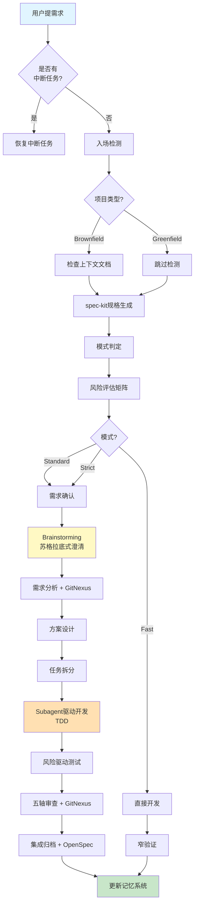

# Ultimate Workflow - 终极AI编程工作流系统

> **装好就用的最强AI编程工作流** - 整合规格驱动、结构化流程、工程纪律、变更管理、代码理解

## 🚀 快速开始

### 使用方式

在你的AI编程工具中说：

```
Use ultimate-workflow.

我要做一个用户登录功能，支持邮箱密码和JWT认证
```

AI会自动：
1. 读取 `GO.md` 路由器
2. 入场检测（brownfield/greenfield）
3. 调用 spec-kit 生成规格（PRD → Plan → Tasks）
4. 判定模式（Fast/Standard/Strict）
5. 启动 7阶段流程：需求澄清 → 设计 → TDD开发 → 测试 → 审查
6. 所有产物保存到 `.ultimate-workflow/<req-id>/`
7. 归档到 OpenSpec 变更管理系统
8. 更新记忆系统

**就这么简单！**

---

## ✨ 核心特性

### 1. 规格驱动开发（来自 spec-kit）
- `/speckit.specify` → PRD 自动生成（分支+编号+目录）
- `/speckit.plan` → 技术方案自动翻译
- `/speckit.tasks` → 任务列表自动拆解
- 模板约束 LLM 防止过早实现细节

### 2. 智能流程编排（来自 devflow-kit）
- **三档模式**: Fast(小改动) / Standard(常规功能) / Strict(高风险)
- **风险评估矩阵**: 自动根据技术复杂度、业务影响、数据敏感性评分
- **Stage Skill架构**: 15个阶段技能，按需加载，依赖管理
- **前置产物全量读取**: 智能降级策略，容错性强

### 3. 工程纪律保障（来自 superpowers）
- **Brainstorming**: 苏格拉底式需求澄清，避免盲目编码
- **TDD硬约束**: RED-GREEN-REFACTOR循环，先写失败测试
- **Subagent驱动**: 并行子代理执行，两阶段审查(spec合规+代码质量)
- **系统化调试**: 四阶段根因追溯，防御性编程

### 4. 跨会话记忆（来自 team-skills）
**自动记忆**:
- ✅ 会话开始时自动读取项目背景
- ✅ 需求完成后自动更新记忆
- ✅ AI自动记录重要决策和失败模式

**持久化上下文**: `.ultimate-workflow/memory/` 存储项目知识
- **决策追踪**: ADR风格记录重要技术决策
- **失败模式库**: 避免重复踩坑
- **会话日志**: 形成完整工作历史轨迹

### 5. 变更管理（来自 OpenSpec）
- `/opsx:propose` → 创建 proposal/specs/design/tasks
- `/opsx:apply` → 执行任务
- `/opsx:archive` → 归档变更
- 迭代式而非瀑布式

### 6. 代码理解（来自 GitNexus）
- Tree-sitter 解析 → LadybugDB 存储
- 调用链/依赖图/聚类分析
- MCP 协议集成（Claude Code/Cursor/Codex）
- PreToolUse hooks 增强搜索上下文
- PostToolUse hooks 检测 stale index

### 7. 专业能力（来自 agent-skills）
23个专业领域 skill 按需加载：
- idea-refine（想法提炼）
- test-driven-development（TDD）
- debugging-and-error-recovery（调试）
- frontend-ui-engineering（前端）
- security-and-hardening（安全）
- performance-optimization（性能）
- ...

### 8. Token优化（来自 caveman）
多级通信压缩：
```
/caveman lite      # 专业但简洁
/caveman full      # 经典 caveman（默认）
/caveman ultra     # 极致压缩
/caveman extreme   # 只保留关键词+代码片段
```

---

## 📊 工作流程可视化



---

## 📦 包内有什么

### 核心目录

| 目录 | 用途 | 来源 |
|------|------|------|
| `GO.md` | 统一路由器 | flow-kit + devflow-kit |
| `SKILL.md` | 主 skill 定义 | 融合版 |
| `skills/stage-skills/` | 15个阶段技能 | devflow-kit |
| `agent-skills/skills/` | 23个专业技能 | agent-skills |
| `memory/` | 记忆系统模板 | team-skills |
| `references/` | 规则/模板/提示词 | 整合优化 |
| `adapters/` | 工具适配器 | devflow-kit |
| `docs/` | 文档和教程 | 重写整合 |

### Stage Skills (15个)

| 阶段 | Stage Skill | 依赖的Skills |
|------|-------------|----------------|
| **0-confirm** | stage-0-confirm | idea-refine, development-core, brainstorming |
| **1-analysis** | stage-1-analysis | development-core, gitnexus-exploring |
| **2-design** | stage-2-design | design-and-architecture, brainstorming, gitnexus-impact-analysis |
| **2a-ui-design** | stage-2a-ui-design | frontend-ui-engineering |
| **3-task** | stage-3-task | planning-and-context |
| **3a-plan** | stage-3a-plan | writing-plans |
| **4-dev** | stage-4-dev | development-core, testing-suite<br/>+ TDD, subagent-driven |
| **5-test** | stage-5-test | security-and-performance |
| **6-review** | stage-6-review | requesting-code-review, code-quality, gitnexus-pr-review |
| **7-integration** | stage-7-integration | finishing-a-development-branch, opsx-archive |
| **A-architect** | stage-a-architect | design-and-architecture |
| **A-evolve** | stage-a-evolve | design-and-architecture |
| **I-intel-scan** | stage-i-intel-scan | development-core, gitnexus-analyze |
| **M-health** | stage-m-health | code-quality |
| **Debug** | stage-debug | systematic-debugging |

> **注**: 依赖分为三类:
> - **Agent Skills**: 基础工程能力(来自 `agent-skills/skills/`)
> - **Superpowers Skills**: 工程纪律方法论(来自 superpowers)
> - **GitNexus/OpenSpec**: 代码理解和变更管理

---

## 🎯 使用场景

### 场景1: 开发新功能

```
Use ultimate-workflow.

在账号设置页增加已保存支付方式管理，支持信用卡和PayPal
```

AI会走完整流程: spec生成 → 需求澄清 → 设计 → TDD开发 → 测试 → 审查 → OpenSpec归档

### 场景2: 快速修复Bug

```
Use ultimate-workflow. Fast模式: 修复settings页面按钮文案typo
```

AI跳过复杂流程，直接窄验证修复。

### 场景3: 探索代码结构

```
Use ultimate-workflow.

哪些函数调用了 auth.verify()？修改它会影响到什么？
```

AI调用 GitNexus 知识图谱查询，返回调用链和影响分析。

### 场景4: 架构重构

```
Use ultimate-workflow.

把单体应用拆分成微服务，先做用户模块
```

AI走 architect 流程: 架构分析 → 拆分方案 → 实施计划 → 逐步迁移。

---

## 🔧 安装方式

### 方式1: AI自动安装（推荐）

在你的AI编程工具中说：

```
Use install-ultimate-workflow.
```

AI会自动：
1. 扫描项目技术栈
2. 提取项目信息
3. 复制所有必要文件
4. 配置工具适配器
5. 初始化记忆系统

### 方式2: 手动安装

```bash
# 克隆到项目根目录
git clone https://github.com/your-org/ultimate-workflow.git

# 或复制文件夹
cp -r ultimate-workflow/ your-project/
```

---

## 📖 详细文档

- [快速上手指南](docs/quickstart.md)
- [Stage Skills 详解](docs/stage-skills.md)
- [记忆系统使用](docs/memory-system.md)
- [OpenSpec 集成](docs/openspec-integration.md)
- [GitNexus 配置](docs/gitnexus-setup.md)
- [故障排查](docs/troubleshooting.md)

---

## 🌟 为什么选择 Ultimate Workflow？

| 特性 | Ultimate | spec-kit | devflow-kit | superpowers |
|------|----------|----------|-------------|-------------|
| 规格生成 | ✅ | ✅ | ❌ | ❌ |
| 阶段流程 | ✅ | ❌ | ✅ | ❌ |
| 工程纪律 | ✅ | ❌ | ❌ | ✅ |
| 记忆系统 | ✅ | ❌ | ✅ | ❌ |
| 变更管理 | ✅ | ❌ | ❌ | ❌ |
| 代码理解 | ✅ | ❌ | ❌ | ❌ |
| 专业能力 | ✅ (23个) | ❌ | ❌ | ✅ (14个) |
| Token优化 | ✅ | ❌ | ❌ | ❌ |

**Ultimate Workflow = 所有最佳实践的集大成者**

---

## 版本

v1.0 - 终极融合版
- 整合 6 大开源项目核心能力
- 统一入口 GO.md 自动路由
- 跨会话记忆系统
- 7阶段流程 + 横向命令
- 企业级变更管理
- 代码知识图谱集成
